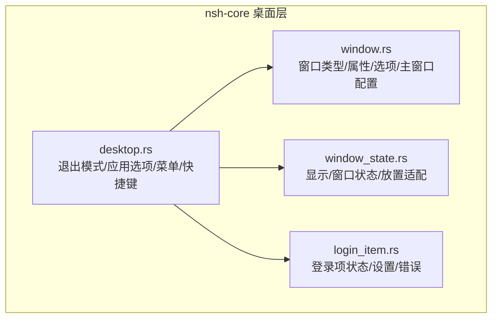
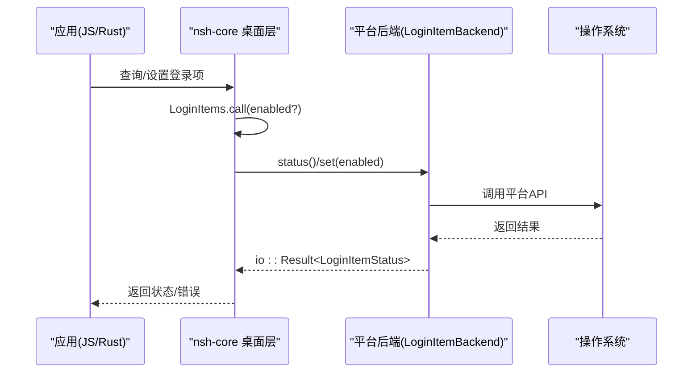
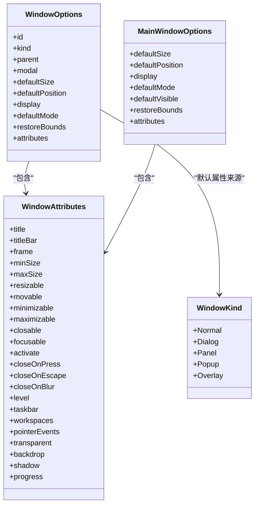
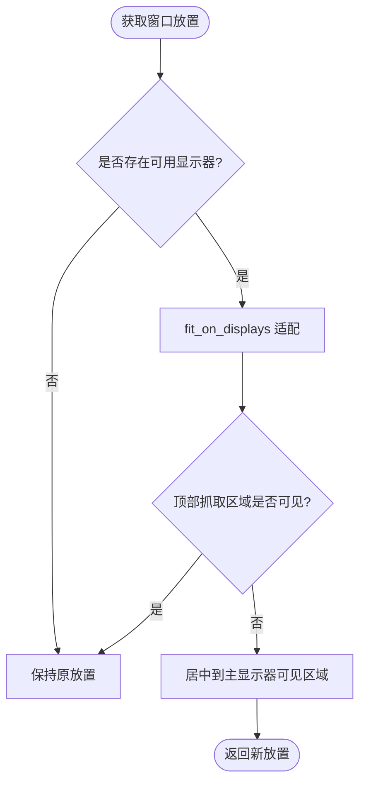
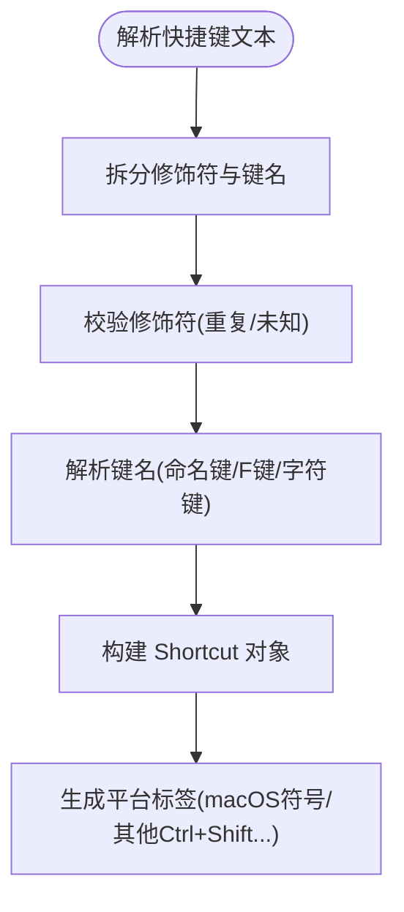
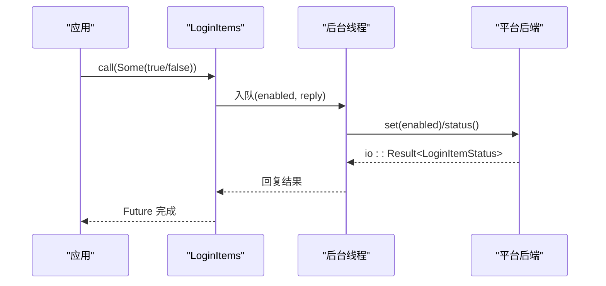
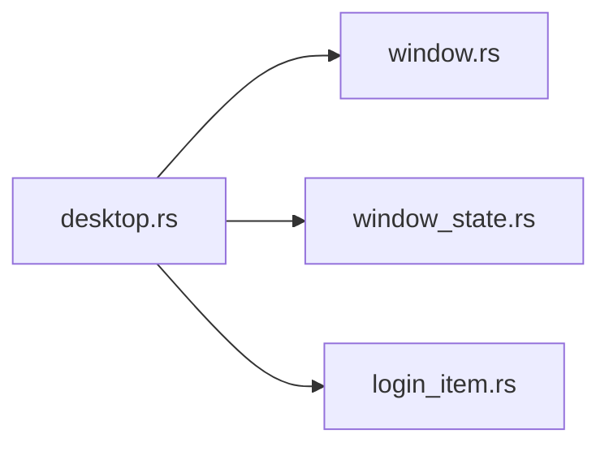

# 桌面特性

<cite>
**本文引用的文件**   
- [desktop.rs](file://crates/nsh-core/src/desktop.rs)
- [login_item.rs](file://crates/nsh-core/src/desktop/login_item.rs)
- [window.rs](file://crates/nsh-core/src/desktop/window.rs)
- [window_state.rs](file://crates/nsh-core/src/desktop/window_state.rs)
</cite>

## 目录
1. [简介](#简介)
2. [项目结构](#项目结构)
3. [核心组件](#核心组件)
4. [架构总览](#架构总览)
5. [详细组件分析](#详细组件分析)
6. [依赖关系分析](#依赖关系分析)
7. [性能与行为特征](#性能与行为特征)
8. [打包、签名与分发指南](#打包签名与分发指南)
9. [故障排除指南](#故障排除指南)
10. [结论](#结论)

## 简介
本文件面向 NSH 桌面特性的实现与使用，聚焦 macOS、Windows、Linux 三平台的窗口管理、菜单栏、托盘图标、文件关联、启动项管理等能力，并说明各平台原生 API 的集成方式。文档基于仓库中 nsh-core 的桌面模块进行梳理，提供跨平台一致的抽象（窗口、菜单、快捷键、显示与窗口状态、登录项），以及平台后端在运行时接入的方式。同时给出打包、签名与分发的实践建议与常见问题排查方法。

## 项目结构
NSH 的桌面能力集中在 crates/nsh-core/src/desktop 目录下，对外暴露统一的 Rust/JS 接口，平台差异由各自的后端实现：
- desktop.rs：桌面能力的顶层定义（退出模式、应用选项、标题栏样式、菜单栏模式、窗口框架、窗口层级、快捷键解析、标准菜单角色等）
- window.rs：窗口模型（窗口类型、属性、选项、主窗口配置、进度条、拖拽区域、自定义标题栏控制等）
- window_state.rs：显示信息、窗口状态、窗口放置与适配逻辑（含刘海屏缺口计算）
- login_item.rs：开机自启（登录项）的状态查询与设置、错误类型、后台线程队列

图表来源
- [desktop.rs:1-39](file://crates/nsh-core/src/desktop.rs#L1-L39)
- [window.rs:1-14](file://crates/nsh-core/src/desktop/window.rs#L1-L14)
- [window_state.rs:1-16](file://crates/nsh-core/src/desktop/window_state.rs#L1-L16)
- [login_item.rs:1-17](file://crates/nsh-core/src/desktop/login_item.rs#L1-L17)

章节来源
- [desktop.rs:1-39](file://crates/nsh-core/src/desktop.rs#L1-L39)
- [window.rs:1-14](file://crates/nsh-core/src/desktop/window.rs#L1-L14)
- [window_state.rs:1-16](file://crates/nsh-core/src/desktop/window_state.rs#L1-L16)
- [login_item.rs:1-17](file://crates/nsh-core/src/desktop/login_item.rs#L1-L17)

## 核心组件
- 退出与应用生命周期
  - QuitMode：按平台或策略决定“关闭最后一个窗口”的行为（Platform/LastWindowClosed/Explicit）
  - ApplicationOptions：读取 nsh.json 的 application 块，支持 quitMode
  - QuitRequestOptions：macOS 独立应用在注销/重启/关机前请求确认（system/main_window_close）
- 窗口系统
  - WindowKind：Normal/Dialog/Panel/Popup/Overlay，不同默认行为
  - WindowAttributes：窗口外观与交互（标题、边框、大小限制、可调整、最小化/最大化/关闭、焦点、透明度、阴影、进度等）
  - WindowOptions/MainWindowOptions：窗口实例与主窗口的启动参数（位置、尺寸、显示、模式、恢复上次布局）
  - TitleBarOptions/TitleBarStyle：系统标题栏或隐藏标题栏（应用自绘）
  - WindowLevel/Backdrop/ProgressState/WindowProgress：层级、背景材质、任务栏/Dock 进度
  - WindowControl/ResizeEdge：自绘标题栏按钮与无边框窗口边缘缩放
- 菜单栏与快捷键
  - MenuRole：标准菜单角色（About/Hide/Quit/Undo/Copy/Paste/Minimize/Zoom/ToggleFullScreen/Close 等）
  - Shortcut/Key：快捷键解析与标签生成（mod/ctrl/alt/shift/meta 组合）
  - MenuBarMode：菜单栏显示模式（Shown/AutoHide）
- 显示与窗口状态
  - Display/DisplayId：显示器信息与稳定 ID（FNV-1a 哈希）
  - WindowState：窗口当前模式、可见性、焦点、边界、内容边界、放置、所在显示器、缩放
  - WindowPlacement：保存/恢复窗口模式与正常模式下的边界，自动适配多显示器
  - notch：计算 macOS 刘海屏缺口区域
- 登录项（开机自启）
  - LoginItemStatus：Enabled/Disabled/RequiresApproval/Unavailable
  - LaunchAtLoginError：Unavailable/System/Denied
  - LoginItemBackend：平台后端接口（status/set）
  - LoginItems：异步队列保证调用顺序，单线程执行，避免阻塞主线程

章节来源
- [desktop.rs:40-137](file://crates/nsh-core/src/desktop.rs#L40-L137)
- [desktop.rs:139-165](file://crates/nsh-core/src/desktop.rs#L139-L165)
- [desktop.rs:267-292](file://crates/nsh-core/src/desktop.rs#L267-L292)
- [desktop.rs:294-481](file://crates/nsh-core/src/desktop.rs#L294-L481)
- [desktop.rs:651-783](file://crates/nsh-core/src/desktop.rs#L651-L783)
- [window.rs:22-118](file://crates/nsh-core/src/desktop/window.rs#L22-L118)
- [window.rs:120-161](file://crates/nsh-core/src/desktop/window.rs#L120-L161)
- [window.rs:163-222](file://crates/nsh-core/src/desktop/window.rs#L163-L222)
- [window.rs:224-293](file://crates/nsh-core/src/desktop/window.rs#L224-L293)
- [window.rs:295-499](file://crates/nsh-core/src/desktop/window.rs#L295-L499)
- [window.rs:631-710](file://crates/nsh-core/src/desktop/window.rs#L631-L710)
- [window.rs:676-798](file://crates/nsh-core/src/desktop/window.rs#L676-L798)
- [window_state.rs:18-84](file://crates/nsh-core/src/desktop/window_state.rs#L18-L84)
- [window_state.rs:108-136](file://crates/nsh-core/src/desktop/window_state.rs#L108-L136)
- [window_state.rs:138-219](file://crates/nsh-core/src/desktop/window_state.rs#L138-L219)
- [window_state.rs:238-285](file://crates/nsh-core/src/desktop/window_state.rs#L238-L285)
- [login_item.rs:19-99](file://crates/nsh-core/src/desktop/login_item.rs#L19-L99)
- [login_item.rs:101-198](file://crates/nsh-core/src/desktop/login_item.rs#L101-L198)

## 架构总览
NSH 桌面层通过统一抽象屏蔽平台差异，平台后端在运行时注入具体实现：
- 窗口与菜单：核心维护窗口属性与事件，平台后端负责渲染与系统交互
- 登录项：核心通过 LoginItemBackend 调用平台 API（macOS SMAppService.main、Windows Run 键、Linux XDG autostart）
- 显示与窗口状态：平台上报 Display 与 WindowState，核心负责持久化与适配

图表来源
- [login_item.rs:87-99](file://crates/nsh-core/src/desktop/login_item.rs#L87-L99)
- [login_item.rs:117-198](file://crates/nsh-core/src/desktop/login_item.rs#L117-L198)

## 详细组件分析

### 窗口系统与属性
- 窗口类型与默认行为
  - Normal：常规主窗口/文档窗口，可调整大小、最小化/最大化
  - Dialog：对话框，不可最小化/最大化，Esc 关闭，不在任务栏
  - Panel：浮动面板，不进入任务栏
  - Popup：无框弹出，悬浮于所有工作区，Esc/失焦关闭
  - Overlay：透明且穿透点击，需 windows 能力的 overlay
- 窗口属性（部分关键字段）
  - title/titleBar/frame/minSize/maxSize/resizable/movable/minimizable/maximizable/closable/focusable/activate/closeOnPress/closeOnEscape/closeOnBlur/level/taskbar/workspaces/pointerEvents/transparent/backdrop/shadow/progress
- 主窗口配置
  - MainWindowOptions：defaultSize/defaultPosition/display/defaultMode/defaultVisible/restoreBounds/attributes
- 标题栏与控件
  - TitleBarOptions：style/height/controls_offset
  - WindowControl：Minimize/Maximize/Close（用于自绘标题栏）
  - ResizeEdge：Top/Bottom/Left/Right/四角（无边框窗口缩放）

图表来源
- [window.rs:22-118](file://crates/nsh-core/src/desktop/window.rs#L22-L118)
- [window.rs:295-499](file://crates/nsh-core/src/desktop/window.rs#L295-L499)
- [window.rs:631-710](file://crates/nsh-core/src/desktop/window.rs#L631-L710)
- [window.rs:676-798](file://crates/nsh-core/src/desktop/window.rs#L676-L798)

章节来源
- [window.rs:22-118](file://crates/nsh-core/src/desktop/window.rs#L22-L118)
- [window.rs:295-499](file://crates/nsh-core/src/desktop/window.rs#L295-L499)
- [window.rs:631-710](file://crates/nsh-core/src/desktop/window.rs#L631-L710)
- [window.rs:676-798](file://crates/nsh-core/src/desktop/window.rs#L676-L798)

### 显示与窗口状态
- Display/DisplayId：显示器名称哈希稳定 ID；bounds/visible_bounds/scale_factor/refresh_rate/cutouts
- WindowState：mode/minimized/visible/focused/bounds/content_bounds/placement/display/scale_factor
- WindowPlacement：保存 mode 与 normal bounds，fit_on_displays 在多显示器环境下自动适配
- notch：根据左右辅助区域与 top_inset 计算刘海屏缺口

图表来源
- [window_state.rs:18-84](file://crates/nsh-core/src/desktop/window_state.rs#L18-L84)
- [window_state.rs:138-219](file://crates/nsh-core/src/desktop/window_state.rs#L138-L219)

章节来源
- [window_state.rs:18-84](file://crates/nsh-core/src/desktop/window_state.rs#L18-L84)
- [window_state.rs:108-136](file://crates/nsh-core/src/desktop/window_state.rs#L108-L136)
- [window_state.rs:138-219](file://crates/nsh-core/src/desktop/window_state.rs#L138-L219)
- [window_state.rs:238-285](file://crates/nsh-core/src/desktop/window_state.rs#L238-L285)

### 菜单栏与快捷键
- MenuRole：标准菜单角色及其默认标签与快捷键（如 Undo/Copy/Paste/SelectAll/Quit/Minimize/Zoom/ToggleFullScreen/Close）
- Shortcut/Key：解析 mod+shift+n 等组合，支持 ctrl/alt/shift/meta/cmd/win/super 等修饰符，生成跨平台标签
- MenuBarMode：Shown/AutoHide（Alt 触发显示/隐藏）

图表来源
- [desktop.rs:294-481](file://crates/nsh-core/src/desktop.rs#L294-L481)
- [desktop.rs:651-783](file://crates/nsh-core/src/desktop.rs#L651-L783)

章节来源
- [desktop.rs:294-481](file://crates/nsh-core/src/desktop.rs#L294-L481)
- [desktop.rs:651-783](file://crates/nsh-core/src/desktop.rs#L651-L783)

### 登录项（开机自启）
- 状态与错误
  - LoginItemStatus：Enabled/Disabled/RequiresApproval/Unavailable
  - LaunchAtLoginError：Unavailable/System/Denied
- 后端接口
  - LoginItemBackend：status()/set(enabled)
- 核心实现
  - LoginItems：异步队列，单线程串行执行，避免阻塞主线程；WASM 下同步执行

图表来源
- [login_item.rs:19-99](file://crates/nsh-core/src/desktop/login_item.rs#L19-L99)
- [login_item.rs:117-198](file://crates/nsh-core/src/desktop/login_item.rs#L117-L198)

章节来源
- [login_item.rs:19-99](file://crates/nsh-core/src/desktop/login_item.rs#L19-L99)
- [login_item.rs:101-198](file://crates/nsh-core/src/desktop/login_item.rs#L101-L198)

## 依赖关系分析
- 模块内依赖
  - desktop.rs 导出 window、window_state、login_item 相关类型
  - window.rs 依赖 window_state 中的 DisplayId、WindowState 等
  - login_item.rs 独立，被 core 在其他模块调用
- 外部依赖
  - 平台后端通过 run_app 的 login_item 选项注入 LoginItemBackend
  - 平台差异体现在后端实现（macOS/Windows/Linux）

图表来源
- [desktop.rs:1-39](file://crates/nsh-core/src/desktop.rs#L1-L39)
- [window.rs:1-14](file://crates/nsh-core/src/desktop/window.rs#L1-L14)
- [window_state.rs:1-16](file://crates/nsh-core/src/desktop/window_state.rs#L1-L16)
- [login_item.rs:1-17](file://crates/nsh-core/src/desktop/login_item.rs#L1-L17)

章节来源
- [desktop.rs:1-39](file://crates/nsh-core/src/desktop.rs#L1-L39)
- [window.rs:1-14](file://crates/nsh-core/src/desktop/window.rs#L1-L14)
- [window_state.rs:1-16](file://crates/nsh-core/src/desktop/window_state.rs#L1-L16)
- [login_item.rs:1-17](file://crates/nsh-core/src/desktop/login_item.rs#L1-L17)

## 性能与行为特征
- 登录项操作
  - 使用独立线程串行执行，避免阻塞主线程与引擎线程
  - 后端 panic 仅影响单次调用，后续调用仍可继续
- 窗口属性变更
  - 每帧提交一次差异（diff），减少平台侧更新开销
- 窗口放置适配
  - fit_on_displays 在多显示器变化时快速回退到主显示器可见区域，避免窗口丢失

章节来源
- [login_item.rs:117-198](file://crates/nsh-core/src/desktop/login_item.rs#L117-L198)
- [window.rs:295-499](file://crates/nsh-core/src/desktop/window.rs#L295-L499)
- [window_state.rs:138-219](file://crates/nsh-core/src/desktop/window_state.rs#L138-L219)

## 打包、签名与分发指南
- 应用清单与窗口配置
  - nsh.json 的 application.window 块用于主窗口启动参数（defaultSize/defaultPosition/display/defaultMode/defaultVisible/restoreBounds/attributes）
  - 注意：signed packages（.nshpkg）不包含这些字段，运行在宿主应用中，由宿主拥有窗口
- 能力与权限
  - 登录项需要 capabilities.application=true，否则 set_launch_at_login 会返回 Denied
  - 覆盖型窗口（pointerEvents:"none"）需要 windows 能力的 overlay
- 平台原生集成要点
  - macOS：SMAppService.main 作为登录项后端；刘海屏缺口通过 notch 计算
  - Windows：Run 键作为登录项后端；任务栏进度与窗口控制按钮
  - Linux：XDG autostart 条目；GTK 默认尺寸与窗口按钮

章节来源
- [window.rs:676-798](file://crates/nsh-core/src/desktop/window.rs#L676-L798)
- [login_item.rs:40-85](file://crates/nsh-core/src/desktop/login_item.rs#L40-L85)
- [window.rs:295-499](file://crates/nsh-core/src/desktop/window.rs#L295-L499)
- [window_state.rs:108-136](file://crates/nsh-core/src/desktop/window_state.rs#L108-L136)

## 故障排除指南
- 登录项不可用
  - Unavailable：非独立桌面应用或开发环境不支持；检查是否为 standalone 构建
  - System：系统 API 失败；查看底层 io::Error 详情
  - Denied：未声明 capabilities.application；在 nsh.json 中添加 application:true
- 窗口无法恢复位置
  - restoreBounds=false：不会保存/恢复上次布局
  - 多显示器变化：fit_on_displays 会将窗口移动到主显示器可见区域
- 刘海屏遮挡
  - 检查 cutouts 与 notch 计算是否正确；确保 UI 避开安全区域
- 快捷键冲突或未生效
  - 检查修饰符拼写与键名（mod/ctrl/alt/shift/meta）；确认 Key 解析无误

章节来源
- [login_item.rs:40-85](file://crates/nsh-core/src/desktop/login_item.rs#L40-L85)
- [window_state.rs:138-219](file://crates/nsh-core/src/desktop/window_state.rs#L138-L219)
- [window_state.rs:108-136](file://crates/nsh-core/src/desktop/window_state.rs#L108-L136)
- [desktop.rs:294-481](file://crates/nsh-core/src/desktop.rs#L294-L481)

## 结论
NSH 的桌面特性以 nsh-core 为核心，提供跨平台一致的窗口、菜单、快捷键、显示与登录项抽象，并通过平台后端对接 macOS/Windows/Linux 的原生 API。开发者可通过统一的 JS/Rust 接口实现窗口管理、菜单栏、托盘图标、文件关联、启动项等功能，并在打包与分发阶段遵循能力声明与平台要求，获得一致的用户体验。