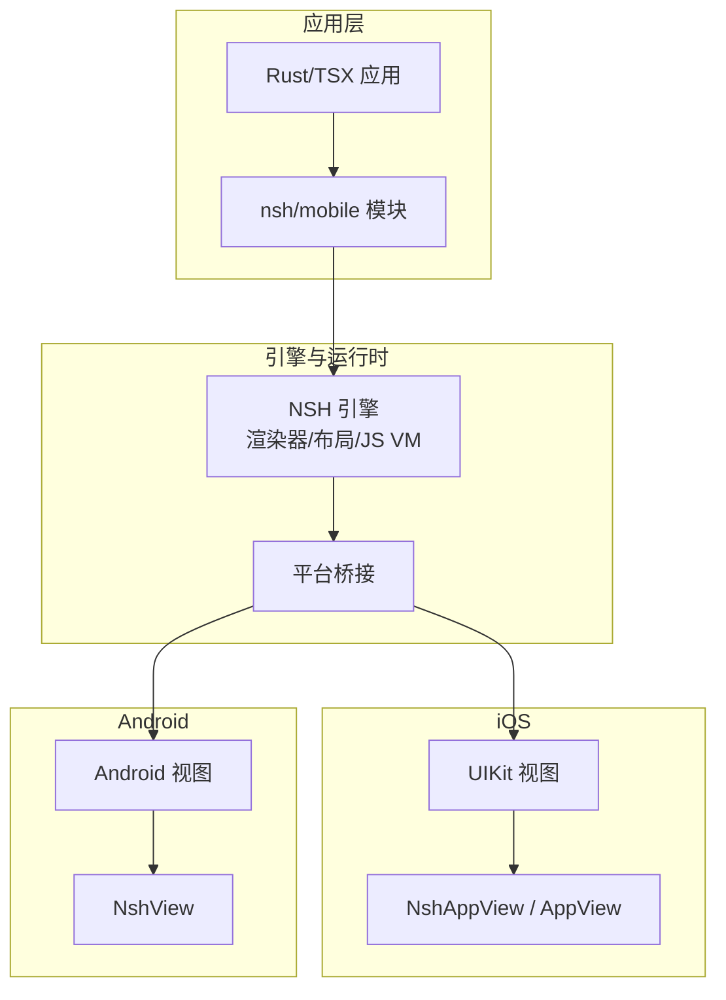
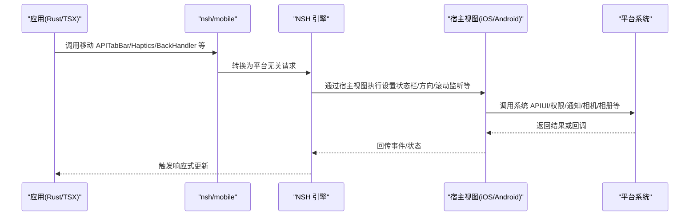
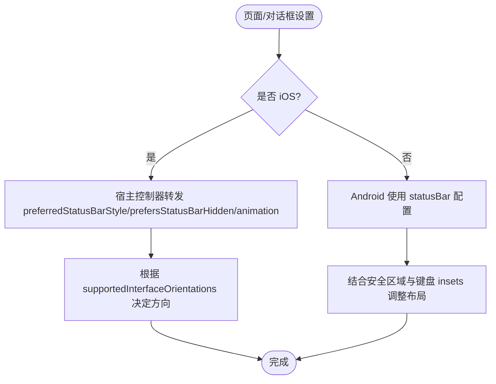
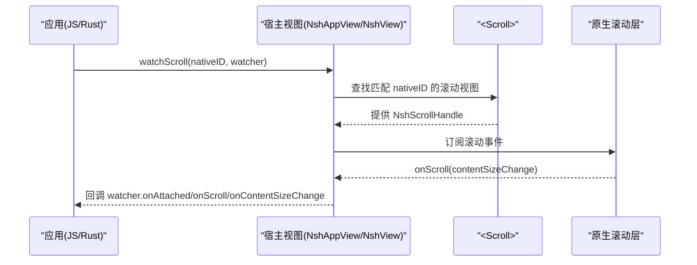
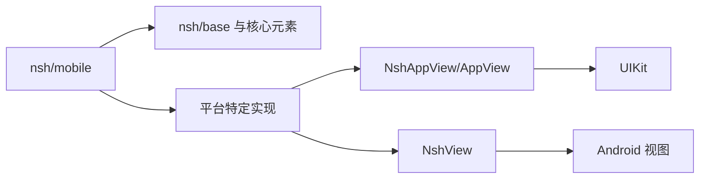

# 移动特性

<cite>
**本文引用的文件**   
- [平台概览](file://website/zh-CN/docs/platforms.md)
- [iOS](file://website/zh-CN/docs/ios.md)
- [Android](file://website/zh-CN/docs/android.md)
- [nsh/mobile](file://website/zh-CN/modules/nsh-mobile.md)
- [安全区域](file://website/elements/safe-area.md)
- [View](file://website/elements/view.md)
</cite>

## 目录
1. [简介](#简介)
2. [项目结构](#项目结构)
3. [核心组件](#核心组件)
4. [架构总览](#架构总览)
5. [详细组件分析](#详细组件分析)
6. [依赖关系分析](#依赖关系分析)
7. [性能与内存优化](#性能与内存优化)
8. [故障排查指南](#故障排查指南)
9. [结论](#结论)
10. [附录：API 参考](#附录api-参考)

## 简介
本文件面向 NSH 的移动特性，聚焦 iOS 与 Android 平台的特有能力与最佳实践。内容涵盖状态栏管理、安全区域、手势处理、传感器与相机/相册访问（通过系统原生能力）、权限模型与生命周期、响应式布局与横竖屏适配、性能优化与内存管理，以及完整的 API 参考与调试技巧。文档以仓库中的官方文档为依据，确保信息准确且可追溯。

## 项目结构
NSH 在多个平台上运行，每个平台拥有自己的后端与打包方式；应用代码在 Rust 与 TSX 层共享，平台差异通过平台特定属性与环境变量暴露给上层。移动平台（iOS、Android）提供系统级 UI 控件、通知、权限、滚动跟随等能力，并通过宿主视图（AppView/NshAppView、NshView）嵌入现有原生应用。

图表来源
- [平台概览:10-32](file://website/zh-CN/docs/platforms.md#L10-L32)
- [iOS:125-130](file://website/zh-CN/docs/ios.md#L125-L130)
- [Android:67-74](file://website/zh-CN/docs/android.md#L67-L74)

章节来源
- [平台概览:10-32](file://website/zh-CN/docs/platforms.md#L10-L32)

## 核心组件
- nsh/mobile 模块：提供移动平台专属的 UI 与系统能力，如 TabBar、SegmentedControl、Switch、DateTimePicker、InputAccessoryView、BackHandler、AppSettings、Haptics 与 isAvailable。
- 安全区域：通过 env(safe-area-inset-*) 与 safeArea()/safeAreaInsets() 获取并避开刘海、状态栏、Home Indicator 等系统 UI。
- 宿主视图：iOS 使用 NshAppView/AppView，Android 使用 NshView，作为独立引擎容器，支持限制、能力、主题覆盖、字体注册、存储目录、缓存选项、滚动监听、事件通信等。

章节来源
- [nsh/mobile:1-44](file://website/zh-CN/modules/nsh-mobile.md#L1-L44)
- [安全区域:1-19](file://website/elements/safe-area.md#L1-L19)
- [iOS:277-306](file://website/zh-CN/docs/ios.md#L277-L306)
- [Android:186-218](file://website/zh-CN/docs/android.md#L186-L218)

## 架构总览
下图展示从应用到宿主视图再到平台后端的调用链，包括事件与数据流。

图表来源
- [iOS:323-353](file://website/zh-CN/docs/ios.md#L323-L353)
- [Android:227-263](file://website/zh-CN/docs/android.md#L227-L263)
- [nsh/mobile:437-461](file://website/zh-CN/modules/nsh-mobile.md#L437-L461)

## 详细组件分析

### 状态栏管理与方向控制
- iOS：宿主视图控制器需转发 NshAppView 的状态栏样式、隐藏与动画，以及页面请求的方向掩码。
- Android：状态栏由页面/对话框的 statusBar 配置；同时可通过安全区域与额外 inset 控制布局避让。

图表来源
- [iOS:259-269](file://website/zh-CN/docs/ios.md#L259-L269)
- [iOS:305-306](file://website/zh-CN/docs/ios.md#L305-L306)
- [Android:484-510](file://website/zh-CN/docs/android.md#L484-L510)

章节来源
- [iOS:259-269](file://website/zh-CN/docs/ios.md#L259-L269)
- [iOS:305-306](file://website/zh-CN/docs/ios.md#L305-L306)
- [Android:484-510](file://website/zh-CN/docs/android.md#L484-L510)

### 安全区域与键盘避让
- 使用 env(safe-area-inset-top/right/bottom/left) 或 p_safe_area() 系列方法为根视图或自定义边栏添加内边距。
- 在需要数值时读取 safeArea()/safeAreaInsets()，并在旋转、页面切换、对话框显示时自动更新。
- Android 嵌入场景下，仅对与视图重叠的系统栏与刘海上报 insets；如需全面屏体验，应让内容延伸到系统栏后方并使用安全区域内边距。

章节来源
- [安全区域:1-19](file://website/elements/safe-area.md#L1-L19)
- [安全区域:63-80](file://website/elements/safe-area.md#L63-L80)
- [安全区域:109-119](file://website/elements/safe-area.md#L109-L119)
- [Android:496-509](file://website/zh-CN/docs/android.md#L496-L509)

### 手势处理与触摸交互
- View 提供通用按压反馈、悬停、滚轮、捏合、旋转、鼠标/触控板事件，以及原始触摸与 responder 系统。
- 移动端通过 pan/pinch/rotation 等手势绑定实现拖拽、缩放、旋转等交互；Android 还支持 Material Ripple 效果。

章节来源
- [View:83-102](file://website/elements/view.md#L83-L102)
- [View:117-152](file://website/elements/view.md#L117-L152)
- [View:168-191](file://website/elements/view.md#L168-L191)

### 传感器与相机/相册访问
- 传感器：仓库未提供直接传感器 API 文档；通常通过平台扩展或第三方库接入。
- 相机/相册：通过系统原生能力（相机、图片选择器）与权限申请流程实现；Rust 侧可使用 nsh-extra 提供的相机与图片处理工具，或在 Android/iOS 宿主中弹出系统视图控制器。

章节来源
- [Android:337-355](file://website/zh-CN/docs/android.md#L337-L355)
- [Android:376-385](file://website/zh-CN/docs/android.md#L376-L385)
- [iOS:424-429](file://website/zh-CN/docs/ios.md#L424-L429)

### 权限模型与生命周期
- Android 危险权限通过 nsh::permissions 申请，支持一次一个、跨配置变更；状态包含 Default/Granted/Denied/Undeclared。
- iOS 通知中心委托归 NSH 所有，应用可设置外部通知处理器；远程通知 token 与点击事件通过 ApplicationEvent 传递。
- 应用生命周期：iOS 通过 on_application_event 接收启动、远程通知等事件；Android 通过 Activity 生命周期与 handleNotificationIntent 处理外部 Intent。

章节来源
- [Android:337-355](file://website/zh-CN/docs/android.md#L337-L355)
- [iOS:35-74](file://website/zh-CN/docs/ios.md#L35-L74)
- [iOS:91-123](file://website/zh-CN/docs/ios.md#L91-L123)
- [Android:387-413](file://website/zh-CN/docs/android.md#L387-L413)

### 响应式布局与横竖屏适配
- 使用 flexbox/grid 布局，按平台条件渲染不同布局（桌面侧边栏 vs 手机标签页）。
- iOS 方向由页面 supportedOrientations 决定；Android 通过 configChanges 声明避免重建，或允许重建并恢复滚动位置与吸顶视图。

章节来源
- [平台概览:105-153](file://website/zh-CN/docs/platforms.md#L105-L153)
- [iOS:266-269](file://website/zh-CN/docs/ios.md#L266-L269)
- [Android:500-509](file://website/zh-CN/docs/android.md#L500-L509)

### 宿主视图与滚动跟随
- iOS：NshAppView.watchScroll + NshScrollWatcher 在主线程、同一帧驱动 Scroll 视图；提供 scrollX/Y、contentSize、viewportSize、scrollBy、stopScrolling 等。
- Android：NshView.watchScroll + ScrollWatcher 同样在 UI 线程、同一帧驱动；提供 getScrollX/Y、getContentWidth/Height、getViewportWidth/Height、scrollBy、stopScrolling 等。

图表来源
- [iOS:354-390](file://website/zh-CN/docs/ios.md#L354-L390)
- [Android:264-305](file://website/zh-CN/docs/android.md#L264-L305)

章节来源
- [iOS:354-390](file://website/zh-CN/docs/ios.md#L354-L390)
- [Android:264-305](file://website/zh-CN/docs/android.md#L264-L305)

## 依赖关系分析
- nsh/mobile 模块依赖平台特定的 UI 与系统能力，但在所有平台均可导入；在非移动平台不占空间、调用立即返回。
- 宿主视图（NshAppView/NshView）隔离 JS VM、限制与能力，支持主题覆盖、字体注册、存储与缓存选项、事件通信。
- 平台概览说明各平台后端与文本系统，移动平台使用 UIKit/CoreText 与 Android 视图/StaticLayout。

图表来源
- [nsh/mobile:1-44](file://website/zh-CN/modules/nsh-mobile.md#L1-L44)
- [平台概览:10-32](file://website/zh-CN/docs/platforms.md#L10-L32)
- [iOS:139-164](file://website/zh-CN/docs/ios.md#L139-L164)
- [Android:67-74](file://website/zh-CN/docs/android.md#L67-L74)

章节来源
- [nsh/mobile:1-44](file://website/zh-CN/modules/nsh-mobile.md#L1-L44)
- [平台概览:10-32](file://website/zh-CN/docs/platforms.md#L10-L32)

## 性能与内存优化
- 限制与预算：宿主视图可设置 JS 堆大小、栈大小、加载预算、每次调用预算与最大节点数；超出将停止应用或中断调用。
- 滚动内容裁剪：contentCulling 默认只创建视口附近内容，关闭后可绘制整页长图但会占用更多内存。
- 字体与主题：提前注册字体与主题覆盖可减少首帧重排；按需启用开发服务器连接以降低发布包体积。
- 日志与追踪：trace 模式记录提交耗时；统一日志便于定位崩溃与性能瓶颈。

章节来源
- [iOS:431-445](file://website/zh-CN/docs/ios.md#L431-L445)
- [iOS:299-300](file://website/zh-CN/docs/ios.md#L299-L300)
- [Android:415-422](file://website/zh-CN/docs/android.md#L415-L422)
- [iOS:520-531](file://website/zh-CN/docs/ios.md#L520-L531)

## 故障排查指南
- 字节码安全：bundle.nshc 只能从应用包内部加载；其他来源应加载 bundle.js 或使用签名包。
- 错误监听：NshAppView.onError 与 NshView.setErrorListener 接收致命错误（加载失败、未捕获异常、VM 因限制停止）。
- 链接与 URL：onOpenURL 可在宿主应用中拦截并处理应用打开的链接；未处理则交由系统。
- 通知与 Intent：iOS 外部通知通过 set_foreign_handler；Android 外部通知通过 set_foreign_handler 与 handleNotificationIntent。

章节来源
- [iOS:308-312](file://website/zh-CN/docs/ios.md#L308-L312)
- [iOS:409-422](file://website/zh-CN/docs/ios.md#L409-L422)
- [Android:214-218](file://website/zh-CN/docs/android.md#L214-L218)
- [Android:321-335](file://website/zh-CN/docs/android.md#L321-L335)
- [Android:387-413](file://website/zh-CN/docs/android.md#L387-L413)

## 结论
NSH 的移动特性通过统一的 nsh/mobile 模块与平台宿主视图（NshAppView/NshView）提供一致的 API 与行为，同时在 iOS 与 Android 上充分利用系统 UI 与能力。借助安全区域、状态栏与方向控制、手势与滚动跟随、权限与生命周期管理，开发者可以构建高质量的原生体验应用。配合限制与预算、内容裁剪与日志追踪，可实现稳定且高性能的移动应用。

## 附录：API 参考

### nsh/mobile 模块
- isAvailable：判断当前是否为 iOS/Android/Catalyst。
- TabBar：系统标签栏，items/selectedIndex/onChange/hidden/class/style/testID。
- SegmentedControl：系统分段控件，items/selectedIndex/disabled/class/style/testID。
- Switch：系统开关，checked/disabled/accessibilityLabel/class/style/testID。
- DateTimePicker：系统日期时间选择器，mode/value/min/max/minuteInterval/disabled/accessibilityLabel/class/style/testID。
- InputAccessoryView：iOS 输入框上方工具栏，nativeID/style/class/children。
- BackHandler：Android 返回键处理，on("press", listener)/exitApp()。
- AppSettings：打开系统设置中的应用页面，open()/available()。
- Haptics：触感反馈，selection()/impact(style)/notification(kind)。

章节来源
- [nsh/mobile:45-51](file://website/zh-CN/modules/nsh-mobile.md#L45-L51)
- [nsh/mobile:53-149](file://website/zh-CN/modules/nsh-mobile.md#L53-L149)
- [nsh/mobile:150-198](file://website/zh-CN/modules/nsh-mobile.md#L150-L198)
- [nsh/mobile:199-234](file://website/zh-CN/modules/nsh-mobile.md#L199-L234)
- [nsh/mobile:236-282](file://website/zh-CN/modules/nsh-mobile.md#L236-L282)
- [nsh/mobile:284-371](file://website/zh-CN/modules/nsh-mobile.md#L284-L371)
- [nsh/mobile:373-436](file://website/zh-CN/modules/nsh-mobile.md#L373-L436)
- [nsh/mobile:437-461](file://website/zh-CN/modules/nsh-mobile.md#L437-L461)
- [nsh/mobile:494-551](file://website/zh-CN/modules/nsh-mobile.md#L494-L551)

### 宿主视图 API（iOS/Android）
- iOS NshAppView：init/onError/limits/handoff/grantCapabilities/locale/fontScale/setThemeOverrides/registerFont/storageDirectory/cacheOptions/loadBundle/run/loadPackage/connectDevServer/register/watchScroll/contentCulling/params/send/handle/removeHandler/static preferredStatusBarStyle/prefersStatusBarHidden/preferredStatusBarUpdateAnimation/supportedInterfaceOrientations。
- Android NshView：构造/setErrorListener/setLimits/setGrantedCapabilities/setLocale/setFontScale/setAdditionalSafeAreaInsets/setThemeOverrides/registerFont/setStorageDirectory/setCacheOptions/loadAssetBundle/loadBundleFile/runPackage/registerComponent/watchScroll/setContentCulling/setParams/send/handle/connectDevServer/handleBack/destroy。

章节来源
- [iOS:277-306](file://website/zh-CN/docs/ios.md#L277-L306)
- [Android:186-218](file://website/zh-CN/docs/android.md#L186-L218)