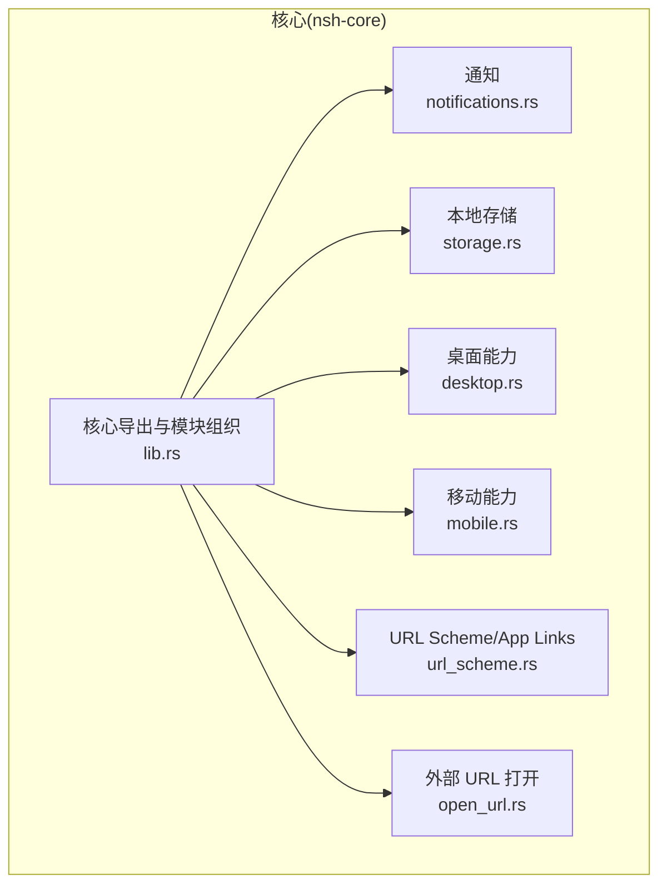
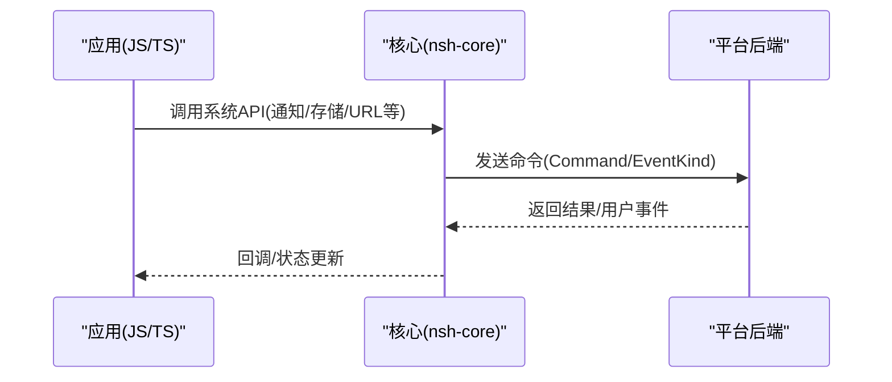
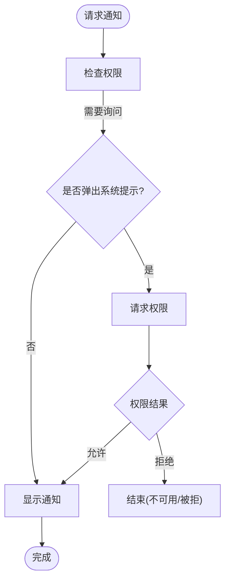
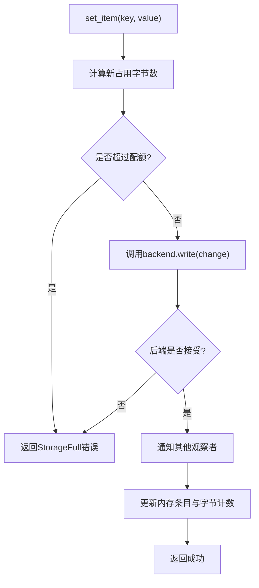
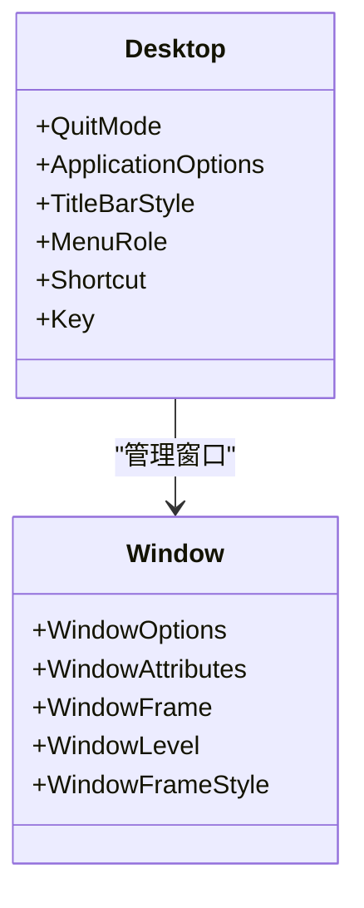
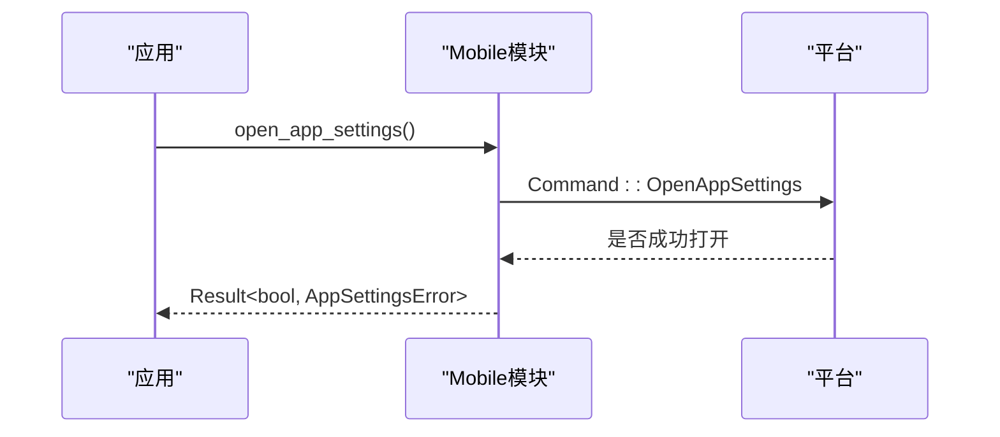
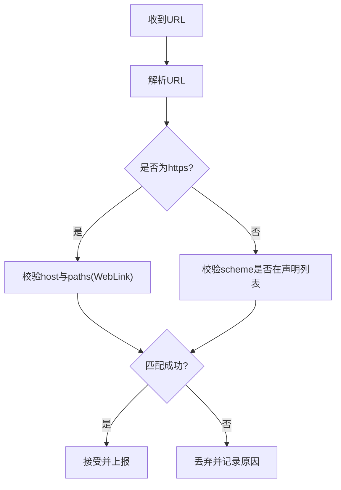
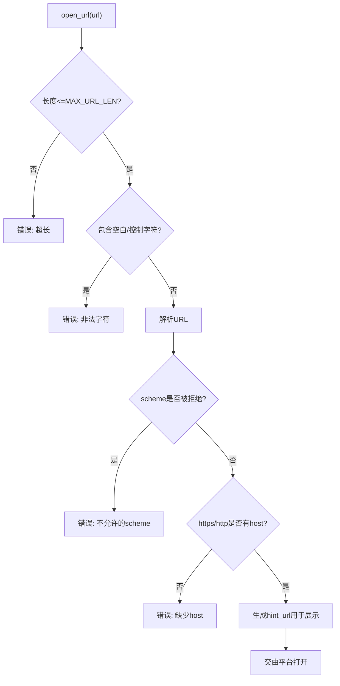

# 系统集成

<cite>
**本文引用的文件**   
- [lib.rs](file://crates/nsh-core/src/lib.rs)
- [notifications.rs](file://crates/nsh-core/src/notifications.rs)
- [storage.rs](file://crates/nsh-core/src/storage.rs)
- [desktop.rs](file://crates/nsh-core/src/desktop.rs)
- [mobile.rs](file://crates/nsh-core/src/mobile.rs)
- [url_scheme.rs](file://crates/nsh-core/src/url_scheme.rs)
- [open_url.rs](file://crates/nsh-core/src/open_url.rs)
</cite>

## 目录
1. [简介](#简介)
2. [项目结构](#项目结构)
3. [核心组件](#核心组件)
4. [架构总览](#架构总览)
5. [详细组件分析](#详细组件分析)
6. [依赖关系分析](#依赖关系分析)
7. [性能考量](#性能考量)
8. [故障排查指南](#故障排查指南)
9. [结论](#结论)
10. [附录](#附录)

## 简介
本文件面向 NSH 的系统集成功能，覆盖系统通知、本地存储、应用更新、URL Scheme 处理与外部 URL 打开能力；并分别说明桌面平台特性（窗口管理、菜单、全局快捷键）、移动平台特性（原生控件、设置页跳转）以及 Web 平台的特殊行为与限制。文档同时提供跨平台开发最佳实践、兼容性策略与错误处理建议，帮助开发者在桌面、移动端和 Web 上构建一致且可靠的系统集成体验。

## 项目结构
NSH 的核心系统能力集中在 nsh-core 模块中，通过统一的命令与事件模型与平台后端交互：
- 通知：nsh-core/src/notifications.rs
- 本地存储：nsh-core/src/storage.rs
- 桌面能力（窗口、菜单、快捷键等）：nsh-core/src/desktop.rs
- 移动能力（TabBar、SegmentedControl、Switch、DateTimePicker、AppSettings）：nsh-core/src/mobile.rs
- URL Scheme 与 App Links：nsh-core/src/url_scheme.rs
- 外部 URL 打开：nsh-core/src/open_url.rs
- 核心导出与模块组织：nsh-core/src/lib.rs



图表来源
- [lib.rs:1-175](file://crates/nsh-core/src/lib.rs#L1-L175)

章节来源
- [lib.rs:1-175](file://crates/nsh-core/src/lib.rs#L1-L175)

## 核心组件
- 通知系统：支持权限请求、显示/关闭通知、角标设置、点击回调与静默播放控制，跨平台声音资源路径规范化。
- 本地存储：键值对持久化，内存缓存 + 后端写入，配额校验，跨视图变更监听，浏览器 localStorage 语义对齐。
- 桌面能力：窗口生命周期与属性、菜单栏、上下文菜单、全局快捷键解析与标签、退出模式配置。
- 移动能力：系统 TabBar、分段控制器、开关、日期时间选择器，以及跳转到系统设置页的能力与错误码。
- URL Scheme 与 App Links：声明式 schemes 与 https web links 校验、历史行为、页面地址与同源检查。
- 外部 URL 打开：安全校验、危险 scheme 拒绝、链接提示展示逻辑。

章节来源
- [notifications.rs:1-231](file://crates/nsh-core/src/notifications.rs#L1-L231)
- [storage.rs:1-800](file://crates/nsh-core/src/storage.rs#L1-L800)
- [desktop.rs:1-800](file://crates/nsh-core/src/desktop.rs#L1-L800)
- [mobile.rs:1-800](file://crates/nsh-core/src/mobile.rs#L1-L800)
- [url_scheme.rs:1-800](file://crates/nsh-core/src/url_scheme.rs#L1-L800)
- [open_url.rs:1-525](file://crates/nsh-core/src/open_url.rs#L1-L525)

## 架构总览
NSH 的集成能力遵循“核心定义协议 + 平台实现”的分层：
- JS/TS 调用核心 API（如 Storage、UrlScheme、Desktop、Mobile）。
- 核心将操作转换为命令或事件（Command/EventKind），由平台后端执行。
- 平台返回结果或用户交互事件，核心再回传给 JS/TS。



图表来源
- [notifications.rs:1-231](file://crates/nsh-core/src/notifications.rs#L1-L231)
- [storage.rs:1-800](file://crates/nsh-core/src/storage.rs#L1-L800)
- [url_scheme.rs:1-800](file://crates/nsh-core/src/url_scheme.rs#L1-L800)
- [open_url.rs:1-525](file://crates/nsh-core/src/open_url.rs#L1-L525)

## 详细组件分析

### 系统通知
- 能力要点
  - 权限：默认/已授权/拒绝/不可用四种状态，支持主动询问。
  - 显示与关闭：按 id 去重替换，支持静默与自定义声音。
  - 角标：SetBadge 独立命令，部分平台无需通知即可设置。
  - 点击回调：以根节点事件上报，未消费前会保留。
- 关键数据结构
  - NotificationPermission、Notification、NotificationCommand、NotificationEvent。
- 声音处理
  - 统一去除 asset:/ 前缀，按平台生成文件名或资源名（Apple 使用文件名，Android 使用 raw resource name）。
- 典型流程



图表来源
- [notifications.rs:25-61](file://crates/nsh-core/src/notifications.rs#L25-L61)
- [notifications.rs:63-151](file://crates/nsh-core/src/notifications.rs#L63-L151)
- [notifications.rs:153-205](file://crates/nsh-core/src/notifications.rs#L153-L205)

章节来源
- [notifications.rs:1-231](file://crates/nsh-core/src/notifications.rs#L1-L231)

### 本地存储
- 能力要点
  - 键值存储，字符串到字符串，内存缓存 + 后端持久化。
  - 配额限制（QUOTA），超过配额或设备拒绝时失败。
  - 多视图共享同一后端，变更通过 Watcher 异步通知。
  - 与浏览器 localStorage 语义对齐（QuotaExceededError 等）。
- 关键接口
  - Storage::get_item/set_item/remove_item/clear/on_change
  - StorageBackend trait（load/write）
  - StorageChange（Set/Remove/Clear）
- 并发与一致性
  - 写操作串行化，读操作无锁访问内存。
  - changed_elsewhere 用于同步外部变更（如其他标签页）。
- 流程图



图表来源
- [storage.rs:33-59](file://crates/nsh-core/src/storage.rs#L33-L59)
- [storage.rs:83-136](file://crates/nsh-core/src/storage.rs#L83-L136)
- [storage.rs:452-478](file://crates/nsh-core/src/storage.rs#L452-L478)

章节来源
- [storage.rs:1-800](file://crates/nsh-core/src/storage.rs#L1-L800)

### 桌面平台特性
- 窗口管理
  - WindowOptions/WindowAttributes/WindowFrame/WindowLevel/WindowFrameStyle 等，支持动画、层级、无边框等。
  - QuitMode 控制“最后一个窗口关闭即退出”的行为。
- 菜单与快捷键
  - MenuRole 标准菜单项角色，自动适配平台快捷键。
  - Shortcut 解析“mod+shift+n”等组合键，支持跨平台标签输出。
- 登录项
  - LoginItemBackend/LaunchAtLoginError 等，由宿主注入。
- 典型用法
  - 通过 DesktopCommand 下发窗口/菜单/快捷键命令，平台侧实现具体 UI 行为。



图表来源
- [desktop.rs:40-105](file://crates/nsh-core/src/desktop.rs#L40-L105)
- [desktop.rs:139-165](file://crates/nsh-core/src/desktop.rs#L139-L165)
- [desktop.rs:267-292](file://crates/nsh-core/src/desktop.rs#L267-L292)
- [desktop.rs:294-497](file://crates/nsh-core/src/desktop.rs#L294-L497)
- [desktop.rs:651-783](file://crates/nsh-core/src/desktop.rs#L651-L783)

章节来源
- [desktop.rs:1-800](file://crates/nsh-core/src/desktop.rs#L1-L800)

### 移动平台特性
- 系统控件
  - TabBar：iOS UITabBar / Android Material 导航栏，支持 badge。
  - SegmentedControl：iOS UISegmentedControl，仅 iOS 可用。
  - Switch：iOS UISwitch / Android Material Switch。
  - DateTimePicker：iOS UIDatePicker / Android 日期时间对话框。
- 设置页跳转
  - open_app_settings() 与 app_settings_available()，错误类型 AppSettingsError（Unavailable/Denied）。
- 典型流程（打开系统设置）



图表来源
- [mobile.rs:614-682](file://crates/nsh-core/src/mobile.rs#L614-L682)

章节来源
- [mobile.rs:1-800](file://crates/nsh-core/src/mobile.rs#L1-L800)

### URL Scheme 与 App Links
- 能力要点
  - 声明 schemes（nsh.json "schemes"）与 https web links（"links"）。
  - 校验 URL 是否属于应用声明范围，拒绝保留 scheme（http/https/file/...）。
  - 支持 HistoryBehavior（Replace/Push）与页面地址变化（back/forward/address）。
  - 同源检查 same_origin 与页面 base 解析 resolve_on_page。
- 关键对象
  - AppLinks、WebLink、AppUrlCell、AppUrlChange、HistoryBehavior。
- 校验流程



图表来源
- [url_scheme.rs:164-208](file://crates/nsh-core/src/url_scheme.rs#L164-L208)
- [url_scheme.rs:251-334](file://crates/nsh-core/src/url_scheme.rs#L251-L334)
- [url_scheme.rs:420-522](file://crates/nsh-core/src/url_scheme.rs#L420-L522)
- [url_scheme.rs:630-679](file://crates/nsh-core/src/url_scheme.rs#L630-L679)

章节来源
- [url_scheme.rs:1-800](file://crates/nsh-core/src/url_scheme.rs#L1-L800)

### 外部 URL 打开
- 能力要点
  - 安全检查：长度限制、禁止空白/控制字符、拒绝危险 scheme（javascript/data/blob/file/about/asset 等）。
  - Windows 路径伪装为 URL 的防护（单字母 scheme 拒绝）。
  - 链接提示 hint_url：展示 scheme/host/port，隐藏敏感信息，截断中间内容。
- 典型流程



图表来源
- [open_url.rs:23-72](file://crates/nsh-core/src/open_url.rs#L23-L72)
- [open_url.rs:89-229](file://crates/nsh-core/src/open_url.rs#L89-L229)

章节来源
- [open_url.rs:1-525](file://crates/nsh-core/src/open_url.rs#L1-L525)

## 依赖关系分析
- 模块内聚性
  - 各子系统职责清晰：通知、存储、桌面、移动、URL 相关各自独立。
- 耦合点
  - 核心通过 lib.rs 统一导出，供上层 JS/TS 与平台后端调用。
  - url_scheme 与 open_url 共用 URL 解析与安全策略，避免重复实现。
- 外部依赖
  - 使用 url 库进行 URL 解析与校验。
  - 平台后端通过 Command/EventKind 与核心通信。

```mermaid
graph LR
Lib["lib.rs"] --> Notif["notifications.rs"]
Lib --> Store["storage.rs"]
Lib --> Desk["desktop.rs"]
Lib --> Mob["mobile.rs"]
Lib --> UrlS["url_scheme.rs"]
Lib --> OpenU["open_url.rs"]
UrlS --> OpenU : "共享URL安全策略"
```

图表来源
- [lib.rs:1-175](file://crates/nsh-core/src/lib.rs#L1-L175)
- [url_scheme.rs:1-800](file://crates/nsh-core/src/url_scheme.rs#L1-L800)
- [open_url.rs:1-525](file://crates/nsh-core/src/open_url.rs#L1-L525)

章节来源
- [lib.rs:1-175](file://crates/nsh-core/src/lib.rs#L1-L175)

## 性能考量
- 本地存储
  - 首次加载后读取走内存，写操作异步落盘，减少阻塞。
  - 配额计算基于 UTF-8 字节长度，避免超大值导致崩溃。
- 通知
  - 静默模式可避免不必要的音频解码与系统开销。
- URL 处理
  - 预校验 URL 长度与字符，尽早失败，降低后续解析成本。
  - hint_url 对长链接进行中间截断，提升 UI 渲染效率。

[本节为通用指导，不直接分析具体文件]

## 故障排查指南
- 通知
  - 权限为 Denied：引导用户前往系统设置开启。
  - 声音无效：确认资源路径与平台支持格式（Apple .caf/.aiff/.wav，Android .ogg/.mp3/.wav）。
- 本地存储
  - StorageFull：检查 QUOTA 与现有数据量，清理无用键值。
  - 浏览器环境：若用户禁用存储或配额已满，write 会失败，需降级策略（如云端同步）。
- 桌面
  - 快捷键冲突：检查 mod/meta/ctrl/alt/shift 组合是否与系统或编辑器冲突。
  - 窗口层级：AboveDock 可能遮挡任务栏，注意 z-order 行为差异。
- 移动
  - AppSettings.open 返回 Unavailable：仅在 iOS/Android 可用。
  - Denial：确保 capabilities 中声明 application。
- URL Scheme/App Links
  - check 失败：核对 nsh.json 的 schemes 与 links 配置，确认 host/path 匹配。
  - 同源问题：Web 环境下 setUrl 必须与页面 origin 一致。
- 外部 URL 打开
  - 被拒绝：检查 scheme 是否在白名单，避免 javascript/data/blob/file/about/asset。
  - 链接提示异常：确认 href 非空且不含控制字符。

章节来源
- [notifications.rs:25-61](file://crates/nsh-core/src/notifications.rs#L25-L61)
- [storage.rs:158-185](file://crates/nsh-core/src/storage.rs#L158-L185)
- [desktop.rs:294-497](file://crates/nsh-core/src/desktop.rs#L294-L497)
- [mobile.rs:614-682](file://crates/nsh-core/src/mobile.rs#L614-L682)
- [url_scheme.rs:164-208](file://crates/nsh-core/src/url_scheme.rs#L164-L208)
- [open_url.rs:23-72](file://crates/nsh-core/src/open_url.rs#L23-L72)

## 结论
NSH 的系统集成能力通过清晰的模块化设计与严格的输入校验，提供了跨平台一致的体验。开发者应优先使用核心 API，结合平台特性进行差异化增强，并在关键路径（存储、URL、通知）做好错误处理与降级策略，以确保应用的健壮性与用户体验。

[本节为总结，不直接分析具体文件]

## 附录
- 跨平台开发最佳实践
  - 始终对 URL 进行长度与字符校验，拒绝危险 scheme。
  - 存储写入失败时提供用户可见的错误提示与恢复路径。
  - 通知权限被拒时引导至系统设置。
  - 桌面快捷键避免与系统/编辑器冲突，提供可配置选项。
  - 移动平台控件仅在对应平台渲染，其他平台退化为占位。
- 兼容性处理方案
  - 使用 PropEnum/TsTypes 等机制保证 TS/Rust 类型一致。
  - 对平台差异（如 Apple/Android 声音资源命名）做统一抽象。
  - Web 环境下对 history 与 baseURI 的处理保持一致语义。

[本节为通用指导，不直接分析具体文件]