# 样式与主题

<cite>
**本文引用的文件**   
- [docs/dev/styles.md](file://docs/dev/styles.md)
- [website/docs/styling.md](file://website/docs/styling.md)
- [website/docs/tailwind.md](file://website/docs/tailwind.md)
- [website/modules/style-reference.md](file://website/modules/style-reference.md)
- [website/modules/tailwind-reference.md](file://website/modules/tailwind-reference.md)
</cite>

## 目录
1. [简介](#简介)
2. [项目结构](#项目结构)
3. [核心组件](#核心组件)
4. [架构总览](#架构总览)
5. [详细组件分析](#详细组件分析)
6. [依赖关系分析](#依赖关系分析)
7. [性能考虑](#性能考虑)
8. [故障排查指南](#故障排查指南)
9. [结论](#结论)
10. [附录](#附录)

## 简介
本文件系统性梳理 NSH 的样式系统与主题机制，覆盖以下方面：
- CSS-in-RS（Rust 类型化样式）与 TSX style 属性的统一语义
- Tailwind CSS 类在原生端的解析、优先级与变体系统
- 主题变量与动态主题切换（深色模式、品牌色定制、组件样式覆盖）
- 边框、阴影、渐变、变换、动画等视觉属性用法
- 响应式设计与断点管理
- 样式性能优化与最佳实践

## 项目结构
NSH 的样式能力由“文档/参考”与“运行时实现”两部分组成。本文档聚焦文档侧的结构与说明，帮助读者快速定位到对应规范与参考页。

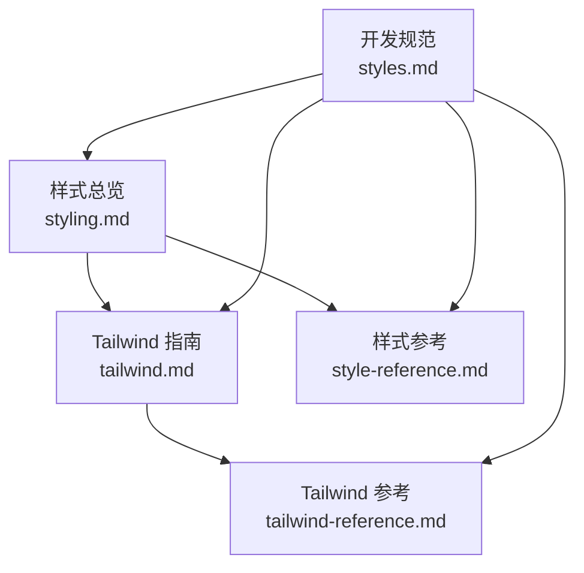

**图示来源**
- [website/docs/styling.md:1-12](file://website/docs/styling.md#L1-L12)
- [website/docs/tailwind.md:1-12](file://website/docs/tailwind.md#L1-L12)
- [website/modules/style-reference.md:1-12](file://website/modules/style-reference.md#L1-L12)
- [website/modules/tailwind-reference.md:1-14](file://website/modules/tailwind-reference.md#L1-L14)
- [docs/dev/styles.md:1-22](file://docs/dev/styles.md#L1-L22)

**章节来源**
- [website/docs/styling.md:1-12](file://website/docs/styling.md#L1-L12)
- [website/docs/tailwind.md:1-12](file://website/docs/tailwind.md#L1-L12)
- [website/modules/style-reference.md:1-12](file://website/modules/style-reference.md#L1-L12)
- [website/modules/tailwind-reference.md:1-14](file://website/modules/tailwind-reference.md#L1-L14)
- [docs/dev/styles.md:1-22](file://docs/dev/styles.md#L1-L22)

## 核心组件
- Rust 类型化样式（Styled）：以链式方法表达样式，编译期可检查，运行时无字符串开销
- TSX style 属性：接受 CSS 语法值，支持信号驱动与原生动画绑定
- Tailwind 类：在原生端解析为样式规则，支持变体、断点、状态与主题扩展
- 主题系统：nsh.json 中 tailwind 主题与设计令牌（theme tokens），支持运行时切换

**章节来源**
- [website/docs/styling.md:11-14](file://website/docs/styling.md#L11-L14)
- [website/docs/tailwind.md:11-13](file://website/docs/tailwind.md#L11-L13)
- [website/modules/style-reference.md:1-12](file://website/modules/style-reference.md#L1-L12)
- [website/modules/tailwind-reference.md:1-14](file://website/modules/tailwind-reference.md#L1-L14)

## 架构总览
NSH 样式管线将三类输入统一到同一套原生样式：
- Rust Styled 方法 → 原生样式键
- TSX style 对象 → 原生样式键
- Tailwind 类串 → 解析为原生样式键

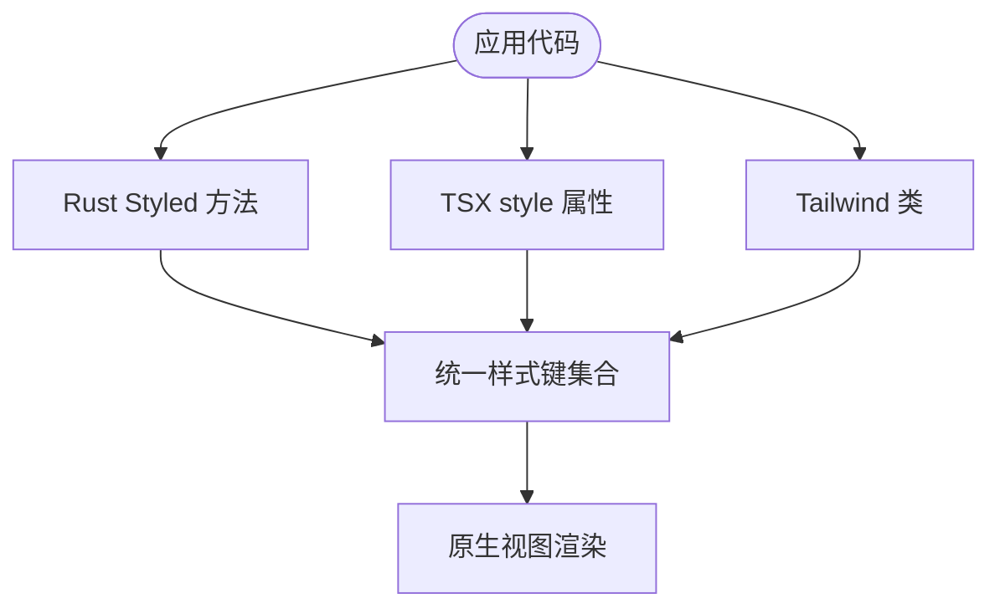

**图示来源**
- [website/docs/styling.md:11-14](file://website/docs/styling.md#L11-L14)
- [website/docs/tailwind.md:11-13](file://website/docs/tailwind.md#L11-L13)
- [website/modules/style-reference.md:1-12](file://website/modules/style-reference.md#L1-L12)

## 详细组件分析

### CSS-in-RS 与 TSX style 的统一语义
- 三者（Rust Styled、style 键、Tailwind 类）指向同一组属性与默认值
- 长度单位为点（points），百分比与 auto 按父级或容器计算
- 颜色支持 CSS Color 5 语法；currentColor 继承文本色用于边框/描边/阴影
- 布局默认：未设置 display 时为列；display:flex 默认为行（CSS 语义）

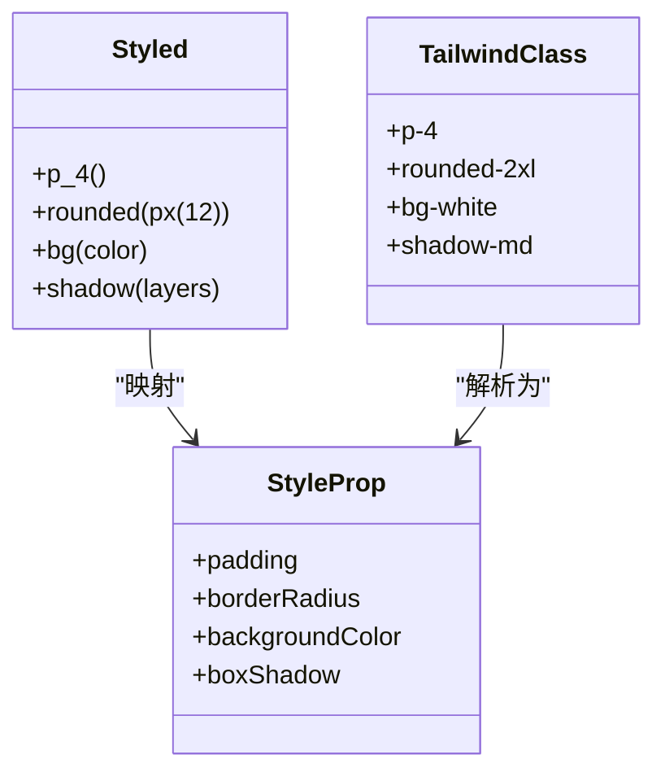

**图示来源**
- [website/modules/style-reference.md:1-12](file://website/modules/style-reference.md#L1-L12)
- [website/modules/tailwind-reference.md:1-14](file://website/modules/tailwind-reference.md#L1-L14)

**章节来源**
- [docs/dev/styles.md:1-22](file://docs/dev/styles.md#L1-L22)
- [website/docs/styling.md:97-119](file://website/docs/styling.md#L97-L119)
- [website/modules/style-reference.md:84-96](file://website/modules/style-reference.md#L84-L96)

### Tailwind 集成与优先级
- 类串在原生端解析并缓存，变体按 Tailwind 顺序重算
- 优先级：important(!) > inline style > 普通类；同类串中“后写的胜出”
- 文本样式在 View 上可继承至子 Text/Input
- 不支持的特性会作为未知类被警告，不会赋予其他含义

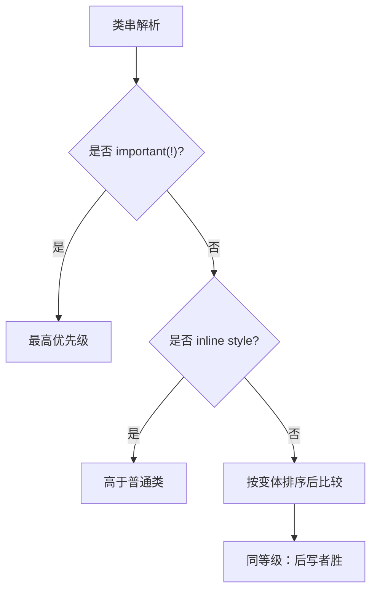

**图示来源**
- [website/docs/tailwind.md:66-73](file://website/docs/tailwind.md#L66-L73)
- [website/modules/tailwind-reference.md:49-56](file://website/modules/tailwind-reference.md#L49-L56)

**章节来源**
- [website/docs/tailwind.md:66-73](file://website/docs/tailwind.md#L66-L73)
- [website/modules/tailwind-reference.md:49-56](file://website/modules/tailwind-reference.md#L49-L56)

### 主题管理与动态切换
- nsh.json 中 tailwind 主题扩展：colors、spacing、breakpoints、fontSize、radius、shadow、blur、perspective、aspect、ease、container 等
- 设计令牌 theme tokens：通过 token()/theme() 读取，支持 light/dark 双值
- 运行时 setTheme()/set_tokens 可替换主题，类名与绑定同步更新

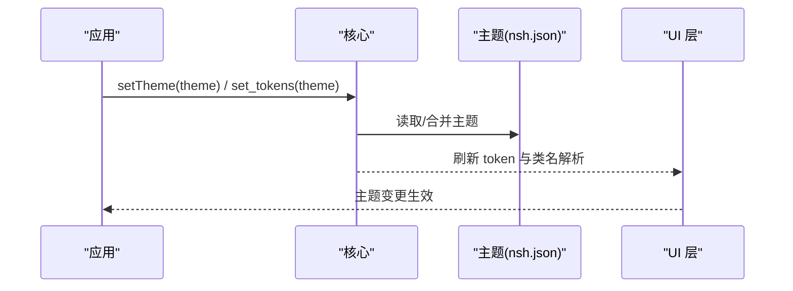

**图示来源**
- [website/docs/tailwind.md:174-215](file://website/docs/tailwind.md#L174-L215)
- [website/docs/tailwind.md:217-270](file://website/docs/tailwind.md#L217-L270)
- [website/modules/tailwind-reference.md:611-666](file://website/modules/tailwind-reference.md#L611-L666)

**章节来源**
- [website/docs/tailwind.md:174-215](file://website/docs/tailwind.md#L174-L215)
- [website/docs/tailwind.md:217-270](file://website/docs/tailwind.md#L217-L270)
- [website/modules/tailwind-reference.md:611-666](file://website/modules/tailwind-reference.md#L611-L666)

### 边框、圆角与曲线
- 边框宽度/颜色按边设置，未设颜色时采用文本色（currentColor）
- 圆角支持逐角设置与 corner-squircle（continuous）平滑曲线
- overflow:hidden 同时裁剪布局与绘制

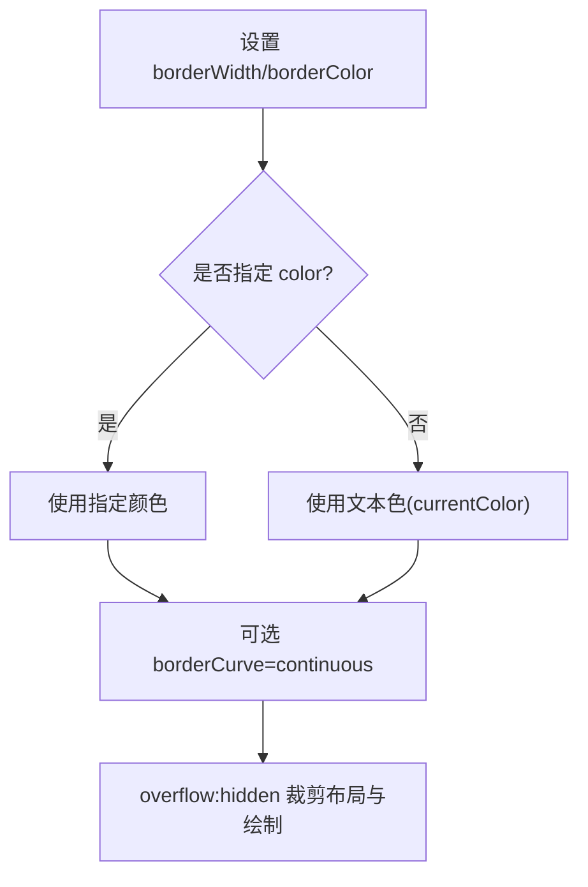

**图示来源**
- [website/docs/styling.md:161-194](file://website/docs/styling.md#L161-L194)
- [website/modules/style-reference.md:234-270](file://website/modules/style-reference.md#L234-L270)

**章节来源**
- [website/docs/styling.md:161-194](file://website/docs/styling.md#L161-L194)
- [website/modules/style-reference.md:234-270](file://website/modules/style-reference.md#L234-L270)

### 阴影与环
- box-shadow 支持多层、spread、inset；过渡可动画
- ring/inset-ring 基于 box-shadow 但位于边框外/内，不占布局空间
- Android 需要背景才能投射阴影；材料阴影用 elevation 属性

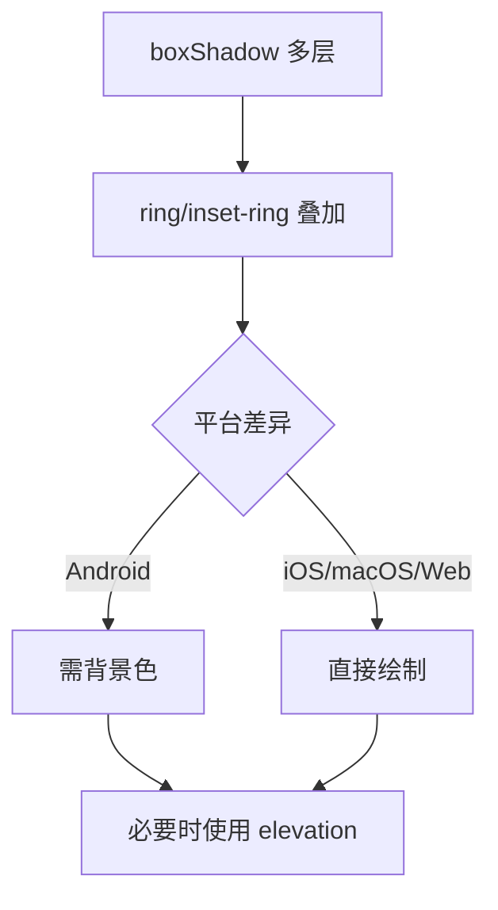

**图示来源**
- [website/docs/styling.md:196-228](file://website/docs/styling.md#L196-L228)
- [website/modules/style-reference.md:282-304](file://website/modules/style-reference.md#L282-L304)
- [website/modules/tailwind-reference.md:332-357](file://website/modules/tailwind-reference.md#L332-L357)

**章节来源**
- [website/docs/styling.md:196-228](file://website/docs/styling.md#L196-L228)
- [website/modules/style-reference.md:282-304](file://website/modules/style-reference.md#L282-L304)
- [website/modules/tailwind-reference.md:332-357](file://website/modules/tailwind-reference.md#L332-L357)

### 渐变与蒙版
- backgroundImage 支持 linear/radial/conic 及其 repeating 形式
- 颜色混合遵循 CSS color-mix 空间；位置支持百分比/长度/角度
- maskImage 可用渐变控制可见区域，配合 backdropFilter 做渐进模糊

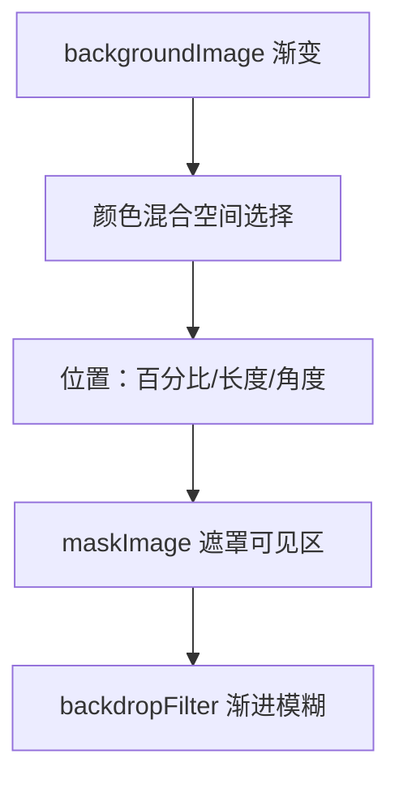

**图示来源**
- [website/docs/styling.md:229-265](file://website/docs/styling.md#L229-L265)
- [website/docs/styling.md:374-408](file://website/docs/styling.md#L374-L408)
- [website/modules/style-reference.md:219-232](file://website/modules/style-reference.md#L219-L232)

**章节来源**
- [website/docs/styling.md:229-265](file://website/docs/styling.md#L229-L265)
- [website/docs/styling.md:374-408](file://website/docs/styling.md#L374-L408)
- [website/modules/style-reference.md:219-232](file://website/modules/style-reference.md#L219-L232)

### 变换与透视
- translate/rotate/scale 为独立属性，transform 为函数串或步骤列表
- perspective-* 为子元素提供深度；transformOrigin 控制旋转缩放原点
- 部分平台限制：Android 无 skew；GPUI 对图像像素变换有限制

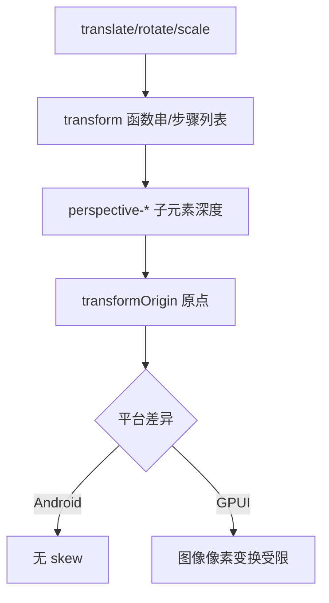

**图示来源**
- [website/docs/styling.md:418-445](file://website/docs/styling.md#L418-L445)
- [website/modules/style-reference.md:316-358](file://website/modules/style-reference.md#L316-L358)
- [website/modules/tailwind-reference.md:376-392](file://website/modules/tailwind-reference.md#L376-L392)

**章节来源**
- [website/docs/styling.md:418-445](file://website/docs/styling.md#L418-L445)
- [website/modules/style-reference.md:316-358](file://website/modules/style-reference.md#L316-L358)
- [website/modules/tailwind-reference.md:376-392](file://website/modules/tailwind-reference.md#L376-L392)

### 过渡与关键帧动画
- transitionProperty 分组动画：颜色、透明度、变换、阴影、圆角/边框、clip-path
- timingFunction 支持 cubic-bezier 与 spring（自计时）
- 内置关键帧：spin/ping/pulse/bounce；也可自定义 KeyframeAnimation

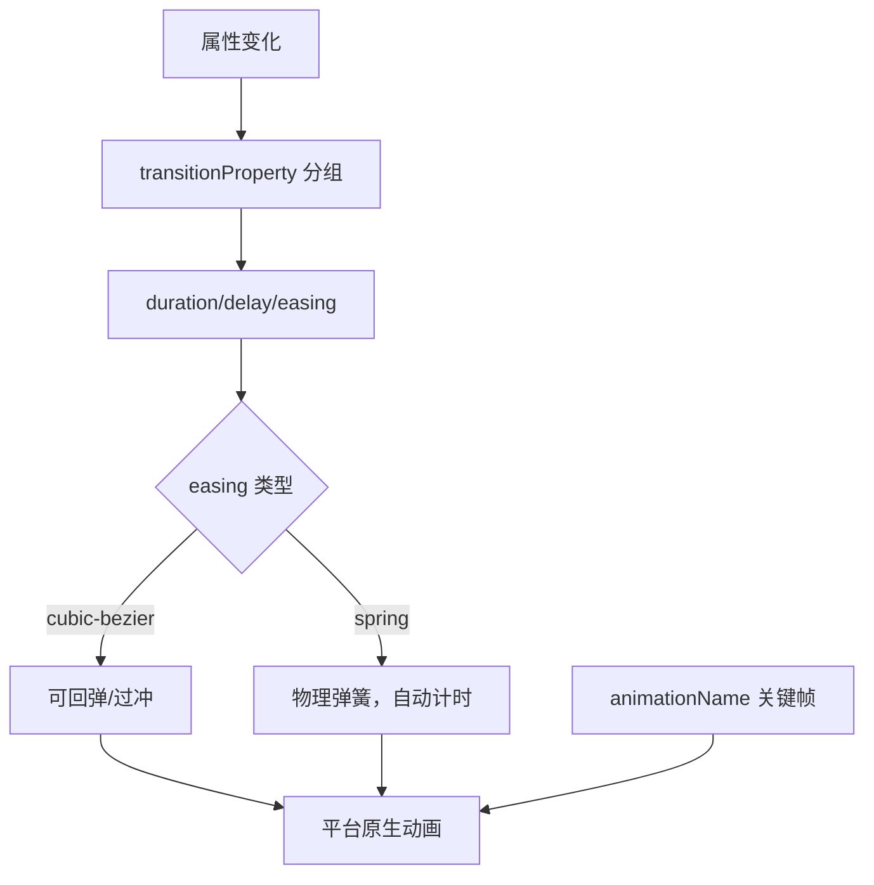

**图示来源**
- [website/docs/styling.md:447-522](file://website/docs/styling.md#L447-L522)
- [website/modules/style-reference.md:375-416](file://website/modules/style-reference.md#L375-L416)
- [website/modules/tailwind-reference.md:393-407](file://website/modules/tailwind-reference.md#L393-L407)

**章节来源**
- [website/docs/styling.md:447-522](file://website/docs/styling.md#L447-L522)
- [website/modules/style-reference.md:375-416](file://website/modules/style-reference.md#L375-L416)
- [website/modules/tailwind-reference.md:393-407](file://website/modules/tailwind-reference.md#L393-L407)

### 响应式设计与断点
- 内置断点：sm/md/lg/xl/2xl；也支持 min-[length]/max-[length]
- 方向：portrait/landscape；指针类型：pointer-fine/coarse
- 终端/平台：terminal/ios/android/web；RTL/LTR；motion-safe/reduce

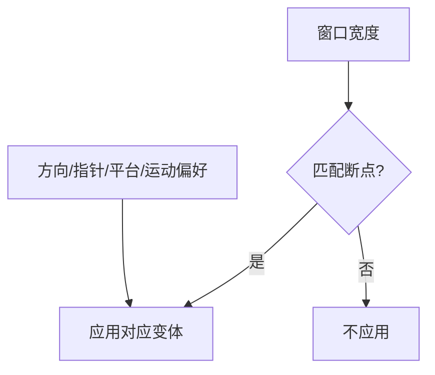

**图示来源**
- [website/docs/tailwind.md:97-107](file://website/docs/tailwind.md#L97-L107)
- [website/modules/tailwind-reference.md:440-476](file://website/modules/tailwind-reference.md#L440-L476)

**章节来源**
- [website/docs/tailwind.md:97-107](file://website/docs/tailwind.md#L97-L107)
- [website/modules/tailwind-reference.md:440-476](file://website/modules/tailwind-reference.md#L440-L476)

### 深色模式与品牌色定制
- 深色模式：dark: 变体；AdaptiveColor 在 Rust 中随外观切换
- 品牌色：nsh.json tailwind.colors 定义调色板；token 命名设计令牌
- 运行时 setTheme 可替换主题，token()/theme() 即时读取

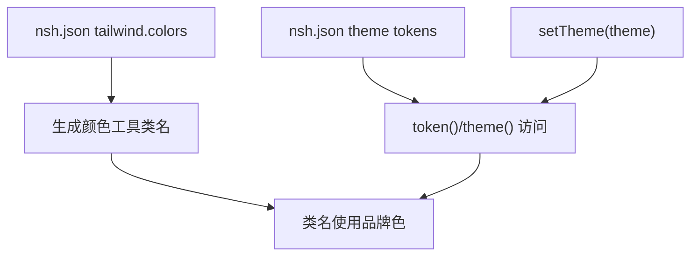

**图示来源**
- [website/docs/styling.md:121-159](file://website/docs/styling.md#L121-L159)
- [website/docs/tailwind.md:174-215](file://website/docs/tailwind.md#L174-L215)
- [website/docs/tailwind.md:217-270](file://website/docs/tailwind.md#L217-L270)

**章节来源**
- [website/docs/styling.md:121-159](file://website/docs/styling.md#L121-L159)
- [website/docs/tailwind.md:174-215](file://website/docs/tailwind.md#L174-L215)
- [website/docs/tailwind.md:217-270](file://website/docs/tailwind.md#L217-L270)

### 组件样式覆盖与状态样式
- active/hover/focus/focus-visible/focus-within/disabled/checked/indeterminate/selected/aria-* 等变体
- 状态样式 props：activeStyle/hoverStyle/focusStyle/... 与类变体等价
- group-* 支持祖先状态联动

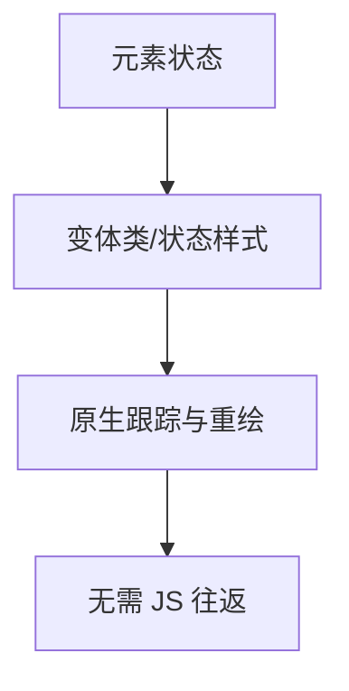

**图示来源**
- [website/docs/tailwind.md:75-107](file://website/docs/tailwind.md#L75-L107)
- [website/modules/tailwind-reference.md:478-503](file://website/modules/tailwind-reference.md#L478-L503)

**章节来源**
- [website/docs/tailwind.md:75-107](file://website/docs/tailwind.md#L75-L107)
- [website/modules/tailwind-reference.md:478-503](file://website/modules/tailwind-reference.md#L478-L503)

## 依赖关系分析
- 文档依赖：styling.md 作为入口，串联 tailwind.md、style-reference.md、tailwind-reference.md
- 运行时依赖：core 解析类串与 style 键，统一映射到原生样式；主题来自 nsh.json

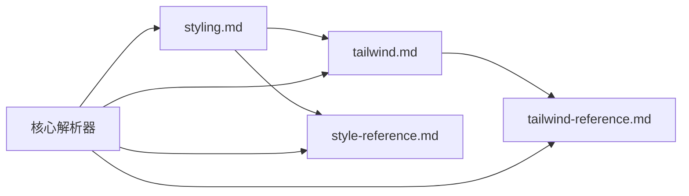

**图示来源**
- [website/docs/styling.md:1-12](file://website/docs/styling.md#L1-L12)
- [website/docs/tailwind.md:1-12](file://website/docs/tailwind.md#L1-L12)
- [website/modules/style-reference.md:1-12](file://website/modules/style-reference.md#L1-L12)
- [website/modules/tailwind-reference.md:1-14](file://website/modules/tailwind-reference.md#L1-L14)

**章节来源**
- [website/docs/styling.md:1-12](file://website/docs/styling.md#L1-L12)
- [website/docs/tailwind.md:1-12](file://website/docs/tailwind.md#L1-L12)
- [website/modules/style-reference.md:1-12](file://website/modules/style-reference.md#L1-L12)
- [website/modules/tailwind-reference.md:1-14](file://website/modules/tailwind-reference.md#L1-L14)

## 性能考虑
- 优先使用类进行静态样式，style 用于计算值与动画
- 避免不必要的 filter/backdropFilter/maskImage 组合，保持层数与区域最小
- 使用 transition 而非每帧 JS 驱动；spring 自计时减少调度开销
- 合理使用 overflow:hidden 裁剪，避免溢出测量与绘制
- 利用 currentColor 减少重复颜色声明

[本节为通用指导，不直接分析具体文件]

## 故障排查指南
- 未知类：构建/运行时报 unknown class，检查是否在支持列表中或拼写错误
- 阴影不可见（Android）：确保有背景色；或使用 elevation
- 渐变/滤镜平台差异：iOS 视图滤镜受限；Android API 版本要求
- 过渡无效：确认 transitionProperty 包含目标属性；尺寸/位置属布局，需用 LayoutAnimation 或原生动画

**章节来源**
- [website/modules/tailwind-reference.md:432-438](file://website/modules/tailwind-reference.md#L432-L438)
- [website/docs/styling.md:196-228](file://website/docs/styling.md#L196-L228)
- [website/docs/styling.md:294-311](file://website/docs/styling.md#L294-L311)
- [website/docs/styling.md:506-507](file://website/docs/styling.md#L506-L507)

## 结论
NSH 的样式系统以“一套属性、三种写法”为核心原则，结合 Tailwind 类的强大生态与主题系统的灵活性，既满足跨平台一致性，又保留原生性能优势。通过合理运用类、style 与主题变量，开发者可以高效构建可维护、高性能且易于定制的界面。

[本节为总结性内容，不直接分析具体文件]

## 附录
- 常用属性速查：边框、阴影、渐变、变换、过渡、动画、断点、状态变体
- 主题扩展清单：tailwind 主题键与 theme tokens 的使用方式
- 平台差异要点：iOS/Android/Web/GPUI 的限制与替代方案

[本节为补充信息，不直接分析具体文件]