# 画廊展示

<cite>
**本文引用的文件**   
- [README.md](file://examples/gallery/README.md)
- [App.tsx](file://examples/gallery/App.tsx)
- [nav.ts](file://examples/gallery/nav.ts)
- [ui.tsx](file://examples/gallery/ui.tsx)
- [TitleBar.tsx](file://examples/gallery/TitleBar.tsx)
- [icons.tsx](file://examples/gallery/icons.tsx)
- [toast.tsx](file://examples/gallery/toast.tsx)
- [ButtonDemo.tsx](file://examples/gallery/demos/ButtonDemo.tsx)
- [Charts.tsx](file://examples/gallery/demos/Charts.tsx)
- [DataTableDemo.tsx](file://examples/gallery/demos/DataTableDemo.tsx)
- [Form.tsx](file://examples/gallery/demos/Form.tsx)
</cite>

## 目录
1. [简介](#简介)
2. [项目结构](#项目结构)
3. [核心组件](#核心组件)
4. [架构总览](#架构总览)
5. [详细组件分析](#详细组件分析)
6. [依赖关系分析](#依赖关系分析)
7. [性能与优化](#性能与优化)
8. [故障排查指南](#故障排查指南)
9. [结论](#结论)
10. [附录](#附录)

## 简介
本仓库中的 Gallery 是一个综合性示例应用，用于演示 NSH 框架的 UI 组件、主题系统、导航结构与跨平台能力。它通过“应用”“元素”“样式”“动效”“平台”等分组组织大量可交互 Demo，覆盖按钮、表单、列表、图表、数据表格、编辑器、终端、通知、声音、窗口与托盘等能力，并支持桌面、移动端、Web 与终端多种运行环境。

该应用同时展示了：
- 基于 nsh/base 的丰富组件族（按钮、输入、菜单、弹窗、表格、图表等）
- 主题系统与外观切换（浅色/深色/跟随系统），以及 RTL 布局
- 导航栈与页面路由（手机模式下的压入式导航，桌面模式下的侧栏+内容区）
- 延迟加载与懒渲染，提升首屏与滚动性能
- Toast 通知体系与声音反馈
- 大数据量场景（百万级股票数据表格）与实时图表

**章节来源**
- [README.md:1-20](file://examples/gallery/README.md#L1-L20)

## 项目结构
Gallery 采用“入口 + 导航 + UI 壳层 + 图标/标题栏 + Toast + 大量 Demo”的分层组织方式：
- 入口 App.tsx：定义分组、路由、桌面/手机两种布局、侧栏搜索与选择逻辑
- nav.ts：声明 DemoEntry 类型与 NavStack 路由
- ui.tsx：提供 PageHeader、DemoPage、lazy 懒加载、RTL/主题/声音开关等通用 UI 能力
- TitleBar.tsx：应用自定义标题栏（桌面端）
- icons.tsx：统一图标绘制与 Lucide 图标封装
- toast.tsx：Toast 管理器与 Toaster 容器
- demos/*：各组件与功能的具体 Demo

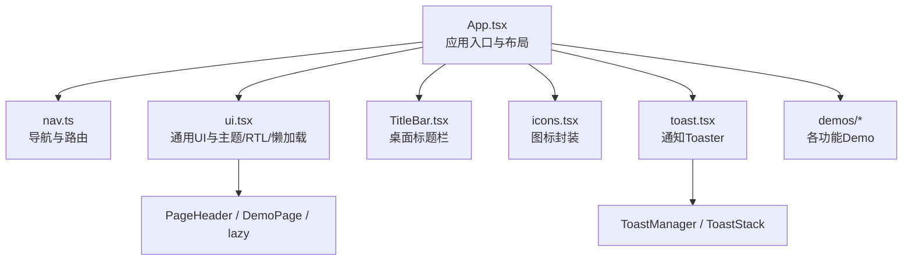

**图示来源**
- [App.tsx:1-25](file://examples/gallery/App.tsx#L1-L25)
- [nav.ts:1-24](file://examples/gallery/nav.ts#L1-L24)
- [ui.tsx:1-15](file://examples/gallery/ui.tsx#L1-L15)
- [TitleBar.tsx:1-35](file://examples/gallery/TitleBar.tsx#L1-L35)
- [icons.tsx:1-10](file://examples/gallery/icons.tsx#L1-L10)
- [toast.tsx:1-15](file://examples/gallery/toast.tsx#L1-L15)

**章节来源**
- [App.tsx:1-25](file://examples/gallery/App.tsx#L1-L25)
- [nav.ts:1-24](file://examples/gallery/nav.ts#L1-L24)
- [ui.tsx:1-15](file://examples/gallery/ui.tsx#L1-L15)
- [TitleBar.tsx:1-35](file://examples/gallery/TitleBar.tsx#L1-L35)
- [icons.tsx:1-10](file://examples/gallery/icons.tsx#L1-L10)
- [toast.tsx:1-15](file://examples/gallery/toast.tsx#L1-L15)

## 核心组件
- 导航与路由
  - DemoEntry：描述每个 Demo 的名称、详情、图标、是否占满整页、屏幕组件工厂
  - Route：home/demo/page 三种路由类型
  - createNavStack：创建全局导航栈，初始为 home
- 通用 UI
  - PageHeader：页面头部，含返回、标题、右侧操作，适配终端与非终端
  - DemoPage：卡片化 Demo 页面，支持多列布局、懒渲染、入场动画
  - lazy：模块级懒加载，首次显示时动态 import
  - ThemeToggle/SoundToggle/DirectionToggle：主题、声音、RTL 切换
- 图标与标题栏
  - Icon/LucideIcon：统一图标绘制与 SVG 转换
  - TitleBar：应用自定义标题栏，带 Logo 与标题
- 通知
  - ToastManager/ToastStack：管理可见 Toast 与生命周期
  - Toaster：在 Overlay 或终端底部渲染 Toast 列表

**章节来源**
- [nav.ts:5-24](file://examples/gallery/nav.ts#L5-L24)
- [ui.tsx:24-99](file://examples/gallery/ui.tsx#L24-L99)
- [ui.tsx:332-417](file://examples/gallery/ui.tsx#L332-L417)
- [ui.tsx:489-518](file://examples/gallery/ui.tsx#L489-L518)
- [ui.tsx:165-220](file://examples/gallery/ui.tsx#L165-L220)
- [icons.tsx:56-83](file://examples/gallery/icons.tsx#L56-L83)
- [TitleBar.tsx:5-33](file://examples/gallery/TitleBar.tsx#L5-L33)
- [toast.tsx:1-15](file://examples/gallery/toast.tsx#L1-L15)

## 架构总览
Gallery 的整体架构分为三层：
- 表现层（UI Shell）：App.tsx 负责整体布局（桌面/手机）、侧栏、工具栏、设置菜单；ui.tsx 提供页面头、Demo 页面、懒加载等通用能力
- 导航层（Navigation）：nav.ts 维护路由栈，控制页面压入/弹出与当前 Demo 状态
- 能力层（Demos & Base Components）：demos/* 使用 nsh/base 提供的 Button/Input/Menu/Table/Plot 等组件实现具体功能

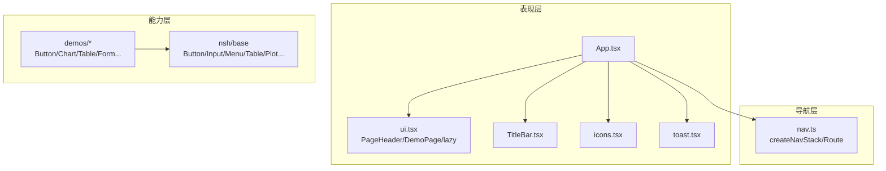

**图示来源**
- [App.tsx:1-25](file://examples/gallery/App.tsx#L1-L25)
- [nav.ts:1-24](file://examples/gallery/nav.ts#L1-L24)
- [ui.tsx:1-15](file://examples/gallery/ui.tsx#L1-L15)
- [TitleBar.tsx:1-35](file://examples/gallery/TitleBar.tsx#L1-L35)
- [icons.tsx:1-10](file://examples/gallery/icons.tsx#L1-L10)
- [toast.tsx:1-15](file://examples/gallery/toast.tsx#L1-L15)

**章节来源**
- [App.tsx:1-25](file://examples/gallery/App.tsx#L1-L25)
- [nav.ts:1-24](file://examples/gallery/nav.ts#L1-L24)
- [ui.tsx:1-15](file://examples/gallery/ui.tsx#L1-L15)

## 详细组件分析

### 导航与路由（nav.ts）
- DemoEntry 定义了每个 Demo 的元数据与懒加载屏幕
- Route 区分首页、Demo 页与子页面
- createNavStack 初始化导航栈，默认首页

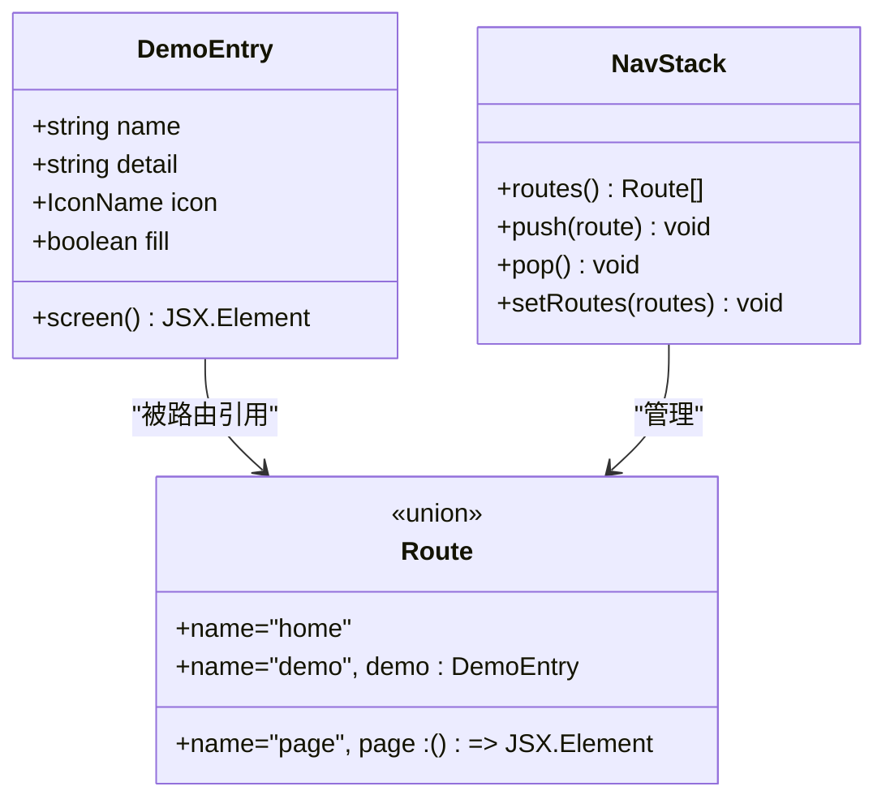

**图示来源**
- [nav.ts:5-24](file://examples/gallery/nav.ts#L5-L24)

**章节来源**
- [nav.ts:5-24](file://examples/gallery/nav.ts#L5-L24)

### 通用 UI（ui.tsx）
- PageHeader：根据是否处于导航栈根路径决定是否显示返回按钮，支持透明背景与自定义左右区域
- DemoPage：将多个卡片按列排布，支持 lazy 懒渲染与 Appear 入场动画，自动计算列数
- lazy：对 Demo 模块进行按需加载，失败时显示错误提示
- 主题/RTL/声音：ThemeToggle/SoundToggle/DirectionToggle 暴露给 App 与设置菜单

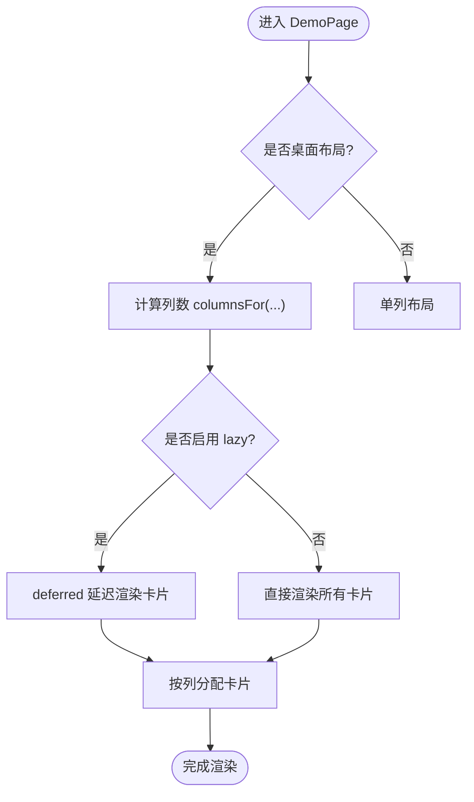

**图示来源**
- [ui.tsx:332-417](file://examples/gallery/ui.tsx#L332-L417)
- [ui.tsx:427-481](file://examples/gallery/ui.tsx#L427-L481)

**章节来源**
- [ui.tsx:24-99](file://examples/gallery/ui.tsx#L24-L99)
- [ui.tsx:332-417](file://examples/gallery/ui.tsx#L332-L417)
- [ui.tsx:489-518](file://examples/gallery/ui.tsx#L489-L518)

### 图标与标题栏（icons.tsx, TitleBar.tsx）
- icons.tsx：将 Lucide 的 SVG 元素转换为 Canvas 绘制，并提供 svg data URL 以兼容原生菜单
- TitleBar.tsx：在桌面端绘制应用标题栏，包含 Logo、标题与平台窗口控制留白

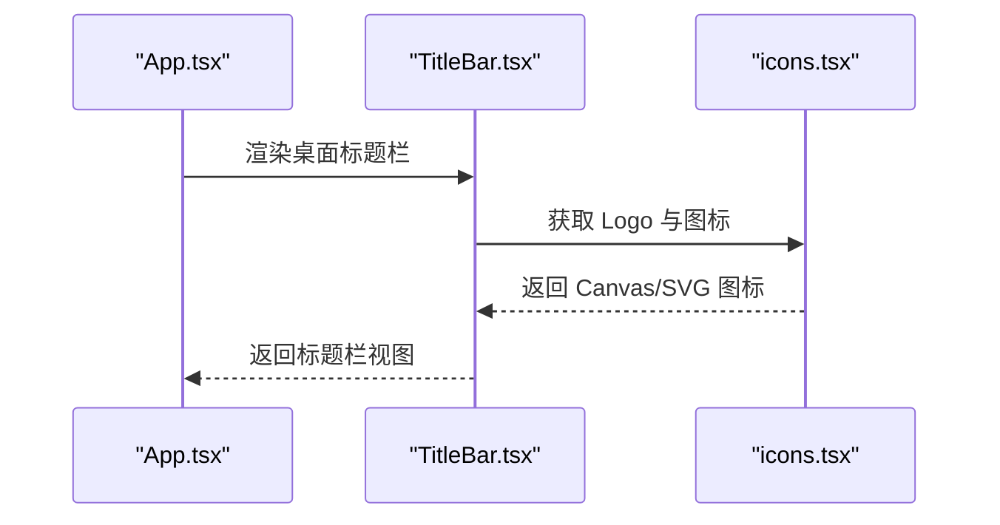

**图示来源**
- [TitleBar.tsx:5-33](file://examples/gallery/TitleBar.tsx#L5-L33)
- [icons.tsx:56-83](file://examples/gallery/icons.tsx#L56-L83)

**章节来源**
- [icons.tsx:56-83](file://examples/gallery/icons.tsx#L56-L83)
- [TitleBar.tsx:5-33](file://examples/gallery/TitleBar.tsx#L5-L33)

### 通知系统（toast.tsx）
- ToastManager/ToastStack：管理可见 Toast 数量、生命周期与展开收起
- Toaster：在非终端环境下以 Overlay 形式定位到底部，终端下则渲染在底部行
- updateToast/dismissToast：支持原地更新与批量关闭

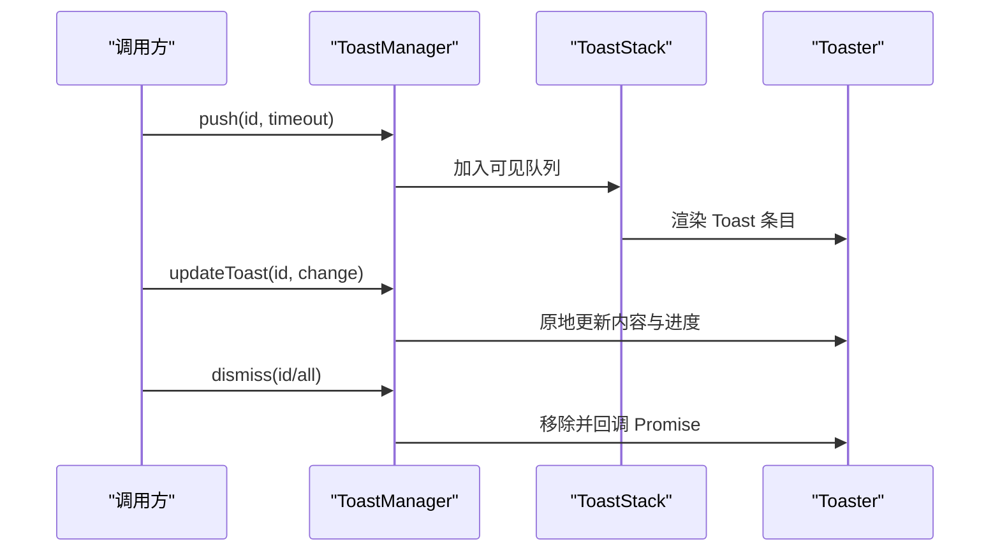

**图示来源**
- [toast.tsx:95-142](file://examples/gallery/toast.tsx#L95-L142)
- [toast.tsx:272-306](file://examples/gallery/toast.tsx#L272-L306)

**章节来源**
- [toast.tsx:95-142](file://examples/gallery/toast.tsx#L95-L142)
- [toast.tsx:272-306](file://examples/gallery/toast.tsx#L272-L306)

### 按钮组件（ButtonDemo.tsx）
- 展示按钮种类、尺寸、图标按钮、分割按钮、忙碌状态、复制反馈、长按确认、禁用状态等
- 结合 nsh/base 的 Button 与 gallery 的 buttonLook/iconButtonLook/splitButtonLook 等样式函数

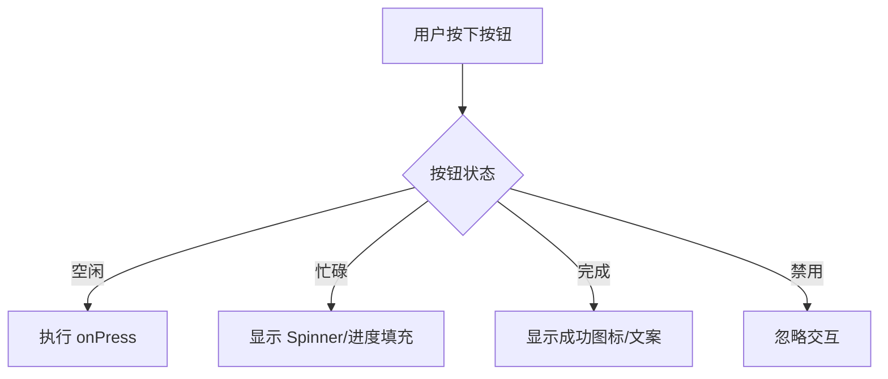

**图示来源**
- [ButtonDemo.tsx:153-186](file://examples/gallery/demos/ButtonDemo.tsx#L153-L186)
- [ButtonDemo.tsx:346-413](file://examples/gallery/demos/ButtonDemo.tsx#L346-L413)
- [ButtonDemo.tsx:458-523](file://examples/gallery/demos/ButtonDemo.tsx#L458-L523)

**章节来源**
- [ButtonDemo.tsx:153-186](file://examples/gallery/demos/ButtonDemo.tsx#L153-L186)
- [ButtonDemo.tsx:346-413](file://examples/gallery/demos/ButtonDemo.tsx#L346-L413)
- [ButtonDemo.tsx:458-523](file://examples/gallery/demos/ButtonDemo.tsx#L458-L523)

### 图表组件（Charts.tsx）
- 展示实时价格、订单簿深度、回撤图、容量环、收入饼图、销售柱状图等
- 使用 nsh/base/plot 的 Plot/Arc/Area/Line/Pie/Bar/Treemap 等绘图原语
- 通过 motion.update 与 appearGeneration 实现平滑过渡与入场动画

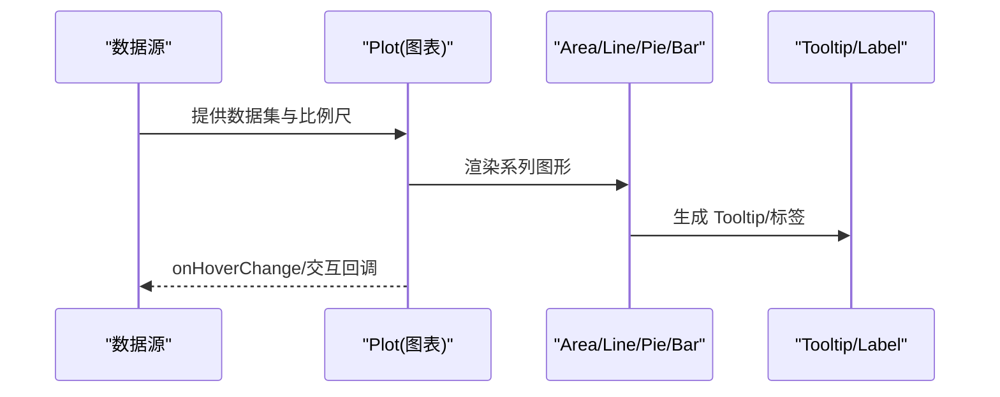

**图示来源**
- [Charts.tsx:101-271](file://examples/gallery/demos/Charts.tsx#L101-L271)
- [Charts.tsx:320-401](file://examples/gallery/demos/Charts.tsx#L320-L401)
- [Charts.tsx:677-760](file://examples/gallery/demos/Charts.tsx#L677-L760)

**章节来源**
- [Charts.tsx:101-271](file://examples/gallery/demos/Charts.tsx#L101-L271)
- [Charts.tsx:320-401](file://examples/gallery/demos/Charts.tsx#L320-L401)
- [Charts.tsx:677-760](file://examples/gallery/demos/Charts.tsx#L677-L760)

### 数据表格（DataTableDemo.tsx）
- 百万级股票数据，仅渲染可视区域及附近缓冲行，每 33ms 随机更新部分报价
- 支持排序、选择（行/单元格/列）、固定列、列宽调整与移动
- 通过 onVisibleRowsChange 与 data/dataStart/rowCount 配合实现高性能分页

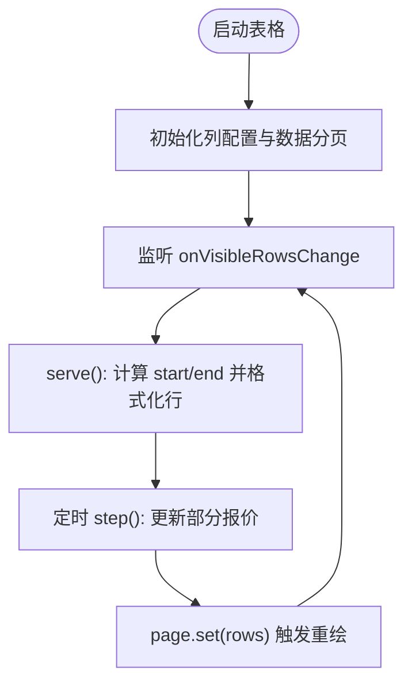

**图示来源**
- [DataTableDemo.tsx:264-351](file://examples/gallery/demos/DataTableDemo.tsx#L264-L351)
- [DataTableDemo.tsx:446-503](file://examples/gallery/demos/DataTableDemo.tsx#L446-L503)

**章节来源**
- [DataTableDemo.tsx:264-351](file://examples/gallery/demos/DataTableDemo.tsx#L264-L351)
- [DataTableDemo.tsx:446-503](file://examples/gallery/demos/DataTableDemo.tsx#L446-L503)

### 表单组件（Form.tsx）
- 展示输入框、前缀/后缀、验证、密码强度、搜索防抖、键盘行为、多行文本等
- 使用 Input 与 fieldLook/fieldText/fieldSize 等样式函数统一视觉与交互

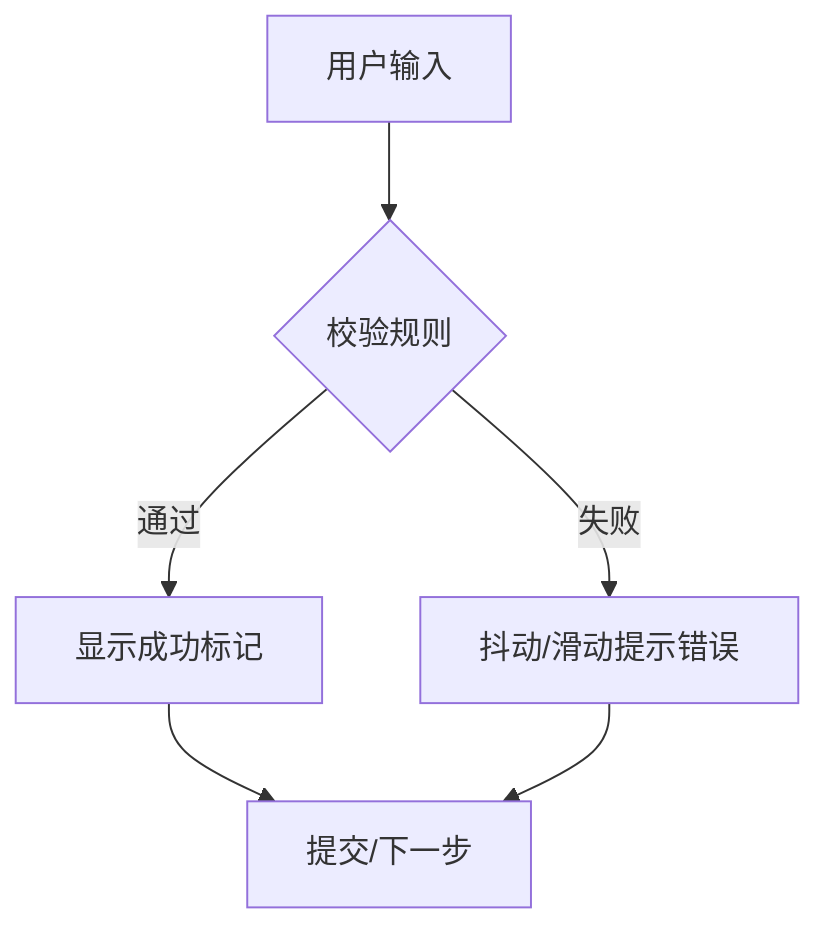

**图示来源**
- [Form.tsx:61-162](file://examples/gallery/demos/Form.tsx#L61-L162)
- [Form.tsx:407-511](file://examples/gallery/demos/Form.tsx#L407-L511)
- [Form.tsx:520-565](file://examples/gallery/demos/Form.tsx#L520-L565)

**章节来源**
- [Form.tsx:61-162](file://examples/gallery/demos/Form.tsx#L61-L162)
- [Form.tsx:407-511](file://examples/gallery/demos/Form.tsx#L407-L511)
- [Form.tsx:520-565](file://examples/gallery/demos/Form.tsx#L520-L565)

## 依赖关系分析
- App.tsx 依赖：
  - nsh 基础能力（信号、动画、Scroll、View、Text 等）
  - nsh/desktop（窗口、菜单、titleBar）
  - nsh/base（AlertDialog、Input、Menu、MenuItem、NavPage、NavStack、Scrollbar）
  - 内部模块：icons、TitleBar、toast、nav、ui
- ui.tsx 依赖：
  - nsh-gallery-ui 共享 UI 库（颜色、半径、hover/focus 样式等）
  - nsh 运行时（platform、setColorScheme、windowSize）
- 各 Demo 依赖：
  - nsh/base 对应组件（Button、Input、Menu、Table、Plot 等）
  - ui.tsx 提供的通用组件与样式函数

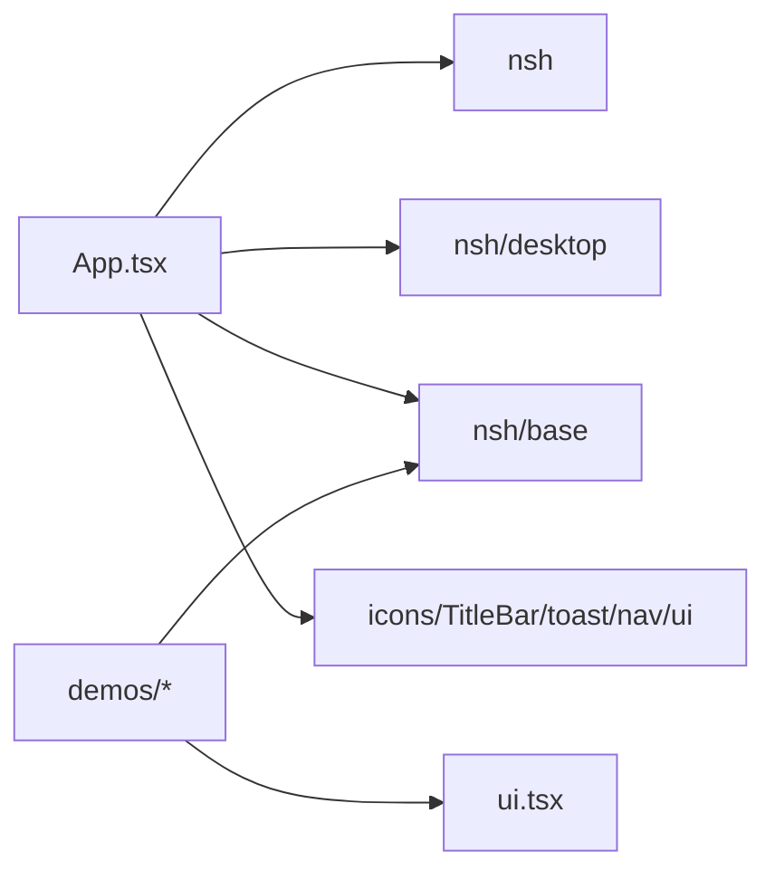

**图示来源**
- [App.tsx:1-25](file://examples/gallery/App.tsx#L1-L25)
- [ui.tsx:1-15](file://examples/gallery/ui.tsx#L1-L15)

**章节来源**
- [App.tsx:1-25](file://examples/gallery/App.tsx#L1-L25)
- [ui.tsx:1-15](file://examples/gallery/ui.tsx#L1-L15)

## 性能与优化
- 懒加载与懒渲染
  - 使用 lazy() 对 Demo 模块进行动态 import，减少首屏体积
  - DemoPage 的 deferred 机制在滚动接近时才渲染卡片，避免一次性构建大量节点
- 大数据表格
  - DataTableDemo 仅渲染可视区域及缓冲行，并通过 onVisibleRowsChange 驱动分页
  - 定时 tick 仅更新部分行，降低重绘成本
- 图表动画
  - 使用 appearGeneration 与 motion.update 控制入场与更新动画，避免频繁重排
- 主题与 RTL
  - 通过 setColorScheme 与 direction 切换，避免重建整个树
- 声音与通知
  - 预加载声音资源，避免首次播放卡顿
  - ToastManager 限制最大显示数量，避免过多 DOM 节点

**章节来源**
- [ui.tsx:489-518](file://examples/gallery/ui.tsx#L489-L518)
- [ui.tsx:427-481](file://examples/gallery/ui.tsx#L427-L481)
- [DataTableDemo.tsx:264-351](file://examples/gallery/demos/DataTableDemo.tsx#L264-L351)
- [Charts.tsx:101-271](file://examples/gallery/demos/Charts.tsx#L101-L271)

## 故障排查指南
- 图表无响应或卡顿
  - 检查 reduceMotion 是否开启，必要时禁用复杂动画
  - 确认 Plot 的 appearGeneration 与 motion 配置合理
- 表格滚动掉帧
  - 确保仅渲染可视区域，避免一次性格式化全部行
  - 检查 onVisibleRowsChange 回调中是否触发了不必要的重渲染
- 表单验证抖动异常
  - 检查 attempt 计数与 relayout 调用时机
  - 确认 shake 动画未与 reduceMotion 冲突
- Toast 不消失或重复显示
  - 检查 duration 与 lingering 映射是否正确
  - 确认 dismissToast 后清理了 answers/chosen/lingering

**章节来源**
- [Charts.tsx:101-271](file://examples/gallery/demos/Charts.tsx#L101-L271)
- [DataTableDemo.tsx:264-351](file://examples/gallery/demos/DataTableDemo.tsx#L264-L351)
- [Form.tsx:61-162](file://examples/gallery/demos/Form.tsx#L61-L162)
- [toast.tsx:95-142](file://examples/gallery/toast.tsx#L95-L142)

## 结论
Gallery 作为 NSH 的综合示例，完整展示了从基础元素到复杂业务场景的实现方式。其清晰的架构分层、统一的 UI 壳层、灵活的导航与主题系统，以及针对大数据与实时数据的性能优化策略，为开发者提供了可复用的最佳实践参考。通过本指南，读者可以快速理解如何组织应用结构、使用各类 UI 组件、定制主题与样式，并在不同平台上获得一致体验。

## 附录
- 运行说明
  - 在仓库根目录执行 cargo run 可运行原生 UI 演示
  - Web 模式下可使用 nsh run examples/gallery --target web 在浏览器中体验
- 标准 API 与权限
  - 标准 API 页面演示文件、进程、TCP、WebSocket、环境与作业接口
  - Request host exit 动作在 nsh.json 中被拒绝，以展示权限结果

**章节来源**
- [README.md:1-20](file://examples/gallery/README.md#L1-L20)