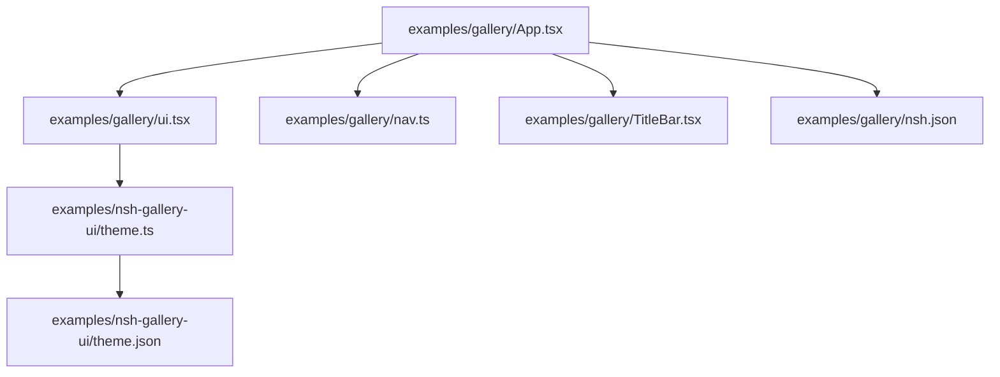
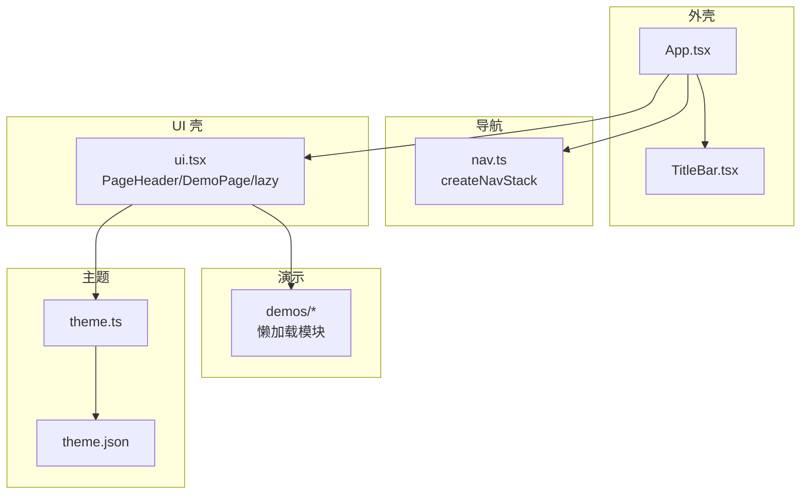
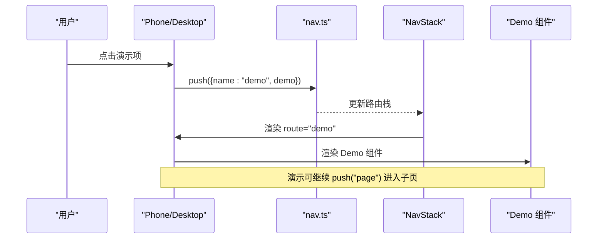
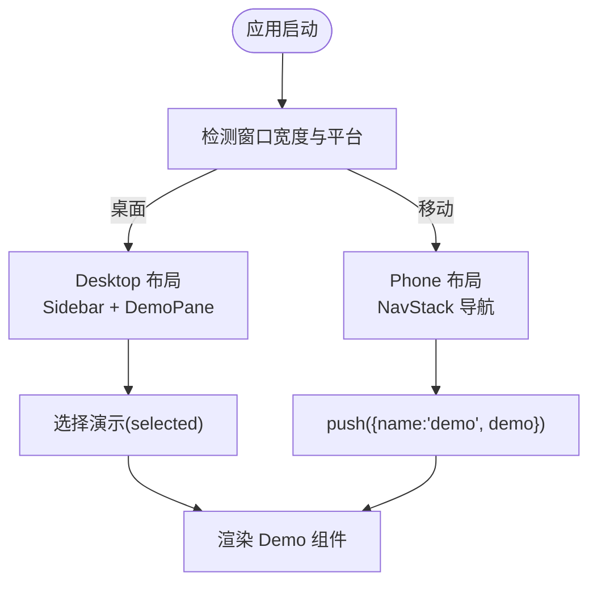
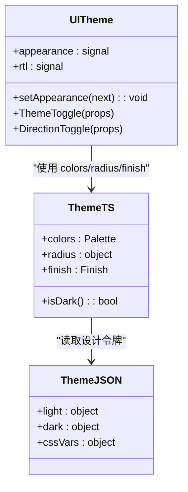
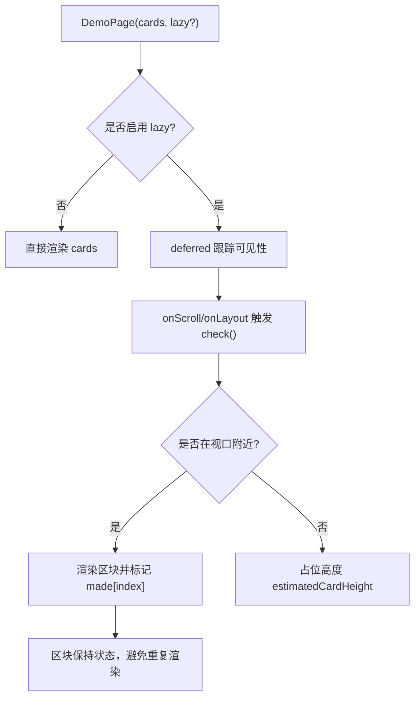
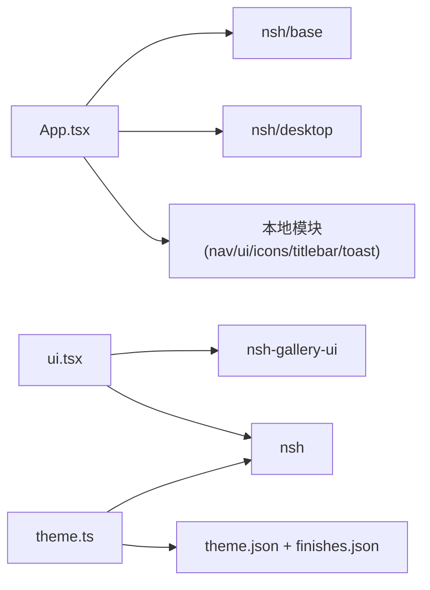
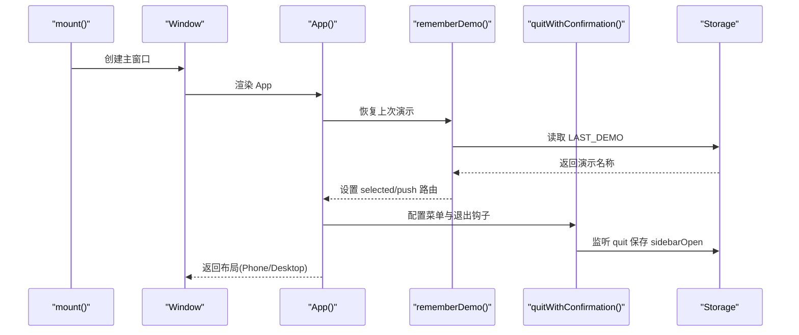

# 画廊应用概览

<cite>
**本文引用的文件**   
- [App.tsx](file://examples/gallery/App.tsx)
- [nav.ts](file://examples/gallery/nav.ts)
- [ui.tsx](file://examples/gallery/ui.tsx)
- [TitleBar.tsx](file://examples/gallery/TitleBar.tsx)
- [nsh.json](file://examples/gallery/nsh.json)
- [theme.ts](file://examples/nsh-gallery-ui/theme.ts)
- [theme.json](file://examples/nsh-gallery-ui/theme.json)
</cite>

## 目录
1. [简介](#简介)
2. [项目结构](#项目结构)
3. [核心组件](#核心组件)
4. [架构总览](#架构总览)
5. [详细组件分析](#详细组件分析)
6. [依赖关系分析](#依赖关系分析)
7. [性能与优化](#性能与优化)
8. [启动流程与配置](#启动流程与配置)
9. [故障排查](#故障排查)
10. [结论](#结论)

## 简介
NSH 画廊是一个综合性示例应用，用于展示 NSH 框架在桌面、移动端、终端和 Web 上的统一能力。它通过“分组 + 演示”的方式组织大量原生 UI 演示，提供：
- 双布局模式：桌面端侧边栏 + 内容区；移动端导航栈。
- 主题系统：浅色/深色/跟随系统，RTL 支持，动态切换。
- 导航系统：基于路由栈的页面切换，状态保持与恢复。
- 性能优化：懒加载模块、滚动区域按需渲染、内存友好。
- 平台能力：窗口、菜单、托盘、通知、存储、URL Scheme 等。

该文档从架构、组件、数据流、性能与启动流程等方面全面解析画廊应用。

## 项目结构
画廊应用位于 examples/gallery，核心入口为 App.tsx，配合 ui.tsx 提供通用 UI 与布局工具，nav.ts 定义导航类型与路由栈，TitleBar.tsx 提供自定义标题栏，nsh.json 描述应用元数据与权限。主题由 nsh-gallery-ui 层提供 theme.json 与 theme.ts。

**图表来源**
- [App.tsx:1-25](file://examples/gallery/App.tsx#L1-L25)
- [ui.tsx:1-13](file://examples/gallery/ui.tsx#L1-L13)
- [nav.ts:1-24](file://examples/gallery/nav.ts#L1-L24)
- [TitleBar.tsx:1-35](file://examples/gallery/TitleBar.tsx#L1-L35)
- [nsh.json:1-83](file://examples/gallery/nsh.json#L1-L83)
- [theme.ts:1-15](file://examples/nsh-gallery-ui/theme.ts#L1-L15)
- [theme.json:1-133](file://examples/nsh-gallery-ui/theme.json#L1-L133)

**章节来源**
- [App.tsx:1-25](file://examples/gallery/App.tsx#L1-L25)
- [ui.tsx:1-13](file://examples/gallery/ui.tsx#L1-L13)
- [nav.ts:1-24](file://examples/gallery/nav.ts#L1-L24)
- [TitleBar.tsx:1-35](file://examples/gallery/TitleBar.tsx#L1-L35)
- [nsh.json:1-83](file://examples/gallery/nsh.json#L1-L83)
- [theme.ts:1-15](file://examples/nsh-gallery-ui/theme.ts#L1-L15)
- [theme.json:1-133](file://examples/nsh-gallery-ui/theme.json#L1-L133)

## 核心组件
- 应用根组件 App：负责初始化、布局选择（桌面/移动）、全局设置（滚动条主题、退出确认）与挂载窗口。
- 导航系统 nav：基于 createNavStack 的路由栈，维护 home/demo/page 三种路由类型，并提供 shownDemo 信号以同步当前演示。
- UI 壳 ui：提供 PageHeader、DemoPage、lazy 懒加载、方向与主题切换、列数计算等通用能力。
- TitleBar：自定义标题栏，适配平台窗口控制区。
- 主题系统 theme：通过 theme.json 定义颜色与圆角等 token，theme.ts 暴露 colors、radius、finish 等运行时访问器，并响应 colorScheme 变化。

**章节来源**
- [App.tsx:920-939](file://examples/gallery/App.tsx#L920-L939)
- [nav.ts:1-24](file://examples/gallery/nav.ts#L1-L24)
- [ui.tsx:18-162](file://examples/gallery/ui.tsx#L18-L162)
- [TitleBar.tsx:1-35](file://examples/gallery/TitleBar.tsx#L1-L35)
- [theme.ts:32-142](file://examples/nsh-gallery-ui/theme.ts#L32-L142)
- [theme.json:1-133](file://examples/nsh-gallery-ui/theme.json#L1-L133)

## 架构总览
画廊采用“外壳 + 演示”的分层架构：
- 外壳层：App.tsx 管理应用生命周期、布局切换、全局状态（如 lastDemo、sidebarOpen）。
- 导航层：nav.ts 提供路由栈，UI 层根据 route.name 渲染不同页面。
- 演示层：每个 demo 是独立模块，通过 lazy(() => import(...)) 延迟加载。
- 主题层：theme.json 提供设计令牌，theme.ts 暴露运行时 API，ui.tsx 将主题应用到界面。

**图表来源**
- [App.tsx:920-939](file://examples/gallery/App.tsx#L920-L939)
- [nav.ts:16-24](file://examples/gallery/nav.ts#L16-L24)
- [ui.tsx:332-417](file://examples/gallery/ui.tsx#L332-L417)
- [theme.ts:114-142](file://examples/nsh-gallery-ui/theme.ts#L114-L142)
- [theme.json:1-133](file://examples/nsh-gallery-ui/theme.json#L1-L133)

## 详细组件分析

### 导航系统与路由管理
- 路由类型：home（首页）、demo（打开某个演示）、page（演示内部子页）。
- 路由栈：使用 createNavStack 创建，初始为 [{ name: "home" }]。
- 页面渲染：Phone 与 Desktop 均通过 NavStack(state=nav) 渲染，根据 route.name 分支处理。
- 状态保持：shownDemo 信号同步当前演示，便于在不同布局间共享选中项。

**图表来源**
- [nav.ts:16-24](file://examples/gallery/nav.ts#L16-L24)
- [App.tsx:261-301](file://examples/gallery/App.tsx#L261-L301)
- [App.tsx:778-805](file://examples/gallery/App.tsx#L778-L805)

**章节来源**
- [nav.ts:1-24](file://examples/gallery/nav.ts#L1-L24)
- [App.tsx:261-301](file://examples/gallery/App.tsx#L261-L301)
- [App.tsx:778-805](file://examples/gallery/App.tsx#L778-L805)

### 布局结构与展示模式
- 移动端：Phone 使用 NavStack 作为主容器，首页 Home 列表展示所有演示，点击后 push 到 demo 页面。
- 桌面端：Desktop 包含 Sidebar（演示列表）与 DemoPane（当前演示），支持侧边栏展开/收起动画。
- 自适应：ui.tsx 中 desktop 计算依据 windowSize 与 platform.desktop，决定布局模式与列数。

**图表来源**
- [ui.tsx:104-123](file://examples/gallery/ui.tsx#L104-L123)
- [App.tsx:261-301](file://examples/gallery/App.tsx#L261-L301)
- [App.tsx:778-805](file://examples/gallery/App.tsx#L778-L805)

**章节来源**
- [ui.tsx:104-123](file://examples/gallery/ui.tsx#L104-L123)
- [App.tsx:261-301](file://examples/gallery/App.tsx#L261-L301)
- [App.tsx:778-805](file://examples/gallery/App.tsx#L778-L805)

### 主题系统与外观定制
- 主题配置：theme.json 定义 light/dark 两套 CSS 变量与设计令牌。
- 运行时访问：theme.ts 通过 tokens() 与 themed() 暴露 colors、radius、finish 等，读取时响应 colorScheme 变化。
- 动态切换：ui.tsx 提供 setAppearance 与 ThemeToggle，调用 setColorScheme 切换浅色/深色/跟随系统。
- RTL 支持：rtl 信号控制 direction，影响布局方向与侧边栏位置。

**图表来源**
- [theme.json:1-133](file://examples/nsh-gallery-ui/theme.json#L1-L133)
- [theme.ts:32-142](file://examples/nsh-gallery-ui/theme.ts#L32-L142)
- [ui.tsx:153-195](file://examples/gallery/ui.tsx#L153-L195)
- [ui.tsx:125-151](file://examples/gallery/ui.tsx#L125-L151)

**章节来源**
- [theme.json:1-133](file://examples/nsh-gallery-ui/theme.json#L1-L133)
- [theme.ts:32-142](file://examples/nsh-gallery-ui/theme.ts#L32-L142)
- [ui.tsx:125-195](file://examples/gallery/ui.tsx#L125-L195)

### 性能优化策略
- 懒加载模块：每个演示通过 lazy(() => import(...)) 首次显示时加载，减少首屏体积。
- 滚动区域按需渲染：DemoPage 支持 lazy 与 estimatedCardHeight，结合 deferred 机制在滚动接近时渲染区块。
- 列数自适应：columnsFor 根据 paneWidth 计算列数，避免过度渲染。
- 内存管理：已渲染区块在宽屏下复用（made 数组），滚动回退不重复绘制。

**图表来源**
- [ui.tsx:332-417](file://examples/gallery/ui.tsx#L332-L417)
- [ui.tsx:419-481](file://examples/gallery/ui.tsx#L419-L481)
- [ui.tsx:483-518](file://examples/gallery/ui.tsx#L483-L518)

**章节来源**
- [ui.tsx:332-417](file://examples/gallery/ui.tsx#L332-L417)
- [ui.tsx:419-481](file://examples/gallery/ui.tsx#L419-L481)
- [ui.tsx:483-518](file://examples/gallery/ui.tsx#L483-L518)

## 依赖关系分析
- App.tsx 依赖：
  - nsh 基础 API（View、Text、Scroll、signal、effect、mount、Window 等）。
  - nsh/base 组件（AlertDialog、Input、Menu、MenuItem、NavPage、NavStack、Scrollbar）。
  - nsh/desktop（Window、Application、Menu、titleBar）。
  - 本地模块（icons、TitleBar、toast、nav、ui）。
- ui.tsx 依赖：
  - nsh-gallery-ui 提供的通用 UI 与主题。
  - nsh 平台 API（platform、setColorScheme、windowSize）。
- theme.ts 依赖：
  - nsh 的 token、colorScheme、reduceMotion 等。
  - finishes.json 提供深浅色 finish 差异。

**图表来源**
- [App.tsx:1-25](file://examples/gallery/App.tsx#L1-L25)
- [ui.tsx:1-13](file://examples/gallery/ui.tsx#L1-L13)
- [theme.ts:1-8](file://examples/nsh-gallery-ui/theme.ts#L1-L8)

**章节来源**
- [App.tsx:1-25](file://examples/gallery/App.tsx#L1-L25)
- [ui.tsx:1-13](file://examples/gallery/ui.tsx#L1-L13)
- [theme.ts:1-8](file://examples/nsh-gallery-ui/theme.ts#L1-L8)

## 性能与优化
- 懒加载：演示模块仅在首次显示时加载，降低初始包体与首屏时间。
- 滚动优化：DemoPage 的 deferred 机制按视口范围批量渲染，避免长列表一次性构建。
- 列数自适应：columnsFor 根据可用宽度计算列数，确保在不同屏幕尺寸下合理布局。
- 状态保持：宽屏下区块复用（made 数组），滚动回退不重建，节省内存与 CPU。
- FPS 监控：通过 setFpsEnabled 可开启性能监控，辅助调试。

[本节为通用性能讨论，不直接分析具体文件]

## 启动流程与配置
- 应用入口：App.tsx 中的 App 函数执行 rememberDemo() 与 quitWithConfirmation()，然后设置 Scrollbar 主题，最后根据 desktop() 选择 Phone 或 Desktop 布局，并通过 mount 挂载 Window。
- 上次演示恢复：rememberDemo 优先读取环境变量 NSH_GALLERY_DEMO 与 NSH_GALLERY_SECTION，否则从 Storage 读取 LAST_DEMO，匹配 groups 中的演示并设置 selected 或 push 路由。
- 退出确认：quitWithConfirmation 设置应用菜单，监听 Application.on("quit") 保存 sidebarOpen 状态。
- 配置项：nsh.json 定义应用名、ID、版本、图标、appearance、window.titleBar.style、theme 路径、capabilities（网络、文件系统、进程、WebView、状态栏、剪贴板、URL Scheme、Picker、Share、Speech、Notifications、Audio、Windows、Application、HomeDir）。

**图表来源**
- [App.tsx:807-865](file://examples/gallery/App.tsx#L807-L865)
- [App.tsx:867-918](file://examples/gallery/App.tsx#L867-L918)
- [App.tsx:920-939](file://examples/gallery/App.tsx#L920-L939)
- [nsh.json:1-83](file://examples/gallery/nsh.json#L1-L83)

**章节来源**
- [App.tsx:807-865](file://examples/gallery/App.tsx#L807-L865)
- [App.tsx:867-918](file://examples/gallery/App.tsx#L867-L918)
- [App.tsx:920-939](file://examples/gallery/App.tsx#L920-L939)
- [nsh.json:1-83](file://examples/gallery/nsh.json#L1-L83)

## 故障排查
- 演示无法恢复：检查 Storage 中 LAST_DEMO 是否存在且名称有效；若无效，应用会忽略并回到首页。
- 主题未生效：确认 setColorScheme 被正确调用，且 theme.json 中存在对应 token。
- 滚动卡顿：检查 DemoPage 是否启用 lazy，并确保 estimatedCardHeight 合理；查看 deferred 的 onScroll/onLayout 是否频繁触发。
- 退出无响应：确认 quitWithConfirmation 已执行，且 Application.on("quit") 已注册；检查 Storage.setItem 是否成功保存 sidebarOpen。

**章节来源**
- [App.tsx:807-865](file://examples/gallery/App.tsx#L807-L865)
- [App.tsx:867-918](file://examples/gallery/App.tsx#L867-L918)
- [ui.tsx:332-417](file://examples/gallery/ui.tsx#L332-L417)

## 结论
NSH 画廊应用通过清晰的架构分层、灵活的导航系统、完善的主题与外观定制、以及多项性能优化策略，展示了跨平台原生 UI 的统一实现方式。其“外壳 + 演示”的组织模式便于扩展与维护，适合作为学习 NSH 框架与构建复杂应用的参考范例。