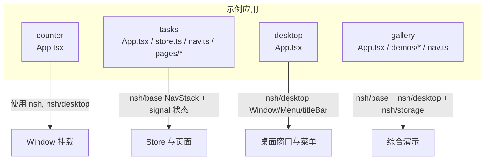
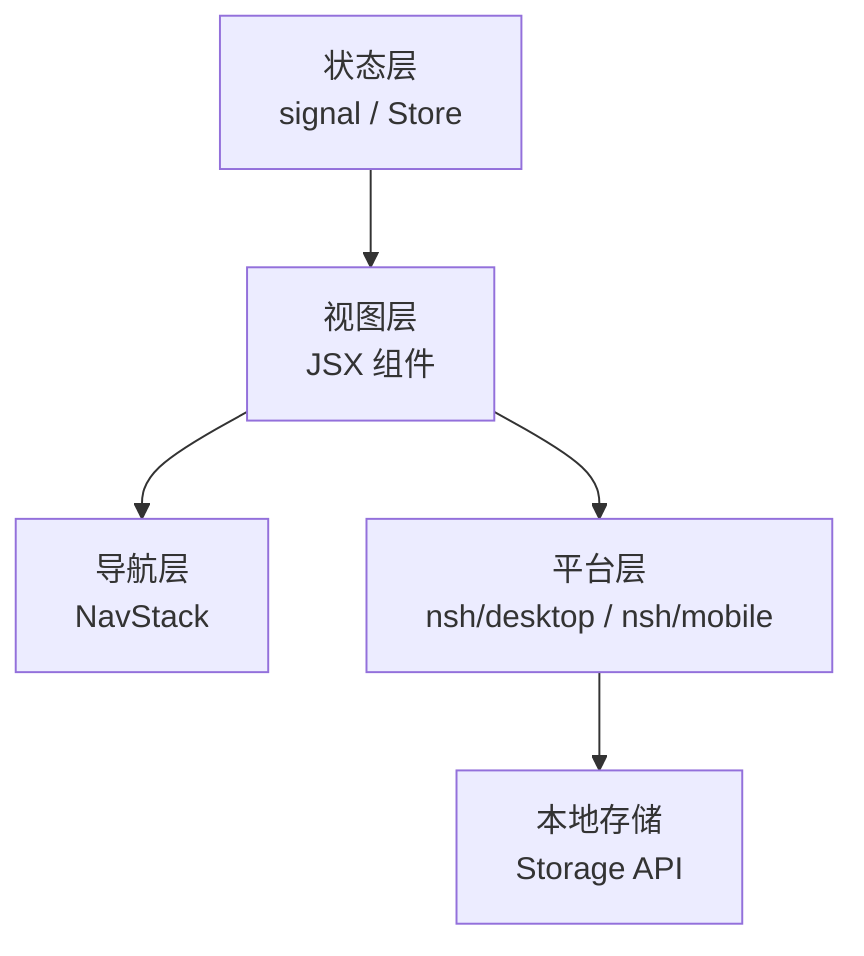
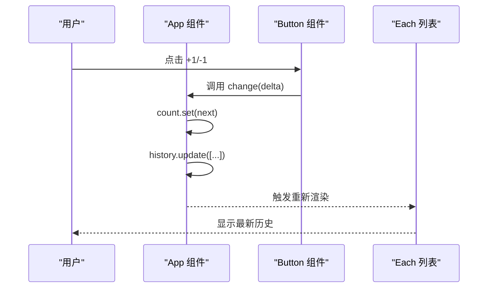
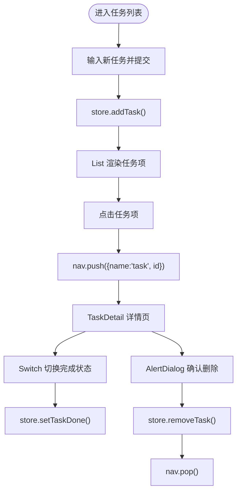
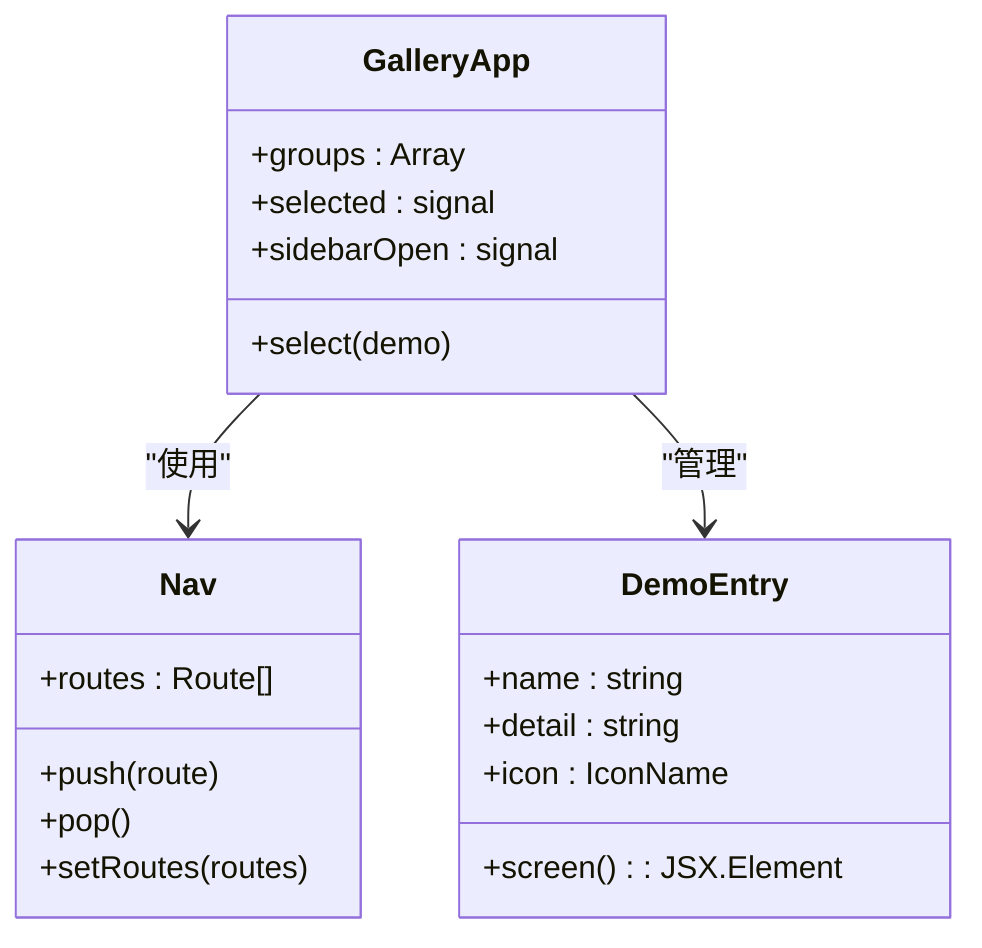
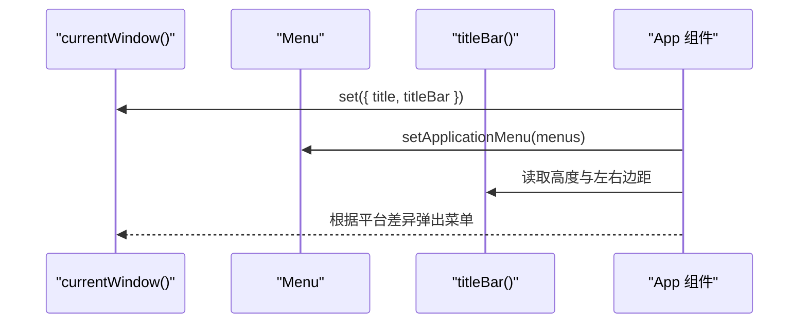
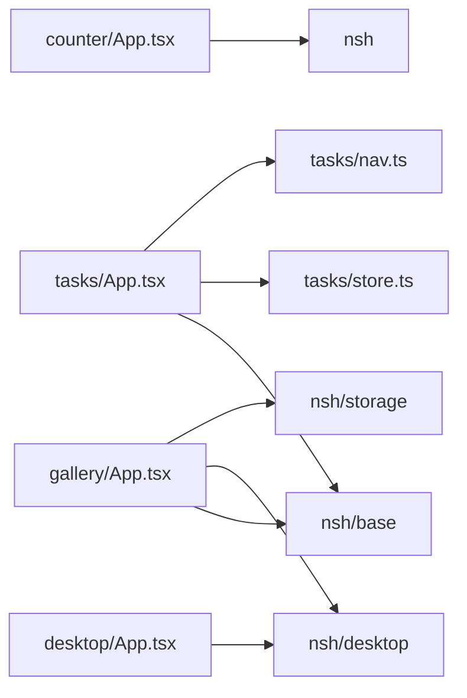

# 示例和教程

<cite>
**本文引用的文件**   
- [examples/counter/App.tsx](file://examples/counter/App.tsx)
- [examples/tasks/App.tsx](file://examples/tasks/App.tsx)
- [examples/tasks/store.ts](file://examples/tasks/store.ts)
- [examples/tasks/nav.ts](file://examples/tasks/nav.ts)
- [examples/tasks/pages/TaskList.tsx](file://examples/tasks/pages/TaskList.tsx)
- [examples/tasks/pages/TaskDetail.tsx](file://examples/tasks/pages/TaskDetail.tsx)
- [examples/desktop/App.tsx](file://examples/desktop/App.tsx)
- [examples/gallery/App.tsx](file://examples/gallery/App.tsx)
- [examples/gallery/nav.ts](file://examples/gallery/nav.ts)
- [examples/gallery/demos/TextDemo.tsx](file://examples/gallery/demos/TextDemo.tsx)
- [examples/gallery/demos/Lists.tsx](file://examples/gallery/demos/Lists.tsx)
- [examples/gallery/demos/Form.tsx](file://examples/gallery/demos/Form.tsx)
- [examples/gallery/demos/Navigation.tsx](file://examples/gallery/demos/Navigation.tsx)
- [examples/gallery/demos/Storage.tsx](file://examples/gallery/demos/Storage.tsx)
</cite>

## 目录
1. [简介](#简介)
2. [项目结构](#项目结构)
3. [核心组件](#核心组件)
4. [架构总览](#架构总览)
5. [详细组件分析](#详细组件分析)
6. [依赖关系分析](#依赖关系分析)
7. [性能与优化](#性能与优化)
8. [故障排查指南](#故障排查指南)
9. [结论](#结论)
10. [附录：分步教程与最佳实践](#附录分步教程与最佳实践)

## 简介
本教程围绕 NSH 框架，提供从简单到复杂的完整应用示例与教程，覆盖以下典型场景：
- 基础计数器应用：展示信号、列表渲染与窗口挂载。
- 任务管理应用：演示导航栈、表单处理、数据持久化（本地存储）与确认对话框。
- 仪表盘应用（Gallery）：综合展示文本、列表、表单、导航、系统 API 等能力。
- 桌面应用：自定义标题栏、菜单、窗口控制与平台差异适配。

每个示例均包含源码路径、关键实现说明与运行指导，并解释其中使用的关键技术点与设计模式，帮助开发者快速上手并掌握 NSH 的最佳实践。

## 项目结构
仓库的 examples 目录下提供了多个可直接运行的示例应用，按功能划分清晰：
- counter：最小化的计数器应用，适合入门学习。
- tasks：基于导航的任务管理应用，涵盖列表、详情、状态管理与交互。
- desktop：桌面端应用示例，演示窗口、菜单与标题栏定制。
- gallery：大型仪表盘示例，聚合大量元素与平台能力演示。

图表来源
- [examples/counter/App.tsx:1-63](file://examples/counter/App.tsx#L1-L63)
- [examples/tasks/App.tsx:1-27](file://examples/tasks/App.tsx#L1-L27)
- [examples/tasks/store.ts:1-38](file://examples/tasks/store.ts#L1-L38)
- [examples/tasks/nav.ts:1-7](file://examples/tasks/nav.ts#L1-L7)
- [examples/desktop/App.tsx:1-191](file://examples/desktop/App.tsx#L1-L191)
- [examples/gallery/App.tsx:1-800](file://examples/gallery/App.tsx#L1-L800)

章节来源
- [examples/counter/App.tsx:1-63](file://examples/counter/App.tsx#L1-L63)
- [examples/tasks/App.tsx:1-27](file://examples/tasks/App.tsx#L1-L27)
- [examples/desktop/App.tsx:1-191](file://examples/desktop/App.tsx#L1-L191)
- [examples/gallery/App.tsx:1-800](file://examples/gallery/App.tsx#L1-L800)

## 核心组件
- 信号与响应式更新：通过 signal 创建可观察状态，配合 Each/List 等组件进行高效渲染。
- 导航栈：使用 createNavStack 与 NavStack 管理多页面路由与过渡。
- 列表与虚拟化：List 支持虚拟滚动、分组、粘性头部、水平滚动与下拉刷新。
- 表单与输入：Input 支持多种键盘类型、前缀/后缀、校验与动画反馈。
- 桌面能力：Window、Menu、titleBar 等用于构建原生桌面体验。
- 本地存储：Storage API 提供键值对持久化，支持异步读写与清理。

章节来源
- [examples/counter/App.tsx:1-63](file://examples/counter/App.tsx#L1-L63)
- [examples/tasks/store.ts:1-38](file://examples/tasks/store.ts#L1-L38)
- [examples/tasks/pages/TaskList.tsx:1-50](file://examples/tasks/pages/TaskList.tsx#L1-L50)
- [examples/gallery/demos/Lists.tsx:1-800](file://examples/gallery/demos/Lists.tsx#L1-L800)
- [examples/gallery/demos/Form.tsx:1-800](file://examples/gallery/demos/Form.tsx#L1-L800)
- [examples/desktop/App.tsx:1-191](file://examples/desktop/App.tsx#L1-L191)
- [examples/gallery/demos/Storage.tsx:1-150](file://examples/gallery/demos/Storage.tsx#L1-L150)

## 架构总览
NSH 示例采用“轻量状态 + 组件树”的架构：
- 状态层：使用 signal 维护应用状态，必要时封装为模块级 Store。
- 视图层：以 JSX 组件描述 UI，结合 nsh/base 提供的丰富组件。
- 导航层：通过 NavStack 管理页面堆栈与路由参数。
- 平台层：在桌面端使用 nsh/desktop 扩展窗口、菜单与系统能力；在其他平台使用 nsh/mobile 或 Web 能力。

图表来源
- [examples/tasks/store.ts:1-38](file://examples/tasks/store.ts#L1-L38)
- [examples/tasks/App.tsx:1-27](file://examples/tasks/App.tsx#L1-L27)
- [examples/desktop/App.tsx:1-191](file://examples/desktop/App.tsx#L1-L191)
- [examples/gallery/demos/Storage.tsx:1-150](file://examples/gallery/demos/Storage.tsx#L1-L150)

## 详细组件分析

### 基础计数器应用（Counter）
- 目标：演示信号、按钮交互、历史列表渲染与窗口挂载。
- 关键点：
  - 使用 signal 维护当前计数与历史记录。
  - 使用 Each 渲染历史列表，确保每次变更仅更新必要节点。
  - 使用 Window 挂载根组件，便于在桌面环境运行。

图表来源
- [examples/counter/App.tsx:21-62](file://examples/counter/App.tsx#L21-L62)

章节来源
- [examples/counter/App.tsx:1-63](file://examples/counter/App.tsx#L1-L63)

### 任务管理应用（Tasks）
- 目标：演示导航、列表、表单、详情页与确认对话框。
- 关键点：
  - 使用 createNavStack 定义路由类型与初始路由。
  - Store 模块封装任务数据与操作函数，保持状态私有。
  - TaskList 使用 Input 与 Button 添加任务，List 渲染任务项。
  - TaskDetail 使用 Switch 切换完成状态，AlertDialog 确认删除。

图表来源
- [examples/tasks/nav.ts:1-7](file://examples/tasks/nav.ts#L1-L7)
- [examples/tasks/store.ts:1-38](file://examples/tasks/store.ts#L1-L38)
- [examples/tasks/pages/TaskList.tsx:1-50](file://examples/tasks/pages/TaskList.tsx#L1-L50)
- [examples/tasks/pages/TaskDetail.tsx:1-43](file://examples/tasks/pages/TaskDetail.tsx#L1-L43)

章节来源
- [examples/tasks/App.tsx:1-27](file://examples/tasks/App.tsx#L1-L27)
- [examples/tasks/store.ts:1-38](file://examples/tasks/store.ts#L1-L38)
- [examples/tasks/nav.ts:1-7](file://examples/tasks/nav.ts#L1-L7)
- [examples/tasks/pages/TaskList.tsx:1-50](file://examples/tasks/pages/TaskList.tsx#L1-L50)
- [examples/tasks/pages/TaskDetail.tsx:1-43](file://examples/tasks/pages/TaskDetail.tsx#L1-L43)

### 仪表盘应用（Gallery）
- 目标：综合展示文本、图片、滚动、列表、画布、着色器、WebView、视频、表单、导航、系统 API、存储等能力。
- 关键点：
  - 使用 lazy 动态加载各 Demo 模块，减少首屏体积。
  - 使用 NavStack 管理首页与 Demo 页面，支持填充全屏与返回。
  - 使用 computed 与 effect 组合状态与副作用。
  - 使用 Storage 演示持久化计数与笔记。

图表来源
- [examples/gallery/App.tsx:1-800](file://examples/gallery/App.tsx#L1-L800)
- [examples/gallery/nav.ts:1-24](file://examples/gallery/nav.ts#L1-L24)

章节来源
- [examples/gallery/App.tsx:1-800](file://examples/gallery/App.tsx#L1-L800)
- [examples/gallery/nav.ts:1-24](file://examples/gallery/nav.ts#L1-L24)

### 桌面应用（Desktop）
- 目标：演示自定义标题栏、应用菜单、窗口拖拽与平台差异。
- 关键点：
  - 使用 currentWindow 获取窗口实例并设置标题与标题栏样式。
  - 使用 Menu.setApplicationMenu 配置应用菜单，支持快捷键与子菜单。
  - 使用 titleBar 获取系统标题栏尺寸与边距，适配布局。
  - 在非 macOS 平台使用 Menu.popup 模拟菜单栏行为。

图表来源
- [examples/desktop/App.tsx:15-90](file://examples/desktop/App.tsx#L15-L90)
- [examples/desktop/App.tsx:92-191](file://examples/desktop/App.tsx#L92-L191)

章节来源
- [examples/desktop/App.tsx:1-191](file://examples/desktop/App.tsx#L1-L191)

## 依赖关系分析
- 示例之间相互独立，但共享 NSH 核心库与 base 组件。
- tasks 示例依赖 store 与 nav 模块，职责分离清晰。
- gallery 示例聚合大量 demo 模块，通过 lazy 按需加载。
- desktop 示例依赖 nsh/desktop 提供的窗口与菜单能力。

图表来源
- [examples/counter/App.tsx:1-63](file://examples/counter/App.tsx#L1-L63)
- [examples/tasks/App.tsx:1-27](file://examples/tasks/App.tsx#L1-L27)
- [examples/tasks/store.ts:1-38](file://examples/tasks/store.ts#L1-L38)
- [examples/tasks/nav.ts:1-7](file://examples/tasks/nav.ts#L1-L7)
- [examples/desktop/App.tsx:1-191](file://examples/desktop/App.tsx#L1-L191)
- [examples/gallery/App.tsx:1-800](file://examples/gallery/App.tsx#L1-L800)

章节来源
- [examples/counter/App.tsx:1-63](file://examples/counter/App.tsx#L1-L63)
- [examples/tasks/App.tsx:1-27](file://examples/tasks/App.tsx#L1-L27)
- [examples/tasks/store.ts:1-38](file://examples/tasks/store.ts#L1-L38)
- [examples/tasks/nav.ts:1-7](file://examples/tasks/nav.ts#L1-L7)
- [examples/desktop/App.tsx:1-191](file://examples/desktop/App.tsx#L1-L191)
- [examples/gallery/App.tsx:1-800](file://examples/gallery/App.tsx#L1-L800)

## 性能与优化
- 列表虚拟化：使用 List 的 estimatedItemSize 与 viewport="parent" 提升长列表性能。
- 延迟加载：使用 lazy(() => import(...)) 按需加载 Demo 模块，减少首屏体积。
- 计算属性：使用 computed 缓存派生状态，避免重复计算。
- 动画优化：使用 LayoutAnimation 与 reduceMotion 控制动画效果，兼顾流畅性与无障碍。
- 内存管理：使用 cleanup 清理定时器与动画循环，防止内存泄漏。

章节来源
- [examples/gallery/demos/Lists.tsx:1-800](file://examples/gallery/demos/Lists.tsx#L1-L800)
- [examples/gallery/App.tsx:1-800](file://examples/gallery/App.tsx#L1-L800)
- [examples/gallery/demos/Form.tsx:1-800](file://examples/gallery/demos/Form.tsx#L1-L800)

## 故障排查指南
- 导航问题：检查 NavStack 的 state 是否正确初始化，路由类型是否匹配。
- 表单校验：确保 touched 状态在失焦或提交时更新，错误信息及时显示。
- 列表滚动：确认 estimatedItemSize 与实际行高接近，避免滚动抖动。
- 桌面菜单：在非 macOS 平台使用 Menu.popup 模拟菜单，注意坐标与遮罩。
- 本地存储：异步写入可能失败，需处理 saved/failed 状态并提示用户。

章节来源
- [examples/tasks/pages/TaskList.tsx:1-50](file://examples/tasks/pages/TaskList.tsx#L1-L50)
- [examples/gallery/demos/Form.tsx:1-800](file://examples/gallery/demos/Form.tsx#L1-L800)
- [examples/desktop/App.tsx:1-191](file://examples/desktop/App.tsx#L1-L191)
- [examples/gallery/demos/Storage.tsx:1-150](file://examples/gallery/demos/Storage.tsx#L1-L150)

## 结论
本教程通过四个典型示例，系统展示了 NSH 框架在状态管理、导航、列表、表单、桌面能力与本地存储等方面的用法。建议开发者从 counter 入手，逐步过渡到 tasks、desktop 与 gallery，结合实际需求进行扩展与优化。

## 附录：分步教程与最佳实践

### 分步教程
- 计数器应用
  - 步骤：创建信号 -> 绑定按钮事件 -> 更新历史列表 -> 使用 Window 挂载。
  - 参考：[examples/counter/App.tsx:21-62](file://examples/counter/App.tsx#L21-L62)

- 任务管理应用
  - 步骤：定义路由 -> 创建 Store -> 实现列表与详情页 -> 添加确认对话框。
  - 参考：
    - [examples/tasks/nav.ts:1-7](file://examples/tasks/nav.ts#L1-L7)
    - [examples/tasks/store.ts:1-38](file://examples/tasks/store.ts#L1-L38)
    - [examples/tasks/pages/TaskList.tsx:1-50](file://examples/tasks/pages/TaskList.tsx#L1-L50)
    - [examples/tasks/pages/TaskDetail.tsx:1-43](file://examples/tasks/pages/TaskDetail.tsx#L1-L43)

- 仪表盘应用
  - 步骤：组织 Demo 列表 -> 使用 lazy 加载 -> 配置导航与搜索 -> 集成系统 API 与存储。
  - 参考：
    - [examples/gallery/App.tsx:1-800](file://examples/gallery/App.tsx#L1-L800)
    - [examples/gallery/nav.ts:1-24](file://examples/gallery/nav.ts#L1-L24)

- 桌面应用
  - 步骤：获取窗口实例 -> 设置标题栏 -> 配置应用菜单 -> 适配非 macOS 平台。
  - 参考：[examples/desktop/App.tsx:15-90](file://examples/desktop/App.tsx#L15-L90)

### 最佳实践
- 状态管理：将业务状态封装在 Store 中，组件只负责渲染与交互。
- 导航设计：使用类型安全的路由定义，避免硬编码字符串。
- 列表优化：合理设置 estimatedItemSize，避免频繁重排。
- 表单体验：提供即时反馈与清晰的错误提示，支持键盘导航。
- 桌面适配：区分平台差异，提供一致的交互体验。

章节来源
- [examples/tasks/store.ts:1-38](file://examples/tasks/store.ts#L1-L38)
- [examples/tasks/nav.ts:1-7](file://examples/tasks/nav.ts#L1-L7)
- [examples/gallery/demos/Lists.tsx:1-800](file://examples/gallery/demos/Lists.tsx#L1-L800)
- [examples/gallery/demos/Form.tsx:1-800](file://examples/gallery/demos/Form.tsx#L1-L800)
- [examples/desktop/App.tsx:1-191](file://examples/desktop/App.tsx#L1-L191)