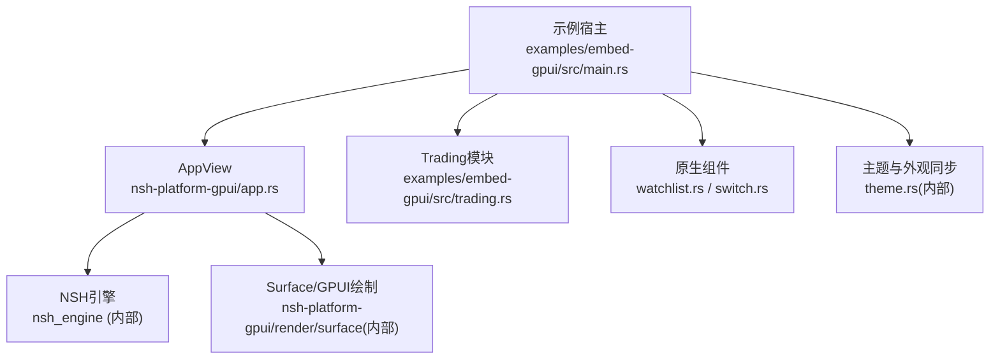
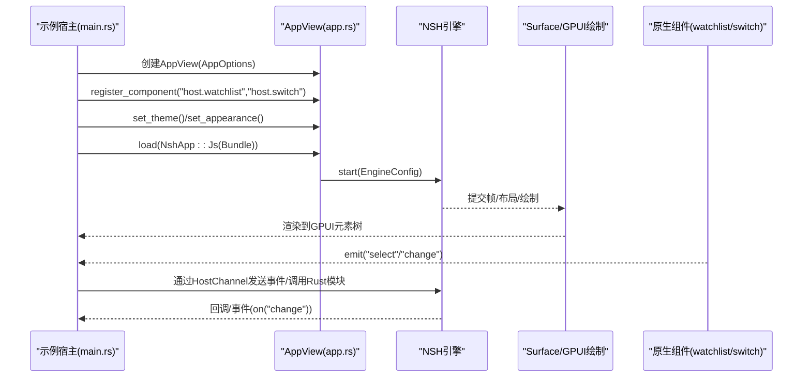
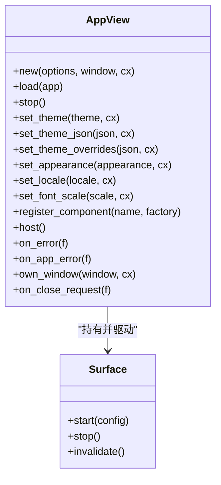
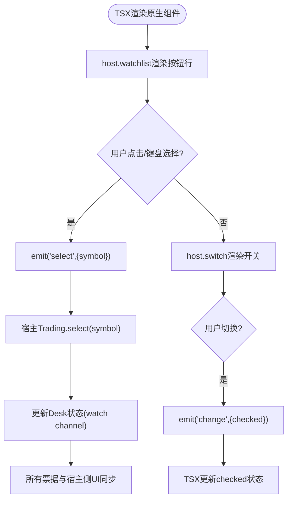
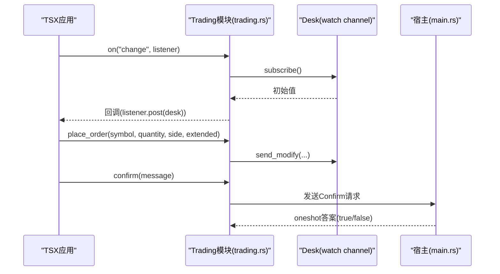
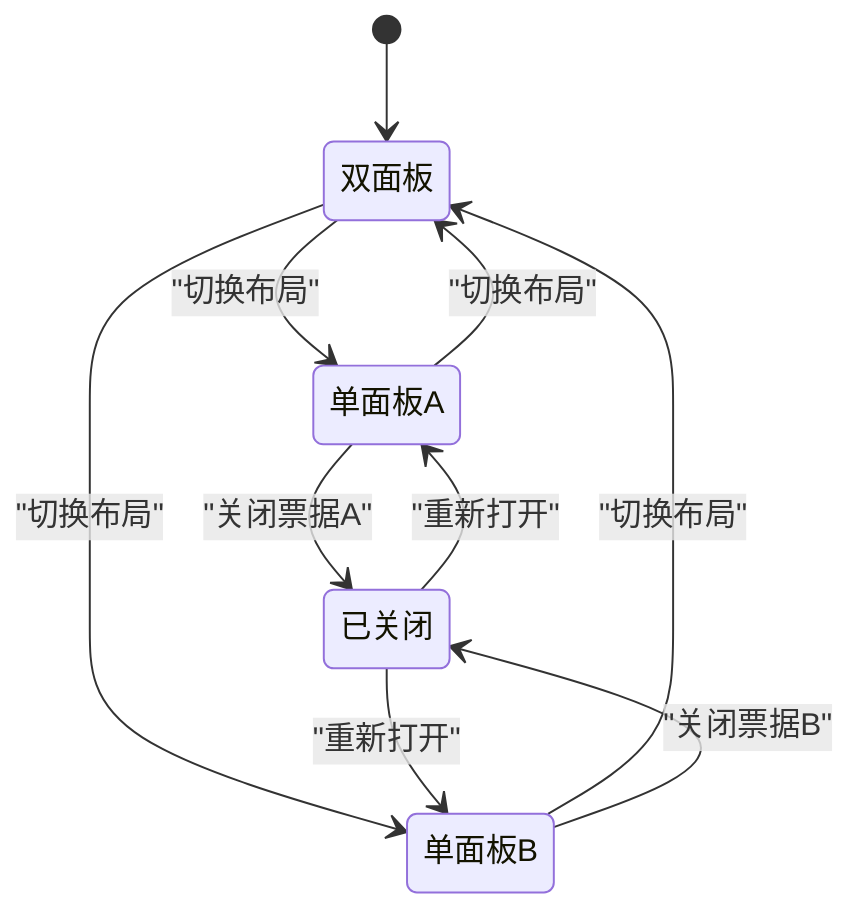
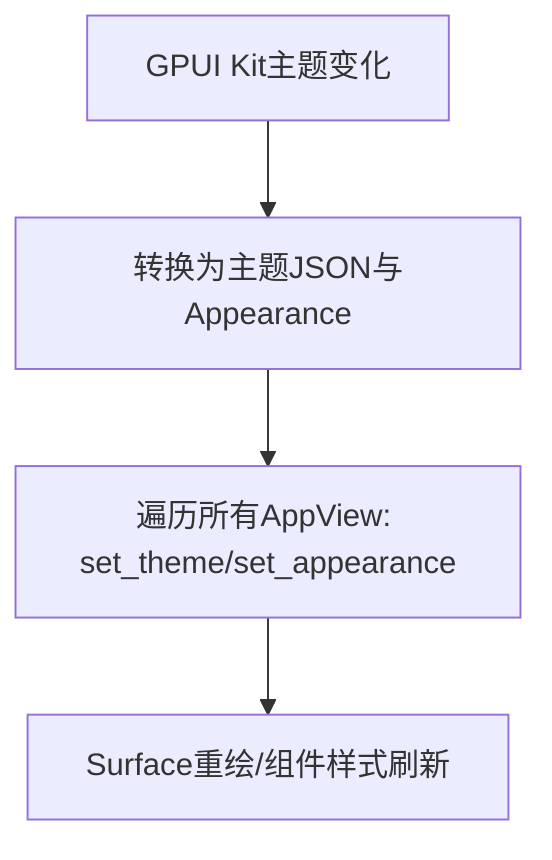
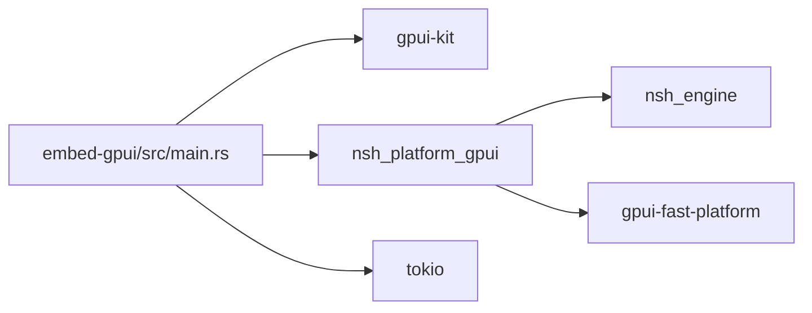

# GPUI集成应用示例

<cite>
**本文引用的文件**   
- [lib.rs](file://crates/gpui/nsh-gpui-host/src/lib.rs)
- [lib.rs](file://crates/gpui/nsh-platform-gpui/src/lib.rs)
- [app.rs](file://crates/gpui/nsh-platform-gpui/src/app.rs)
- [main.rs](file://examples/embed-gpui/src/main.rs)
- [trading.rs](file://examples/embed-gpui/src/trading.rs)
- [watchlist.rs](file://examples/embed-gpui/src/watchlist.rs)
- [switch.rs](file://examples/embed-gpui/src/switch.rs)
- [README.md](file://examples/embed-gpui/README.md)
- [Cargo.toml](file://examples/embed-gpui/Cargo.toml)
</cite>

## 目录
1. [简介](#简介)
2. [项目结构](#项目结构)
3. [核心组件](#核心组件)
4. [架构总览](#架构总览)
5. [详细组件分析](#详细组件分析)
6. [依赖关系分析](#依赖关系分析)
7. [性能与渲染特性](#性能与渲染特性)
8. [故障排查指南](#故障排查指南)
9. [结论](#结论)
10. [附录：金融交易界面案例要点](#附录金融交易界面案例要点)

## 简介
本示例展示如何在GPUI应用中嵌入NSH（nsh）组件，构建混合UI架构：宿主使用GPUI Kit构建原生侧UI，同时在窗口中嵌入多个NSH引擎实例，运行TSX应用。Rust侧通过`nsh_platform_gpui::AppView`将NSH表面作为GPUI视图嵌入；TypeScript侧通过`nativeModule`和`nativeComponent`调用Rust能力、注册并渲染GPUI Kit控件。示例包含实时数据共享、交互式图表（由NSH的plot等组件承载）、多窗口/多面板管理、主题同步、跨语言通信与确认对话框等高级特性。

## 项目结构
- 开发主机：`crates/gpui/nsh-gpui-host`提供命令行入口，支持从开发服务器或打包产物加载NSH应用。
- GPUI后端：`crates/gpui/nsh-platform-gpui`实现NSH在GPUI上的渲染、输入、窗口、主题、原生组件桥接等。
- 示例宿主：`examples/embed-gpui`是一个完整的GPUI Kit应用，演示如何嵌入NSH、共享状态、注册原生组件、弹出对话框与通知。

**图示来源** 
- [main.rs:1-687](file://examples/embed-gpui/src/main.rs#L1-L687)
- [app.rs:1-1252](file://crates/gpui/nsh-platform-gpui/src/app.rs#L1-L1252)
- [trading.rs:1-283](file://examples/embed-gpui/src/trading.rs#L1-L283)
- [watchlist.rs:1-176](file://examples/embed-gpui/src/watchlist.rs#L1-L176)
- [switch.rs:1-148](file://examples/embed-gpui/src/switch.rs#L1-L148)

**章节来源**
- [README.md:1-50](file://examples/embed-gpui/README.md#L1-L50)
- [Cargo.toml:1-41](file://examples/embed-gpui/Cargo.toml#L1-L41)

## 核心组件
- `nsh-gpui-host`：开发主机，解析命令行参数，选择从开发服务器或本地包加载NSH应用，启动GPUI窗口并运行应用。
- `nsh-platform-gpui`：NSH在GPUI上的后端，提供`AppView`（可嵌入任意GPUI树中的NSH表面）、主题/外观注入、原生组件注册、输入/滚动/IME、窗口管理等。
- `examples/embed-gpui`：示例宿主，使用GPUI Kit构建侧边栏、工具栏、可分割面板，并在每个面板中运行一个NSH引擎实例；通过`set_ui_sets`暴露Rust模块给JS；通过`AppView::register_component`将GPUI Kit控件以原生组件形式嵌入NSH页面。

关键API与职责：
- `AppOptions`：配置应用源、资源基路径、应用ID、标题、尺寸、组件集、外观、FPS统计、限制、缓存、存储、上下文、宿主通道、透明背景、窗口托管、后台模式、显示位置等。
- `AppView`：创建/加载/停止NSH应用；设置主题、外观、字体缩放、错误回调；注册原生组件；接管Tab焦点；处理拖放；与宿主进行事件/命令双向通信。
- `run_app`/`open_app_window`：打开独立窗口或嵌入到现有GPUI窗口。
- `set_ui_sets`：为所有引擎提供UI集合（默认包含`nsh/base`核心部分），宿主可追加自定义模块（如`host/trading`）。

**章节来源**
- [lib.rs:1-123](file://crates/gpui/nsh-gpui-host/src/lib.rs#L1-L123)
- [lib.rs:1-96](file://crates/gpui/nsh-platform-gpui/src/lib.rs#L1-L96)
- [app.rs:123-205](file://crates/gpui/nsh-platform-gpui/src/app.rs#L123-L205)
- [app.rs:287-351](file://crates/gpui/nsh-platform-gpui/src/app.rs#L287-L351)
- [app.rs:402-455](file://crates/gpui/nsh-platform-gpui/src/app.rs#L402-L455)
- [app.rs:546-625](file://crates/gpui/nsh-platform-gpui/src/app.rs#L546-L625)
- [app.rs:984-1086](file://crates/gpui/nsh-platform-gpui/src/app.rs#L984-L1086)
- [app.rs:1211-1252](file://crates/gpui/nsh-platform-gpui/src/app.rs#L1211-L1252)

## 架构总览
下图展示了宿主、NSH引擎、GPUI绘制层以及原生组件之间的交互关系。

**图示来源**
- [main.rs:582-618](file://examples/embed-gpui/src/main.rs#L582-L618)
- [app.rs:353-421](file://crates/gpui/nsh-platform-gpui/src/app.rs#L353-L421)
- [app.rs:904-957](file://crates/gpui/nsh-platform-gpui/src/app.rs#L904-L957)
- [watchlist.rs:43-137](file://examples/embed-gpui/src/watchlist.rs#L43-L137)
- [switch.rs:43-132](file://examples/embed-gpui/src/switch.rs#L43-L132)

## 详细组件分析

### Rust侧GPUI集成（AppView与生命周期）
- 生命周期：`AppView::new`初始化环境、绑定键盘、创建`Surface`、设置外观/透明、注册系统监听；`load`构造`EngineConfig`并启动引擎；`stop`/Drop停止引擎。
- 主题与外观：`set_theme`/`set_theme_json`/`set_theme_overrides`/`set_appearance`/`set_font_scale`/`set_locale`即时生效，影响当前运行与后续加载的应用。
- 输入与焦点：实现`Focusable`与`EntityInputHandler`，将文本输入、IME、选择范围等转发到NSH；Tab/Shift+Tab在宿主与NSH之间无缝切换。
- 窗口与Chrome：`own_window`接管关闭请求、菜单键、全屏/最大化等；`render`将Surface包装进GPUI元素树，叠加开发调试覆盖层。
- 错误与监控：`on_error`/`on_app_error`统一上报；`set_fps_monitor`输出帧统计。

**图示来源**
- [app.rs:353-421](file://crates/gpui/nsh-platform-gpui/src/app.rs#L353-L421)
- [app.rs:546-625](file://crates/gpui/nsh-platform-gpui/src/app.rs#L546-L625)
- [app.rs:904-957](file://crates/gpui/nsh-platform-gpui/src/app.rs#L904-L957)

**章节来源**
- [app.rs:353-421](file://crates/gpui/nsh-platform-gpui/src/app.rs#L353-L421)
- [app.rs:546-625](file://crates/gpui/nsh-platform-gpui/src/app.rs#L546-L625)
- [app.rs:904-957](file://crates/gpui/nsh-platform-gpui/src/app.rs#L904-L957)

### TypeScript侧UI组件与原生组件
- 原生组件注册：宿主通过`AppView::register_component`将`host.watchlist`与`host.switch`注册为原生组件，TSX侧用`nativeComponent`声明并使用。
- 组件行为：
  - `host.watchlist`：展示可选标的列表，点击或键盘导航触发`select`事件，调用Rust的`Trading.select`，更新全局桌面状态。
  - `host.switch`：展示“延长交易时段”开关，受控于TSX的`checked`属性，变化时通过`onChange`回传状态。
- 交互细节：组件维护自身焦点句柄，响应鼠标/键盘事件，向NSH报告尺寸，确保Tab顺序与宿主一致。

**图示来源**
- [watchlist.rs:43-137](file://examples/embed-gpui/src/watchlist.rs#L43-L137)
- [switch.rs:43-132](file://examples/embed-gpui/src/switch.rs#L43-L132)
- [trading.rs:121-132](file://examples/embed-gpui/src/trading.rs#L121-L132)

**章节来源**
- [watchlist.rs:1-176](file://examples/embed-gpui/src/watchlist.rs#L1-L176)
- [switch.rs:1-148](file://examples/embed-gpui/src/switch.rs#L1-L148)

### 跨语言通信机制（Rust模块与事件）
- 模块暴露：宿主通过`set_ui_sets([nsh_base::registry(), trading::registry()])`将`host/trading`模块暴露给所有NSH引擎。
- 模块接口：`quote`、`select`、`place_order`、`confirm`、`on("change", listener)`。
- 事件流：`Trading.on("change", …)`订阅`tokio::sync::watch`通道，初始推送当前状态，之后每次变更都回调JS；返回`Stop`函数用于取消订阅。
- 确认对话框：`Trading.confirm`异步等待宿主弹窗结果，未配置宿主时默认同意。

**图示来源**
- [trading.rs:179-245](file://examples/embed-gpui/src/trading.rs#L179-L245)
- [trading.rs:247-252](file://examples/embed-gpui/src/trading.rs#L247-L252)
- [main.rs:635-640](file://examples/embed-gpui/src/main.rs#L635-L640)

**章节来源**
- [trading.rs:1-283](file://examples/embed-gpui/src/trading.rs#L1-L283)
- [main.rs:635-640](file://examples/embed-gpui/src/main.rs#L635-L640)

### 多窗口与多面板管理
- 宿主使用GPUI Kit的可分割面板(`h_resizable`)展示两个票据面板，每个面板包含一个`AppView`实例，各自运行独立的NSH引擎。
- 关闭面板即释放`AppView`，引擎随之停止；重新打开则重建视图并加载新引擎。
- 工具栏提供“显示图层”、“主题切换”、“Violet主题”、“对话框/通知”等功能，均作用于宿主与所有票据。

**图示来源**
- [main.rs:191-236](file://examples/embed-gpui/src/main.rs#L191-L236)
- [main.rs:301-373](file://examples/embed-gpui/src/main.rs#L301-L373)
- [main.rs:505-549](file://examples/embed-gpui/src/main.rs#L505-L549)

**章节来源**
- [main.rs:191-236](file://examples/embed-gpui/src/main.rs#L191-L236)
- [main.rs:301-373](file://examples/embed-gpui/src/main.rs#L301-L373)
- [main.rs:505-549](file://examples/embed-gpui/src/main.rs#L505-L549)

### 主题与外观同步
- 宿主监听GPUI Kit主题变化，将`Theme`转换为NSH主题JSON并通过`view.set_theme`下发；同时通过`view.set_appearance`同步明暗模式。
- NSH侧组件与Surface背景按主题重绘，保证视觉一致性。

**图示来源**
- [main.rs:170-180](file://examples/embed-gpui/src/main.rs#L170-L180)
- [app.rs:546-598](file://crates/gpui/nsh-platform-gpui/src/app.rs#L546-L598)

**章节来源**
- [main.rs:170-180](file://examples/embed-gpui/src/main.rs#L170-L180)
- [app.rs:546-598](file://crates/gpui/nsh-platform-gpui/src/app.rs#L546-L598)

## 依赖关系分析
- 示例宿主依赖：
  - `gpui_kit`：构建宿主UI（侧边栏、按钮、输入、可分割面板、主题系统等）。
  - `nsh_platform_gpui`：提供`AppView`、`AppOptions`、`Bundle`、`AssetBase`等。
  - `nsh-base`、`nsh-core`：提供UI集合注册与基础类型。
  - `tokio`：用于`watch`通道与异步通信。
- 运行时依赖：
  - `nsh_engine`：引擎执行、包加载、策略与限制、缓存等。
  - `gpui-fast-platform`：GPUI平台后端（字体、X11/Wayland等）。

**图示来源**
- [Cargo.toml:15-35](file://examples/embed-gpui/Cargo.toml#L15-L35)
- [lib.rs:1-96](file://crates/gpui/nsh-platform-gpui/src/lib.rs#L1-L96)

**章节来源**
- [Cargo.toml:1-41](file://examples/embed-gpui/Cargo.toml#L1-L41)
- [lib.rs:1-96](file://crates/gpui/nsh-platform-gpui/src/lib.rs#L1-L96)

## 性能与渲染特性
- 渲染管线：每个NSH节点对应一个`NshView`，Surface作为单个GPUI元素绘制整棵树（阴影、背景、内容、子项、边框、宿主项）。
- 线程模型：引擎运行在独立线程，提交闭包到GPUI主线程执行；文本整形在引擎线程完成，主线程绘制字形。
- 动画与帧率：原生动画与JS帧请求在窗口帧上tick；未聚焦窗口默认30fps，示例显式设置`inactive_frame_interval: None`以避免动画降速。
- FPS统计：可通过`AppOptions.fps`或`set_fps_monitor`开启每秒帧统计日志。

**章节来源**
- [lib.rs:1-24](file://crates/gpui/nsh-platform-gpui/src/lib.rs#L1-L24)
- [app.rs:904-957](file://crates/gpui/nsh-platform-gpui/src/app.rs#L904-L957)
- [main.rs:657-668](file://examples/embed-gpui/src/main.rs#L657-L668)

## 故障排查指南
- 无法读取打包产物：检查`Bundle::read_trusted`路径与权限；示例在加载失败时记录错误并跳过。
- 主题/外观不生效：确认`set_theme`/`set_appearance`在`load`前调用；确保主题JSON格式正确。
- 原生组件无响应：确认已通过`register_component`注册且名称与TSX侧`nativeComponent`一致；检查组件是否设置了尺寸与焦点句柄。
- 跨语言事件未触发：确认`set_ui_sets`已包含目标模块；检查`Trading.on("change", …)`是否正确订阅与取消。
- 窗口行为异常：检查`WindowOptions`（如`inactive_frame_interval`、`show`、`display_id`）与`AppOptions.background`设置。

**章节来源**
- [main.rs:582-618](file://examples/embed-gpui/src/main.rs#L582-L618)
- [app.rs:984-1086](file://crates/gpui/nsh-platform-gpui/src/app.rs#L984-L1086)
- [trading.rs:222-245](file://examples/embed-gpui/src/trading.rs#L222-L245)

## 结论
该示例完整展示了在GPUI应用中嵌入NSH组件的混合UI架构：Rust侧通过`AppView`与`AppOptions`管理NSH引擎的生命周期、主题与输入；TypeScript侧通过`nativeModule`与`nativeComponent`与Rust能力互通；示例还演示了多面板管理、实时数据共享、主题同步与跨语言确认对话框等高级特性。借助此模式，可在同一窗口内融合高性能原生UI与丰富的Web生态组件，满足复杂业务场景（如金融交易界面）的需求。

## 附录：金融交易界面案例要点
- 实时数据展示：通过`Trading.on("change", …)`订阅`Desk`状态，票据与宿主侧UI同步更新。
- 交互式图表：由NSH的plot等组件承载，随主题与外观变化自动重绘。
- 多窗口管理：宿主侧使用可分割面板管理多个票据面板，支持切换与关闭。
- 跨语言通信：Rust模块提供报价、下单、确认等能力；TSX侧通过事件与回调与Rust协作。
- 主题与外观：宿主主题变化时，自动下发至所有NSH表面，保持视觉一致。

**章节来源**
- [README.md:1-50](file://examples/embed-gpui/README.md#L1-L50)
- [trading.rs:1-283](file://examples/embed-gpui/src/trading.rs#L1-L283)
- [main.rs:1-687](file://examples/embed-gpui/src/main.rs#L1-L687)