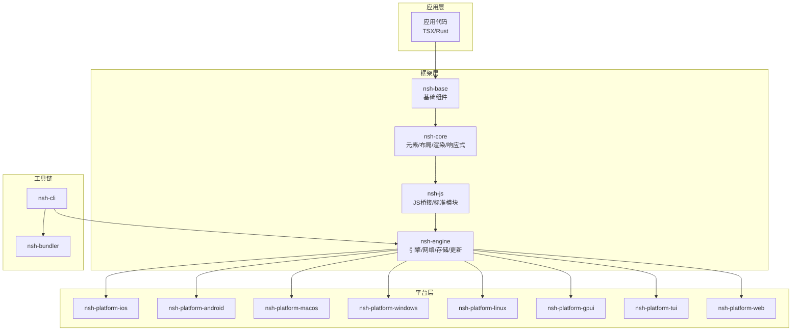
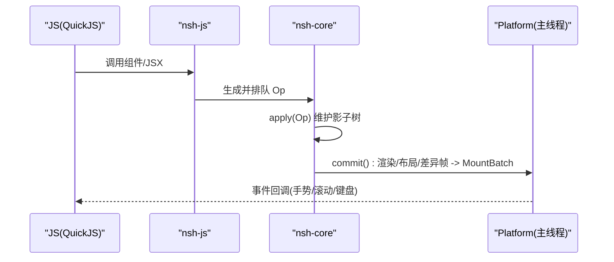
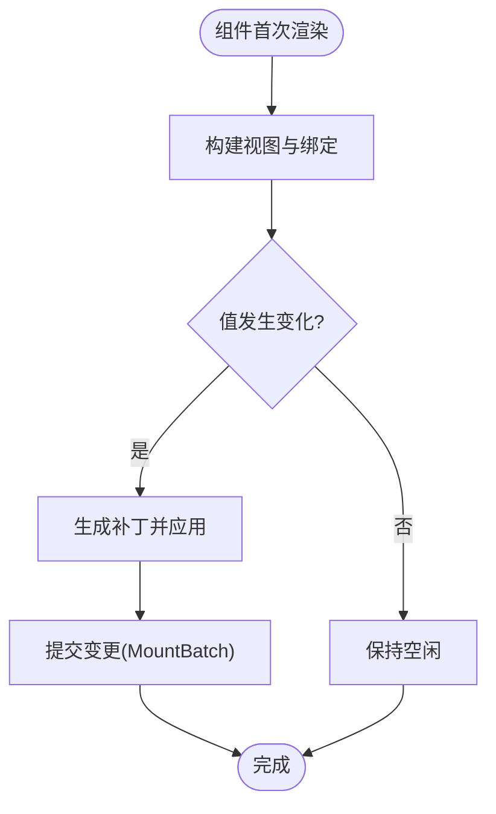
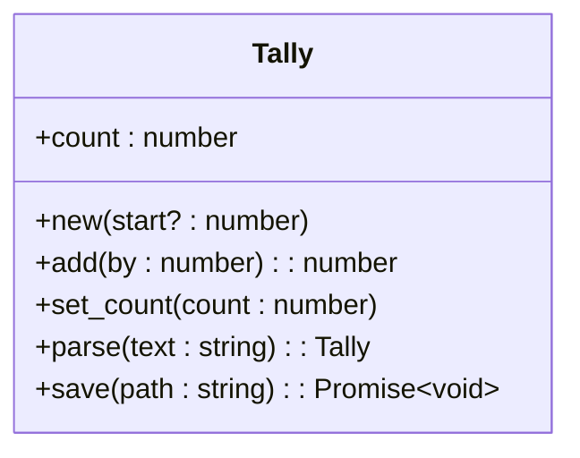
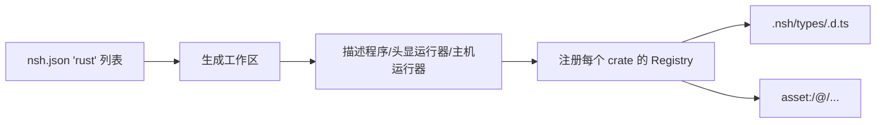
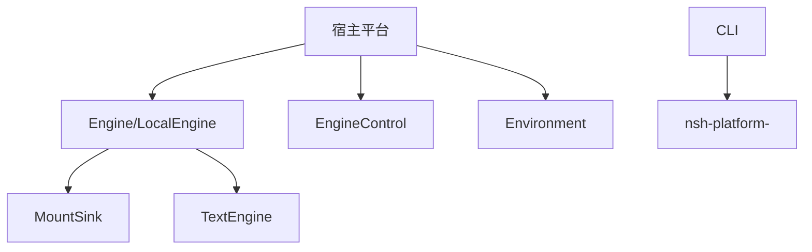
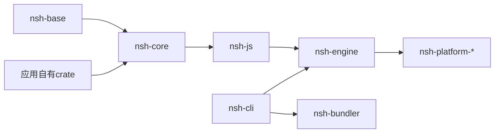

# 企业级应用开发模式

<cite>
**本文引用的文件**   
- [README.md](file://README.md)
- [Cargo.toml](file://Cargo.toml)
- [architecture.md](file://docs/dev/architecture.md)
- [engineering.md](file://docs/dev/engineering.md)
- [performance.md](file://docs/dev/performance.md)
- [platforms.md](file://docs/dev/platforms.md)
- [reactive-components.md](file://docs/dev/reactive-components.md)
- [components.md](file://docs/dev/components.md)
- [rust-modules.md](file://docs/dev/rust-modules.md)
- [rust-classes.md](file://docs/dev/rust-classes.md)
</cite>

## 目录
1. [引言](#引言)
2. [项目结构](#项目结构)
3. [核心组件](#核心组件)
4. [架构总览](#架构总览)
5. [详细组件分析](#详细组件分析)
6. [依赖关系分析](#依赖关系分析)
7. [性能考量](#性能考量)
8. [故障排查指南](#故障排查指南)
9. [结论](#结论)
10. [附录](#附录)

## 引言
本文件面向在企业级场景中使用 NSH（Native Shell）构建大型应用的团队，总结在 NSH 中构建大型应用的架构模式与最佳实践。内容覆盖：
- 项目结构组织与分层设计
- 状态管理与响应式模型
- 错误处理机制与可观测性
- 日志记录方案与调试策略
- 跨平台适配与扩展点
- 性能优化与基准验证
- 从简单应用到复杂企业系统的演进路径与实践指导

NSH 以 Rust 为核心，提供 iOS、Android、macOS、Windows、Linux、GPUI、终端与 Web 的统一 UI 框架；TSX 与 Rust 混合开发，共享响应式引擎、布局与 API，并通过平台后端渲染原生视图或 HTML。

**章节来源**
- [README.md:1-60](file://README.md#L1-L60)

## 项目结构
仓库采用多 crate 的 Cargo workspace 组织，核心能力按职责拆分：
- nsh-core：基础元素、环境、布局、渲染、响应式图
- nsh-js：JS 运行时桥接与标准模块
- nsh-engine：应用引擎、网络、存储、更新等
- nsh-base：无样式的基础组件库（行为、状态、焦点、键盘、无障碍）
- nsh-platform-*：各平台后端（iOS/Android/macOS/Windows/Linux/GPUI/Terminal/Web）
- nsh-cli：统一命令行工具（dev/run/test/package）
- nsh-bundler：打包与编译管线
- 示例与应用：examples/* 与 website/*

**图表来源**
- [Cargo.toml:1-10](file://Cargo.toml#L1-L10)
- [Cargo.toml:37-56](file://Cargo.toml#L37-L56)

**章节来源**
- [Cargo.toml:1-10](file://Cargo.toml#L1-L10)
- [Cargo.toml:37-56](file://Cargo.toml#L37-L56)

## 核心组件
- 响应式系统：Rust 与 TSX 共用同一套信号、计算值、副作用与所有权模型，确保“一次渲染，细粒度绑定”的性能特性。
- 元素与样式：typed styles（GPUI 风格），Tailwind 类映射到类型化声明，主题 token 驱动外观。
- 组件体系：nsh-base 提供无样式基础组件；应用自有 styled 层基于 nsh/base 组合。
- 运行时模块：nsh 标准模块（键盘、图像、剪贴板、存储、可访问性等）通过 #[module] 暴露给 TSX。
- 类与函数：#[class] 导出可在 TS 中作为类使用的 Rust 类型，支持同步成员与异步任务。

**章节来源**
- [reactive-components.md:1-55](file://docs/dev/reactive-components.md#L1-L55)
- [components.md:1-120](file://docs/dev/components.md#L1-L120)
- [rust-classes.md:1-63](file://docs/dev/rust-classes.md#L1-L63)

## 架构总览
NSH 的分层与线程模型强调：
- 数据流：JS（QuickJS）→ nsh-js → nsh-core（Op 队列）→ Platform（主线程挂载）
- 输入：原生手势 → EngineControl::dispatch_event → 引擎线程 → JS 处理器
- 文本排版：引擎线程准备与测量，主线程仅绘制
- 每个 Surface/NshView 对应一个引擎实例，避免全局单例，便于嵌入多个实例

**图表来源**
- [architecture.md:3-20](file://docs/dev/architecture.md#L3-L20)

**章节来源**
- [architecture.md:3-20](file://docs/dev/architecture.md#L3-L20)

## 详细组件分析

### 响应式 Rust 组件
- 组件体只运行一次，变化通过绑定（闭包/信号）触发最小更新
- Props 为 Prop<T>，事件为枚举，方法通过 #[methods] 暴露
- 控制流：when/dynamic/each/catch_error 与 TSX 语义一致
- 列表行保持引用，移动时仅更新 index 绑定，减少重排

**图表来源**
- [reactive-components.md:32-55](file://docs/dev/reactive-components.md#L32-L55)
- [components.md:120-230](file://docs/dev/components.md#L120-L230)

**章节来源**
- [reactive-components.md:32-55](file://docs/dev/reactive-components.md#L32-L55)
- [components.md:120-230](file://docs/dev/components.md#L120-L230)

### 类与函数（Rust 导出到 TS）
- 同步成员在 JS 调用栈内执行，返回即时值
- 异步成员作为核心任务运行，返回 Promise
- 回调通过 Callback<A,R> 传递，支持 call/post/call_async
- 实例由 JS 对象持有，生命周期与 GC 联动

**图表来源**
- [rust-classes.md:13-63](file://docs/dev/rust-classes.md#L13-L63)

**章节来源**
- [rust-classes.md:94-135](file://docs/dev/rust-classes.md#L94-L135)
- [rust-classes.md:258-336](file://docs/dev/rust-classes.md#L258-L336)

### 多 crate Rust 应用
- nsh.json 的 "rust" 支持 crate 列表，每个 crate 独立导出到 TS
- 生成的工作区链接所有 crate，并为每个 specifier 生成 .d.ts 与资源
- 开发时监听所有列出的 crate 及其 path 依赖

**图表来源**
- [rust-modules.md:11-43](file://docs/dev/rust-modules.md#L11-L43)

**章节来源**
- [rust-modules.md:1-43](file://docs/dev/rust-modules.md#L1-L43)

### 平台扩展点
- 引擎：Engine/LocalEngine 启动应用，Surface 与 Engine 一一对应
- 挂载批次：MountSink::submit 接收 MountBatch，平台按序应用
- 文本：TextEngine 在引擎侧 prepare/measure/layout，平台负责绘制
- 输入与环境：EngineControl 发送事件/滚动/尺寸/环境变化
- 命令行外部目标：nsh --target <name> 调用 nsh-platform-<name>

**图表来源**
- [platforms.md:11-26](file://docs/dev/platforms.md#L11-L26)
- [platforms.md:28-78](file://docs/dev/platforms.md#L28-L78)
- [platforms.md:79-121](file://docs/dev/platforms.md#L79-L121)
- [platforms.md:138-158](file://docs/dev/platforms.md#L138-L158)

**章节来源**
- [platforms.md:11-121](file://docs/dev/platforms.md#L11-L121)
- [platforms.md:138-158](file://docs/dev/platforms.md#L138-L158)

## 依赖关系分析
- 依赖方向：nsh-core ← nsh-js ← nsh-engine ← nsh-platform-* ← 宿主/应用
- nsh-base 仅依赖 nsh-core，被 bundler、平台与 CLI 使用
- 应用自有 crate 仅依赖 nsh-core，避免耦合平台与 JS
- 顶层 Cargo.toml 集中管理依赖版本与 profile 优化

**图表来源**
- [Cargo.toml:37-56](file://Cargo.toml#L37-L56)
- [Cargo.toml:615-678](file://Cargo.toml#L615-L678)

**章节来源**
- [Cargo.toml:37-56](file://Cargo.toml#L37-L56)
- [Cargo.toml:615-678](file://Cargo.toml#L615-L678)

## 性能考量
- 首帧与交互延迟：通过细粒度绑定与区域清理降低重排成本
- 长列表与大数据：虚拟列表、行保留、增量解析与缓存显著改善
- 文本与 Markdown：增量解析、流式修复、定义解析优化
- 动画与帧：平台动画走原生帧时钟，避免主线程等待 JS
- 发布配置：release LTO、codegen-units=1，web profile 体积优先

建议实践：
- 使用 when/dynamic/each 控制结构，避免整棵子树重建
- 将频繁更新的值拆分为小信号，减少无关绑定
- 对大文档使用 TextView 的 streaming 与增量解析
- 使用 release 构建与 web profile 进行体积优化
- 用 nsh test --trace 与 headless 基准验证改动影响

**章节来源**
- [performance.md:1-118](file://docs/dev/performance.md#L1-L118)
- [performance.md:251-357](file://docs/dev/performance.md#L251-L357)
- [performance.md:406-544](file://docs/dev/performance.md#L406-L544)
- [performance.md:609-680](file://docs/dev/performance.md#L609-L680)
- [Cargo.toml:615-678](file://Cargo.toml#L615-L678)

## 故障排查指南
- 错误处理规范：
  - 异步调用从不抛出，失败一律 reject；同步调用对误用抛出 TypeError/RangeError
  - 稳定错误码（ERR_ACCESS_DENIED、ERR_FEATURE_UNAVAILABLE_ON_PLATFORM、ETIMEDOUT 等）
  - 命令型方法（如 scrollToRow/fold）对未知 id/index 静默告警，不抛异常
- 日志与可观测性：
  - 库 crate 通过 log facade 输出，性能日志 target=nsh::perf，JS 日志 target=js
  - CLI 通过 ui.rs 打印步骤、捕获工具输出与 error 报告
- 调试与测试：
  - 使用 nsh test --trace 与 headless 流程复现问题
  - 手动时钟与 flush 用于确定性测试与 idle 检测

**章节来源**
- [engineering.md:119-167](file://docs/dev/engineering.md#L119-L167)
- [engineering.md:195-201](file://docs/dev/engineering.md#L195-L201)
- [reactive-components.md:266-289](file://docs/dev/reactive-components.md#L266-L289)

## 结论
NSH 为企业级应用提供了清晰的分层架构、统一的响应式模型与跨平台扩展点。通过 nsh-core/nsh-base 的强约束与 nsh-engine 的平台抽象，团队可以在保证性能与可维护性的前提下，逐步从简单应用演进到复杂企业系统。结合严格的错误处理、日志与测试基线，以及多 crate 的组织方式，能够支撑大规模协作与长期演进。

## 附录

### 从简单应用到企业系统的演进路径
- 起步阶段：
  - 使用 TSX 模板快速搭建页面，利用 nsh/base 基础组件
  - 通过 signal/computed/effect 管理状态，避免整树重建
- 中型应用：
  - 引入 Rust 组件与 #[module]/#[class] 复用逻辑
  - 拆分 nsh.json "rust" 列表，按领域划分 crate
  - 建立单元测试与 headless 回归用例
- 大型企业系统：
  - 自定义平台扩展（External targets）与 Host Services
  - 制定错误码与日志规范，接入性能监控
  - 使用 release/web profile 优化体积与启动时间
  - 通过 nsh test --trace 持续验证关键路径

**章节来源**
- [rust-modules.md:1-43](file://docs/dev/rust-modules.md#L1-L43)
- [platforms.md:138-158](file://docs/dev/platforms.md#L138-L158)
- [performance.md:609-680](file://docs/dev/performance.md#L609-L680)