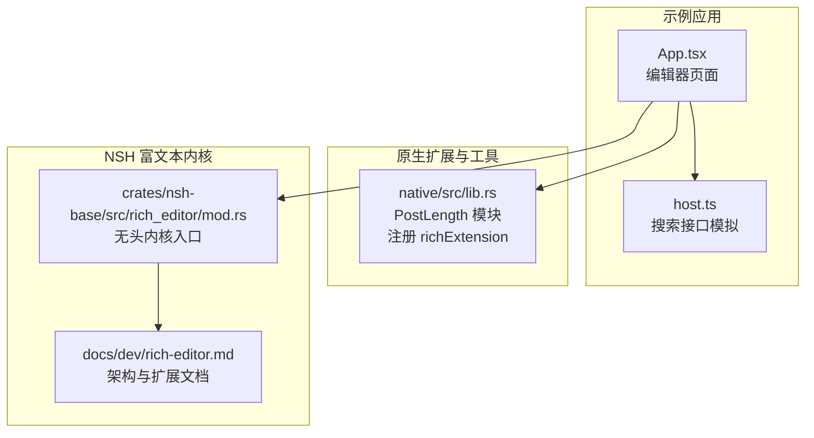
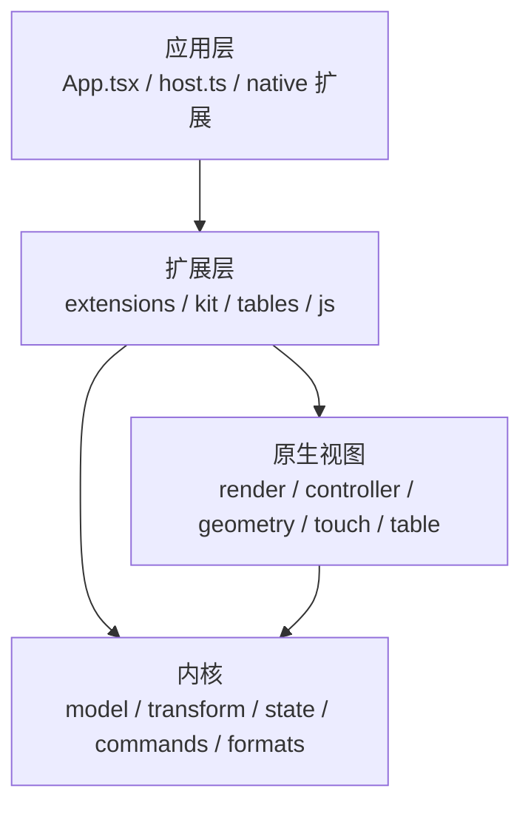
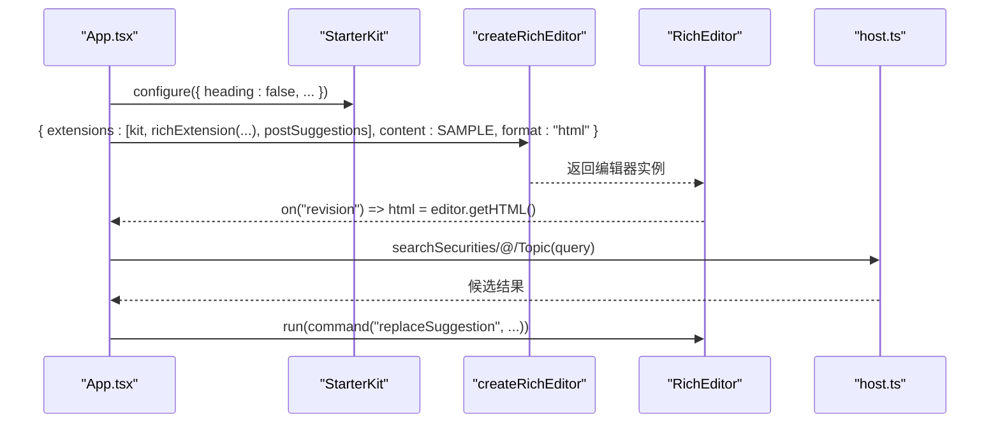
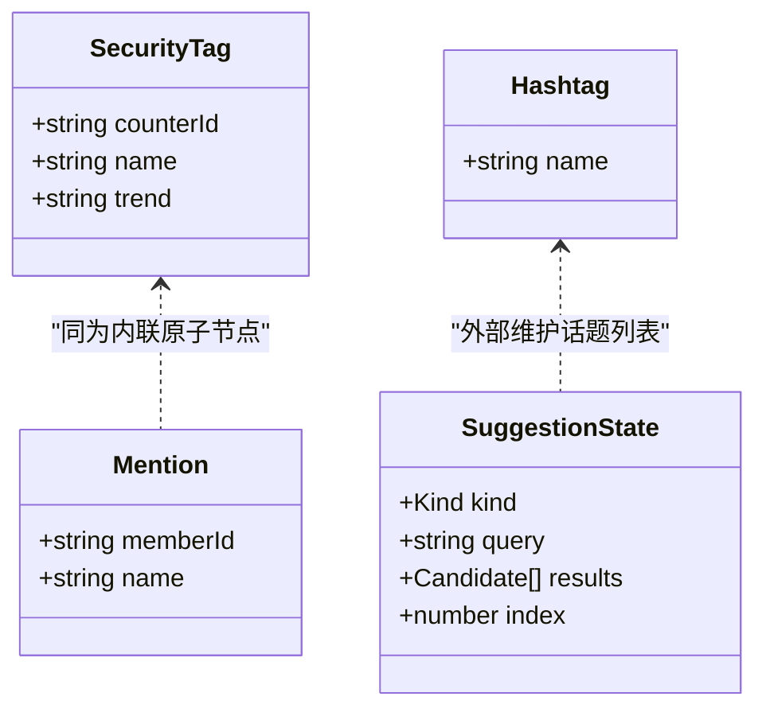
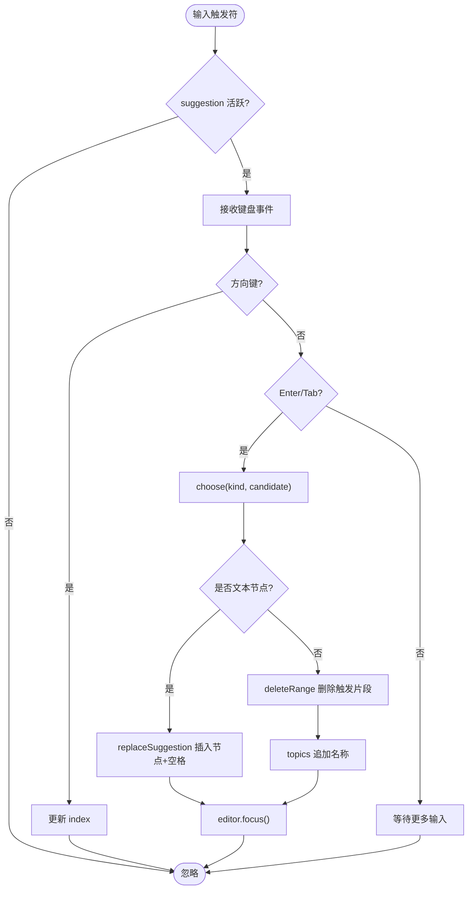
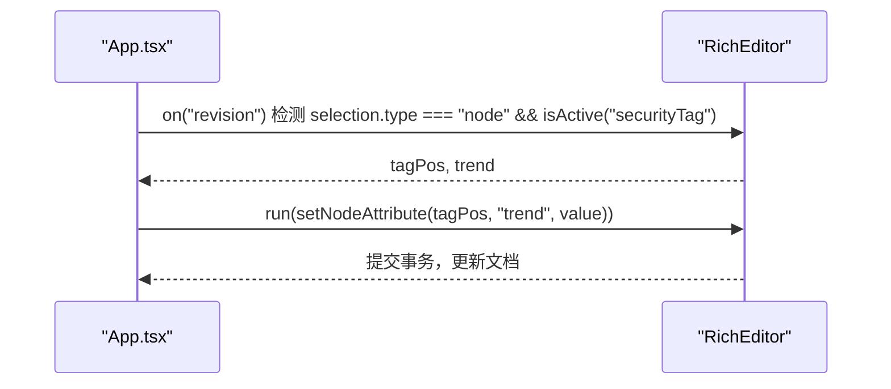
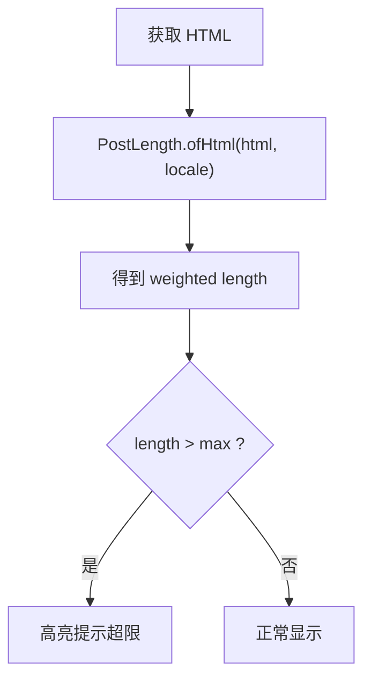
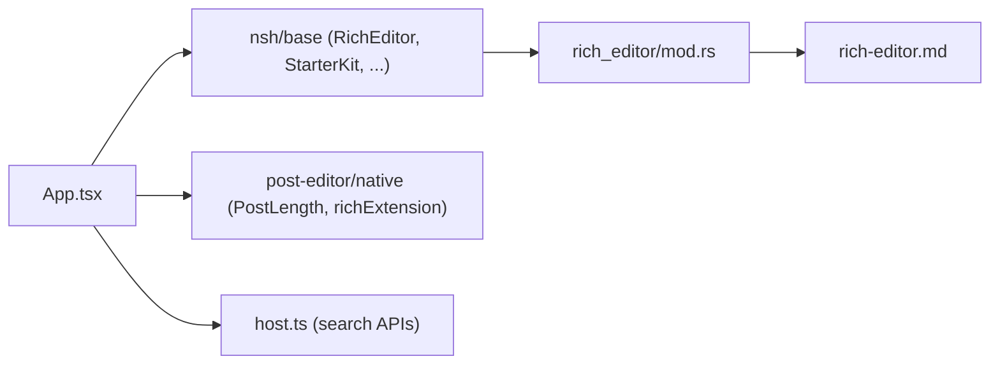

# 富文本编辑器应用示例

<cite>
**本文引用的文件**   
- [App.tsx](file://examples/post-editor/App.tsx)
- [host.ts](file://examples/post-editor/host.ts)
- [lib.rs](file://examples/post-editor/native/src/lib.rs)
- [rich-editor.md](file://docs/dev/rich-editor.md)
- [mod.rs](file://crates/nsh-base/src/rich_editor/mod.rs)
</cite>

## 目录
1. [简介](#简介)
2. [项目结构](#项目结构)
3. [核心组件](#核心组件)
4. [架构总览](#架构总览)
5. [详细组件分析](#详细组件分析)
6. [依赖关系分析](#依赖关系分析)
7. [性能与优化](#性能与优化)
8. [故障排查](#故障排查)
9. [结论](#结论)
10. [附录：API 与扩展清单](#附录api-与扩展清单)

## 简介
本示例展示如何基于 NSH 的 RichEditor 构建一个面向博客/短帖的富文本编辑器。它演示了以下能力：
- 使用 StarterKit 裁剪默认功能，聚焦段落、内联标记和自定义节点
- 通过 richExtension 注册原生扩展（股票标签、用户提及、话题标签）
- 实现“@/$/#”触发式建议菜单，并与宿主搜索 API 交互
- 将编辑器内容以 HTML 格式与后端交换，并支持读回编辑
- 通过 Rust 原生模块 PostLength 计算带权重的字符长度，满足服务端校验规则
- 利用 bubbleMenu 为选中节点提供上下文菜单（如股票趋势选择）

该示例同时体现了 NSH 富文本编辑器的“无头内核 + 原生视图 + Tiptap 风格扩展层”的设计，以及 JS 描述行为、Rust 执行逻辑的混合模式。

## 项目结构
示例位于 examples/post-editor，包含前端 TSX 页面、宿主搜索模拟、以及 Rust 原生扩展与工具模块。

图表来源
- [App.tsx:1-333](file://examples/post-editor/App.tsx#L1-L333)
- [host.ts:1-50](file://examples/post-editor/host.ts#L1-L50)
- [lib.rs:1-61](file://examples/post-editor/native/src/lib.rs#L1-L61)
- [mod.rs:1-35](file://crates/nsh-base/src/rich_editor/mod.rs#L1-L35)
- [rich-editor.md:1-533](file://docs/dev/rich-editor.md#L1-L533)

章节来源
- [App.tsx:1-333](file://examples/post-editor/App.tsx#L1-L333)
- [host.ts:1-50](file://examples/post-editor/host.ts#L1-L50)
- [lib.rs:1-61](file://examples/post-editor/native/src/lib.rs#L1-L61)
- [mod.rs:1-35](file://crates/nsh-base/src/rich_editor/mod.rs#L1-L35)
- [rich-editor.md:1-533](file://docs/dev/rich-editor.md#L1-L533)

## 核心组件
- RichEditor 与 createRichEditor：创建编辑器会话、管理状态、命令、插件与事件
- StarterKit 配置：按需关闭不需要的块级与内联能力，减少渲染与处理开销
- richExtension：注册自定义节点类型（securityTag、mention、hashtag）与建议插件（postSuggestions）
- 宿主 host：提供股票、成员、话题的候选数据查询接口
- PostLength：Rust 原生模块，提供带权重长度的计算与截断能力，用于满足服务端限制

章节来源
- [App.tsx:67-117](file://examples/post-editor/App.tsx#L67-L117)
- [App.tsx:111-117](file://examples/post-editor/App.tsx#L111-L117)
- [App.tsx:114-117](file://examples/post-editor/App.tsx#L114-L117)
- [host.ts:44-49](file://examples/post-editor/host.ts#L44-L49)
- [lib.rs:20-49](file://examples/post-editor/native/src/lib.rs#L20-L49)

## 架构总览
NSH 富文本编辑器采用三层设计：
- 无头内核（ProseMirror 风格）：定义文档模型、步骤与事务、不可变状态、命令与插件
- 原生视图（GPUI 驱动）：负责渲染、输入、IME、几何测量、表格与气泡菜单等
- 扩展层（Tiptap 风格）：以 Extension 为单位组合 schema、命令、快捷键、输入规则与插件；JS 描述，Rust 执行

图表来源
- [mod.rs:1-35](file://crates/nsh-base/src/rich_editor/mod.rs#L1-L35)
- [rich-editor.md:16-26](file://docs/dev/rich-editor.md#L16-L26)
- [rich-editor.md:121-285](file://docs/dev/rich-editor.md#L121-L285)
- [rich-editor.md:286-410](file://docs/dev/rich-editor.md#L286-L410)

章节来源
- [rich-editor.md:1-15](file://docs/dev/rich-editor.md#L1-L15)
- [rich-editor.md:16-26](file://docs/dev/rich-editor.md#L16-L26)
- [rich-editor.md:121-285](file://docs/dev/rich-editor.md#L121-L285)
- [rich-editor.md:286-410](file://docs/dev/rich-editor.md#L286-L410)

## 详细组件分析

### 编辑器初始化与内容格式
- 使用 StarterKit.configure 关闭标题、引用、列表、图片、链接、样式等能力，使编辑器专注短帖场景
- 通过 createRichEditor 传入 extensions、content 与 format="html"，让编辑器以 HTML 作为存储与读写格式
- 监听 revision 事件同步 getHTML() 输出，并在 suggestion 活跃时联动 UI 显示候选列表

图表来源
- [App.tsx:67-117](file://examples/post-editor/App.tsx#L67-L117)
- [App.tsx:161-191](file://examples/post-editor/App.tsx#L161-L191)
- [host.ts:37-49](file://examples/post-editor/host.ts#L37-L49)

章节来源
- [App.tsx:67-117](file://examples/post-editor/App.tsx#L67-L117)
- [App.tsx:161-191](file://examples/post-editor/App.tsx#L161-L191)

### 自定义节点与扩展机制
- securityTag：插入含 counter_id、name、trend 的内联节点，支持趋势菜单更新属性
- mention：插入 member_id、name 的用户提及节点
- hashtag：作为“话题芯片”，不在正文中保留 # 前缀，而是维护外部 topics 列表
- postSuggestions：建议插件，捕获 @/$/# 触发词，维护活跃建议状态与键盘导航

图表来源
- [App.tsx:31-50](file://examples/post-editor/App.tsx#L31-L50)
- [App.tsx:144-155](file://examples/post-editor/App.tsx#L144-L155)
- [lib.rs:1-18](file://examples/post-editor/native/src/lib.rs#L1-L18)

章节来源
- [App.tsx:31-50](file://examples/post-editor/App.tsx#L31-L50)
- [App.tsx:144-155](file://examples/post-editor/App.tsx#L144-L155)
- [lib.rs:1-18](file://examples/post-editor/native/src/lib.rs#L1-L18)

### 建议菜单与键盘交互流程
- 当 suggestion 活跃时，根据 lastKey 控制上下移动与 Enter/Tab 选择
- 选择后调用 replaceSuggestion 命令替换触发片段为对应节点或删除触发符并追加话题芯片
- 非文本类节点（如 hashtag）不插入节点，而是从文档中移除触发片段，并将名称加入外部 topics

图表来源
- [App.tsx:161-191](file://examples/post-editor/App.tsx#L161-L191)
- [App.tsx:144-155](file://examples/post-editor/App.tsx#L144-L155)

章节来源
- [App.tsx:161-191](file://examples/post-editor/App.tsx#L161-L191)
- [App.tsx:144-155](file://examples/post-editor/App.tsx#L144-L155)

### 气泡菜单与节点属性编辑
- 当光标位于 securityTag 节点时，bubbleMenu 显示趋势菜单
- 通过 setNodeAttribute(pos, "trend", value) 更新节点属性，保持可撤销、可映射的事务语义

图表来源
- [App.tsx:184-198](file://examples/post-editor/App.tsx#L184-L198)

章节来源
- [App.tsx:184-198](file://examples/post-editor/App.tsx#L184-L198)

### 原生能力集成：PostLength 与字数限制
- PostLength.ofHtml(html, locale) 按服务端规则计算 HTML 中的文本权重长度
- PostLength.max(locale) 返回最大允许权重
- 在 UI 中实时显示当前长度与上限，并根据 locale 区分中文与非中文策略

图表来源
- [App.tsx:119-123](file://examples/post-editor/App.tsx#L119-L123)
- [lib.rs:20-49](file://examples/post-editor/native/src/lib.rs#L20-L49)

章节来源
- [App.tsx:119-123](file://examples/post-editor/App.tsx#L119-L123)
- [lib.rs:20-49](file://examples/post-editor/native/src/lib.rs#L20-L49)

### 主题定制与样式
- 通过 classes.content、classes.placeholder、classes.nodes 与 selectedNode 对编辑器内容与选中态进行样式覆盖
- 针对 securityTag[trend=...] 等属性选择器设置不同颜色，体现业务语义

章节来源
- [App.tsx:95-108](file://examples/post-editor/App.tsx#L95-L108)

### 与后端 API 的交互模式
- 示例使用 host.ts 模拟搜索接口，实际项目中应替换为真实后端 API
- 建议在异步回调中检查请求票据（ticket），避免旧请求覆盖新结果
- 将 getHTML() 的输出作为服务器存储的内容，并通过 setContent(html, "html") 读回继续编辑

章节来源
- [host.ts:1-50](file://examples/post-editor/host.ts#L1-L50)
- [App.tsx:132-139](file://examples/post-editor/App.tsx#L132-L139)
- [App.tsx:250-257](file://examples/post-editor/App.tsx#L250-L257)

## 依赖关系分析
- App.tsx 依赖 nsh/base 提供的 RichEditor、StarterKit、command、richExtension、setNodeAttribute 等
- App.tsx 依赖 post-editor/native 暴露的 PostLength 与 richExtension 注册项
- host.ts 提供候选数据，供 App.tsx 在 suggestion 活跃时调用
- 内核 mod.rs 与文档 rich-editor.md 定义了扩展层与视图层的契约

图表来源
- [App.tsx:1-14](file://examples/post-editor/App.tsx#L1-L14)
- [lib.rs:10-18](file://examples/post-editor/native/src/lib.rs#L10-L18)
- [mod.rs:1-35](file://crates/nsh-base/src/rich_editor/mod.rs#L1-L35)
- [rich-editor.md:1-15](file://docs/dev/rich-editor.md#L1-L15)

章节来源
- [App.tsx:1-14](file://examples/post-editor/App.tsx#L1-L14)
- [lib.rs:10-18](file://examples/post-editor/native/src/lib.rs#L10-L18)
- [mod.rs:1-35](file://crates/nsh-base/src/rich_editor/mod.rs#L1-L35)
- [rich-editor.md:1-15](file://docs/dev/rich-editor.md#L1-L15)

## 性能与优化
- 精简 StarterKit：仅启用必要能力，减少不必要的命令、规则与渲染分支
- 长文档虚拟挂载：内核对超过阈值的顶级块只挂载可视区域附近节点，降低 DOM 压力
- 几何测量复用：通过 TextGeometry 与布局缓存减少重复排版成本
- 粘贴队列与重试：JS 钩子粘贴走队列，避免阻塞输入路径，并在状态变化时重放
- 建议菜单与键盘事件：Rust 侧记录 keyCount 与 lastKey，JS 侧仅消费差异，避免频繁事务
- 原生长度计算：PostLength 在 Rust 侧完成权重统计，避免 JS 侧重复解析

章节来源
- [rich-editor.md:159-176](file://docs/dev/rich-editor.md#L159-L176)
- [rich-editor.md:200-213](file://docs/dev/rich-editor.md#L200-L213)
- [rich-editor.md:441-453](file://docs/dev/rich-editor.md#L441-L453)
- [lib.rs:20-49](file://examples/post-editor/native/src/lib.rs#L20-L49)

## 故障排查
- 建议菜单不响应键盘：确认 suggestion 插件已注册且 active 状态正确；检查 lastKey 与 keyCount 是否被记录
- 节点属性未更新：确保使用 setNodeAttribute 而非直接修改节点；确认 pos 有效且在可见范围内
- 字数超限提示异常：检查 locale 是否正确传递；确认 PostLength.ofHtml 与 max 的计算一致
- 粘贴内容错乱：查看 paste 队列是否被其他事务打断；必要时使用 pasteHTML/pasteText 绕过 JS 钩子
- 气泡菜单位置异常：确认 bubbleMenuPlacement 与 overlay 翻转逻辑；检查 coordsAtPos/pageCoordsAtPos 返回值

章节来源
- [App.tsx:161-191](file://examples/post-editor/App.tsx#L161-L191)
- [App.tsx:184-198](file://examples/post-editor/App.tsx#L184-L198)
- [App.tsx:119-123](file://examples/post-editor/App.tsx#L119-L123)
- [rich-editor.md:200-213](file://docs/dev/rich-editor.md#L200-L213)
- [rich-editor.md:370-383](file://docs/dev/rich-editor.md#L370-L383)

## 结论
本示例展示了如何在 NSH 中使用 RichEditor 构建企业级富文本编辑器：
- 通过 StarterKit 裁剪能力，聚焦业务场景
- 使用 richExtension 注册自定义节点与建议插件，扩展编辑器能力
- 借助气泡菜单与节点属性编辑，实现交互式编辑体验
- 通过 Rust 原生模块 PostLength 实现服务端一致的字数限制
- 遵循内核 + 视图 + 扩展的分层架构，保证可扩展性与性能

在实际项目中，可将 host.ts 的模拟搜索替换为真实后端 API，并结合网络层与错误处理完善健壮性。

## 附录：API 与扩展清单
- 编辑器创建与配置
  - createRichEditor：传入 extensions、content、format
  - StarterKit.configure：按需禁用/启用能力
- 命令与操作
  - command("replaceSuggestion", ...)
  - command("deleteRange", ...)
  - setNodeAttribute(pos, attr, value)
- 事件与查询
  - on("revision")
  - editor.isActive("securityTag")
  - editor.selection
- 原生模块
  - PostLength.ofHtml(html, locale)
  - PostLength.max(locale)
  - PostLength.trim(text, limit, locale)

章节来源
- [App.tsx:111-117](file://examples/post-editor/App.tsx#L111-L117)
- [App.tsx:144-155](file://examples/post-editor/App.tsx#L144-L155)
- [App.tsx:184-198](file://examples/post-editor/App.tsx#L184-L198)
- [lib.rs:20-49](file://examples/post-editor/native/src/lib.rs#L20-L49)