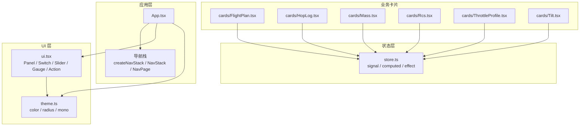
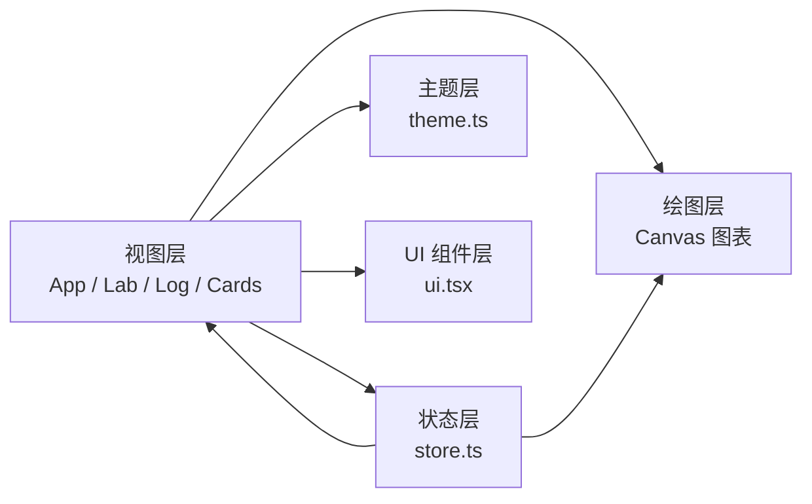
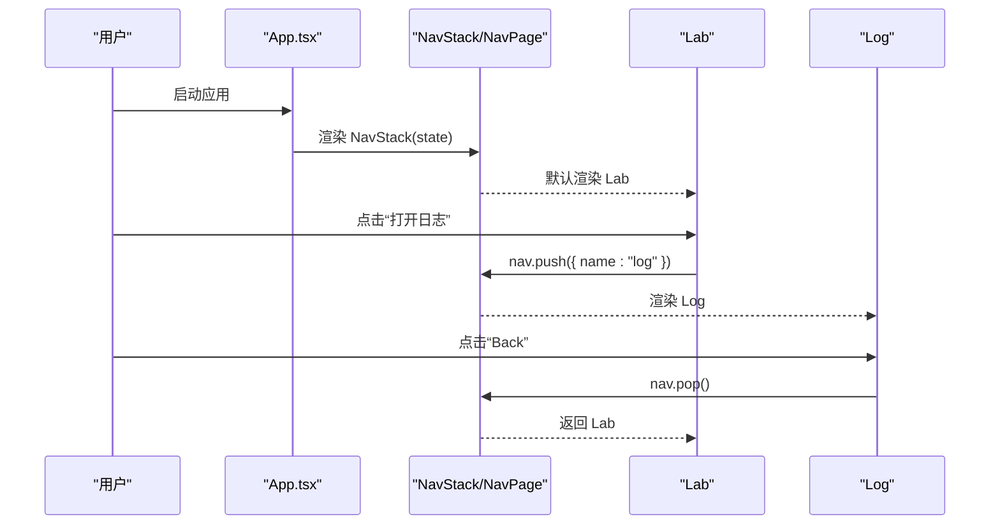
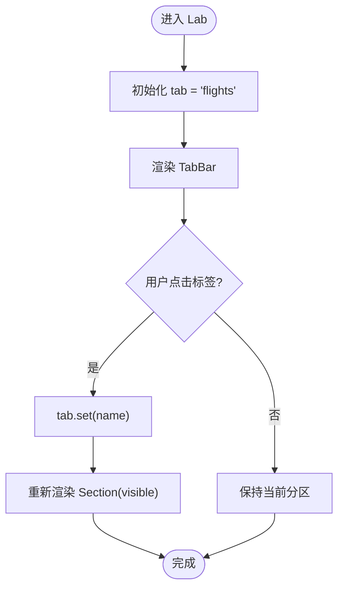
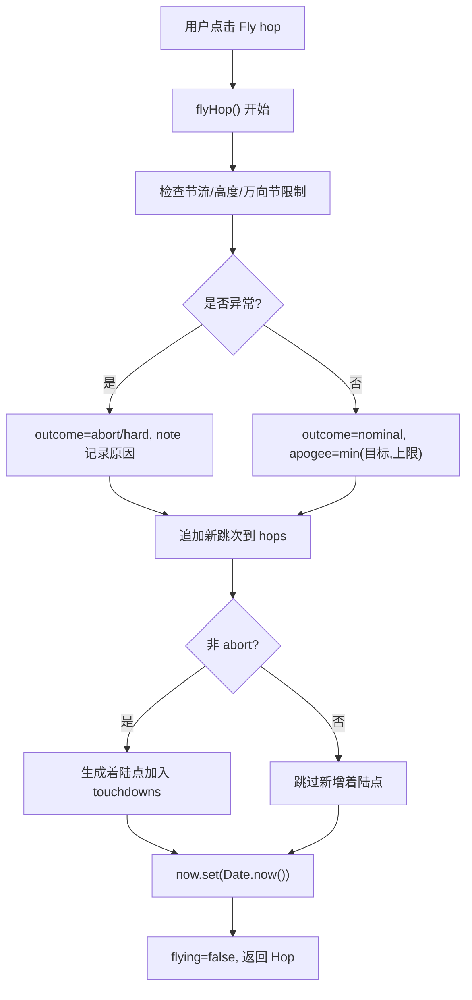
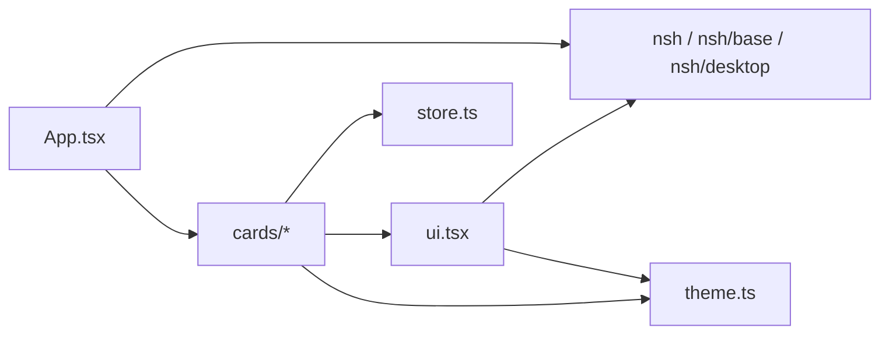
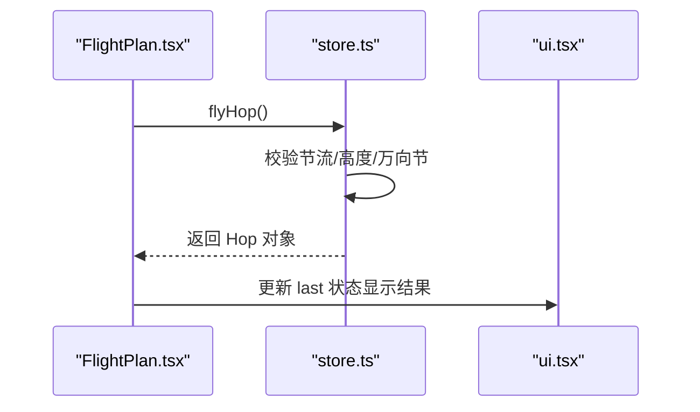

# 航天器监控应用示例

<cite>
**本文引用的文件**   
- [examples/hopper/App.tsx](file://examples/hopper/App.tsx)
- [examples/hopper/store.ts](file://examples/hopper/store.ts)
- [examples/hopper/ui.tsx](file://examples/hopper/ui.tsx)
- [examples/hopper/theme.ts](file://examples/hopper/theme.ts)
- [examples/hopper/cards/FlightPlan.tsx](file://examples/hopper/cards/FlightPlan.tsx)
- [examples/hopper/cards/HopLog.tsx](file://examples/hopper/cards/HopLog.tsx)
- [examples/hopper/cards/Mass.tsx](file://examples/hopper/cards/Mass.tsx)
- [examples/hopper/cards/Rcs.tsx](file://examples/hopper/cards/Rcs.tsx)
- [examples/hopper/cards/ThrottleProfile.tsx](file://examples/hopper/cards/ThrottleProfile.tsx)
- [examples/hopper/cards/Tilt.tsx](file://examples/hopper/cards/Tilt.tsx)
</cite>

## 目录
1. [引言](#引言)
2. [项目结构](#项目结构)
3. [核心组件](#核心组件)
4. [架构总览](#架构总览)
5. [详细组件分析](#详细组件分析)
6. [依赖关系分析](#依赖关系分析)
7. [性能与实时性](#性能与实时性)
8. [故障排查指南](#故障排查指南)
9. [结论](#结论)
10. [附录：关键流程时序图](#附录关键流程时序图)

## 引言
本文件面向使用 NSH 构建专业科学计算与监控系统界面的工程师，围绕 Hopper 航天器监控示例进行系统化文档化。该示例展示了以下关键技术点：
- 导航栈管理：基于 createNavStack、NavStack、NavPage 的页面路由与返回逻辑。
- 标签页切换：底部 TabBar 驱动 Section 显示与隐藏，保持子组件状态。
- 数据可视化：大量 Canvas 图表（柱状、散点、曲线、极坐标）与动画条、进度条等。
- 状态管理与实时更新：signal/computed/effect 驱动的响应式数据流，定时器与异步飞行模拟。
- 交互设计：自定义手势追踪 track、可访问性动作、拖拽控制滑块与曲线。
- 主题与样式：集中化的 color/radius/mono 主题系统。

目标读者包括前端/跨端开发者、UI 工程师以及需要搭建科学仪器监控界面的团队。

## 项目结构
Hopper 示例位于 examples/hopper 目录，采用“功能卡片 + 共享 UI 组件 + 全局状态”的组织方式：
- App.tsx：应用入口、导航栈、主布局与页面定义。
- store.ts：全局响应式状态（信号）、计算值、飞行模拟与参数。
- ui.tsx：通用 UI 组件（面板、开关、分段控件、滑块、计数器、按钮等）。
- theme.ts：颜色、圆角、字体族等主题常量。
- cards/*：各业务卡片（飞行计划、跳次日志、质量与重心、RCS、节流曲线、姿态倾斜）。

图示来源
- [examples/hopper/App.tsx:1-180](file://examples/hopper/App.tsx#L1-L180)
- [examples/hopper/store.ts:1-288](file://examples/hopper/store.ts#L1-L288)
- [examples/hopper/ui.tsx:1-486](file://examples/hopper/ui.tsx#L1-L486)
- [examples/hopper/theme.ts:1-29](file://examples/hopper/theme.ts#L1-L29)

章节来源
- [examples/hopper/App.tsx:1-180](file://examples/hopper/App.tsx#L1-L180)
- [examples/hopper/store.ts:1-288](file://examples/hopper/store.ts#L1-L288)
- [examples/hopper/ui.tsx:1-486](file://examples/hopper/ui.tsx#L1-L486)
- [examples/hopper/theme.ts:1-29](file://examples/hopper/theme.ts#L1-L29)

## 核心组件
- 导航与页面
  - 导航栈：通过 createNavStack<Route> 创建类型安全的导航状态，初始路由为 lab。
  - 页面容器：NavPage 提供标题栏与平台适配；Header 在桌面/Web 上绘制自定义头部，支持返回按钮。
  - 路由映射：NavStack 根据 route.name 渲染 Lab 或 Log。
- 标签页与分区
  - 底部 TabBar 维护当前 tab，Section 以 display:flex/none 切换可见性，保证子组件状态保留。
- 数据可视化
  - HopLog：Apogees 柱状图、Dispersion 散点图。
  - Mass：推进剂液位与重心 CG 剖面图。
  - Rcs：俯视布局与四组 RCS 喷嘴扇形指示。
  - ThrottleProfile：贝塞尔曲线编辑器与时间轴阶段选择。
  - Tilt：姿态倾角曲线与舵面命令条形图。
- 通用 UI
  - Panel、Switch、Segmented、Slider、Counter、Gauge、Action 等封装了样式与交互细节。
- 主题
  - 统一 color、radius、mono，确保全应用视觉一致性。

章节来源
- [examples/hopper/App.tsx:14-179](file://examples/hopper/App.tsx#L14-L179)
- [examples/hopper/ui.tsx:67-486](file://examples/hopper/ui.tsx#L67-L486)
- [examples/hopper/theme.ts:1-29](file://examples/hopper/theme.ts#L1-L29)

## 架构总览
Hopper 采用“视图-状态-绘图”三层分离：
- 视图层：App/Lab/Log 负责页面结构与导航；卡片组件负责具体业务视图。
- 状态层：store.ts 暴露 signal/computed，承载历史跳次、着陆散布、飞行计划、节流阶段、车辆质量属性、RCS 与姿态遥测。
- 绘图层：大量 Canvas 组件实现高性能图表，结合 track 手势追踪与 accessibilityActions 提升可访问性。

图示来源
- [examples/hopper/App.tsx:1-180](file://examples/hopper/App.tsx#L1-L180)
- [examples/hopper/store.ts:1-288](file://examples/hopper/store.ts#L1-L288)
- [examples/hopper/ui.tsx:1-486](file://examples/hopper/ui.tsx#L1-L486)
- [examples/hopper/theme.ts:1-29](file://examples/hopper/theme.ts#L1-L29)

## 详细组件分析

### 导航栈与页面管理
- 路由定义：Route 联合类型限定 lab/log 两种页面。
- 导航初始化：createNavStack<Route>([{ name: "lab" }]) 设置初始路由。
- 页面渲染：NavStack(state) 回调中按 route.name 渲染对应页面。
- 返回行为：Header 中的 back 按钮调用 nav.pop()。
- 平台适配：headerStyle 用于 iOS/Android 原生头部；桌面/Web 使用自定义 Header。

图示来源
- [examples/hopper/App.tsx:14-179](file://examples/hopper/App.tsx#L14-L179)

章节来源
- [examples/hopper/App.tsx:14-179](file://examples/hopper/App.tsx#L14-L179)

### 标签页切换与分区可见性
- 标签配置：tabs 数组定义 Flights/Plan/Vehicle 三个标签。
- 状态管理：tab = signal("flights")，TabBar onChange 更新 tab。
- 分区渲染：Section 根据 visible 条件切换 display:flex/none，保持内部状态。
- 可访问性：TabBar 使用 role="tablist"/"tab" 与 accessibilityState.selected。

图示来源
- [examples/hopper/App.tsx:17-154](file://examples/hopper/App.tsx#L17-L154)

章节来源
- [examples/hopper/App.tsx:17-154](file://examples/hopper/App.tsx#L17-L154)

### 数据可视化组件
- Apogees（最近跳次的柱状图）
  - 数据来源：hops 信号，computed 取最近 40 条。
  - 交互：track 手势滑动选择索引，accessibilityActions 支持键盘操作。
  - 绘制：Canvas draw 中绘制天花板虚线、柱状条、选中高亮。
- Dispersion（着陆散布）
  - 数据来源：touchdowns 信号，computed 计算 RMS 散布。
  - 交互：拖动调整着陆区半径 zone，inside 百分比实时计算。
  - 绘制：同心环、网格、着陆点着色（区内/外/危险）。
- Mass（质量与重心）
  - 数据来源：vehicle、load、cgHeight、wetMass。
  - 交互：在 Tank Path2D 内拖拽设置推进剂负载。
  - 绘制：剖面图、液位渐变、CG 标记、推力重量比。
- Rcs（反作用控制系统）
  - 数据来源：quads、nitrogenTank。
  - 交互：点击选择四组 RCS，显示退化与用量。
  - 绘制：俯视布局、喷嘴扇形、路径命中检测。
- ThrottleProfile（节流曲线）
  - 数据来源：phases、selectedPhase、easings。
  - 交互：拖拽贝塞尔控制点、选择缓动预设、预览动画。
  - 绘制：曲线填充区域、控制手柄、时间轴阶段。
- Tilt（姿态倾角）
  - 数据来源：tiltAt、gimbalCommands、HOP_LENGTH。
  - 交互：拖拽游标查看任意时刻倾角，条形图选择命令索引。
  - 绘制：±限制带、轨迹折线、光标与命令条。

章节来源
- [examples/hopper/cards/HopLog.tsx:1-189](file://examples/hopper/cards/HopLog.tsx#L1-L189)
- [examples/hopper/cards/Mass.tsx:1-204](file://examples/hopper/cards/Mass.tsx#L1-L204)
- [examples/hopper/cards/Rcs.tsx:1-160](file://examples/hopper/cards/Rcs.tsx#L1-L160)
- [examples/hopper/cards/ThrottleProfile.tsx:1-326](file://examples/hopper/cards/ThrottleProfile.tsx#L1-L326)
- [examples/hopper/cards/Tilt.tsx:1-159](file://examples/hopper/cards/Tilt.tsx#L1-L159)

### 状态管理与实时数据更新
- 信号与计算
  - hops/touchdowns/now/plan/phases/load 等均为 signal。
  - dispersion/cgHeight/wetMass 等为 computed，自动重算。
- 定时更新
  - now 每 30 秒更新一次，使“几分钟前”文案保持稳定。
- 飞行模拟
  - flyHop 异步函数依据 plan 参数判定结果（abort/hard/nominal），追加到 hops 与 touchdowns，并更新时间戳。
- 节流阶段
  - phases 列表支持添加阶段、设置缓动、编辑贝塞尔曲线；selectedPhase 控制当前编辑阶段。

图示来源
- [examples/hopper/store.ts:136-165](file://examples/hopper/store.ts#L136-L165)

章节来源
- [examples/hopper/store.ts:1-288](file://examples/hopper/store.ts#L1-L288)

### 通用 UI 组件与交互
- Panel：统一卡片外观，包含图标、标题、状态行、可选标签与详情按钮。
- Switch：基于 nsh/base 的 Switch，封装轨道与拇指类名，支持禁用态。
- Segmented：基于 Tabs/Tab 的分段控件，选中项凸起。
- Slider：自定义滑块，低于阈值变琥珀色，支持可访问性动作。
- Counter：正负按钮，长按重复步进，终端适配宽度。
- Gauge：带动画的进度条，超过阈值变警告色。
- Action：全宽按钮，主按钮强调色。

章节来源
- [examples/hopper/ui.tsx:67-486](file://examples/hopper/ui.tsx#L67-L486)

### 主题系统
- color：页面、卡片、线条、文本、强调、警告、警报等语义化颜色。
- radius：卡片、控件、胶囊圆角。
- mono：等宽字体族，用于数值与指标展示。

章节来源
- [examples/hopper/theme.ts:1-29](file://examples/hopper/theme.ts#L1-L29)

## 依赖关系分析
- App.tsx 依赖：
  - nsh 基础元素（View/Text/Scroll/signal/mount/platform）。
  - nsh/desktop Window。
  - nsh/base 导航（createNavStack/NavPage/NavStack）。
  - 卡片模块（FlightPlan/HopLog/Mass/Rcs/ThrottleProfile/Tilt）。
  - icons 与 theme。
- store.ts 依赖：
  - nsh 响应式 API（signal/computed/effect）。
- ui.tsx 依赖：
  - nsh 基础元素与动画（createAnimatedValue/Easing）。
  - nsh/base 控件（Button/Switch/Tabs/Tab/Input）。
  - icons 与 theme。
- 卡片模块依赖：
  - store.ts 提供的数据与计算。
  - ui.tsx 提供的通用组件。
  - theme.ts 提供的主题常量。

图示来源
- [examples/hopper/App.tsx:1-180](file://examples/hopper/App.tsx#L1-L180)
- [examples/hopper/store.ts:1-288](file://examples/hopper/store.ts#L1-L288)
- [examples/hopper/ui.tsx:1-486](file://examples/hopper/ui.tsx#L1-L486)
- [examples/hopper/theme.ts:1-29](file://examples/hopper/theme.ts#L1-L29)

章节来源
- [examples/hopper/App.tsx:1-180](file://examples/hopper/App.tsx#L1-L180)
- [examples/hopper/store.ts:1-288](file://examples/hopper/store.ts#L1-L288)
- [examples/hopper/ui.tsx:1-486](file://examples/hopper/ui.tsx#L1-L486)
- [examples/hopper/theme.ts:1-29](file://examples/hopper/theme.ts#L1-L29)

## 性能与实时性
- 响应式更新
  - 使用 signal/computed 最小化重绘范围，避免整树重建。
  - 对频繁更新的 now 使用 setInterval 降低频率（30 秒）。
- 绘图优化
  - Canvas 仅在必要时重绘，利用 onLayout 缓存尺寸。
  - 使用 Path2D 与 isPointInPath 提高命中测试效率。
- 动画与交互
  - createAnimatedValue 配合 timing/spring 在 UI 线程执行动画，减少阻塞。
  - track 手势追踪避免滚动冲突，提升拖拽体验。
- 建议
  - 大数据集（如长列表）考虑虚拟滚动或分页加载。
  - 复杂图表可分帧绘制或使用离屏 Canvas。
  - 将计算密集型逻辑放入 Web Worker 或通过后端接口获取。

[本节为通用指导，不直接分析具体文件]

## 故障排查指南
- 导航问题
  - 现象：无法返回或页面未切换。
  - 排查：确认 NavStack 正确传入 state；Header back 按钮调用 nav.pop()；路由名称匹配。
  - 参考：[examples/hopper/App.tsx:31-65](file://examples/hopper/App.tsx#L31-L65)、[examples/hopper/App.tsx:156-179](file://examples/hopper/App.tsx#L156-L179)
- 标签页不生效
  - 现象：点击 TabBar 无变化。
  - 排查：检查 tab signal 是否被 onChange 更新；Section visible 条件是否正确。
  - 参考：[examples/hopper/App.tsx:82-154](file://examples/hopper/App.tsx#L82-L154)
- 图表无响应
  - 现象：拖拽无效或无障碍键不可用。
  - 排查：确认 track 已绑定且 accept 条件合理；accessibilityActions 与 onAccessibilityAction 已实现。
  - 参考：[examples/hopper/ui.tsx:15-65](file://examples/hopper/ui.tsx#L15-L65)、[examples/hopper/cards/HopLog.tsx:18-33](file://examples/hopper/cards/HopLog.tsx#L18-L33)
- 飞行模拟异常
  - 现象：结果不符合预期或状态未更新。
  - 排查：检查 plan 参数（节流/高度/万向节）；确认 flyHop 返回值与 hops/touchdowns 更新逻辑。
  - 参考：[examples/hopper/store.ts:136-165](file://examples/hopper/store.ts#L136-L165)
- 主题不一致
  - 现象：颜色或圆角不一致。
  - 排查：确认所有样式来自 theme.ts 的 color/radius/mono。
  - 参考：[examples/hopper/theme.ts:1-29](file://examples/hopper/theme.ts#L1-L29)

章节来源
- [examples/hopper/App.tsx:31-65](file://examples/hopper/App.tsx#L31-L65)
- [examples/hopper/App.tsx:82-154](file://examples/hopper/App.tsx#L82-L154)
- [examples/hopper/ui.tsx:15-65](file://examples/hopper/ui.tsx#L15-L65)
- [examples/hopper/cards/HopLog.tsx:18-33](file://examples/hopper/cards/HopLog.tsx#L18-L33)
- [examples/hopper/store.ts:136-165](file://examples/hopper/store.ts#L136-L165)
- [examples/hopper/theme.ts:1-29](file://examples/hopper/theme.ts#L1-L29)

## 结论
Hopper 示例完整演示了如何使用 NSH 构建专业的航天器监控界面：
- 通过导航栈与标签页实现清晰的页面与分区组织。
- 借助 signal/computed/effect 构建响应式数据流，支撑实时数据更新与复杂计算。
- 大量 Canvas 图表与动画组件满足科学可视化需求。
- 统一的主题系统与通用 UI 组件提升开发效率与一致性。
- 良好的可访问性与手势处理提升了用户体验。

建议在真实项目中：
- 将业务逻辑进一步拆分至服务层，保持视图简洁。
- 引入单元测试与端到端测试覆盖关键交互与数据流。
- 针对大规模数据与高频更新场景进行性能优化与资源隔离。

[本节为总结性内容，不直接分析具体文件]

## 附录：关键流程时序图

### 飞行计划提交与结果回写

图示来源
- [examples/hopper/cards/FlightPlan.tsx:71-76](file://examples/hopper/cards/FlightPlan.tsx#L71-L76)
- [examples/hopper/store.ts:136-165](file://examples/hopper/store.ts#L136-L165)

章节来源
- [examples/hopper/cards/FlightPlan.tsx:71-76](file://examples/hopper/cards/FlightPlan.tsx#L71-L76)
- [examples/hopper/store.ts:136-165](file://examples/hopper/store.ts#L136-L165)