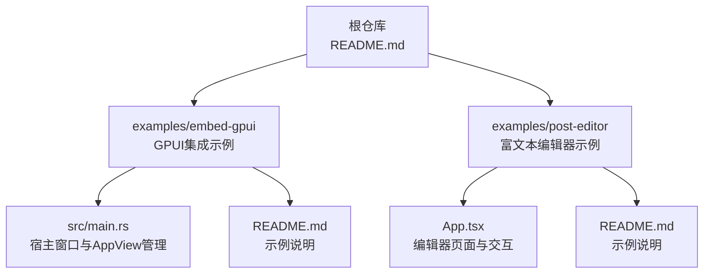
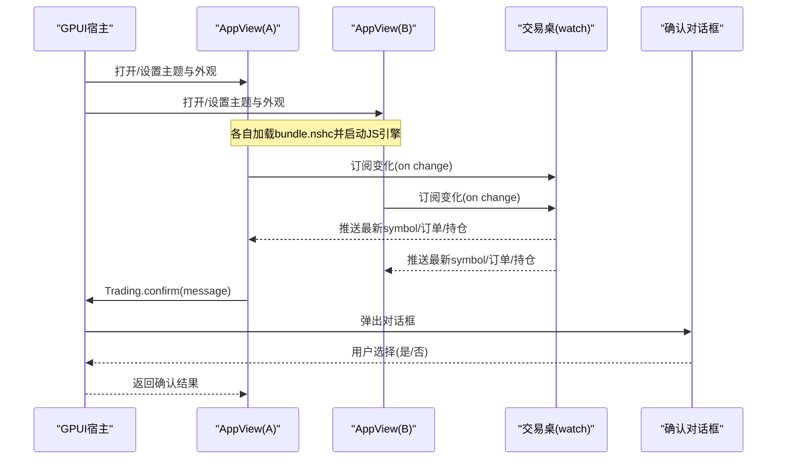
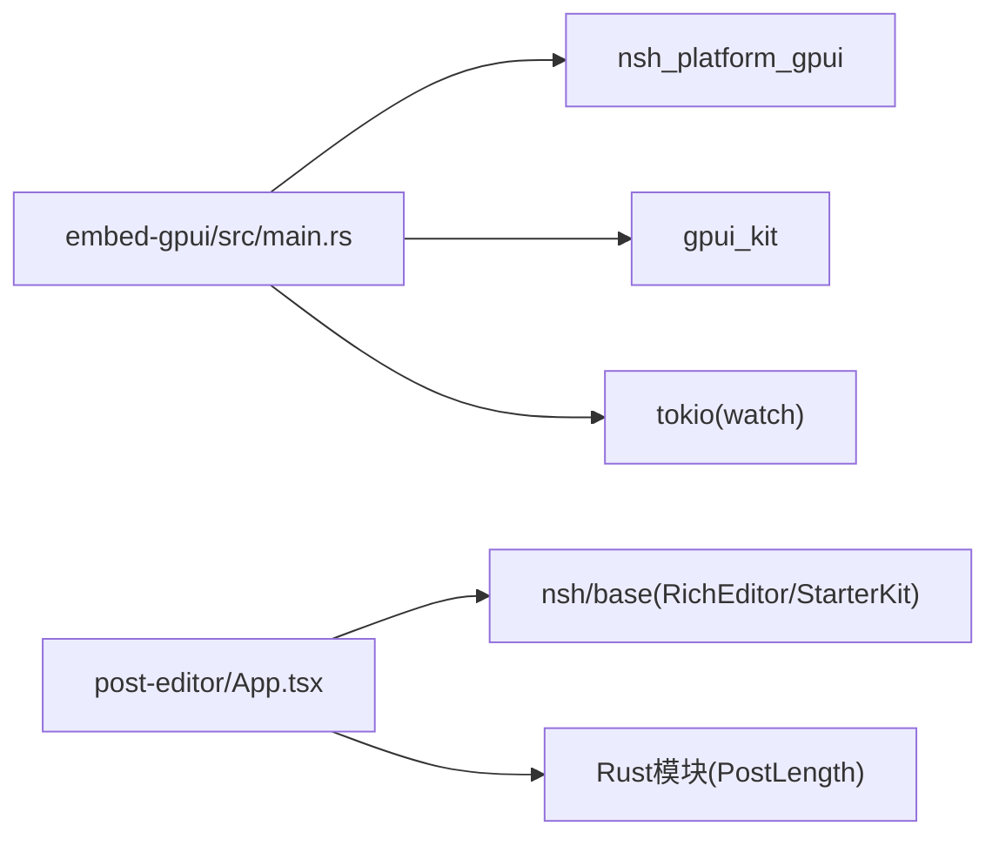

# 高级应用示例

<cite>
**本文引用的文件**   
- [README.md](file://README.md)
- [examples/embed-gpui/README.md](file://examples/embed-gpui/README.md)
- [examples/embed-gpui/src/main.rs](file://examples/embed-gpui/src/main.rs)
- [examples/post-editor/README.md](file://examples/post-editor/README.md)
- [examples/post-editor/App.tsx](file://examples/post-editor/App.tsx)
</cite>

## 目录
1. [引言](#引言)
2. [项目结构](#项目结构)
3. [核心组件](#核心组件)
4. [架构总览](#架构总览)
5. [详细组件分析](#详细组件分析)
6. [依赖关系分析](#依赖关系分析)
7. [性能与优化](#性能与优化)
8. [故障排查指南](#故障排查指南)
9. [结论](#结论)
10. [附录：企业级最佳实践](#附录企业级最佳实践)

## 引言
本文件面向NSH的高级应用示例，聚焦三类复杂场景：
- 航天器监控应用（概念性说明）
- 富文本编辑器（post-editor）
- GPUI集成应用（embed-gpui）

文档将深入讲解Canvas绘图、WebView集成、原生能力调用、性能优化等高级特性，并总结企业级开发的最佳实践，包括代码组织、错误处理、日志记录、跨平台适配与部署。

## 项目结构
仓库根目录提供多平台运行与打包能力，示例位于 examples 目录下。其中与本主题直接相关的示例：
- embed-gpui：在GPUI Kit应用中嵌入多个NSH引擎实例，展示宿主与子应用的双向通信、主题同步、原生组件注册、对话框与通知的层级关系。
- post-editor：基于RichEditor的短帖编辑器原型，演示自定义原子节点、搜索建议、HTML往返序列化、长度统计等。



**图表来源**
- [README.md:1-57](file://README.md#L1-L57)
- [examples/embed-gpui/README.md:1-50](file://examples/embed-gpui/README.md#L1-L50)
- [examples/post-editor/README.md:1-46](file://examples/post-editor/README.md#L1-L46)

**章节来源**
- [README.md:1-57](file://README.md#L1-L57)

## 核心组件
- NSH运行时与平台后端：支持iOS、Android、macOS、Windows、Linux、GPUI、TUI、Web等多平台渲染与交互。
- nsh/base：基础UI行为与可访问性结构，RichEditor、StarterKit等高级组件。
- nsh-platform-gpui：在GPUI中承载NSH应用的AppView，负责主题、外观、资源加载、错误回调等。
- RichEditor与扩展：通过richExtension、command、setNodeAttribute等API实现自定义节点、气泡菜单、建议列表等。

**章节来源**
- [README.md:17-57](file://README.md#L17-L57)

## 架构总览
下图展示“GPUI宿主 + 多个NSH引擎”的整体架构，以及宿主与子应用之间的数据流与事件流。

```mermaid
graph TB
subgraph "GPUI宿主"
HostWindow["宿主窗口<br/>Sidebar/Toolbar/Dialogs"]
TradingDesk["交易桌(共享状态)<br/>watch channel"]
NativeWidgets["原生组件注册<br/>watchlist/switch"]
end
subgraph "NSH引擎A"
AppViewA["AppView(A)"]
JS_A["TSX应用(A)"]
NativeModA["nativeModule('host/trading')"]
end
subgraph "NSH引擎B"
AppViewB["AppView(B)"]
JS_B["TSX应用(B)"]
NativeModB["nativeModule('host/trading')"]
end
HostWindow --> AppViewA
HostWindow --> AppViewB
TradingDesk < --> NativeModA
TradingDesk < --> NativeModB
NativeWidgets --> AppViewA
NativeWidgets --> AppViewB
```

**图表来源**
- [examples/embed-gpui/src/main.rs:1-22](file://examples/embed-gpui/src/main.rs#L1-L22)
- [examples/embed-gpui/src/main.rs:635-687](file://examples/embed-gpui/src/main.rs#L635-L687)

**章节来源**
- [examples/embed-gpui/src/main.rs:1-22](file://examples/embed-gpui/src/main.rs#L1-L22)
- [examples/embed-gpui/src/main.rs:635-687](file://examples/embed-gpui/src/main.rs#L635-L687)

## 详细组件分析

### GPUI集成应用（embed-gpui）
该示例展示了在GPUI Kit应用中嵌入多个NSH引擎实例，实现：
- 主题与外观同步：宿主主题变化时，所有AppView同步更新。
- 双向共享状态：通过tokio::sync::watch通道共享“交易桌”，各票据与宿主侧边栏/工具栏保持一致。
- 原生组件注册：将GPUI Kit控件作为原生组件暴露给NSH应用使用。
- 对话框与通知层级：宿主对话框与通知绘制在NSH表面之上。
- 图层可视化：可选显示GPUI宿主、NSH应用、NSH内GPUI控件三层边界。



**图表来源**
- [examples/embed-gpui/src/main.rs:100-143](file://examples/embed-gpui/src/main.rs#L100-L143)
- [examples/embed-gpui/src/main.rs:551-580](file://examples/embed-gpui/src/main.rs#L551-L580)
- [examples/embed-gpui/src/main.rs:582-618](file://examples/embed-gpui/src/main.rs#L582-L618)

关键实现要点（路径引用）：
- 宿主窗口与AppView生命周期管理：[examples/embed-gpui/src/main.rs:98-163](file://examples/embed-gpui/src/main.rs#L98-L163)
- 主题同步与外观切换：[examples/embed-gpui/src/main.rs:170-189](file://examples/embed-gpui/src/main.rs#L170-L189)
- 共享交易桌与确认流程：[examples/embed-gpui/src/main.rs:114-143](file://examples/embed-gpui/src/main.rs#L114-L143), [examples/embed-gpui/src/main.rs:551-580](file://examples/embed-gpui/src/main.rs#L551-L580)
- 加载bundle与注册原生组件：[examples/embed-gpui/src/main.rs:582-618](file://examples/embed-gpui/src/main.rs#L582-L618)
- 入口与UI Sets配置：[examples/embed-gpui/src/main.rs:635-687](file://examples/embed-gpui/src/main.rs#L635-L687)

**章节来源**
- [examples/embed-gpui/README.md:1-50](file://examples/embed-gpui/README.md#L1-L50)
- [examples/embed-gpui/src/main.rs:1-22](file://examples/embed-gpui/src/main.rs#L1-L22)
- [examples/embed-gpui/src/main.rs:98-163](file://examples/embed-gpui/src/main.rs#L98-L163)
- [examples/embed-gpui/src/main.rs:170-189](file://examples/embed-gpui/src/main.rs#L170-L189)
- [examples/embed-gpui/src/main.rs:551-580](file://examples/embed-gpui/src/main.rs#L551-L580)
- [examples/embed-gpui/src/main.rs:582-618](file://examples/embed-gpui/src/main.rs#L582-L618)
- [examples/embed-gpui/src/main.rs:635-687](file://examples/embed-gpui/src/main.rs#L635-L687)

### 富文本编辑器（post-editor）
该示例基于RichEditor构建短帖编辑器，支持：
- 自定义原子节点：securityTag、mention、hashtag，具备parse_dom/to_dom与DOM属性映射。
- 搜索建议：$股票、@用户、#话题，键盘导航与选择。
- HTML往返：getHTML输出与setContent(html, "html")读回，保持编辑一致性。
- 加权长度统计：Rust模块PostLength计算HTML文本长度，遵循web端规则。

```mermaid
flowchart TD
Start(["编辑器初始化"]) --> CreateEditor["创建RichEditor<br/>配置StarterKit与扩展"]
CreateEditor --> RenderBubble["渲染气泡菜单<br/>建议列表/趋势菜单"]
RenderBubble --> HandleInput{"用户输入?"}
HandleInput --> |触发符|$Trigger["$ 触发股票搜索"]
HandleInput --> |触发符| @Trigger["@ 触发用户搜索"]
HandleInput --> |触发符| #Trigger["# 触发话题搜索"]
$Trigger --> SearchSec["异步搜索股票候选"]
@Trigger --> SearchMember["异步搜索成员候选"]
#Trigger --> SearchTopic["异步搜索话题候选"]
SearchSec --> ShowList["展示候选列表"]
SearchMember --> ShowList
SearchTopic --> ShowList
ShowList --> SelectItem{"选择项?"}
SelectItem --> |是| InsertNode["插入原子节点或话题标签"]
SelectItem --> |否| KeepEditing["继续编辑"]
InsertNode --> UpdateHTML["更新HTML内容"]
UpdateHTML --> LengthCalc["计算加权长度(PostLength)"]
LengthCalc --> End(["完成一次编辑循环"])
```

**图表来源**
- [examples/post-editor/App.tsx:67-117](file://examples/post-editor/App.tsx#L67-L117)
- [examples/post-editor/App.tsx:132-155](file://examples/post-editor/App.tsx#L132-L155)
- [examples/post-editor/App.tsx:161-191](file://examples/post-editor/App.tsx#L161-L191)
- [examples/post-editor/App.tsx:250-257](file://examples/post-editor/App.tsx#L250-L257)

关键实现要点（路径引用）：
- StarterKit精简配置与扩展注册：[examples/post-editor/App.tsx:67-117](file://examples/post-editor/App.tsx#L67-L117)
- 搜索与候选选择逻辑：[examples/post-editor/App.tsx:132-155](file://examples/post-editor/App.tsx#L132-L155)
- 修订事件监听与气泡菜单状态：[examples/post-editor/App.tsx:161-191](file://examples/post-editor/App.tsx#L161-L191)
- HTML往返与草稿编辑：[examples/post-editor/App.tsx:250-257](file://examples/post-editor/App.tsx#L250-L257)
- 示例说明与HTML格式约定：[examples/post-editor/README.md:14-38](file://examples/post-editor/README.md#L14-L38)

**章节来源**
- [examples/post-editor/README.md:1-46](file://examples/post-editor/README.md#L1-L46)
- [examples/post-editor/App.tsx:67-117](file://examples/post-editor/App.tsx#L67-L117)
- [examples/post-editor/App.tsx:132-155](file://examples/post-editor/App.tsx#L132-L155)
- [examples/post-editor/App.tsx:161-191](file://examples/post-editor/App.tsx#L161-L191)
- [examples/post-editor/App.tsx:250-257](file://examples/post-editor/App.tsx#L250-L257)

### 航天器监控应用（概念性说明）
以下为概念性设计，用于指导如何在NSH中构建航天器监控类应用：
- 数据源接入：通过WebSocket或HTTP轮询获取遥测数据，结合nsh/web模块进行网络请求与连接管理。
- 实时可视化：使用Canvas绘制轨道图、仪表盘、时序曲线；利用nsh/canvas模块进行高性能绘制。
- 告警与通知：使用Toast/Alert/Notification组件进行告警提示，结合系统通知模块提升可见性。
- 多视图布局：使用SplitView/Tabs/Dock组织多面板，支持响应式布局与跨平台适配。
- 本地缓存与持久化：使用Storage模块缓存历史数据与用户偏好，提高首屏性能。
- 安全与权限：在沙箱环境中限制敏感能力，按需申请权限，确保数据安全。

（本节为概念性说明，不直接分析具体文件）

## 依赖关系分析
- embed-gpui依赖：
  - nsh_platform_gpui：AppView、Bundle、AppOptions等，用于在GPUI中承载NSH应用。
  - gpui_kit：宿主UI框架，提供Sidebar、Popover、Dialog、Theme等。
  - tokio：异步运行时与watch通道，用于共享状态。
- post-editor依赖：
  - nsh/base：RichEditor、StarterKit、命令与扩展API。
  - Rust模块PostLength：加权长度计算。



**图表来源**
- [examples/embed-gpui/src/main.rs:635-687](file://examples/embed-gpui/src/main.rs#L635-L687)
- [examples/post-editor/App.tsx:1-14](file://examples/post-editor/App.tsx#L1-L14)

**章节来源**
- [examples/embed-gpui/src/main.rs:635-687](file://examples/embed-gpui/src/main.rs#L635-L687)
- [examples/post-editor/App.tsx:1-14](file://examples/post-editor/App.tsx#L1-L14)

## 性能与优化
- 减少重绘与无效更新：
  - 在RichEditor中仅对必要区域更新，避免全量重绘。
  - 在GPUI宿主中，主题变化时使用最小化更新策略，批量同步到所有AppView。
- 异步与并发：
  - 使用tokio的watch通道进行高效状态广播，避免频繁轮询。
  - 搜索建议采用异步查询与去抖，降低网络压力。
- Canvas绘制优化：
  - 分层绘制与离屏缓冲，减少重复绘制开销。
  - 使用增量更新与脏矩形技术，仅重绘变化区域。
- WebView集成优化：
  - 预加载常用页面，减少首次加载延迟。
  - 控制内存占用，及时释放不再使用的WebView实例。
- 资源与打包：
  - 使用nsh bundler进行资源压缩与分割，减小包体大小。
  - 静态资源按平台分发，避免不必要的二进制体积。

（本节为通用指导，不直接分析具体文件）

## 故障排查指南
- embed-gpui常见问题：
  - Bundle加载失败：检查Bundle路径与资源目录是否正确，查看日志输出。
  - 主题不同步：确认宿主主题变化事件是否传递到所有AppView。
  - 原生组件未注册：确认register_component调用是否在AppView初始化前执行。
- post-editor常见问题：
  - HTML往返不一致：检查parse_dom/to_dom实现是否与服务器格式一致。
  - 长度统计异常：确认PostLength模块与web端规则对齐。
  - 建议列表不更新：检查revision事件监听与状态同步逻辑。

**章节来源**
- [examples/embed-gpui/src/main.rs:582-618](file://examples/embed-gpui/src/main.rs#L582-L618)
- [examples/post-editor/App.tsx:161-191](file://examples/post-editor/App.tsx#L161-L191)

## 结论
本文件围绕NSH的高级应用示例，系统讲解了GPUI集成与富文本编辑器的实现细节，提供了航天器监控应用的概念性设计，并总结了性能优化与企业级最佳实践。通过这些示例与指南，开发者可以快速构建跨平台、高性能、可扩展的复杂应用。

## 附录：企业级最佳实践
- 代码组织：
  - 按功能域划分模块，保持高内聚低耦合。
  - 使用统一的命名规范与目录结构，便于维护与协作。
- 错误处理：
  - 统一错误类型与错误码，便于前端展示与后端定位。
  - 使用try-catch与错误边界，防止崩溃扩散。
- 日志记录：
  - 分级日志（debug/info/warn/error），生产环境关闭冗余日志。
  - 结构化日志，便于检索与分析。
- 跨平台适配：
  - 抽象平台差异，提供统一接口。
  - 针对各平台特性进行优化，如移动端手势、桌面端快捷键。
- 部署与发布：
  - 自动化构建与测试流水线，确保质量。
  - 灰度发布与回滚机制，降低风险。

（本节为通用指导，不直接分析具体文件）