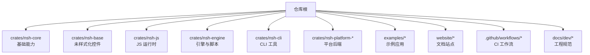
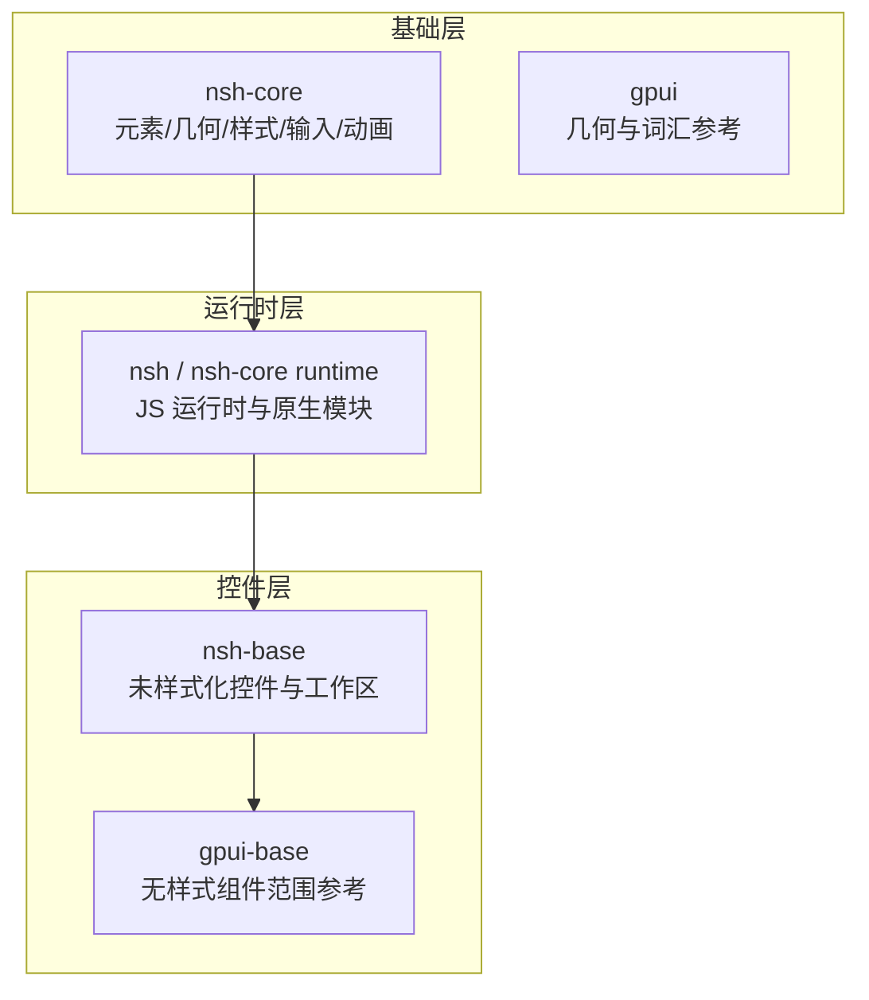
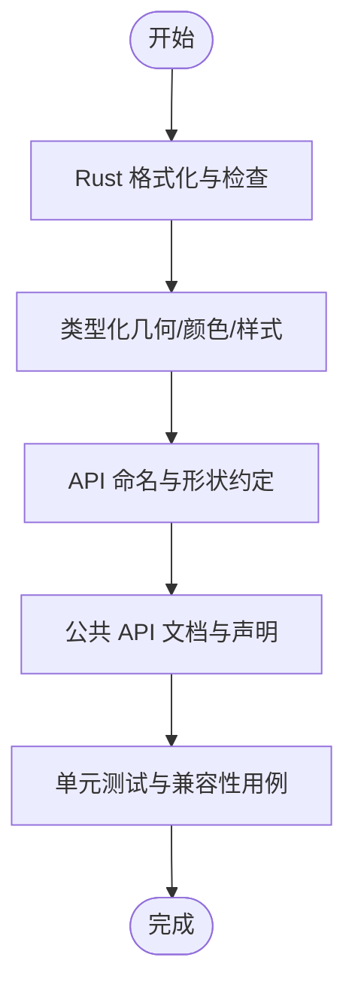
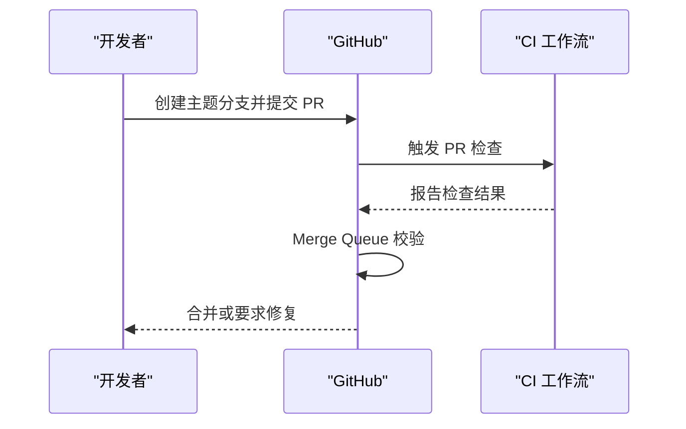
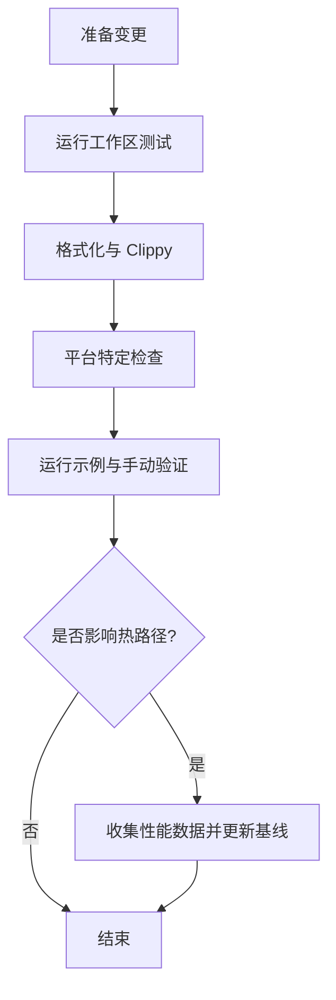
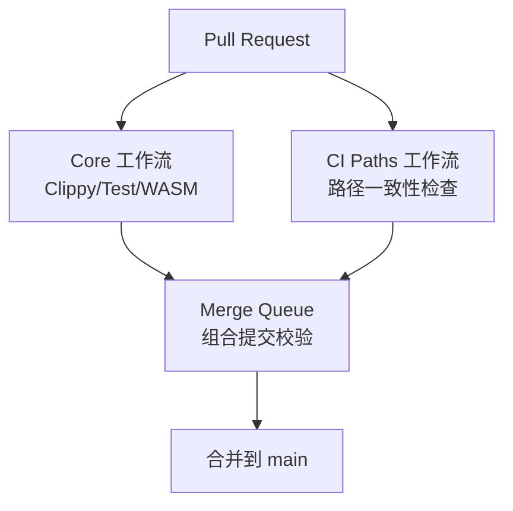
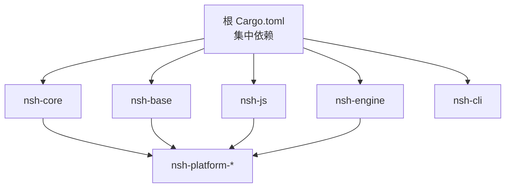

# 贡献指南

<cite>
**本文引用的文件**   
- [CONTRIBUTING.md](file://CONTRIBUTING.md)
- [README.md](file://README.md)
- [docs/dev/workflow.md](file://docs/dev/workflow.md)
- [docs/dev/engineering.md](file://docs/dev/engineering.md)
- [.github/pull_request_template.md](file://.github/pull_request_template.md)
- [.github/workflows/core.yml](file://.github/workflows/core.yml)
- [.github/workflows/ci-paths.yml](file://.github/workflows/ci-paths.yml)
- [.rustfmt.toml](file://.rustfmt.toml)
</cite>

## 目录
1. [简介](#简介)
2. [项目结构](#项目结构)
3. [核心组件](#核心组件)
4. [架构总览](#架构总览)
5. [详细组件分析](#详细组件分析)
6. [依赖分析](#依赖分析)
7. [性能考虑](#性能考虑)
8. [故障排查指南](#故障排查指南)
9. [结论](#结论)
10. [附录](#附录)

## 简介
本指南面向希望为 NSH 贡献代码、文档和测试的开发者。NSH 是一个跨平台原生 UI 框架，支持 iOS、Android、macOS、Windows、Linux 与 Web，强调“一次编写、多端原生渲染”，并提供 TSX 与 Rust 两种开发方式以及统一的响应式运行时。贡献者应遵循轻量、可维护、跨平台一致性与向后兼容的设计原则，优先修复缺陷、提升性能、完善现有组件能力，而非引入仅服务于单一应用的功能。

## 项目结构
仓库采用 Cargo workspace 组织多个 crate，核心包括：
- `crates/nsh-core`：基础元素、几何、样式、输入、动画、JS 绑定等底层能力
- `crates/nsh-base`：未加样式的通用控件与工作区行为（如按钮、输入框、导航、对话框）
- `crates/nsh-js` / `crates/nsh-engine`：JS 运行时、引擎与打包相关逻辑
- `crates/nsh-cli`：统一 CLI，负责构建、运行、测试、打包与发布
- `crates/nsh-platform-*`：各平台后端实现（iOS、Android、macOS、Windows、Linux、Web、GPUI、TUI）
- `examples/`：示例应用，用于演示功能与回归验证
- `website/`：文档站点与演示
- `.github/workflows/`：持续集成工作流
- `docs/dev/`：工程规范、API 命名、工作流等内部文档

**图表来源**
- [README.md:1-60](file://README.md#L1-L60)
- [CONTRIBUTING.md:12-40](file://CONTRIBUTING.md#L12-L40)

**章节来源**
- [README.md:1-60](file://README.md#L1-L60)
- [CONTRIBUTING.md:12-40](file://CONTRIBUTING.md#L12-L40)

## 核心组件
- 基础层（nsh-core）：提供视图、文本、滚动、列表、图像、画布、覆盖层、视频、WebView、安全区域、键盘等基础元素与环境能力，并定义类型化的几何、颜色、样式与事件模型。
- 控件层（nsh-base）：在基础层之上提供可复用的未样式化控件与工作区组件，关注行为、状态、焦点、键盘与无障碍语义，外观由应用决定。
- 运行时与引擎（nsh-js / nsh-engine）：承载 JS 模块加载、运行时 API、脚本执行、打包与优化流程，并与宿主平台交互。
- 平台后端（nsh-platform-*）：将 NSH 的元素与布局映射到各平台的原生视图或渲染系统，处理输入、窗口、菜单、状态栏等平台特性。
- CLI（nsh-cli）：统一入口，提供 init、run、build、test、package、publish 等命令，串联开发、调试与交付流程。

**章节来源**
- [docs/dev/engineering.md:14-46](file://docs/dev/engineering.md#L14-L46)
- [CONTRIBUTING.md:84-128](file://CONTRIBUTING.md#L84-L128)

## 架构总览
NSH 的架构遵循三层划分：
- 基础层（nsh-core ↔ gpui）：定义原语与环境
- 运行时层（nsh / nsh-core runtime）：暴露给 TSX 与 Rust 的统一 API
- 控件层（nsh-base ↔ gpui-base）：提供未样式化控件，外观由应用决定

**图表来源**
- [docs/dev/engineering.md:14-46](file://docs/dev/engineering.md#L14-L46)

**章节来源**
- [docs/dev/engineering.md:14-46](file://docs/dev/engineering.md#L14-L46)

## 详细组件分析

### 开发环境与工具链
- Rust 工具链：通过 rustup 安装稳定版，并按 `rust-toolchain.toml` 选择目标；使用 nightly 进行格式化。
- 推荐 Cargo 替代：huacnlee/cargo，共享构建目录并限制体积增长。
- 平台依赖：
  - macOS/iOS：Xcode
  - Linux：GTK 4 开发包、WebKitGTK 6.0、clang
  - Windows：Visual Studio Build Tools、C++ 工作负载、Windows SDK、LLVM（libclang）
  - Android：Android SDK（含 platform 35 与 build tools）、NDK、JDK
- IDE 建议：Rust Analyzer、TypeScript 语言服务、Tailwind CSS 插件；确保编辑器能读取生成的 TypeScript 声明（TSX 模板会生成 `.nsh/types`）。

**章节来源**
- [CONTRIBUTING.md:258-276](file://CONTRIBUTING.md#L258-L276)
- [README.md:214-218](file://README.md#L214-L218)

### 代码结构与命名规范
- Rust 风格：
  - 使用 `cargo +nightly fmt --all` 格式化，配置位于 `.rustfmt.toml`
  - 公共结构体使用 `#[non_exhaustive]` 并实现 `Default`
  - 所有 `unsafe` 块需附带 `// SAFETY:` 注释
  - 库 crate 仅通过 `log` 门面记录日志，二进制安装 logger
  - 依赖在根 `Cargo.toml` 中集中声明，crate 内使用 `.workspace = true`
- TypeScript/TSX 约定：
  - TSX 标签使用 PascalCase，导入路径对应 Rust crate 分层
  - 公共 API 变更需在 PR 描述中列出签名与用途
  - 选项对象使用 `<Method>Options` 命名，避免内联对象类型
- API 设计：
  - 名称短、准确、中性，优先使用项目自身词汇
  - 差异从 GPUI Kit 处记录于 `docs/dev/api-naming.md`
  - 返回值统一为对象，失败使用错误码而非哨兵值
  - 监听器注册函数为 `on(event, listener)`，返回取消函数

**图表来源**
- [docs/dev/engineering.md:168-221](file://docs/dev/engineering.md#L168-L221)
- [CONTRIBUTING.md:129-158](file://CONTRIBUTING.md#L129-L158)

**章节来源**
- [docs/dev/engineering.md:168-221](file://docs/dev/engineering.md#L168-L221)
- [CONTRIBUTING.md:129-158](file://CONTRIBUTING.md#L129-L158)
- [.rustfmt.toml:1-13](file://.rustfmt.toml#L1-L13)

### 提交流程与分支策略
- 所有变更必须通过 Pull Request，禁止直接推送至 `main`
- 分支策略：创建主题分支，PR 目标为 `main`，合并通过 GitHub Merge Queue
- 提交消息格式：`<area>: <What the change does>`，area 小写，动词祈使句，约 72 字符
- PR 标题与正文：说明问题、方法与成本；热路径变更附前后性能数据
- 公共 API 变更：在 PR 描述中按 crate/module 分组列出签名与用途；破坏性变更附 diff 示例

**图表来源**
- [docs/dev/workflow.md:7-39](file://docs/dev/workflow.md#L7-L39)
- [CONTRIBUTING.md:215-248](file://CONTRIBUTING.md#L215-L248)

**章节来源**
- [docs/dev/workflow.md:7-39](file://docs/dev/workflow.md#L7-L39)
- [CONTRIBUTING.md:215-248](file://CONTRIBUTING.md#L215-L248)

### 测试要求
- 单元测试：`cargo test --workspace`
- 格式化与静态检查：`cargo +nightly fmt --all`、`cargo clippy --workspace --all-targets`
- 平台特定检查：针对 iOS Catalyst、Android、Linux、Windows 的 clippy 任务
- 示例运行：`cargo run` 启动 gallery，或通过 `nsh run` 指定目标平台
- 性能基准：对热路径变更使用 `nsh test --trace` 与 `list_bench` 基准测试，更新基线

**图表来源**
- [CONTRIBUTING.md:277-347](file://CONTRIBUTING.md#L277-L347)

**章节来源**
- [CONTRIBUTING.md:277-347](file://CONTRIBUTING.md#L277-L347)

### 代码审查流程
- 审查顺序：目的与范围 → 需求与方法合理性 → 具体发现 → 验证与局限
- 范围优先：轻量框架定位明确，新功能需满足跨平台一致性与成本衡量
- 公共 API 审查：新增/变更/移除项需列出签名与用途；破坏性变更需附 diff
- UI 变更：必须包含截图或录屏，展示受影响状态与交互

**章节来源**
- [docs/dev/workflow.md:30-39](file://docs/dev/workflow.md#L30-L39)
- [CONTRIBUTING.md:191-213](file://CONTRIBUTING.md#L191-L213)
- [CONTRIBUTING.md:320-329](file://CONTRIBUTING.md#L320-L329)

### 持续集成配置
- Core 工作流：对共享 crate 进行 lint 与测试，包含 WebAssembly 检查
- CI Paths 工作流：校验工作流中的路径过滤与依赖图一致性
- 并发与去抖：PR 与 merge queue 使用并发组与去抖环境，减少资源占用
- Runner 策略：部分作业在自托管 runner 上运行，发布与下载产物仅在 GitHub 官方 runner 上执行

**图表来源**
- [.github/workflows/core.yml:1-121](file://.github/workflows/core.yml#L1-L121)
- [.github/workflows/ci-paths.yml:1-42](file://.github/workflows/ci-paths.yml#L1-L42)

**章节来源**
- [.github/workflows/core.yml:1-121](file://.github/workflows/core.yml#L1-L121)
- [.github/workflows/ci-paths.yml:1-42](file://.github/workflows/ci-paths.yml#L1-L42)

### 问题报告与功能请求
- 问题报告：先阅读 AGENTS.md 与 docs/dev 相关页面，确认是否为 bug、性能或现有行为改进
- 功能请求：新功能需满足“无法用现有 API 或 nshm 实现”“多应用需要”“跨平台一致”“成本可衡量”
- 提案流程：先开 issue 说明理由与范围，等待维护者同意后再提交 PR
- 模板：使用 `.github/pull_request_template.md` 填写描述、截图、公共 API、破坏性变更、性能数据与测试步骤

**章节来源**
- [CONTRIBUTING.md:12-83](file://CONTRIBUTING.md#L12-L83)
- [.github/pull_request_template.md:1-45](file://.github/pull_request_template.md#L1-L45)

### 治理结构与决策流程
- 治理原则：NSH 保持轻量 GUI 框架定位，不接受 Electron 式全栈平台扩展
- 决策标准：新功能需通过范围审查；若可通过 nshm 或应用自身实现，则不纳入 NSH
- 维护者角色：对范围与 API 设计拥有最终决定权；未经同意的功能 PR 可能被拒绝
- 兼容性：已发布 API 不得破坏，变更需保留旧名作为弃用别名，并通过兼容性测试

**章节来源**
- [CONTRIBUTING.md:12-83](file://CONTRIBUTING.md#L12-L83)
- [docs/dev/engineering.md:47-65](file://docs/dev/engineering.md#L47-L65)

## 依赖分析
- 工作区依赖：根 `Cargo.toml` 集中声明依赖，crate 内使用 `.workspace = true`
- 平台依赖：各平台后端仅在对应系统上编译，CI 通过路径过滤与平台特定 job 执行
- 外部依赖：QuickJS、GTK、WebKitGTK、Xcode、Android SDK/NDK/JDK、LLVM 等

**图表来源**
- [docs/dev/engineering.md:197-201](file://docs/dev/engineering.md#L197-L201)
- [CONTRIBUTING.md:258-276](file://CONTRIBUTING.md#L258-L276)

**章节来源**
- [docs/dev/engineering.md:197-201](file://docs/dev/engineering.md#L197-L201)
- [CONTRIBUTING.md:258-276](file://CONTRIBUTING.md#L258-L276)

## 性能考虑
- 性能优先级：渲染、布局、滚动与启动速度、内存占用与挂载项数量
- 热路径变更：需提供 `nsh test --trace` 前后数据，并与基线对比
- 基准测试：使用 `list_bench` 与设备 Profiler（Instruments、Android Studio）进行深度分析
- 优化原则：避免无关重构与清理，聚焦根因修复与状态追踪

**章节来源**
- [CONTRIBUTING.md:331-347](file://CONTRIBUTING.md#L331-L347)

## 故障排查指南
- 常见环境问题：
  - Windows 下 rustc 栈溢出：设置 `RUST_MIN_STACK=268435456`
  - Android NDK 不完整：设置 `ANDROID_NDK_HOME`
  - Linux 缺少 GTK/WebKitGTK：安装对应开发包
- 构建与测试失败：
  - 检查路径过滤与依赖图一致性（CI Paths）
  - 确认平台特定 clippy 任务是否执行
  - 验证生成的 TypeScript 声明是否与公共 API 同步

**章节来源**
- [CONTRIBUTING.md:258-292](file://CONTRIBUTING.md#L258-L292)
- [.github/workflows/ci-paths.yml:1-42](file://.github/workflows/ci-paths.yml#L1-L42)

## 结论
NSH 的贡献流程强调范围控制、跨平台一致性与向后兼容。贡献者应优先修复缺陷、提升性能与完善现有组件，新功能需通过严格审查并以 nshm 或应用自身实现为首选。遵循代码规范、测试要求与 CI 流程，有助于提高审查效率与合并速度。

## 附录
- 快速开始：通过 `nsh` CLI 初始化项目并运行示例
- 示例应用：gallery、counter、tasks、hopper 等
- 文档站点：website/docs 与 website/elements 提供完整 API 与设计指南

**章节来源**
- [README.md:61-237](file://README.md#L61-L237)