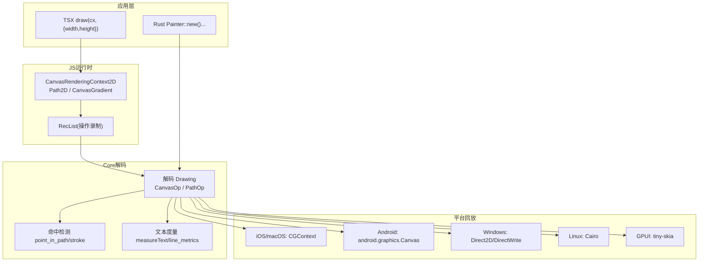
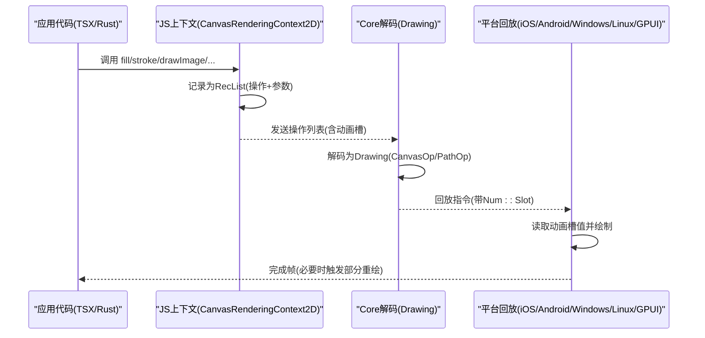
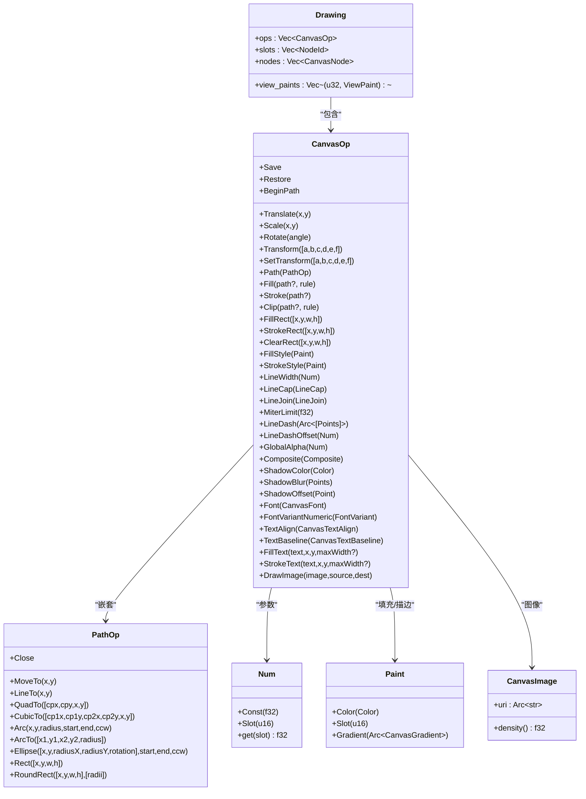
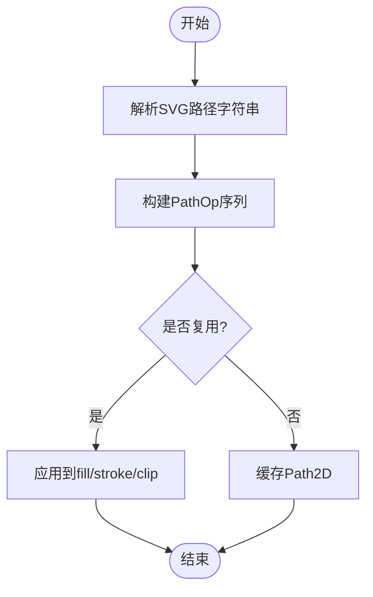
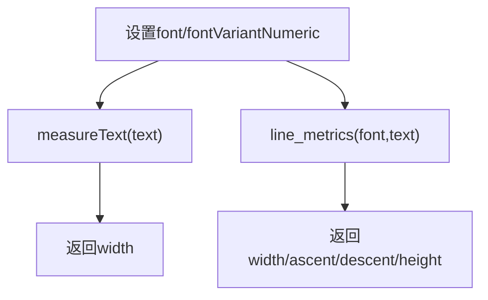
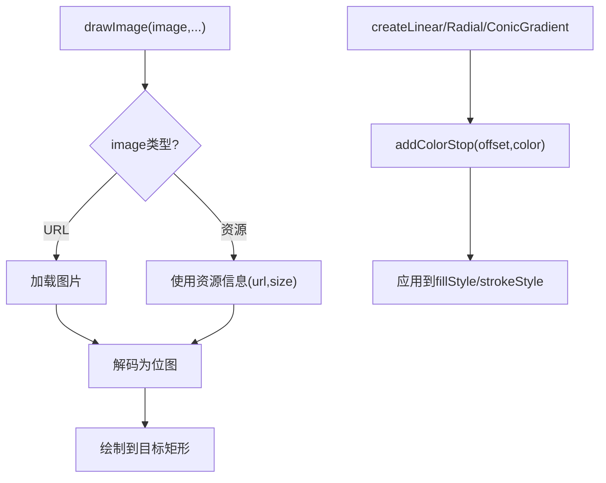
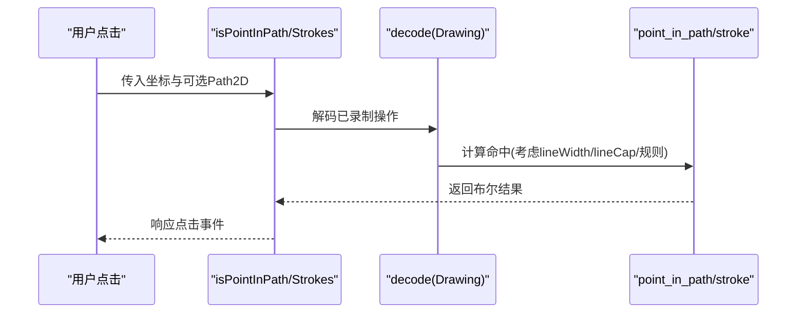
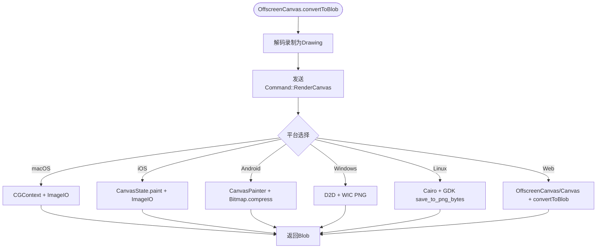
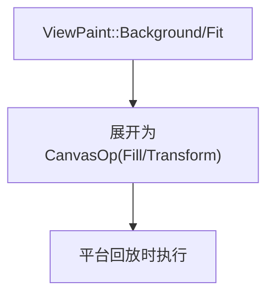

# Canvas绘图系统

<cite>
**本文引用的文件**   
- [crates/nsh-core/src/canvas.rs](file://crates/nsh-core/src/canvas.rs)
- [crates/nsh-js/src/canvas.rs](file://crates/nsh-js/src/canvas.rs)
- [docs/dev/canvas.md](file://docs/dev/canvas.md)
- [website/docs/canvas.md](file://website/docs/canvas.md)
- [crates/nsh-platform-windows/src/canvas.rs](file://crates/nsh-platform-windows/src/canvas.rs)
- [crates/nsh-platform-tui/src/canvas.rs](file://crates/nsh-platform-tui/src/canvas.rs)
- [crates/nsh-platform-windows/src/image.rs](file://crates/nsh-platform-windows/src/image.rs)
</cite>

## 目录
1. [引言](#引言)
2. [项目结构](#项目结构)
3. [核心组件](#核心组件)
4. [架构总览](#架构总览)
5. [详细组件分析](#详细组件分析)
6. [依赖关系分析](#依赖关系分析)
7. [性能与优化](#性能与优化)
8. [故障排查指南](#故障排查指南)
9. [结论](#结论)
10. [附录](#附录)

## 引言
本技术文档面向NSH的Canvas绘图系统，系统性阐述2D图形绘制API、路径与形状渲染、图像处理与变换操作；深入解析Canvas组件生命周期、渲染管道与平台回放机制；说明自定义渲染器开发方法（原生平台集成与GPU加速思路）；提供复杂绘图场景示例（图表、图像滤镜、实时数据可视化）；并给出内存管理与性能调优最佳实践，确保高负载场景下的稳定表现。

## 项目结构
Canvas子系统由“JS侧录制”和“Core侧解码/数据结构”组成，并由各平台后端进行回放：
- JS侧：实现HTML Canvas 2D子集上下文（CanvasRenderingContext2D）、Path2D、CanvasGradient等类，将调用记录为紧凑的操作列表。
- Core侧：定义Drawing、CanvasOp、PathOp、Num、Paint、CanvasImage等数据结构，以及文本度量、命中检测、视图背景填充、ViewBox适配等能力。
- 平台侧：iOS/macOS使用Core Graphics，Android使用android.graphics.Canvas，Windows使用Direct2D/DirectWrite/GDI+，Linux使用Cairo，GPUI使用tiny-skia；OffscreenCanvas在各平台分别实现离屏渲染与编码。

**图示来源**
- [crates/nsh-js/src/canvas.rs:1-11](file://crates/nsh-js/src/canvas.rs#L1-L11)
- [crates/nsh-core/src/canvas.rs:1-10](file://crates/nsh-core/src/canvas.rs#L1-L10)
- [docs/dev/canvas.md:1-39](file://docs/dev/canvas.md#L1-L39)

**章节来源**
- [crates/nsh-js/src/canvas.rs:1-11](file://crates/nsh-js/src/canvas.rs#L1-L11)
- [crates/nsh-core/src/canvas.rs:1-10](file://crates/nsh-core/src/canvas.rs#L1-L10)
- [docs/dev/canvas.md:1-39](file://docs/dev/canvas.md#L1-L39)

## 核心组件
- 录制与上下文（JS侧）
  - CanvasRenderingContext2D：状态保存/恢复、全局透明度、混合模式、线型与虚线、阴影、字体（含fontVariantNumeric扩展）、变换矩阵、路径构建、填充/描边/裁剪、矩形操作、文本绘制与测量、命中测试、渐变创建、图像绘制。
  - Path2D：复用SVG路径数据，支持moveTo/arc/roundRect等路径方法与addPath。
  - CanvasGradient：线性/径向/圆锥渐变，addColorStop。
  - OffscreenCanvas：独立尺寸对象，getContext("2d")录制，convertToBlob解码为Drawing并通过命令返回Blob。
- 数据结构与解码（Core侧）
  - Drawing：包含ops、slots（动画槽）、nodes（可访问性节点）、view_paints（从视图样式注入的绘制）。
  - CanvasOp/PathOp：所有绘制操作的枚举表示，支持数值为动画槽（Num::Slot），颜色/渐变作为Paint。
  - Num：常量或动画槽值，在平台回放时读取。
  - Paint：颜色、渐变或动画插值颜色。
  - CanvasImage：drawImage目标（URL或资源），density用于无目标尺寸时的像素到点映射。
  - ViewPaint/ViewBoxFit：视图背景填充与SVG viewBox适配。
  - 文本度量：measure_line/line_metrics，兼容浏览器行为（尾随空白处理）。
  - 命中检测：point_in_path/point_in_stroke，基于记录的几何与当前状态计算。
- 平台回放
  - iOS/macOS：CGContext回放，部分重绘与分层优化。
  - Android：CanvasPainter解释指令并在位图上绘制。
  - Windows：Direct2D/DirectWrite回放，支持部分重绘与DamageIndex索引。
  - Linux：Cairo回放，分块纹理与区域重绘。
  - GPUI：tiny-skia光栅化，包含阴影与合成临时贴图。

**章节来源**
- [crates/nsh-js/src/canvas.rs:1-11](file://crates/nsh-js/src/canvas.rs#L1-L11)
- [crates/nsh-core/src/canvas.rs:29-48](file://crates/nsh-core/src/canvas.rs#L29-L48)
- [crates/nsh-core/src/canvas.rs:56-133](file://crates/nsh-core/src/canvas.rs#L56-L133)
- [crates/nsh-core/src/canvas.rs:171-208](file://crates/nsh-core/src/canvas.rs#L171-L208)
- [crates/nsh-core/src/canvas.rs:327-369](file://crates/nsh-core/src/canvas.rs#L327-L369)
- [crates/nsh-core/src/canvas.rs:407-423](file://crates/nsh-core/src/canvas.rs#L407-L423)
- [crates/nsh-core/src/canvas.rs:670-684](file://crates/nsh-core/src/canvas.rs#L670-L684)
- [crates/nsh-core/src/canvas.rs:686-841](file://crates/nsh-core/src/canvas.rs#L686-L841)
- [crates/nsh-core/src/canvas.rs:861-942](file://crates/nsh-core/src/canvas.rs#L861-L942)
- [crates/nsh-core/src/canvas.rs:1025-1146](file://crates/nsh-core/src/canvas.rs#L1025-L1146)
- [crates/nsh-core/src/canvas.rs:531-634](file://crates/nsh-core/src/canvas.rs#L531-L634)
- [docs/dev/canvas.md:1-39](file://docs/dev/canvas.md#L1-L39)

## 架构总览
Canvas渲染管线分为三个阶段：录制→解码→回放。录制阶段在JS侧将API调用转换为紧凑操作序列；解码阶段在Core侧构造不可变Drawing；回放阶段由各平台后端按设备像素密度绘制，支持动画槽实时读取与部分重绘。

**图示来源**
- [crates/nsh-js/src/canvas.rs:581-605](file://crates/nsh-js/src/canvas.rs#L581-L605)
- [crates/nsh-core/src/canvas.rs:861-880](file://crates/nsh-core/src/canvas.rs#L861-L880)
- [docs/dev/canvas.md:1-39](file://docs/dev/canvas.md#L1-L39)

## 详细组件分析

### 2D API与操作模型
- 状态管理：save/restore、globalAlpha、globalCompositeOperation、lineWidth/lineCap/lineJoin/miterLimit、setLineDash/getLineDash/lineDashOffset、shadow*、font/fontVariantNumeric、textAlign/textBaseline。
- 变换：translate/scale/rotate/transform/setTransform/resetTransform。
- 路径：beginPath/moveTo/lineTo/quadraticCurveTo/bezierCurveTo/arc/arcTo/ellipse/rect/roundRect/closePath；fill/stroke/clip支持Path2D。
- 矩形：fillRect/strokeRect/clearRect。
- 文本：fillText/strokeText/measureText；Rust侧提供measure_text/line_metrics。
- 命中：isPointInPath/isPointInStroke；Rust侧path_contains/stroke_contains/is_point_in_path/is_point_in_stroke。
- 渐变：createLinearGradient/createRadialGradient/createConicGradient + addColorStop。
- 图像：drawImage三种重载；CanvasImage.density决定无目标尺寸时的缩放。

**图示来源**
- [crates/nsh-core/src/canvas.rs:56-133](file://crates/nsh-core/src/canvas.rs#L56-L133)
- [crates/nsh-core/src/canvas.rs:686-841](file://crates/nsh-core/src/canvas.rs#L686-L841)
- [crates/nsh-core/src/canvas.rs:861-880](file://crates/nsh-core/src/canvas.rs#L861-L880)
- [crates/nsh-core/src/canvas.rs:29-48](file://crates/nsh-core/src/canvas.rs#L29-L48)
- [crates/nsh-core/src/canvas.rs:327-369](file://crates/nsh-core/src/canvas.rs#L327-L369)
- [crates/nsh-core/src/canvas.rs:670-684](file://crates/nsh-core/src/canvas.rs#L670-L684)

**章节来源**
- [crates/nsh-core/src/canvas.rs:56-133](file://crates/nsh-core/src/canvas.rs#L56-L133)
- [crates/nsh-core/src/canvas.rs:686-841](file://crates/nsh-core/src/canvas.rs#L686-L841)
- [crates/nsh-core/src/canvas.rs:861-880](file://crates/nsh-core/src/canvas.rs#L861-L880)
- [crates/nsh-core/src/canvas.rs:29-48](file://crates/nsh-core/src/canvas.rs#L29-L48)
- [crates/nsh-core/src/canvas.rs:327-369](file://crates/nsh-core/src/canvas.rs#L327-L369)
- [crates/nsh-core/src/canvas.rs:670-684](file://crates/nsh-core/src/canvas.rs#L670-L684)

### 路径与SVG路径数据
- Path2D支持SVG路径字符串，便于图标复用；可在多个fill/stroke/clip中重用。
- roundRect支持CSS border-radius语义（1个或2-4个半径）。
- addPath合并路径子图元。

**图示来源**
- [crates/nsh-js/src/canvas.rs:804-839](file://crates/nsh-js/src/canvas.rs#L804-L839)
- [crates/nsh-js/src/canvas.rs:841-873](file://crates/nsh-js/src/canvas.rs#L841-L873)
- [website/docs/canvas.md:200-240](file://website/docs/canvas.md#L200-L240)

**章节来源**
- [crates/nsh-js/src/canvas.rs:804-839](file://crates/nsh-js/src/canvas.rs#L804-L839)
- [crates/nsh-js/src/canvas.rs:841-873](file://crates/nsh-js/src/canvas.rs#L841-L873)
- [website/docs/canvas.md:200-240](file://website/docs/canvas.md#L200-L240)

### 文本与度量
- font支持CSS简写，包含small-caps与数字形式（tabular-nums等）。
- fontVariantNumeric独立于font，避免重置。
- textAlign/textBaseline控制文本对齐与基线。
- measureText同步返回宽度；Rust侧line_metrics提供ascent/descent/height。

**图示来源**
- [crates/nsh-core/src/canvas.rs:407-423](file://crates/nsh-core/src/canvas.rs#L407-L423)
- [crates/nsh-core/src/canvas.rs:531-634](file://crates/nsh-core/src/canvas.rs#L531-L634)
- [crates/nsh-js/src/canvas.rs:1027-1060](file://crates/nsh-js/src/canvas.rs#L1027-L1060)

**章节来源**
- [crates/nsh-core/src/canvas.rs:407-423](file://crates/nsh-core/src/canvas.rs#L407-L423)
- [crates/nsh-core/src/canvas.rs:531-634](file://crates/nsh-core/src/canvas.rs#L531-L634)
- [crates/nsh-js/src/canvas.rs:1027-1060](file://crates/nsh-js/src/canvas.rs#L1027-L1060)

### 图像与渐变
- drawImage支持URL或导入资源；当无目标尺寸时使用CanvasImage.density换算像素到点。
- SVG通过nsh_core::svg光栅化为位图后交给canvas绘制。
- 渐变支持线性/径向/圆锥，addColorStop按偏移顺序应用。

**图示来源**
- [crates/nsh-core/src/canvas.rs:670-684](file://crates/nsh-core/src/canvas.rs#L670-L684)
- [crates/nsh-core/src/canvas.rs:201-325](file://crates/nsh-core/src/canvas.rs#L201-L325)
- [crates/nsh-js/src/canvas.rs:1157-1200](file://crates/nsh-js/src/canvas.rs#L1157-L1200)

**章节来源**
- [crates/nsh-core/src/canvas.rs:670-684](file://crates/nsh-core/src/canvas.rs#L670-L684)
- [crates/nsh-core/src/canvas.rs:201-325](file://crates/nsh-core/src/canvas.rs#L201-L325)
- [crates/nsh-js/src/canvas.rs:1157-1200](file://crates/nsh-js/src/canvas.rs#L1157-L1200)

### 命中检测与交互
- isPointInPath/isPointInStroke在JS侧基于已录制的drawing进行命中判断，动画值视为0。
- Rust侧path_contains/stroke_contains/is_point_in_path/is_point_in_stroke提供相同逻辑。

**图示来源**
- [crates/nsh-js/src/canvas.rs:1062-1114](file://crates/nsh-js/src/canvas.rs#L1062-L1114)
- [crates/nsh-core/src/canvas.rs:1-10](file://crates/nsh-core/src/canvas.rs#L1-L10)

**章节来源**
- [crates/nsh-js/src/canvas.rs:1062-1114](file://crates/nsh-js/src/canvas.rs#L1062-L1114)
- [crates/nsh-core/src/canvas.rs:1-10](file://crates/nsh-core/src/canvas.rs#L1-L10)

### OffscreenCanvas与离屏渲染
- OffscreenCanvas.getContext("2d")录制独立于屏幕Canvas；convertToBlob解码为Drawing并通过Command::RenderCanvas下发给平台。
- 各平台实现：
  - macOS：CGContext sRGB位图，ImageIO编码。
  - iOS：CanvasState.paint到CGBitmapContext，ImageIO。
  - Android：CanvasPainter在Bitmap上绘制，Bitmap.compress。
  - Windows：D2D位图，WIC PNG编码，GPU查询非阻塞。
  - Linux：Cairo ImageSurface，GDK保存PNG。
  - Web：OffscreenCanvas或<canvas>重放，convertToBlob。

**图示来源**
- [docs/dev/canvas.md:41-84](file://docs/dev/canvas.md#L41-L84)

**章节来源**
- [docs/dev/canvas.md:41-84](file://docs/dev/canvas.md#L41-L84)

### 视图背景与SVG viewBox适配
- ViewPaint::Background将视图的backgroundColor与backgroundImage（CSS渐变）展开为填充操作，仅在路径填充区域内显示。
- ViewPaint::Fit将SVG viewBox映射到Canvas盒，支持preserveAspectRatio（meet/slice/xMidYMid等）。

**图示来源**
- [crates/nsh-core/src/canvas.rs:882-942](file://crates/nsh-core/src/canvas.rs#L882-L942)
- [crates/nsh-core/src/canvas.rs:1049-1126](file://crates/nsh-core/src/canvas.rs#L1049-L1126)

**章节来源**
- [crates/nsh-core/src/canvas.rs:882-942](file://crates/nsh-core/src/canvas.rs#L882-L942)
- [crates/nsh-core/src/canvas.rs:1049-1126](file://crates/nsh-core/src/canvas.rs#L1049-L1126)

## 依赖关系分析
- JS侧Canvas类与Core侧CanvasOp/PathOp通过#[derive(JsOps)]生成方法/属性规格，减少桥接开销。
- 动画值以槽位（slot）形式嵌入Drawing.slots，平台回放时读取，避免JS参与动画帧。
- 平台侧对动画值影响区域进行DamageScan与DamageIndex优化，减少重绘范围。

**图示来源**
- [crates/nsh-js/src/canvas.rs:143-166](file://crates/nsh-js/src/canvas.rs#L143-L166)
- [crates/nsh-core/src/canvas.rs:861-880](file://crates/nsh-core/src/canvas.rs#L861-L880)
- [docs/dev/canvas.md:85-120](file://docs/dev/canvas.md#L85-L120)

**章节来源**
- [crates/nsh-js/src/canvas.rs:143-166](file://crates/nsh-js/src/canvas.rs#L143-L166)
- [crates/nsh-core/src/canvas.rs:861-880](file://crates/nsh-core/src/canvas.rs#L861-L880)
- [docs/dev/canvas.md:85-120](file://docs/dev/canvas.md#L85-L120)

## 性能与优化
- 录制一次、回放多次：避免每帧跨语言桥接；将频繁变化的数值放入动画槽，信号变化仅触发重新录制。
- 拆分静态与动态部分：将静态背景与动态前景拆分为两个Canvas叠加，降低重绘成本。
- 部分重绘：iOS/macOS/Windows/Linux支持DamageScan/DamageIndex，仅重绘受影响区域；macOS可将短小的animated后缀拆分为独立内容层。
- 图像与SVG：优先使用SVG矢量绘制以获得任意缩放清晰度；避免放大远大于内在尺寸的位图。
- 离屏渲染：OffscreenCanvas在各平台线程安全地编码，避免UI线程阻塞。
- 内存管理：
  - 控制数组预算（MAX_ARRAY_ITEMS）与深度限制，防止稀疏数组与深层嵌套导致内存暴涨。
  - 及时释放Recording持有的JS值（finalizer/gc_mark）。
  - 复用Path2D与CanvasGradient，避免重复构建。
  - 使用AnimatedValue派生节点（derived）保持槽位稳定，避免重复分配。

**章节来源**
- [website/docs/canvas.md:528-534](file://website/docs/canvas.md#L528-L534)
- [docs/dev/canvas.md:85-120](file://docs/dev/canvas.md#L85-L120)
- [crates/nsh-js/src/canvas.rs:492-574](file://crates/nsh-js/src/canvas.rs#L492-L574)
- [crates/nsh-js/src/canvas.rs:277-298](file://crates/nsh-js/src/canvas.rs#L277-L298)

## 故障排查指南
- 无效颜色或字体：对应操作被丢弃（与HTML Canvas一致），检查color/font语法。
- 离屏渲染超时：render::TIMEOUT（默认30秒）会拒绝请求并释放槽位，检查平台服务可用性（Environment::canvas_render）。
- 平台不支持：未设置Environment::canvas_render时返回ERR_FEATURE_UNAVAILABLE_ON_PLATFORM。
- 命中检测异常：动画值在命中计算中视为0；确保传递的坐标与路径状态正确。
- 文本度量差异：尾部空白处理方式与浏览器一致，必要时使用mark字符辅助测量。

**章节来源**
- [docs/dev/canvas.md:41-84](file://docs/dev/canvas.md#L41-L84)
- [crates/nsh-js/src/canvas.rs:1062-1114](file://crates/nsh-js/src/canvas.rs#L1062-L1114)
- [crates/nsh-core/src/canvas.rs:531-634](file://crates/nsh-core/src/canvas.rs#L531-L634)

## 结论
NSH的Canvas系统通过“JS录制→Core解码→平台回放”的架构，实现了高性能、跨平台的2D绘图能力。其设计强调：
- 最小化桥接开销与内存分配
- 动画值槽位驱动的原生重绘
- 丰富的2D API与SVG路径复用
- 多平台一致的文本度量与命中检测
- 可扩展的OffscreenCanvas与离屏编码

遵循本文的最佳实践与优化策略，可在高负载场景下获得稳定且流畅的绘图体验。

## 附录

### 复杂绘图场景示例
- 图表绘制：使用Path2D复用折线/柱状图路径，结合渐变与阴影提升视觉层次；将轴标签与刻度分离为静态Canvas，数据更新仅重绘前景。
- 图像处理滤镜：由于不支持getImageData/putImageData与filter，建议在Rust侧预处理图像或使用Shader模块实现特效。
- 实时数据可视化：将高频更新的数值封装为AnimatedValue，配合DamageScan实现局部重绘；使用conic渐变制作进度环。

**章节来源**
- [website/docs/canvas.md:356-464](file://website/docs/canvas.md#L356-L464)
- [docs/dev/canvas.md:1-39](file://docs/dev/canvas.md#L1-L39)