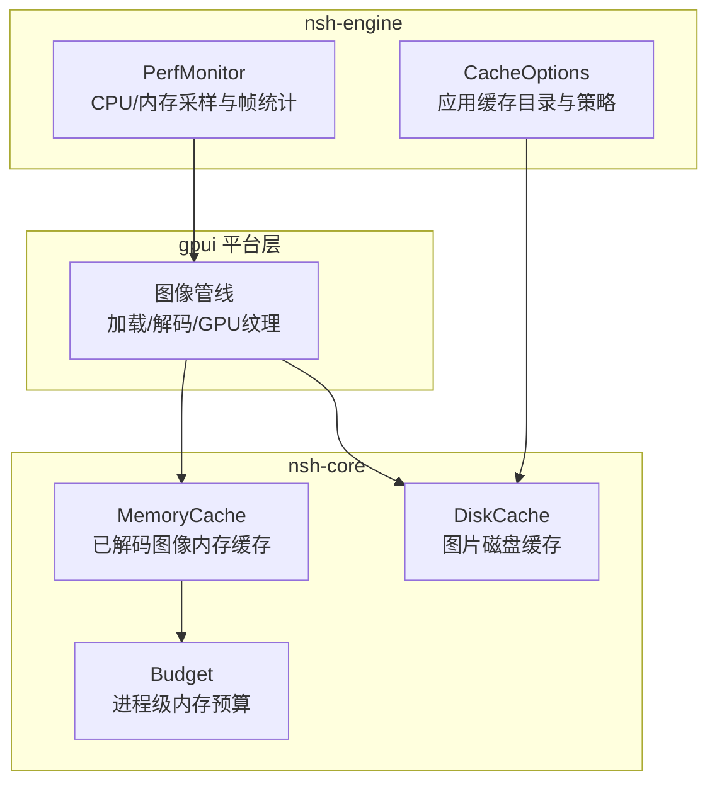
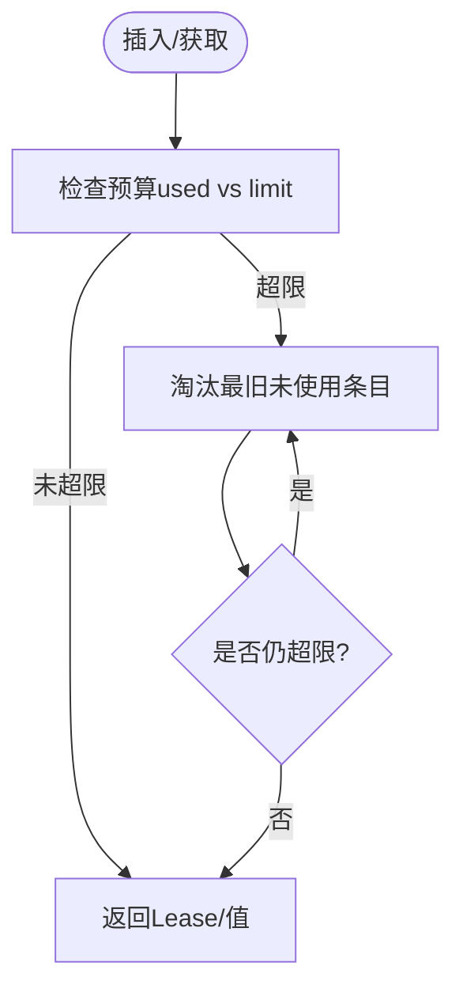
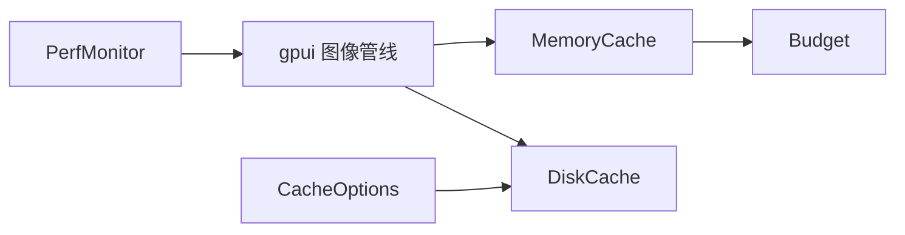

# 内存管理

<cite>
**本文引用的文件**   
- [memory.rs](file://crates/nsh-core/src/image/memory.rs)
- [cache.rs（核心图片缓存）](file://crates/nsh-core/src/image/cache.rs)
- [cache.rs（引擎缓存配置）](file://crates/nsh-engine/src/cache.rs)
- [perf.rs](file://crates/nsh-engine/src/perf.rs)
- [image.rs（平台图像管线）](file://crates/gpui/nsh-platform-gpui/src/image.rs)
</cite>

## 目录
1. [引言](#引言)
2. [项目结构](#项目结构)
3. [核心组件](#核心组件)
4. [架构总览](#架构总览)
5. [详细组件分析](#详细组件分析)
6. [依赖关系分析](#依赖关系分析)
7. [性能与内存优化建议](#性能与内存优化建议)
8. [故障排查指南](#故障排查指南)
9. [结论](#结论)

## 引言
本文件面向 NSH UI 框架的内存管理机制，聚焦以下目标：
- 解释 Rust 所有权、生命周期与借用检查在 UI 资源管理中的体现。
- 深入讲解资源缓存策略：已解码图像内存缓存、磁盘持久化图片缓存、以及计算结果/渲染相关开销的计量方式。
- 说明内存分配器与堆栈使用特征、预算控制与回退机制。
- 梳理垃圾回收与弱引用在跨线程共享对象中的作用。
- 提供内存泄漏检测与分析工具的使用思路。
- 总结大型应用的内存优化最佳实践，包括对象池、弱引用、内存压力处理等。
- 结合仓库中实际实现，给出可落地的优化案例与效果观测方法。

## 项目结构
NSH 的内存管理主要分布在以下模块：
- nsh-core 图片子系统：负责已解码图像的内存预算、LRU 淘汰、Lease 持有模型与 GPU 侧成本计量。
- nsh-core 图片磁盘缓存：按 HTTP 缓存语义持久化下载的图片字节，支持条件请求、重定向校验与 LRU 清理。
- nsh-engine 引擎缓存配置：为每个应用隔离缓存目录，并提供图片缓存策略开关与大小上限。
- gpui 平台图像管线：将图像加载、解码、GPU 纹理拷贝与内存预算联动。
- nsh-engine 性能监控：进程 CPU/内存采样、帧与提交统计，用于定位内存与性能问题。



图表来源
- [memory.rs:32-204](file://crates/nsh-core/src/image/memory.rs#L32-L204)
- [cache.rs（核心图片缓存）:303-423](file://crates/nsh-core/src/image/cache.rs#L303-L423)
- [cache.rs（引擎缓存配置）:11-99](file://crates/nsh-engine/src/cache.rs#L11-L99)
- [perf.rs:158-233](file://crates/nsh-engine/src/perf.rs#L158-L233)

章节来源
- [memory.rs:1-20](file://crates/nsh-core/src/image/memory.rs#L1-L20)
- [cache.rs（核心图片缓存）:1-61](file://crates/nsh-core/src/image/cache.rs#L1-L61)
- [cache.rs（引擎缓存配置）:1-21](file://crates/nsh-engine/src/cache.rs#L1-L21)
- [perf.rs:1-30](file://crates/nsh-engine/src/perf.rs#L1-L30)

## 核心组件
- Budget：进程级内存预算控制器，统一跟踪所有缓存条目占用，并在超过限制时触发 LRU 淘汰；达到阈值后尝试归还系统内存。
- MemoryCache<K, V>：通用键值缓存，基于 Lease 持有模型保证“正在使用的条目不被淘汰”，并通过 add_cost 动态计入 GPU 侧开销。
- DiskCache：持久化图片缓存，遵循 HTTP 缓存语义（ETag/Last-Modified），对重定向进行访问控制校验，并维护目录级 LRU。
- CacheOptions：应用级缓存位置与策略（默认 256 MiB 图片缓存），支持关闭或自定义大小。
- PerfMonitor：性能与内存采样，提供 FPS、帧耗时、提交耗时、进程 CPU/内存占用等指标，辅助定位内存热点。

章节来源
- [memory.rs:32-204](file://crates/nsh-core/src/image/memory.rs#L32-L204)
- [memory.rs:216-411](file://crates/nsh-core/src/image/memory.rs#L216-L411)
- [cache.rs（核心图片缓存）:303-423](file://crates/nsh-core/src/image/cache.rs#L303-L423)
- [cache.rs（引擎缓存配置）:11-99](file://crates/nsh-engine/src/cache.rs#L11-L99)
- [perf.rs:158-233](file://crates/nsh-engine/src/perf.rs#L158-L233)

## 架构总览
NSH 的内存管理以“预算 + 缓存”为核心：
- 内存预算（Budget）作为全局约束，协调多个缓存（如不同 key 空间的图像缓存）共同遵守上限。
- 已解码图像通过 MemoryCache 管理，Lease 确保视图持有期间不被淘汰；add_cost 将 GPU 纹理拷贝纳入预算。
- 磁盘缓存（DiskCache）独立于内存预算，按 URL 持久化原始图片字节，避免重复下载，同时遵循 HTTP 缓存策略。
- 平台图像管线（gpui）将加载、解码、纹理上传与预算联动，形成从网络到屏幕的完整路径。
- 性能监控（PerfMonitor）贯穿主线程与引擎线程，采集帧、提交、CPU/内存数据，帮助定位瓶颈。

```mermaid
sequenceDiagram
participant App as "应用代码"
participant Img as "平台图像管线"
participant Disk as "DiskCache"
participant Mem as "MemoryCache"
participant Bud as "Budget"
App->>Img : 请求显示图片
Img->>Disk : lookup(url)
alt 命中且新鲜
Disk-->>Img : Fresh(bytes)
else 陈旧或不存在
Disk-->>Img : Stale(validators)/Miss
Img->>Img : 发起HTTP(带条件头)
Img->>Disk : complete(response)
Disk-->>Img : bytes/错误
end
Img->>Mem : insert(key, value, cost)
Mem->>Bud : used += cost; enforce()
Bud-->>Mem : 可能淘汰旧条目
Img->>Mem : add_cost(delta) // GPU纹理拷贝
Mem->>Bud : used += delta; enforce()
```

图表来源
- [cache.rs（核心图片缓存）:373-406](file://crates/nsh-core/src/image/cache.rs#L373-L406)
- [cache.rs（核心图片缓存）:461-528](file://crates/nsh-core/src/image/cache.rs#L461-L528)
- [memory.rs:314-363](file://crates/nsh-core/src/image/memory.rs#L314-L363)
- [memory.rs:180-204](file://crates/nsh-core/src/image/memory.rs#L180-L204)

## 详细组件分析

### 已解码图像内存缓存（MemoryCache + Budget）
- 设计要点
  - 进程级 Budget 统一管理所有缓存的字节计数，支持动态设置上限与强制清理。
  - MemoryCache 使用 HashMap 存储条目，BTreeMap 按时间戳排序未使用条目，实现 LRU。
  - Lease 持有模型：只要存在有效 Lease，条目不会被淘汰；Lease 克隆即再次持有。
  - add_cost 允许动态增加条目成本（例如 GPU 纹理拷贝），并触发预算检查。
  - 当条目大于整个预算时，仅在最后一个 Lease 释放后才会被移除。
- 复杂度与行为
  - get/insert/remove/clear 均受 Mutex 保护，O(1) 平均查找，LRU 操作 O(log n)。
  - enforce 遍历各缓存的最旧未使用条目，直到满足预算上限。
- 关键流程
  - 插入新条目：更新 budget.used，必要时淘汰最旧条目；返回 Lease。
  - 释放 Lease：若 leases 归零，将条目移入 unused 并按时间戳排序；若条目成本超预算则直接移除。
  - 成本变更：add_cost 调整条目成本并触发 enforce。



图表来源
- [memory.rs:180-204](file://crates/nsh-core/src/image/memory.rs#L180-L204)
- [memory.rs:314-363](file://crates/nsh-core/src/image/memory.rs#L314-L363)
- [memory.rs:425-490](file://crates/nsh-core/src/image/memory.rs#L425-L490)

章节来源
- [memory.rs:32-204](file://crates/nsh-core/src/image/memory.rs#L32-L204)
- [memory.rs:216-411](file://crates/nsh-core/src/image/memory.rs#L216-L411)
- [memory.rs:425-490](file://crates/nsh-core/src/image/memory.rs#L425-L490)

### 图片磁盘缓存（DiskCache）
- 设计要点
  - 按 URL 持久化原始图片字节，不解码位图，跨启动与离线可用。
  - 遵循 HTTP 缓存语义：Cache-Control、Expires、ETag、Last-Modified、Vary、Pragma。
  - 对重定向进行访问控制校验，拒绝的路径会丢弃缓存项。
  - 文件写入采用临时名+原子重命名，保证并发安全与一致性。
  - 目录级 LRU：超过上限时按修改时间删除最旧条目至目标的 3/4。
- 关键流程
  - lookup：判断 Fresh/Stale/Miss，必要时返回条件请求头。
  - complete：根据响应状态码决定存储、替换或丢弃；304 情况下更新策略头并决定是否保留。
  - trim：扫描目录，清理临时文件与过期条目，更新估计大小。

```mermaid
flowchart TD
Lookup["lookup(url)"] --> Fresh{"是否Fresh?"}
Fresh --> |是| ServeFresh["直接返回字节"]
Fresh --> |否| Request["发送条件请求(If-None-Match/If-Modified-Since)"]
Request --> Response{"响应状态"}
Response --> |200/203| Store["存储并返回字节"]
Response --> |304| Update["更新策略头/决定是否保留"]
Response --> |5xx| StaleServe["尝试返回陈旧副本"]
Response --> |3xx(未跟随)| Drop["丢弃条目并报错"]
```

图表来源
- [cache.rs（核心图片缓存）:373-406](file://crates/nsh-core/src/image/cache.rs#L373-L406)
- [cache.rs（核心图片缓存）:461-528](file://crates/nsh-core/src/image/cache.rs#L461-L528)
- [cache.rs（核心图片缓存）:647-687](file://crates/nsh-core/src/image/cache.rs#L647-L687)

章节来源
- [cache.rs（核心图片缓存）:1-61](file://crates/nsh-core/src/image/cache.rs#L1-L61)
- [cache.rs（核心图片缓存）:303-423](file://crates/nsh-core/src/image/cache.rs#L303-L423)
- [cache.rs（核心图片缓存）:461-528](file://crates/nsh-core/src/image/cache.rs#L461-L528)
- [cache.rs（核心图片缓存）:647-687](file://crates/nsh-core/src/image/cache.rs#L647-L687)

### 引擎缓存配置（CacheOptions）
- 设计要点
  - 每个应用拥有独立缓存根目录：<root>/<app id>/<kind>，避免应用间污染。
  - 图片缓存默认 256 MiB，可通过 CachePolicy::MaxSize 调整或关闭。
  - CacheLocation::System 使用系统缓存目录，可由系统清理；Dir 允许自定义路径；Off 禁用磁盘缓存。
- 关键接口
  - open_images：根据 app_id 与策略打开图片磁盘缓存。
  - dir：解析缓存目录路径。

章节来源
- [cache.rs（引擎缓存配置）:11-99](file://crates/nsh-engine/src/cache.rs#L11-L99)

### 性能与内存采样（PerfMonitor）
- 设计要点
  - 双线程协作：引擎线程记录 commit 与 busy 时间；主线程记录工作耗时与 vsync，闭合帧。
  - 提供 FPS、帧间隔、丢帧率、提交速率、JS/布局耗时、延迟、引擎忙碌比例等指标。
  - 进程级 CPU/内存采样：macOS 使用物理足迹（phys_footprint），Linux/Android 使用驻留集，Windows 使用 WorkingSetSize。
  - 支持环境开关 NSH_FPS=1 开启面板与日志。
- 关键接口
  - record_work/vsync/record_latency/record_commit/record_busy/snapshot。
  - set_process/set_memory 注入进程与内存样本。

章节来源
- [perf.rs:1-30](file://crates/nsh-engine/src/perf.rs#L1-L30)
- [perf.rs:158-233](file://crates/nsh-engine/src/perf.rs#L158-L233)
- [perf.rs:304-484](file://crates/nsh-engine/src/perf.rs#L304-L484)
- [perf.rs:501-674](file://crates/nsh-engine/src/perf.rs#L501-L674)

## 依赖关系分析
- 平台图像管线（gpui）依赖 MemoryCache 与 DiskCache：
  - 加载阶段优先走 DiskCache，命中则跳过网络；否则发起请求并回填缓存。
  - 解码后通过 MemoryCache 管理内存，并将 GPU 纹理拷贝成本通过 add_cost 计入预算。
- Budget 聚合所有缓存的 used 计数，统一执行 enforce 淘汰策略。
- PerfMonitor 与平台层联动，采集帧与进程资源数据，辅助诊断内存与性能问题。



图表来源
- [image.rs（平台图像管线）:859-909](file://crates/gpui/nsh-platform-gpui/src/image.rs#L859-L909)
- [memory.rs:314-363](file://crates/nsh-core/src/image/memory.rs#L314-L363)
- [cache.rs（核心图片缓存）:373-406](file://crates/nsh-core/src/image/cache.rs#L373-L406)
- [cache.rs（引擎缓存配置）:89-99](file://crates/nsh-engine/src/cache.rs#L89-L99)
- [perf.rs:304-484](file://crates/nsh-engine/src/perf.rs#L304-L484)

章节来源
- [image.rs（平台图像管线）:859-909](file://crates/gpui/nsh-platform-gpui/src/image.rs#L859-L909)
- [memory.rs:314-363](file://crates/nsh-core/src/image/memory.rs#L314-L363)
- [cache.rs（核心图片缓存）:373-406](file://crates/nsh-core/src/image/cache.rs#L373-L406)
- [cache.rs（引擎缓存配置）:89-99](file://crates/nsh-engine/src/cache.rs#L89-L99)
- [perf.rs:304-484](file://crates/nsh-engine/src/perf.rs#L304-L484)

## 性能与内存优化建议
- 预算与缓存调优
  - 合理设置 Budget.limit：桌面端通常为物理内存的 1/16（上限 256 MiB），移动端为 1/8（上限 128 MiB）。
  - 针对大图场景，使用 bucket/wanted 计算合适的解码尺寸，减少不必要的像素内存。
  - 通过 DiskCache 的 CachePolicy 控制图片缓存大小，避免磁盘占用过高。
- GPU 侧成本计量
  - 使用 MemoryCache::add_cost 将纹理拷贝纳入预算，防止 GPU 内存膨胀导致整体内存压力。
- 弱引用与共享对象
  - 使用 Arc/Weak 管理跨线程共享对象，避免强引用环导致的泄漏；Budget.caches 使用 Weak<dyn Evict> 避免循环。
- 内存压力处理
  - 调用 Budget.clear 主动清空未使用条目，并在 Linux glibc 上尝试 malloc_trim 归还内存。
- 性能监控与定位
  - 启用 NSH_FPS=1 观察 FPS、帧耗时、丢帧率与引擎忙碌比例。
  - 使用 ProcessSampler 采集 CPU/内存，结合 PerfSnapshot.memory 分析 JS 堆与节点数量趋势。

[本节为通用指导，不直接分析具体文件]

## 故障排查指南
- 常见症状
  - 内存持续增长：检查 MemoryCache 的 Lease 是否正确释放；确认 add_cost 是否与纹理创建/销毁匹配。
  - 图片加载缓慢：检查 DiskCache 命中率与条件请求头（ETag/Last-Modified）是否正确传递。
  - 卡顿与掉帧：查看 PerfMonitor 的 frame 与 dropped 指标，定位主线程阻塞点。
- 排查步骤
  - 启用性能面板：NSH_FPS=1 或 --fps，观察 FPS、frame_interval、dropped、engine_busy。
  - 检查进程内存：PerfMonitor.set_process 注入 ProcessSample，关注 memory 字段变化。
  - 验证缓存策略：DiskCache 的 store/trim 逻辑是否符合预期，目录大小是否增长过快。
  - 审计 Lease 生命周期：确保视图销毁时 Lease 被 drop，条目进入 unused 并被 LRU 淘汰。

章节来源
- [perf.rs:304-484](file://crates/nsh-engine/src/perf.rs#L304-L484)
- [perf.rs:501-674](file://crates/nsh-engine/src/perf.rs#L501-L674)
- [memory.rs:425-490](file://crates/nsh-core/src/image/memory.rs#L425-L490)
- [cache.rs（核心图片缓存）:647-687](file://crates/nsh-core/src/image/cache.rs#L647-L687)

## 结论
NSH 的内存管理以 Budget + MemoryCache + DiskCache 为核心，结合 Lease 持有模型与 HTTP 缓存语义，实现了高效且可控的资源管理。通过 PerfMonitor 的性能与内存采样，开发者可以精准定位瓶颈并进行调优。在实际项目中，建议：
- 合理设置预算与缓存大小，避免过度解码与磁盘占用。
- 使用 add_cost 精确计量 GPU 侧开销，保持整体内存健康。
- 利用弱引用与 Lease 模型避免泄漏，确保资源及时释放。
- 借助性能面板与进程采样持续监控，迭代优化用户体验。

[本节为总结性内容，不直接分析具体文件]