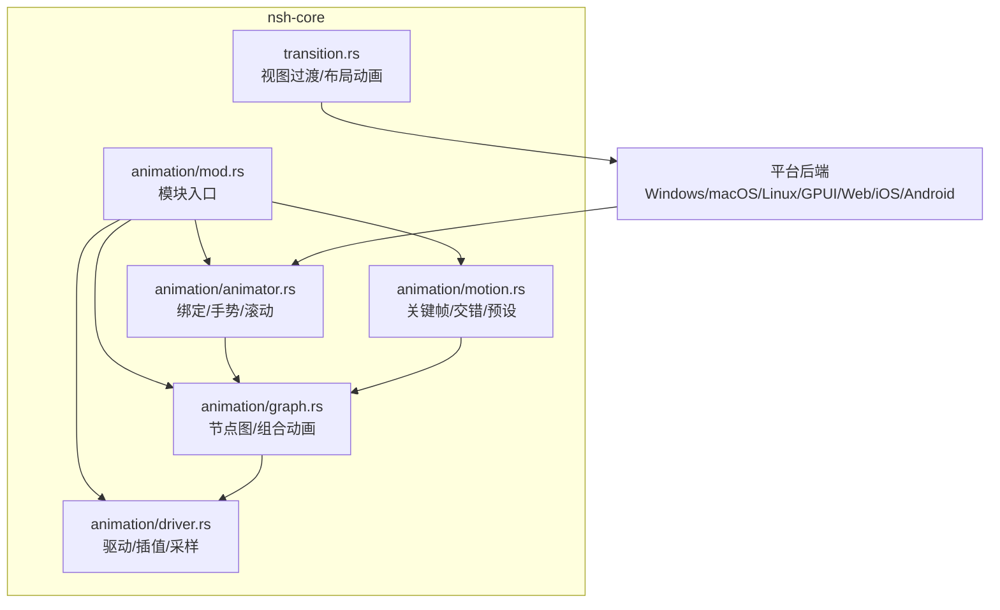
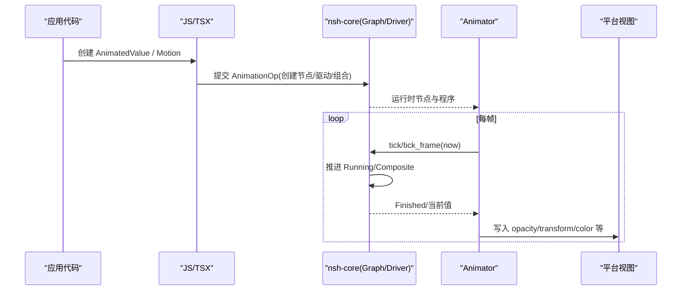
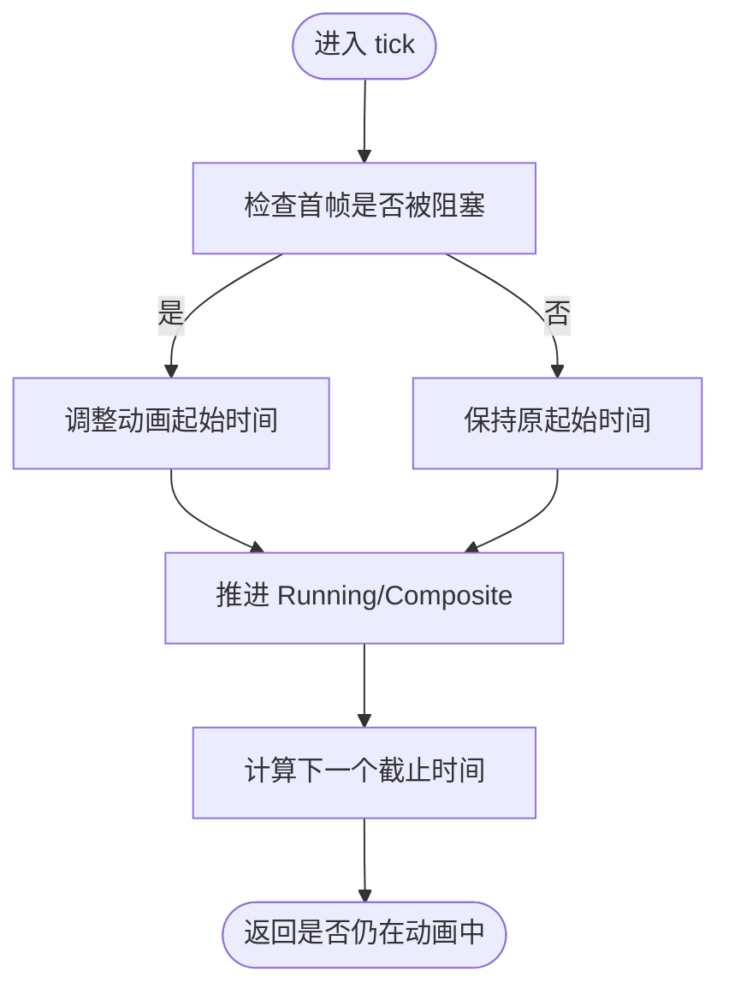
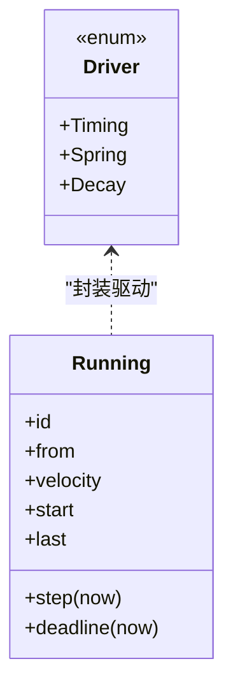
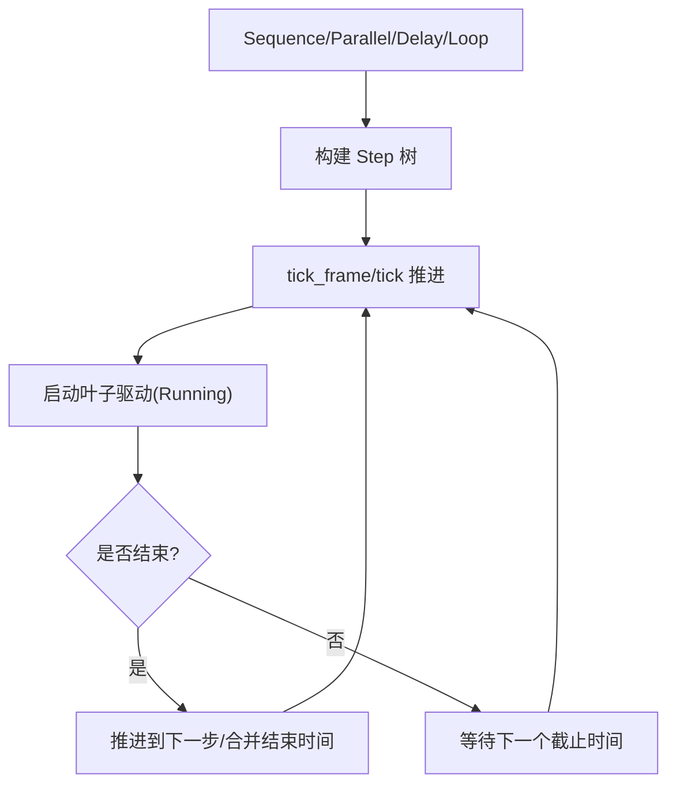
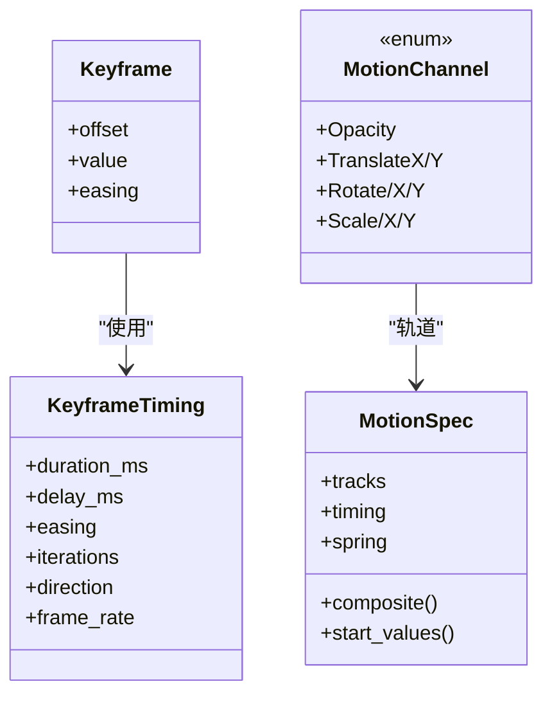
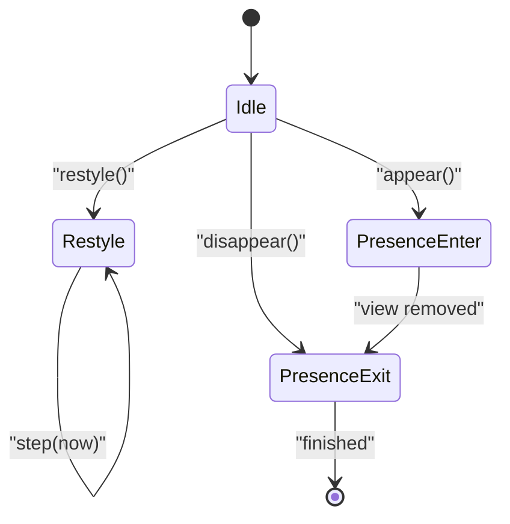
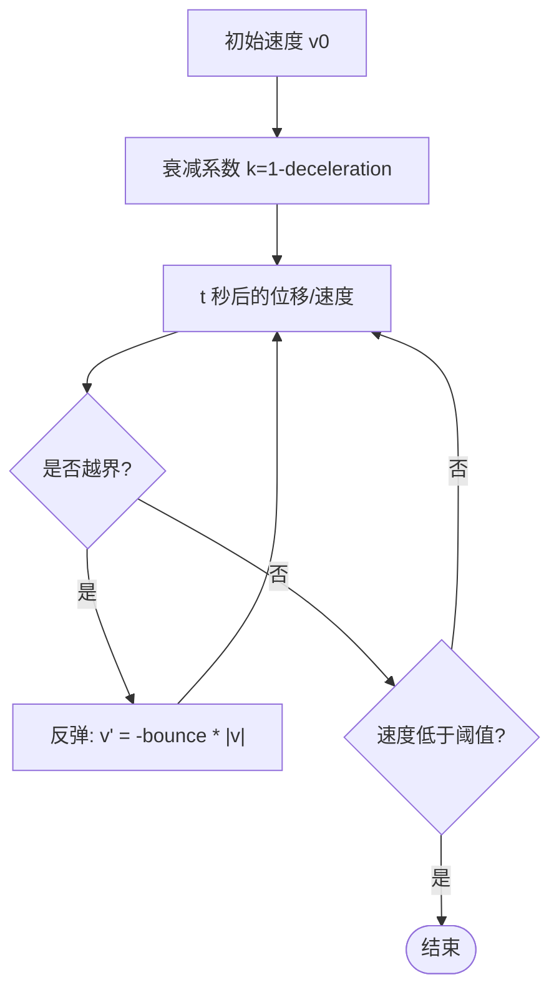
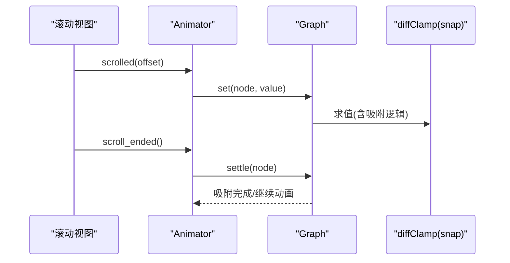
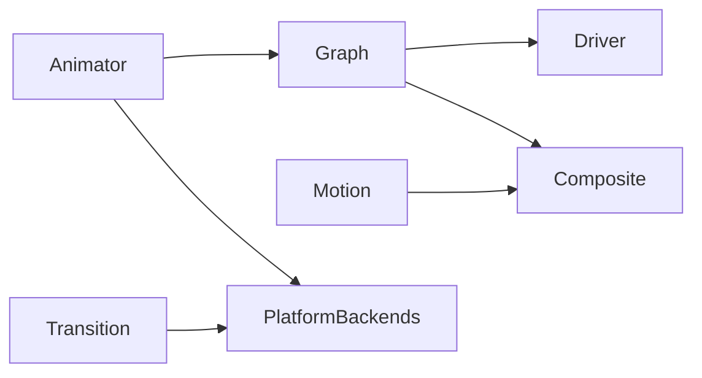

# 动画系统

<cite>
**本文引用的文件**   
- [animation.md（开发文档）](file://docs/dev/animation.md)
- [animation.md（网站文档）](file://website/docs/animation.md)
- [mod.rs（动画模块入口）](file://crates/nsh-core/src/animation/mod.rs)
- [animator.rs（桌面端动画器）](file://crates/nsh-core/src/animation/animator.rs)
- [driver.rs（驱动与插值）](file://crates/nsh-core/src/animation/driver.rs)
- [graph.rs（节点图与组合动画）](file://crates/nsh-core/src/animation/graph.rs)
- [motion.rs（关键帧、交错与预设运动）](file://crates/nsh-core/src/animation/motion.rs)
- [transition.rs（视图过渡与布局动画）](file://crates/nsh-core/src/transition.rs)
</cite>

## 目录
1. [简介](#简介)
2. [项目结构](#项目结构)
3. [核心组件](#核心组件)
4. [架构总览](#架构总览)
5. [详细组件分析](#详细组件分析)
6. [依赖关系分析](#依赖关系分析)
7. [性能考量](#性能考量)
8. [故障排查指南](#故障排查指南)
9. [结论](#结论)
10. [附录](#附录)

## 简介
本文件系统性梳理 NSH 的动画系统，覆盖动画引擎、时间管理、插值算法、过渡动画（状态切换、页面转场、元素入场/退出）、物理动画（弹性、缓动、惯性滚动）、自定义曲线、复杂组合（链式、并行、条件），以及性能优化（硬件加速、帧率控制、内存管理）。NSH 的所有动画均在 UI 线程运行，由 Rust 原生驱动，JS 仅描述一次，平台侧按帧回放，避免 JS 阻塞导致卡顿。

## 项目结构
动画子系统位于 nsh-core 的 animation 模块，并与 transition 模块协同完成视图级过渡与布局动画；各平台后端通过 Animator 将图形节点的值写入具体视图属性。

图表来源
- [mod.rs:1-37](file://crates/nsh-core/src/animation/mod.rs#L1-L37)
- [animator.rs:1-65](file://crates/nsh-core/src/animation/animator.rs#L1-L65)
- [graph.rs:1-25](file://crates/nsh-core/src/animation/graph.rs#L1-L25)
- [driver.rs:1-25](file://crates/nsh-core/src/animation/driver.rs#L1-L25)
- [motion.rs:1-16](file://crates/nsh-core/src/animation/motion.rs#L1-L16)
- [transition.rs:1-30](file://crates/nsh-core/src/transition.rs#L1-L30)

章节来源
- [mod.rs:1-37](file://crates/nsh-core/src/animation/mod.rs#L1-L37)

## 核心组件
- 动画节点图 Graph：维护数值、插值、diffClamp、数学运算等节点，负责求值、生命周期、组合动画调度与截止时间计算。
- 驱动 Driver：timing/spring/decay 三类闭形式驱动，提供精确的时间到值的映射，支持采样与参数校验。
- 组合动画 Composite：sequence/parallel/delay/loop 等步骤树，零间隙衔接，支持保留速度、重置基线、终止传播。
- 动画器 Animator：将节点图与视图绑定，处理手势、滚动、粘性单元格、画布参数与原生组件槽位更新。
- 运动 MotionSpec：以通道为单位的关键帧或弹簧动画，生成 Composite 供 Graph 执行，内置大量预设。
- 过渡 Live：单视图的布局动画、样式过渡、文本颜色过渡、出现/消失与关键帧动画的状态机。

章节来源
- [graph.rs:158-221](file://crates/nsh-core/src/animation/graph.rs#L158-L221)
- [driver.rs:40-91](file://crates/nsh-core/src/animation/driver.rs#L40-L91)
- [graph.rs:223-259](file://crates/nsh-core/src/animation/graph.rs#L223-L259)
- [animator.rs:40-65](file://crates/nsh-core/src/animation/animator.rs#L40-L65)
- [motion.rs:521-538](file://crates/nsh-core/src/animation/motion.rs#L521-L538)
- [transition.rs:40-61](file://crates/nsh-core/src/transition.rs#L40-L61)

## 架构总览
动画系统采用“数据描述 + 原生执行”的架构：JS/Rust 声明节点与动画，Graph 在 UI 线程按时间推进，Animator 将结果写回视图属性；过渡层为视图级动画提供布局、样式与文本颜色的平滑过渡。

图表来源
- [animator.rs:145-186](file://crates/nsh-core/src/animation/animator.rs#L145-L186)
- [graph.rs:325-450](file://crates/nsh-core/src/animation/graph.rs#L325-L450)
- [driver.rs:167-183](file://crates/nsh-core/src/animation/driver.rs#L167-L183)

## 详细组件分析

### 动画引擎与时间管理
- 时间基准：所有驱动是时间的闭函数，不依赖帧率；首次可见帧可能因 UI 线程被占用而延迟，系统会补偿起始时间，保证首帧不被跳过。
- 截止时间：每个驱动/组合都给出 deadline，平台用单一定时器在下一帧前唤醒，确保隐藏窗口也能按时结束动画。
- 帧率协商：动画可声明最高所需帧率，Graph 聚合后交由平台降低刷新率以节能。

图表来源
- [driver.rs:17-38](file://crates/nsh-core/src/animation/driver.rs#L17-L38)
- [driver.rs:122-165](file://crates/nsh-core/src/animation/driver.rs#L122-L165)
- [graph.rs:453-476](file://crates/nsh-core/src/animation/graph.rs#L453-L476)

章节来源
- [driver.rs:17-38](file://crates/nsh-core/src/animation/driver.rs#L17-L38)
- [driver.rs:122-165](file://crates/nsh-core/src/animation/driver.rs#L122-L165)
- [graph.rs:453-476](file://crates/nsh-core/src/animation/graph.rs#L453-L476)

### 插值算法与驱动
- timing：线性时间到目标值的插值，支持 easing；若 easing 非有限数则退化为线性。
- spring：二阶阻尼谐振子，分欠阻尼/临界阻尼/过阻尼三种解析解，避免 cosh 溢出；收敛阈值判定停止。
- decay：指数衰减，支持 clamp 与 bounce；有界区间内碰撞反弹，多段闭合解在同一帧内迭代求解。
- 参数清洗：启动时对 stiffness/mass/damping/velocity/duration/easing/clamp/bounce 等进行合法性校验与替换，异常参数立即落至目标或静止。

图表来源
- [driver.rs:40-91](file://crates/nsh-core/src/animation/driver.rs#L40-L91)
- [driver.rs:167-297](file://crates/nsh-core/src/animation/driver.rs#L167-L297)
- [driver.rs:300-382](file://crates/nsh-core/src/animation/driver.rs#L300-L382)

章节来源
- [driver.rs:167-297](file://crates/nsh-core/src/animation/driver.rs#L167-L297)
- [driver.rs:300-382](file://crates/nsh-core/src/animation/driver.rs#L300-L382)

### 组合动画（链式、并行、循环、交错）
- sequence：顺序执行，下一步从上一部结束时刻开始，无间隙。
- parallel：并行执行，可选择 stopTogether 行为。
- delay：等待固定时长，NaN 视为 0。
- loop：无限或有限次数循环，支持 reset_before_iteration 恢复基线。
- stagger：基于 StaggerFrom（first/last/center/index）计算每项延迟。

图表来源
- [graph.rs:223-259](file://crates/nsh-core/src/animation/graph.rs#L223-L259)
- [graph.rs:325-450](file://crates/nsh-core/src/animation/graph.rs#L325-L450)
- [motion.rs:400-428](file://crates/nsh-core/src/animation/motion.rs#L400-L428)

章节来源
- [graph.rs:325-450](file://crates/nsh-core/src/animation/graph.rs#L325-L450)
- [motion.rs:400-428](file://crates/nsh-core/src/animation/motion.rs#L400-L428)

### 关键帧与运动（Motion）
- keyframes：按 Web Animations API 语义解析 offset、easing、direction、iterations，生成 Timing 序列。
- MotionSpec：对多个通道（opacity/translate/rotate/scale）分别定义关键帧或弹簧，统一时序或各自弹簧。
- 预设 Preset：内置 enter/exit/attention/loop 多种常用动画，作为数据表驱动。

图表来源
- [motion.rs:20-68](file://crates/nsh-core/src/animation/motion.rs#L20-L68)
- [motion.rs:124-156](file://crates/nsh-core/src/animation/motion.rs#L124-L156)
- [motion.rs:430-519](file://crates/nsh-core/src/animation/motion.rs#L430-L519)
- [motion.rs:521-654](file://crates/nsh-core/src/animation/motion.rs#L521-L654)

章节来源
- [motion.rs:206-371](file://crates/nsh-core/src/animation/motion.rs#L206-L371)
- [motion.rs:521-654](file://crates/nsh-core/src/animation/motion.rs#L521-L654)

### 过渡动画（状态切换、页面转场、元素入场/退出）
- 样式过渡：根据 transitionProperty 与 Transition 配置，在旧值与新值之间插值，支持 spring 曲线。
- 文本颜色过渡：当文本前后均为单色时，逐帧绘制整段文字于中间色，避免重排版。
- 出现/消失：通过 Presence 控制 opacity 与额外 transform，配合 LayoutTransition 实现入场/出场。
- 布局动画：LayoutAnimation 对下一次提交的帧变化进行原生插值，插入/删除/移动均参与。

图表来源
- [transition.rs:94-175](file://crates/nsh-core/src/transition.rs#L94-L175)
- [transition.rs:186-232](file://crates/nsh-core/src/transition.rs#L186-L232)
- [transition.rs:277-361](file://crates/nsh-core/src/transition.rs#L277-L361)
- [transition.rs:377-406](file://crates/nsh-core/src/transition.rs#L377-L406)

章节来源
- [transition.rs:94-175](file://crates/nsh-core/src/transition.rs#L94-L175)
- [transition.rs:277-361](file://crates/nsh-core/src/transition.rs#L277-L361)
- [transition.rs:377-406](file://crates/nsh-core/src/transition.rs#L377-L406)

### 物理动画（弹性、缓动、惯性滚动）
- 弹性 spring：质量-刚度-阻尼模型，支持初速度继承，收敛阈值判定停止。
- 缓动 easing：CSS 与 React Native 曲线集合，steps 支持离散步进。
- 惯性滚动 decay：带 deceleration 的指数衰减，支持 clamp 与 bounce；结合 diffClamp 实现吸附效果。

图表来源
- [driver.rs:492-503](file://crates/nsh-core/src/animation/driver.rs#L492-L503)
- [driver.rs:245-297](file://crates/nsh-core/src/animation/driver.rs#L245-L297)
- [driver.rs:582-654](file://crates/nsh-core/src/animation/driver.rs#L582-L654)

章节来源
- [driver.rs:245-297](file://crates/nsh-core/src/animation/driver.rs#L245-L297)
- [driver.rs:492-503](file://crates/nsh-core/src/animation/driver.rs#L492-L503)
- [driver.rs:582-654](file://crates/nsh-core/src/animation/driver.rs#L582-L654)

### 自定义动画曲线
- 曲线类型：linear、easeIn/Out/InOut、cubic-bezier、poly、sin/circle/exp、back、elastic、bounce、steps。
- 采样：Easing.sample/sample_easing 与 sample_driver 返回与运行一致的离散点集，便于可视化与调试。
- 平台一致性：曲线在 Rust 中统一解码与求值，JS 仅传递数据，避免函数跨语言调用开销。

章节来源
- [driver.rs:582-654](file://crates/nsh-core/src/animation/driver.rs#L582-L654)
- [driver.rs:509-537](file://crates/nsh-core/src/animation/driver.rs#L509-L537)

### 复杂动画组合场景
- 链式动画：sequence 串联 timing/spring/decay/keyframes，每一步无缝衔接。
- 并行动画：parallel 同时驱动多个节点，支持 stopTogether 同步终止。
- 条件动画：diffClamp(min,max,{snap:true}) 跟随滚动值并在停顿时吸附到最近边界；结合 scroll_ended 触发。
- 手势联动：pan/pinch/rotation 直接设置节点值，拖动期间保持速度，释放后 decay 滑行。

图表来源
- [animator.rs:194-225](file://crates/nsh-core/src/animation/animator.rs#L194-L225)
- [graph.rs:83-101](file://crates/nsh-core/src/animation/graph.rs#L83-L101)

章节来源
- [animator.rs:194-225](file://crates/nsh-core/src/animation/animator.rs#L194-L225)
- [graph.rs:83-101](file://crates/nsh-core/src/animation/graph.rs#L83-L101)

## 依赖关系分析
- Animator 依赖 Graph 进行求值与调度，并将结果写回视图属性；同时维护手势、滚动、粘性单元格与原生组件槽位。
- Graph 依赖 Driver 提供时间到值的映射，依赖 Composite 表示组合结构。
- Motion 将高层语义（通道+关键帧/弹簧）编译为 Composite，供 Graph 执行。
- transition 独立于 Graph，专注视图级过渡与布局动画，与平台后端紧密协作。

图表来源
- [animator.rs:1-65](file://crates/nsh-core/src/animation/animator.rs#L1-L65)
- [graph.rs:1-25](file://crates/nsh-core/src/animation/graph.rs#L1-L25)
- [motion.rs:1-16](file://crates/nsh-core/src/animation/motion.rs#L1-L16)
- [transition.rs:1-30](file://crates/nsh-core/src/transition.rs#L1-L30)

章节来源
- [animator.rs:1-65](file://crates/nsh-core/src/animation/animator.rs#L1-L65)
- [graph.rs:1-25](file://crates/nsh-core/src/animation/graph.rs#L1-L25)
- [motion.rs:1-16](file://crates/nsh-core/src/animation/motion.rs#L1-L16)
- [transition.rs:1-30](file://crates/nsh-core/src/transition.rs#L1-L30)

## 性能考量
- 硬件加速：iOS 使用 Core Animation/CASpringAnimation，Android 使用 ValueAnimator，Web 使用 CSS/WAAPI；Rust 仅计算值，平台负责 GPU 合成。
- 帧率控制：动画可声明 frameRate，Graph 聚合最高需求，平台在无其他动画时降低刷新率；隐藏窗口通过 deadline 计时而非持续渲染。
- 内存管理：AnimatedValue 的生命周期由绑定视图与创建者共同持有；组合动画不持有值对象，JS 侧通过 key 维持活跃；释放后循环自动停止，避免空转。
- 首帧保护：首帧可能被 UI 线程阻塞，系统补偿起始时间，避免跳过开头；测试环境特殊处理以保证帧一致。

章节来源
- [animation.md（网站文档）:1-11](file://website/docs/animation.md#L1-L11)
- [driver.rs:17-38](file://crates/nsh-core/src/animation/driver.rs#L17-L38)
- [driver.rs:117-120](file://crates/nsh-core/src/animation/driver.rs#L117-L120)
- [graph.rs:171-185](file://crates/nsh-core/src/animation/graph.rs#L171-L185)
- [animation.md（开发文档）:57-79](file://docs/dev/animation.md#L57-L79)

## 故障排查指南
- 参数非法：stiffness/mass 非正、damping 非有限、duration NaN/无穷、velocity 非有限、clamp 无效等，系统会警告并替换为可运行参数或直接落至目标。
- 数值溢出：插值过程中出现非有限值，timing/spring 直接落到目标，decay 回到起点并结束。
- 循环空转：组合动画结束时若值已被释放，循环不会继续；JS 侧需保持 composites 键存活。
- 滚动吸附异常：确认 scroll_ended 已调用，diffClamp 的 snap 模式仅在滚动静止时生效。
- 文本颜色闪烁：确保文本前后均为单色，否则不会走颜色过渡路径。

章节来源
- [driver.rs:300-382](file://crates/nsh-core/src/animation/driver.rs#L300-L382)
- [driver.rs:414-475](file://crates/nsh-core/src/animation/driver.rs#L414-L475)
- [graph.rs:325-450](file://crates/nsh-core/src/animation/graph.rs#L325-L450)
- [animator.rs:194-225](file://crates/nsh-core/src/animation/animator.rs#L194-L225)
- [transition.rs:514-536](file://crates/nsh-core/src/transition.rs#L514-L536)

## 结论
NSH 动画系统以“数据驱动 + 原生执行”为核心，通过 Graph/Driver/Composite 提供高性能、可预测且跨平台的动画能力；Animator 将节点图与视图、手势、滚动深度集成；transition 提供视图级过渡与布局动画。系统在时间管理、物理仿真、曲线采样与组合编排上具备完备性，并通过帧率协商与内存策略保障性能与稳定性。

## 附录
- 参考文档
  - [动画（开发文档）](file://docs/dev/animation.md)
  - [动画（网站文档）](file://website/docs/animation.md)