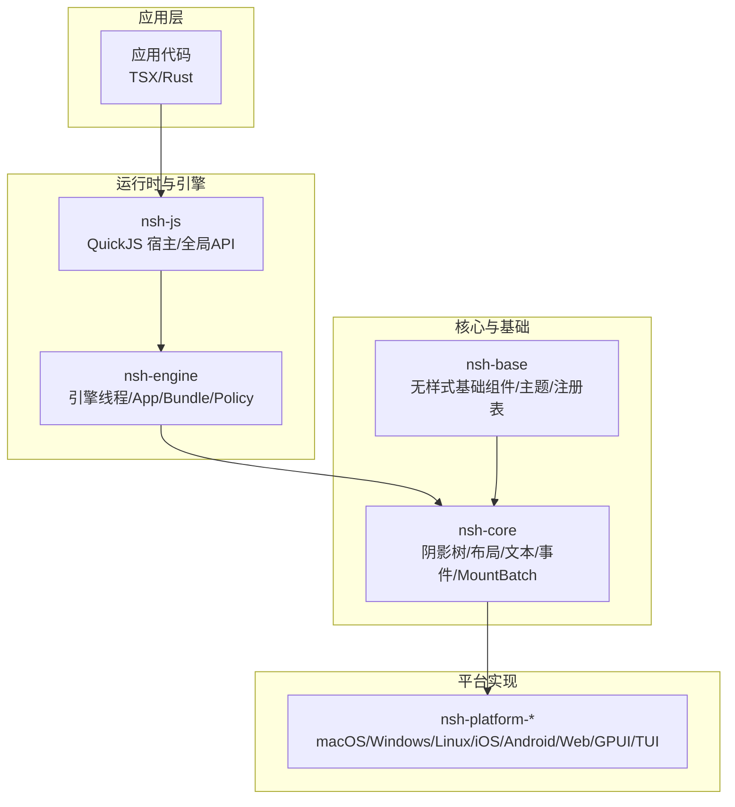
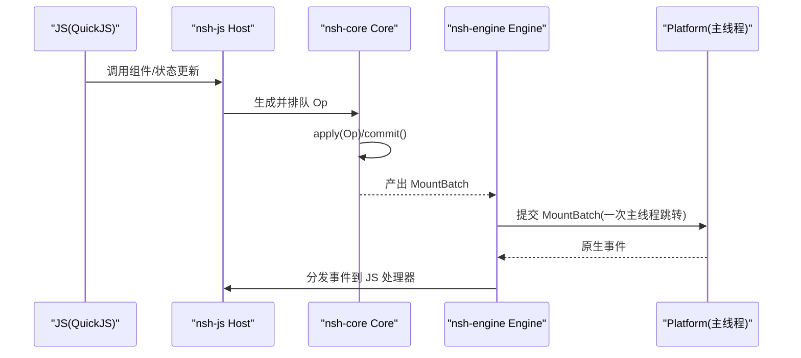
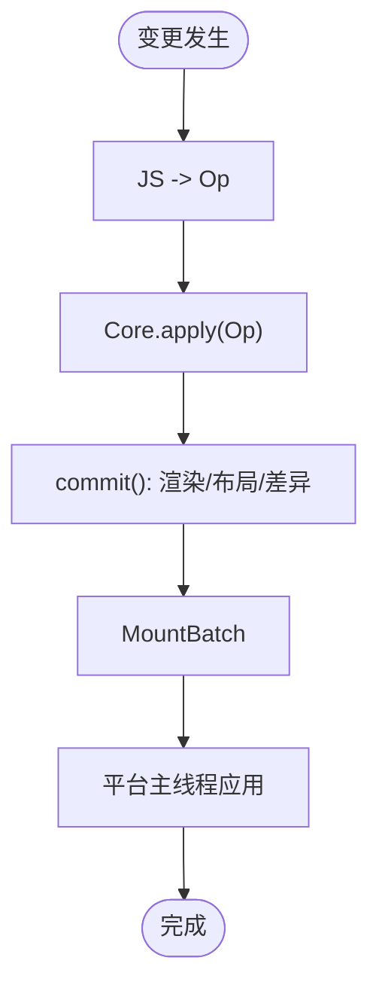
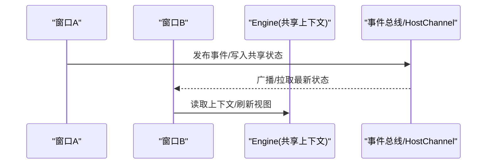
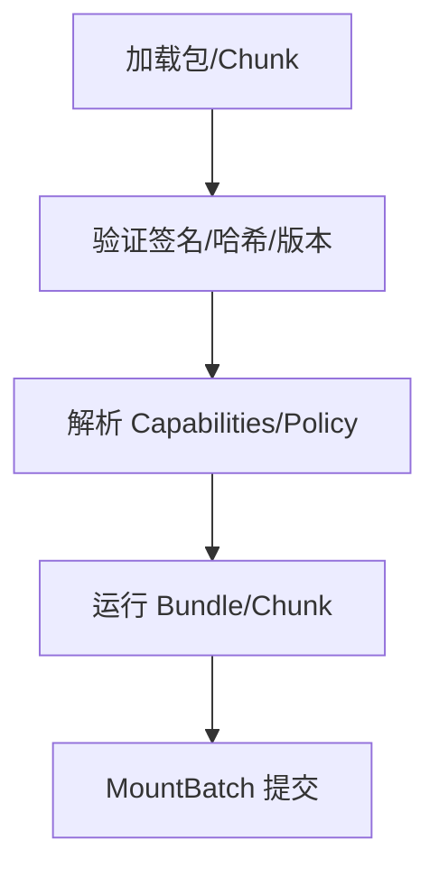
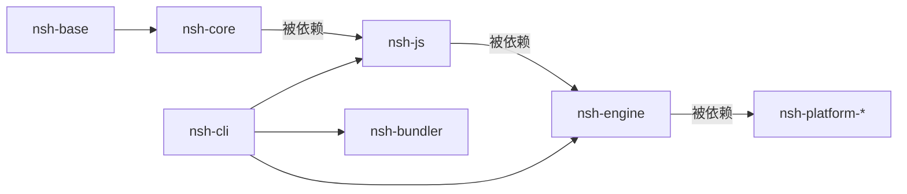

# 复杂应用开发

<cite>
**本文引用的文件**   
- [README.md](file://README.md)
- [架构文档](file://docs/dev/architecture.md)
- [nsh-core/lib.rs](file://crates/nsh-core/src/lib.rs)
- [nsh-base/lib.rs](file://crates/nsh-base/src/lib.rs)
- [nsh-engine/lib.rs](file://crates/nsh-engine/src/lib.rs)
- [nsh-js/lib.rs](file://crates/nsh-js/src/lib.rs)
</cite>

## 目录
1. [引言](#引言)
2. [项目结构](#项目结构)
3. [核心组件](#核心组件)
4. [架构总览](#架构总览)
5. [详细组件分析](#详细组件分析)
6. [依赖关系分析](#依赖关系分析)
7. [性能与可观测性](#性能与可观测性)
8. [故障排查指南](#故障排查指南)
9. [结论](#结论)
10. [附录：实战清单](#附录实战清单)

## 引言
本文件面向在 NSH（Native Shell）上构建“复杂应用”的工程师，围绕大型应用的架构模式、模块化组织、状态管理、依赖注入、实时数据可视化、多窗口协调、插件化加载、企业级能力（权限、日志、错误处理、用户反馈）、以及性能监控与排障进行系统化说明。NSH 提供跨平台原生 UI 渲染、统一的响应式引擎、TSX/Rust 混合开发、运行时模块加载与沙箱能力，适合构建桌面/移动/Web/Terminal/GPUI 等多形态企业级产品。

## 项目结构
仓库采用多 crate 分层组织，核心层与平台层解耦，UI 基础库与应用 UI 分离，便于扩展与裁剪。



图表来源
- [架构文档:91-110](file://docs/dev/architecture.md#L91-L110)
- [nsh-engine/lib.rs:1-10](file://crates/nsh-engine/src/lib.rs#L1-L10)
- [nsh-js/lib.rs:1-10](file://crates/nsh-js/src/lib.rs#L1-L10)
- [nsh-core/lib.rs:1-10](file://crates/nsh-core/src/lib.rs#L1-L10)
- [nsh-base/lib.rs:1-18](file://crates/nsh-base/src/lib.rs#L1-L18)

章节来源
- [README.md:1-40](file://README.md#L1-L40)
- [架构文档:91-110](file://docs/dev/architecture.md#L91-L110)

## 核心组件
- nsh-core：平台无关的核心，负责接收 JS 渲染器产生的 Op，维护阴影树，转换为布局，合并文本，执行布局并输出 MountBatch 给平台后端。
- nsh-js：QuickJS 宿主，安装全局 API（console、timers、fetch 等），服务 nsh 原生模块，将应用变更排队为 Op，并将原生事件分发回 JS。
- nsh-engine：引擎线程，运行一个 App（Rust 根组件或 JS Bundle），调度任务、应用提交、布局、派发 MountBatch；支持沙箱策略、包加载、热更新、性能统计等。
- nsh-base：无样式的基础组件集合（按钮、表单、导航、弹窗、表格、图表部件等），通过 Registry 暴露给 JS，由应用自行绘制外观。

章节来源
- [nsh-core/lib.rs:1-10](file://crates/nsh-core/src/lib.rs#L1-L10)
- [nsh-js/lib.rs:1-10](file://crates/nsh-js/src/lib.rs#L1-L10)
- [nsh-engine/lib.rs:1-10](file://crates/nsh-engine/src/lib.rs#L1-L10)
- [nsh-base/lib.rs:1-18](file://crates/nsh-base/src/lib.rs#L1-L18)

## 架构总览
NSH 的数据流与线程模型强调“引擎线程与主线程分离”，避免主线程阻塞于 JS，保证输入与渲染的流畅性。



图表来源
- [架构文档:3-19](file://docs/dev/architecture.md#L3-L19)
- [nsh-engine/lib.rs:1-10](file://crates/nsh-engine/src/lib.rs#L1-L10)
- [nsh-js/lib.rs:1-10](file://crates/nsh-js/src/lib.rs#L1-L10)

章节来源
- [架构文档:3-19](file://docs/dev/architecture.md#L3-L19)

## 详细组件分析

### 模块化组织与依赖注入
- 组件注册：nsh-base 通过 parts 机制将组件按功能域拆分，统一注册到 Registry，供 JS 侧按需使用。
- 依赖注入：EngineContext 作为上下文贯穿组件树，允许在不同层级注入服务（如主题、国际化、路由、网络等）。
- 模块边界：nsh-core 不依赖任何平台或 JS crate，确保核心稳定；nsh-base 仅依赖 nsh-core，保持“行为与外观分离”。

```mermaid
classDiagram
class Registry {
+register(Component)
+module(Module)
+tokens_from(fn)
}
class Parts {
+core(registry)
+menu(registry)
+overlays(registry)
+select(registry)
+command(registry)
+combobox(registry)
+toast(registry)
+pickers(registry)
+color_picker(registry)
+carousel(registry)
+tree(registry)
+fields(registry)
+text_view(registry)
+editor(registry)
+diff(registry)
+rich_editor(registry)
+term(registry)
+data_table(registry)
+table(registry)
+dock(registry)
+resizable(registry)
+plot(registry)
}
class EngineContext {
+get_service(key)
+set_service(key, value)
}
Registry <.. Parts : "parts : : ALL 注册"
EngineContext <.. Components : "注入服务"
```

图表来源
- [nsh-base/lib.rs:299-318](file://crates/nsh-base/src/lib.rs#L299-L318)
- [nsh-base/lib.rs:326-587](file://crates/nsh-base/src/lib.rs#L326-L587)
- [nsh-engine/lib.rs:57-75](file://crates/nsh-engine/src/lib.rs#L57-L75)

章节来源
- [nsh-base/lib.rs:299-318](file://crates/nsh-base/src/lib.rs#L299-L318)
- [nsh-base/lib.rs:326-587](file://crates/nsh-base/src/lib.rs#L326-L587)
- [nsh-engine/lib.rs:57-75](file://crates/nsh-engine/src/lib.rs#L57-L75)

### 状态管理与响应式
- 响应式图：信号、计算值、副作用、所有者和上下文以 Rust 中的图形式存在，JS 与 Rust 共享同一套语义。
- 渲染管线：JS 变更被解码为 Op，Core.apply 维护阴影树，commit 触发渲染、文本合并、布局与帧差异，最终产生 MountBatch。
- 时间与时钟：EngineConfig::clock 统一管理 JS 定时器、Rust 任务定时器、滚动节流、鼠标移动与帧时间，支持手动时钟用于测试与模拟。



图表来源
- [架构文档:3-19](file://docs/dev/architecture.md#L3-L19)
- [nsh-core/lib.rs:1-10](file://crates/nsh-core/src/lib.rs#L1-L10)

章节来源
- [架构文档:3-19](file://docs/dev/architecture.md#L3-L19)
- [nsh-core/lib.rs:1-10](file://crates/nsh-core/src/lib.rs#L1-L10)

### 实时数据可视化方案
- 图表部件：nsh-base/plot 提供 Arc/Area/Line/Pie/Treemap 等基础绘图部件，配合 Tailwind 与主题 token 实现可定制外观。
- 数据流：上层业务组件订阅信号/存储变化，驱动 plot 部件重绘；大量数据建议分页/增量更新，结合列表虚拟化减少重绘范围。
- 交互：通过事件回调（点击、悬停、缩放）与命令面板联动，实现钻取、筛选与导出。


图表来源
- [nsh-base/lib.rs:582-586](file://crates/nsh-base/src/lib.rs#L582-L586)

章节来源
- [nsh-base/lib.rs:582-586](file://crates/nsh-base/src/lib.rs#L582-L586)

### 多窗口应用协调机制
- 窗口模型：引擎线程持有 App（Rust Root 或 JS Bundle），每个 Surface 对应一个引擎实例；独立窗口可作为该引擎的根视图树。
- 窗口间通信：通过 EngineContext 注入的服务、HostChannel、WebSocket 或平台消息通道进行跨窗口协作。
- 状态同步：使用共享存储（本地存储/文件系统）与事件总线（命令/通知）保持一致性；必要时引入乐观更新与冲突解决策略。
- 事件分发：原生输入经 EngineControl.dispatch_event 进入引擎线程，再分发给 JS 处理器；动画与帧循环由平台主线程驱动。



图表来源
- [架构文档:29-39](file://docs/dev/architecture.md#L29-L39)
- [nsh-engine/lib.rs:57-75](file://crates/nsh-engine/src/lib.rs#L57-L75)

章节来源
- [架构文档:29-39](file://docs/dev/architecture.md#L29-L39)
- [nsh-engine/lib.rs:57-75](file://crates/nsh-engine/src/lib.rs#L57-L75)

### 插件化架构与动态模块加载
- 包与策略：Bundle 承载 JS 源码或字节码，Policy 控制能力声明与授予；支持从已验证包中加载资源与配置。
- 动态加载：Split bundle 的 Chunk 支持 import() 按需加载；MountSink.load_chunk 可由平台实现按需获取。
- 安全与兼容：VerifiedPackage 校验签名、证书、撤销列表与哈希；Capabilities 解析时未知字段被忽略并告警，保证向后兼容。



图表来源
- [nsh-engine/lib.rs:206-258](file://crates/nsh-engine/src/lib.rs#L206-L258)
- [nsh-engine/lib.rs:317-360](file://crates/nsh-engine/src/lib.rs#L317-L360)
- [nsh-engine/lib.rs:593-630](file://crates/nsh-engine/src/lib.rs#L593-L630)
- [nsh-engine/lib.rs:730-743](file://crates/nsh-engine/src/lib.rs#L730-L743)

章节来源
- [nsh-engine/lib.rs:206-258](file://crates/nsh-engine/src/lib.rs#L206-L258)
- [nsh-engine/lib.rs:317-360](file://crates/nsh-engine/src/lib.rs#L317-L360)
- [nsh-engine/lib.rs:593-630](file://crates/nsh-engine/src/lib.rs#L593-L630)
- [nsh-engine/lib.rs:730-743](file://crates/nsh-engine/src/lib.rs#L730-L743)

### 企业级能力：权限、日志、错误处理与用户反馈
- 权限管理：Capabilities 与 Access 控制 JS 对系统能力的访问；嵌入方可通过 granted 限制最大权限。
- 日志记录：logging 模块与日志文件输出，结合 symbolicate 还原源码位置，便于定位问题。
- 错误处理：AppError/AppErrorKind 分类错误；MountSink.report/report_error 上报错误；Trial 接口用于首帧健康度判定。
- 用户反馈：Toast/Dialog/Sheet 等基础组件提供轻量反馈；可结合命令面板与帮助文档提升可用性。

章节来源
- [nsh-engine/lib.rs:85-93](file://crates/nsh-engine/src/lib.rs#L85-L93)
- [nsh-engine/lib.rs:260-273](file://crates/nsh-engine/src/lib.rs#L260-L273)
- [nsh-engine/lib.rs:708-715](file://crates/nsh-engine/src/lib.rs#L708-L715)
- [nsh-base/lib.rs:258-273](file://crates/nsh-base/src/lib.rs#L258-L273)

## 依赖关系分析
NSH 的 crate 依赖方向严格分层，避免反向依赖，确保核心稳定与平台可替换。



图表来源
- [架构文档:108-110](file://docs/dev/architecture.md#L108-L110)

章节来源
- [架构文档:108-110](file://docs/dev/architecture.md#L108-L110)

## 性能与可观测性
- 文本布局一次化：TextEngine 在引擎线程准备与测量，主线程只绘制，避免布局抖动。
- 测量缓存：MeasureCache 按引擎缓存测量结果，颜色变化不触发布局。
- 帧与计时：Clock 统一管理时间；requestAnimationFrame 与 next_frame 请求在下一帧处理；Idle GC 周期回收对象。
- 性能监控：perfStats 周期性采样；Mouse move 节流至每帧一次；网络请求双向流式传输，支持背压。

章节来源
- [架构文档:20-28](file://docs/dev/architecture.md#L20-L28)
- [架构文档:74-89](file://docs/dev/architecture.md#L74-L89)
- [nsh-engine/lib.rs:101-123](file://crates/nsh-engine/src/lib.rs#L101-L123)

## 故障排查指南
- 启动失败/致命错误：检查 Bundle.read/read_trusted 与 from_package 的错误路径；确认 capabilities.json/app.json 格式正确。
- 堆栈不可读：启用 source map，并使用 symbolicate 还原源码位置。
- 渲染卡顿：检查是否在主线程操作 UI 对象；确认文本布局与测量缓存生效；减少不必要的重绘区域。
- 权限拒绝：核对 declared/granted Capabilities；查看日志中“not granted”提示。
- 窗口异常：确认 EngineContext 注入的服务可用；检查 HostChannel 与 WebSocket 连接状态。

章节来源
- [nsh-engine/lib.rs:519-590](file://crates/nsh-engine/src/lib.rs#L519-L590)
- [nsh-engine/lib.rs:708-715](file://crates/nsh-engine/src/lib.rs#L708-L715)
- [nsh-engine/lib.rs:730-743](file://crates/nsh-engine/src/lib.rs#L730-L743)

## 结论
NSH 通过清晰的层次划分、严格的依赖方向与强大的运行时能力，为复杂应用提供了可扩展、高性能且安全的开发基座。借助 nsh-core 的响应式与布局能力、nsh-js 的全局 API、nsh-engine 的沙箱与包管理、以及 nsh-base 的基础组件生态，团队可以在多平台上构建一致体验的企业级产品，并通过插件化与多窗口机制实现灵活的业务扩展与协同。

## 附录：实战清单
- 架构设计
  - 明确分层：核心/基础/平台/应用，禁止反向依赖。
  - 使用 EngineContext 注入服务，避免全局单例。
  - 将 UI 外观与行为分离，基于 nsh/base 构建自有组件库。
- 状态管理
  - 使用信号/计算值/副作用管理状态，避免直接 DOM 操作。
  - 大数据场景下采用分页、增量更新与虚拟列表。
- 可视化
  - 使用 nsh/base/plot 部件组合图表，结合主题 token 定制外观。
  - 将交互事件与业务逻辑解耦，通过命令面板统一入口。
- 多窗口
  - 使用共享存储与事件总线进行状态同步。
  - 谨慎处理并发与冲突，采用乐观更新与重试机制。
- 插件化
  - 使用 Split bundle 与 Chunk 按需加载模块。
  - 通过 VerifiedPackage 与 Capabilities 保障安全与兼容。
- 企业级
  - 权限最小化原则，明确 declared/granted。
  - 完善日志与错误上报，结合 symbolicate 快速定位。
  - 提供 Toast/Dialog/Sheet 等用户反馈通道。
- 性能与排障
  - 利用 MeasureCache 与 TextEngine 优化布局与文本。
  - 使用 Clock 与 requestAnimationFrame 控制帧节奏。
  - 建立性能基线与回归测试，持续监控 perfStats。