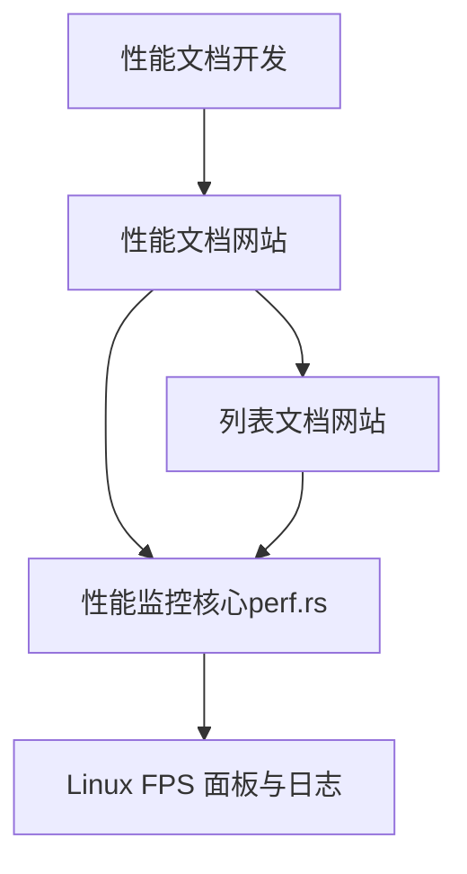
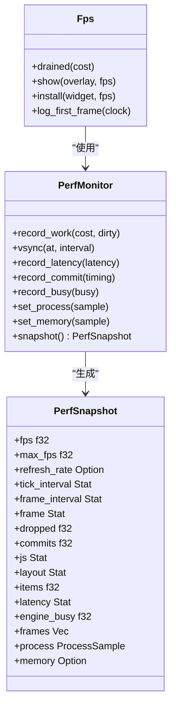
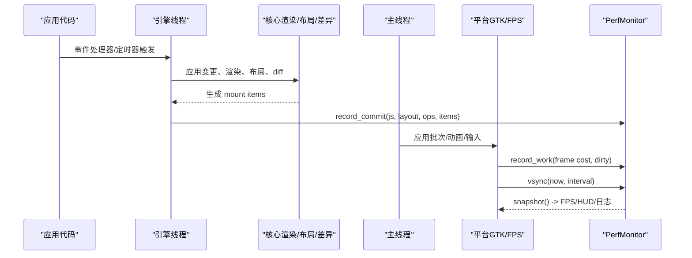
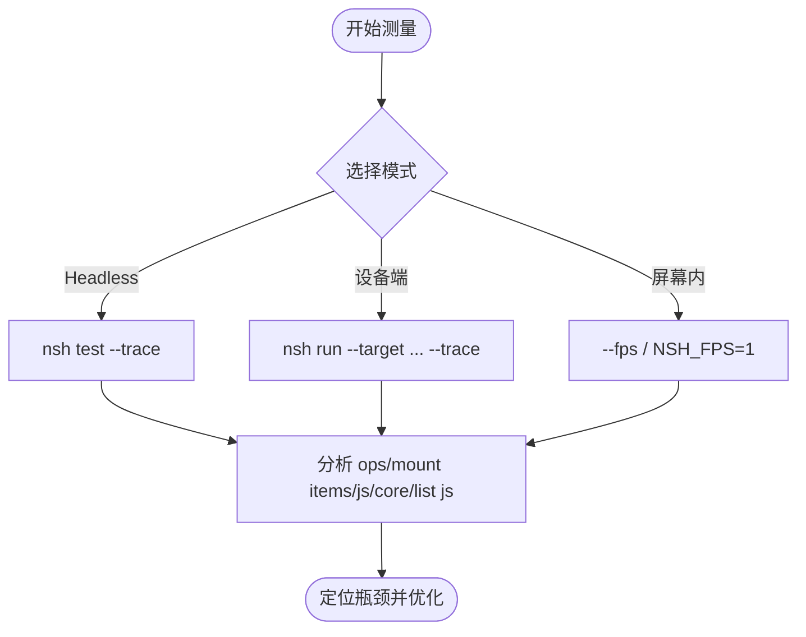
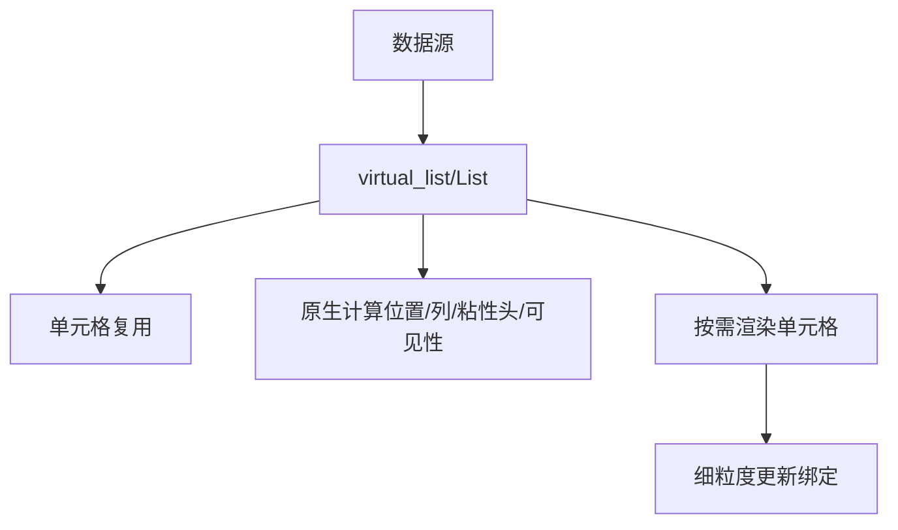
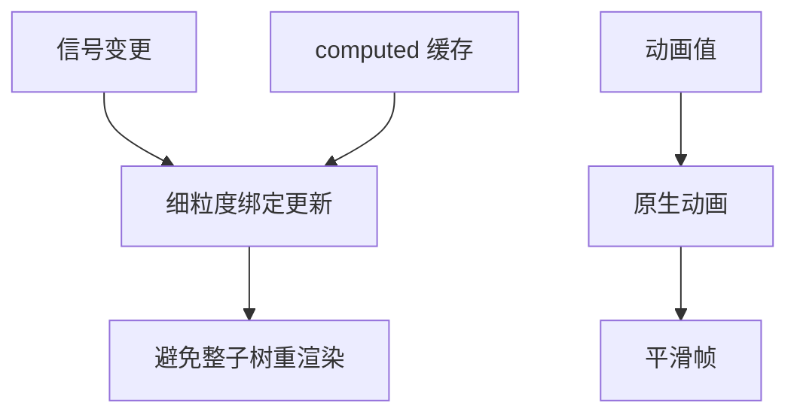
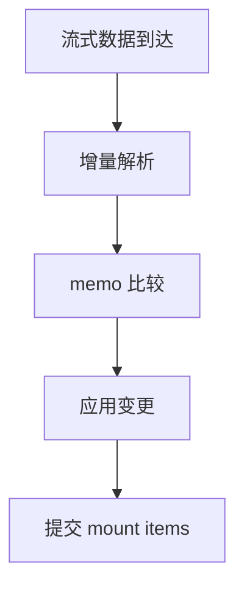
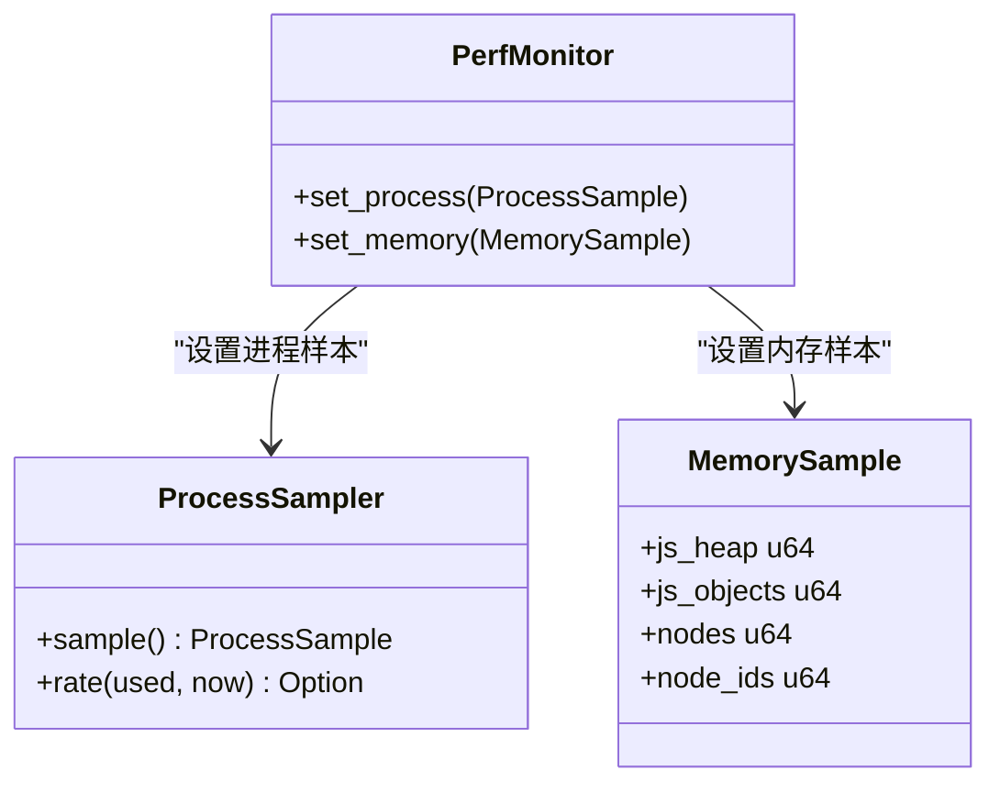
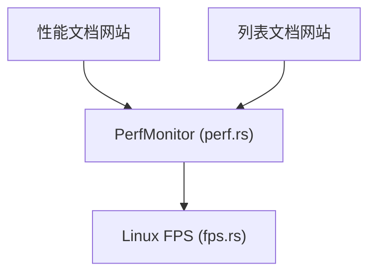

# 性能优化

<cite>
**本文引用的文件**   
- [性能文档（开发）](file://docs/dev/performance.md)
- [性能文档（网站）](file://website/docs/performance.md)
- [列表文档（网站）](file://website/docs/lists.md)
- [性能监控核心（nsh-engine）](file://crates/nsh-engine/src/perf.rs)
- [Linux FPS 面板与日志](file://crates/nsh-platform-linux/src/fps.rs)
</cite>

## 目录
1. [引言](#引言)
2. [项目结构](#项目结构)
3. [核心组件](#核心组件)
4. [架构总览](#架构总览)
5. [详细组件分析](#详细组件分析)
6. [依赖关系分析](#依赖关系分析)
7. [性能注意事项](#性能注意事项)
8. [故障排查指南](#故障排查指南)
9. [结论](#结论)
10. [附录](#附录)

## 引言
本指南面向 NSH 应用的性能优化，聚焦以下目标：
- 性能分析工具使用：CPU 使用率、内存占用、帧率与提交成本、JS/Core 时间、挂载项数量等。
- 常见瓶颈识别与解决：重绘/布局优化、网络请求与增量渲染、大数据列表虚拟化。
- 内存管理最佳实践：对象池、引用计数、垃圾回收调优思路。
- 基准测试方法与持续监控策略。
- 真实案例研究：从问题诊断到解决方案实施的全流程。

NSH 将性能作为首要优先级，运行时为原生实现，更新跨线程一次批处理，动画与列表虚拟化在原生侧运行，Rust 应用不执行 JS。这些设计决定了大多数性能决策由框架承担，但开发者仍需遵循最小 JS 工作、细粒度更新、虚拟化长列表等规则。

**章节来源**
- [性能文档（网站）:10-13](file://website/docs/performance.md#L10-L13)

## 项目结构
围绕性能优化的关键代码与文档分布如下：
- 性能基准与优化记录：docs/dev/performance.md
- 用户向性能说明与测量方法：website/docs/performance.md
- 列表虚拟化与滚动优化：website/docs/lists.md
- 性能监控核心：crates/nsh-engine/src/perf.rs
- Linux 平台 FPS 面板与日志输出：crates/nsh-platform-linux/src/fps.rs

**图表来源**
- [性能文档（开发）:1-20](file://docs/dev/performance.md#L1-L20)
- [性能文档（网站）:192-250](file://website/docs/performance.md#L192-L250)
- [列表文档（网站）:1-12](file://website/docs/lists.md#L1-L12)
- [性能监控核心（nsh-engine）:1-30](file://crates/nsh-engine/src/perf.rs#L1-L30)
- [Linux FPS 面板与日志:1-18](file://crates/nsh-platform-linux/src/fps.rs#L1-L18)

**章节来源**
- [性能文档（开发）:1-20](file://docs/dev/performance.md#L1-L20)
- [性能文档（网站）:192-250](file://website/docs/performance.md#L192-L250)
- [列表文档（网站）:1-12](file://website/docs/lists.md#L1-L12)
- [性能监控核心（nsh-engine）:1-30](file://crates/nsh-engine/src/perf.rs#L1-L30)
- [Linux FPS 面板与日志:1-18](file://crates/nsh-platform-linux/src/fps.rs#L1-L18)

## 核心组件
- 性能监控核心（PerfMonitor）
  - 双线程采集：引擎线程记录每次提交的 JS/Core 时间与操作数；主线程记录帧绘制阶段、VSync、批次延迟。
  - 快照（PerfSnapshot）提供 FPS、最大可维持帧率、丢帧比例、提交统计、JS/Core 耗时、挂载项均值、引擎忙碌占比、进程 CPU/内存等。
- Linux FPS 面板与日志
  - 通过 GTK FrameClock 钩子划分 update/layout/paint/snapshot/canvas 阶段，每秒输出一行性能指标，并显示 HUD 面板。
- 性能文档与列表文档
  - 指导如何 headless 与设备端测量、何时使用虚拟列表、动画值、滚动监听替代方案等。

**图表来源**
- [性能监控核心（nsh-engine）:100-233](file://crates/nsh-engine/src/perf.rs#L100-L233)
- [Linux FPS 面板与日志:67-128](file://crates/nsh-platform-linux/src/fps.rs#L67-L128)

**章节来源**
- [性能监控核心（nsh-engine）:1-30](file://crates/nsh-engine/src/perf.rs#L1-L30)
- [Linux FPS 面板与日志:1-18](file://crates/nsh-platform-linux/src/fps.rs#L1-L18)

## 架构总览
NSH 性能监控与测量涉及两条线程与多个平台层：
- 引擎线程：执行 JS/Rust 逻辑，产生提交（commit），记录 JS/Core 耗时与 ops/items。
- 主线程：应用批次、驱动动画、处理输入、绘制 UI，记录每帧工作与 VSync。
- 平台层（以 Linux 为例）：通过 GTK FrameClock 划分阶段，HUD 面板展示指标，每秒输出日志。

**图表来源**
- [性能监控核心（nsh-engine）:1-30](file://crates/nsh-engine/src/perf.rs#L1-L30)
- [Linux FPS 面板与日志:489-607](file://crates/nsh-platform-linux/src/fps.rs#L489-L607)

**章节来源**
- [性能监控核心（nsh-engine）:1-30](file://crates/nsh-engine/src/perf.rs#L1-L30)
- [Linux FPS 面板与日志:489-607](file://crates/nsh-platform-linux/src/fps.rs#L489-L607)

## 详细组件分析

### 性能分析与监控工具
- Headless 测量：`nsh test --trace` 打印 perf commit、first frame、event js、list js 等指标，便于定位 JS 与 Core 的耗时分布与挂载项数量。
- 设备端测量：`nsh run --target ... --trace` 输出相同指标，结合平台文本引擎。
- 屏幕内 FPS 面板：`--fps` 或 `NSH_FPS=1` 启用，显示 FPS、刷新率、帧时、JS/Core 时间、CPU、内存、节点数等。

**图表来源**
- [性能文档（网站）:192-250](file://website/docs/performance.md#L192-L250)

**章节来源**
- [性能文档（网站）:192-250](file://website/docs/performance.md#L192-L250)

### 大数据列表虚拟化
- 使用 virtual_list/List 仅创建视口附近行，复用单元格，位置/列/粘性头/可见性计算均在原生侧完成。
- 关键实践：
  - 设置 estimatedItemSize 接近真实行高。
  - 将每行状态保存在数据中（按 id 索引），而非行函数内创建的信号。
  - 使用 scroll_value 替代 onScroll 以减少 JS 调用。
  - 对长列表优先虚拟化，小集合用普通 ScrollView。

**图表来源**
- [列表文档（网站）:1-12](file://website/docs/lists.md#L1-L12)
- [列表文档（网站）:62-140](file://website/docs/lists.md#L62-L140)

**章节来源**
- [列表文档（网站）:1-12](file://website/docs/lists.md#L1-L12)
- [列表文档（网站）:62-140](file://website/docs/lists.md#L62-L140)

### 渲染性能优化
- 避免整棵子树重渲染：只更新读取信号的绑定（文本、样式、分支、each 的行）。
- 使用 computed 缓存多绑定共享的值。
- 使用动画值（animated_value/createAnimatedValue）进行原生动画，避免每帧写信号导致提交抖动。
- 使用 LayoutAnimation 原生动画下一批次的帧变化。

**图表来源**
- [性能文档（网站）:62-108](file://website/docs/performance.md#L62-L108)
- [性能文档（网站）:131-176](file://website/docs/performance.md#L131-L176)

**章节来源**
- [性能文档（网站）:62-108](file://website/docs/performance.md#L62-L108)
- [性能文档（网站）:131-176](file://website/docs/performance.md#L131-L176)

### 网络请求与增量渲染
- 流式 Markdown 与 TextView 增量解析：仅解析新增部分，减少重复解析与比较开销。
- 典型场景：长回复分块到达，TextView 保持已读边界，增量解析与 memo 比较，显著降低 parse 与 memos 时间。

**图表来源**
- [性能文档（开发）:406-444](file://docs/dev/performance.md#L406-L444)

**章节来源**
- [性能文档（开发）:406-444](file://docs/dev/performance.md#L406-L444)

### 内存管理与 GC 调优
- 进程内存采样：ProcessSampler 提供 CPU/内存/GPU 使用率，平台差异（Apple phys_footprint、Linux RSS、Windows WorkingSet）。
- JS 堆与对象计数：MemorySample 提供 js_heap、js_objects、nodes/node_ids，用于观察 JS 堆增长与核心节点存活情况。
- 建议：
  - 控制 JS 对象生命周期，避免长时间持有大对象。
  - 使用对象池与引用计数（如 AnimatedValue/ElementRef handles）减少分配。
  - 调整 GC 频率：在频繁交互后延迟 idle collection，减少卡顿。

**图表来源**
- [性能监控核心（nsh-engine）:158-187](file://crates/nsh-engine/src/perf.rs#L158-L187)
- [性能监控核心（nsh-engine）:497-549](file://crates/nsh-engine/src/perf.rs#L497-L549)

**章节来源**
- [性能监控核心（nsh-engine）:158-187](file://crates/nsh-engine/src/perf.rs#L158-L187)
- [性能监控核心（nsh-engine）:497-549](file://crates/nsh-engine/src/perf.rs#L497-L549)

### 真实项目案例研究
- RichEditor 长文档优化：
  - 问题：每个 block 的 handlers 遍历全表，表格控件重复运行，首次提交随 block 数平方增长。
  - 解决：handlers 按 node 维护，表格控件区域仅在相关元素移动时重新运行。
  - 结果：5,000 行首次提交从 28.5s 降至 1.7s（list js 从 27s 降至 240ms）。
- 列表 each 更新优化：
  - 问题：每次更新构建所有行的 map，追加行时搜索旧元素，复杂度 O(N^2)。
  - 解决：按顺序传递行，保留 key 所在位置的行，仅匹配后续元素。
  - 结果：640 行追加从 ~955ms 降至 ~443ms，5,000 行从 ~23s 降至 ~3.7s。
- TextView 流式 Markdown：
  - 问题：每次更新解析全文并复制 blocks，parse 与 memos 成本高。
  - 解决：增量解析与定义处理优化，仅解析新增边界。
  - 结果：典型 20KB 回复平均 parse+memos 从 5.985ms 降至 0.037ms。

**章节来源**
- [性能文档（开发）:15-29](file://docs/dev/performance.md#L15-L29)
- [性能文档（开发）:169-218](file://docs/dev/performance.md#L169-L218)
- [性能文档（开发）:406-444](file://docs/dev/performance.md#L406-L444)

## 依赖关系分析
- PerfMonitor 被平台 FPS 模块使用，收集帧与提交统计。
- Linux FPS 面板通过 GTK FrameClock 钩子划分阶段，每秒输出日志。
- 性能文档与列表文档为用户指南，指导如何使用 PerfMonitor 与虚拟化列表。

**图表来源**
- [性能监控核心（nsh-engine）:1-30](file://crates/nsh-engine/src/perf.rs#L1-L30)
- [Linux FPS 面板与日志:1-18](file://crates/nsh-platform-linux/src/fps.rs#L1-L18)
- [性能文档（网站）:192-250](file://website/docs/performance.md#L192-L250)
- [列表文档（网站）:1-12](file://website/docs/lists.md#L1-L12)

**章节来源**
- [性能监控核心（nsh-engine）:1-30](file://crates/nsh-engine/src/perf.rs#L1-L30)
- [Linux FPS 面板与日志:1-18](file://crates/nsh-platform-linux/src/fps.rs#L1-L18)
- [性能文档（网站）:192-250](file://website/docs/performance.md#L192-L250)
- [列表文档（网站）:1-12](file://website/docs/lists.md#L1-L12)

## 性能注意事项
- JS 工作最小化：Rust 应用无 JS 解释器，TSX 应用中仅业务代码为 JS，重型计算应缓存或移至原生。
- 批量跨线程：一次 handler 的所有写入合并为一个 commit，避免桥接消息序列化。
- 细粒度更新：组件仅运行一次，之后仅更新读取信号的绑定。
- 不发送多余数据：核心仅发送变更，不变样式与帧不发送。
- 原生动画：使用动画值，避免每帧写信号。
- 虚拟化长列表：优先 virtual_list/List，设置 estimatedItemSize，状态保存在数据中。

**章节来源**
- [性能文档（网站）:17-60](file://website/docs/performance.md#L17-L60)
- [性能文档（网站）:62-108](file://website/docs/performance.md#L62-L108)
- [性能文档（网站）:125-190](file://website/docs/performance.md#L125-L190)

## 故障排查指南
- 使用 `nsh test --trace` 检查 ops 与 mount items 是否异常增长。
- 使用 `--fps` 面板观察 FPS、JS/Core 时间、CPU/内存、节点数。
- 关注 list js 时间，若过高，检查列表虚拟化与行渲染逻辑。
- 检查内存泄漏：观察 js_heap、js_objects、nodes 是否持续增长。
- 针对流式数据：确认增量解析是否生效，避免全文解析。

**章节来源**
- [性能文档（网站）:192-250](file://website/docs/performance.md#L192-L250)
- [性能监控核心（nsh-engine）:174-187](file://crates/nsh-engine/src/perf.rs#L174-L187)

## 结论
NSH 的性能优化依赖于原生运行时、批处理提交、细粒度更新与虚拟化列表。通过 PerfMonitor 与 FPS 面板，开发者可以准确测量 CPU、内存、帧率与提交成本，并结合文档与实践快速定位瓶颈。大数据列表虚拟化、流式解析、原生动画与内存管理是提升性能的关键方向。

## 附录
- 基准测试命令示例：
  - `echo 'await app.press("Add")' | nsh test App.tsx --trace`
  - `echo 'await app.scroll("id:feed", 3000)' | nsh test App.tsx --trace`
  - `nsh run App.tsx --target android --trace --release`
- 环境变量：
  - `NSH_FPS=1` 启用性能监控。
- 参考文档：
  - [性能文档（开发）](file://docs/dev/performance.md)
  - [性能文档（网站）](file://website/docs/performance.md)
  - [列表文档（网站）](file://website/docs/lists.md)