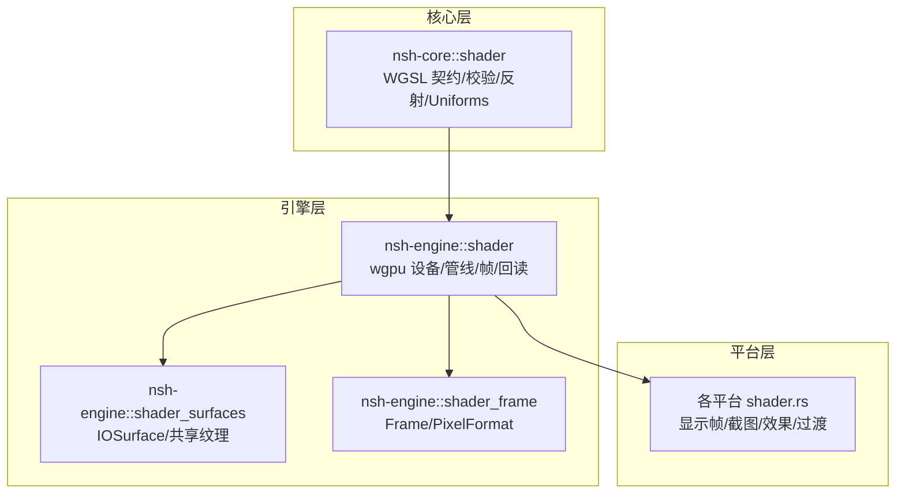
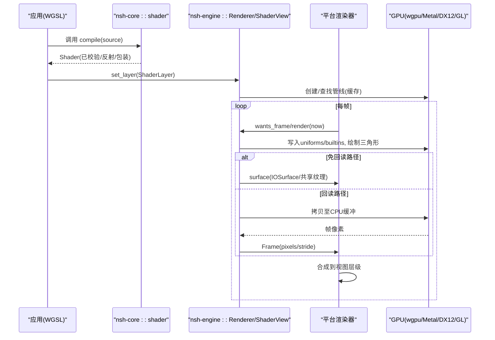
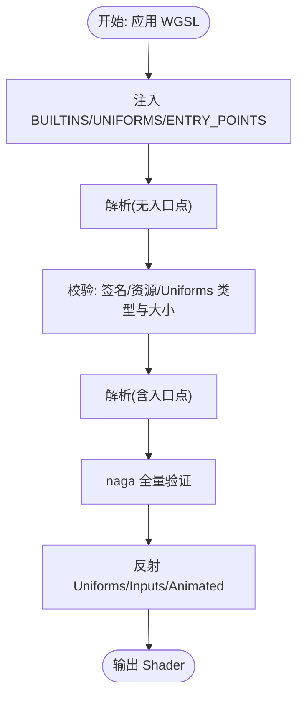
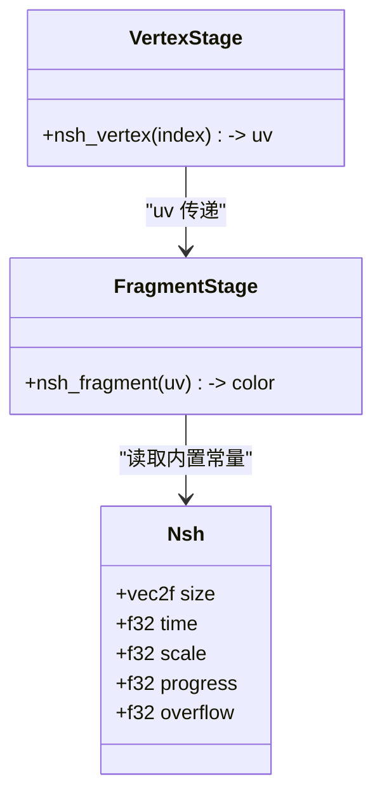
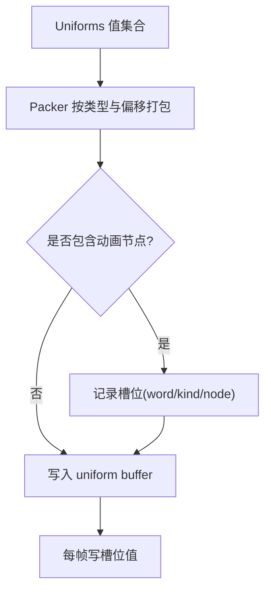
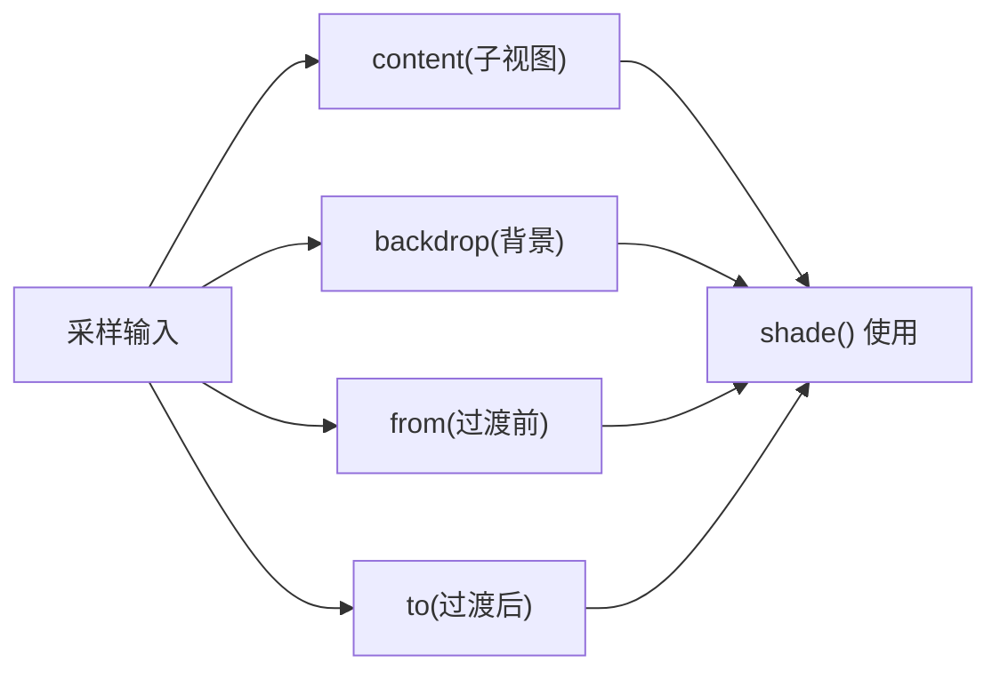
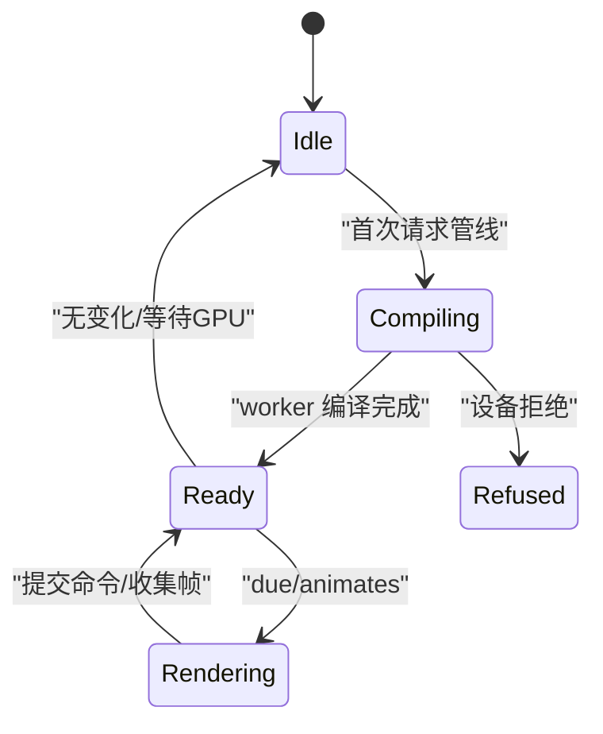
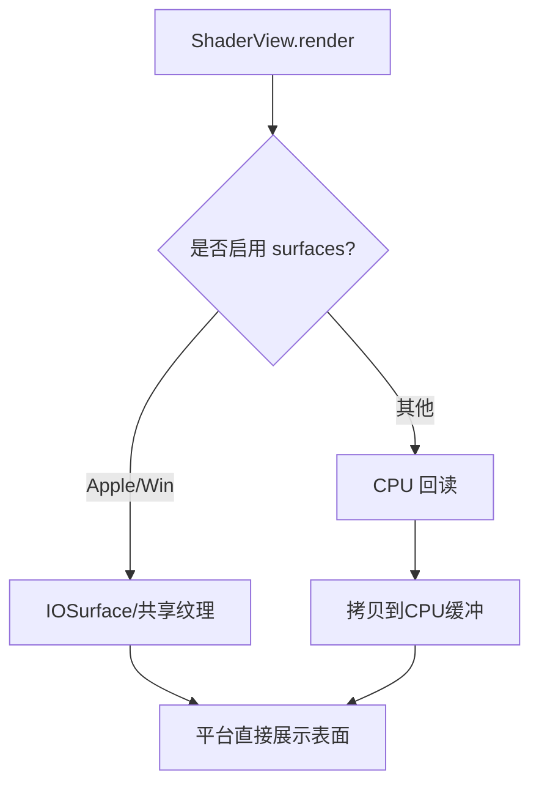
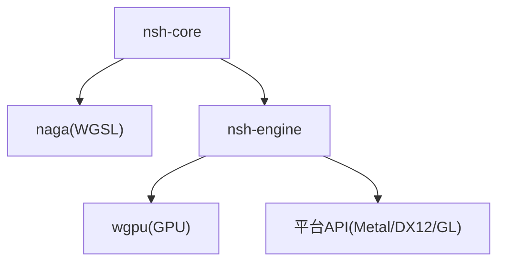

# 着色器系统

<cite>
**本文引用的文件**   
- [crates/nsh-core/src/shader.rs](file://crates/nsh-core/src/shader.rs)
- [crates/nsh-engine/src/shader.rs](file://crates/nsh-engine/src/shader.rs)
- [crates/nsh-engine/src/shader_frame.rs](file://crates/nsh-engine/src/shader_frame.rs)
- [crates/nsh-engine/src/shader_surfaces.rs](file://crates/nsh-engine/src/shader_surfaces.rs)
- [docs/dev/shaders.md](file://docs/dev/shaders.md)
- [examples/gallery/demos/Shaders.tsx](file://examples/gallery/demos/Shaders.tsx)
</cite>

## 目录
1. [简介](#简介)
2. [项目结构](#项目结构)
3. [核心组件](#核心组件)
4. [架构总览](#架构总览)
5. [详细组件分析](#详细组件分析)
6. [依赖关系分析](#依赖关系分析)
7. [性能与优化](#性能与优化)
8. [故障排查与调试](#故障排查与调试)
9. [结论](#结论)
10. [附录：示例与最佳实践](#附录示例与最佳实践)

## 简介
本文件系统性梳理 NSH 的 GPU 着色器子系统，覆盖从 WGSL 源码到平台渲染的完整链路。重点包括：
- 顶点/片段着色器的生成与编译流程
- Rust 代码与着色器的绑定机制、参数传递与数据同步
- 视觉效果实现（渐变、阴影、模糊、自定义滤镜）
- 着色器生命周期管理与资源优化策略
- 实际开发示例（从简单颜色变换到粒子系统与实时特效）
- 调试技巧与性能分析方法

## 项目结构
NSH 的着色器能力由“核心定义 + 引擎渲染 + 平台适配”三层组成：
- 核心层（nsh-core）：定义着色器语言契约、校验与反射、Uniforms 打包、动画槽位、输入采样接口等
- 引擎层（nsh-engine）：基于 wgpu 的设备管理、管线缓存、帧缓冲与回读、IOSurface/共享纹理优化
- 平台层（各平台 shader.rs）：将帧展示为平台原生图像或像素，并处理效果/过渡/页面导航

图表来源
- [crates/nsh-core/src/shader.rs:1-55](file://crates/nsh-core/src/shader.rs#L1-L55)
- [crates/nsh-engine/src/shader.rs:1-43](file://crates/nsh-engine/src/shader.rs#L1-L43)
- [crates/nsh-engine/src/shader_surfaces.rs:1-19](file://crates/nsh-engine/src/shader_surfaces.rs#L1-L19)
- [crates/nsh-engine/src/shader_frame.rs:1-34](file://crates/nsh-engine/src/shader_frame.rs#L1-L34)

章节来源
- [docs/dev/shaders.md:1-25](file://docs/dev/shaders.md#L1-L25)

## 核心组件
- Shader 编译与校验：确保应用只暴露 `fn shade(uv: vec2f) -> vec4f`，禁止自定义入口点与资源；支持可选 `struct Uniforms`；检测是否读取 `nsh.time` 以决定是否每帧重绘
- 内置常量与采样接口：提供 `nsh.size/time/scale/progress/overflow`，以及 `sample_content/backdrop/from/to` 用于效果、过渡与页面导航
- Uniforms 打包与动画槽：将数字、颜色、向量与数组映射到统一缓冲区，支持动画节点直接驱动槽位值
- 渲染管线与帧：按源哈希缓存管线，异步编译；帧最大边长限制，必要时降缩放；支持 IOSurface/共享纹理免回读路径

章节来源
- [crates/nsh-core/src/shader.rs:74-197](file://crates/nsh-core/src/shader.rs#L74-L197)
- [crates/nsh-core/src/shader.rs:483-575](file://crates/nsh-core/src/shader.rs#L483-L575)
- [crates/nsh-core/src/shader.rs:1082-1405](file://crates/nsh-core/src/shader.rs#L1082-L1405)
- [crates/nsh-engine/src/shader.rs:127-144](file://crates/nsh-engine/src/shader.rs#L127-L144)
- [crates/nsh-engine/src/shader.rs:669-705](file://crates/nsh-engine/src/shader.rs#L669-L705)

## 架构总览
下图展示了从应用编写 WGSL 到平台展示的端到端流程：

图表来源
- [crates/nsh-core/src/shader.rs:649-706](file://crates/nsh-core/src/shader.rs#L649-L706)
- [crates/nsh-engine/src/shader.rs:428-459](file://crates/nsh-engine/src/shader.rs#L428-L459)
- [crates/nsh-engine/src/shader.rs:1073-1301](file://crates/nsh-engine/src/shader.rs#L1073-L1301)
- [crates/nsh-engine/src/shader_surfaces.rs:112-175](file://crates/nsh-engine/src/shader_surfaces.rs#L112-L175)

## 详细组件分析

### 着色器语言契约与编译流程
- 应用只需实现 `shade(uv)`，返回非预乘 sRGB 颜色；核心在片段入口对结果 clamp 并预乘
- 自动注入内置 `Nsh` 结构与采样函数，以及顶点/片段入口
- 校验阶段拒绝自定义入口点与资源，仅允许 `var<private>` 全局；Uniforms 类型受限且大小上限
- 通过 naga 进行两次解析：先不带入口点以保留行号，再带入口点做最终验证
- 检测是否读取 `nsh.time`，标记为 animated 以启用每帧更新

图表来源
- [crates/nsh-core/src/shader.rs:88-170](file://crates/nsh-core/src/shader.rs#L88-L170)
- [crates/nsh-core/src/shader.rs:649-706](file://crates/nsh-core/src/shader.rs#L649-L706)
- [crates/nsh-core/src/shader.rs:832-900](file://crates/nsh-core/src/shader.rs#L832-L900)
- [crates/nsh-core/src/shader.rs:903-975](file://crates/nsh-core/src/shader.rs#L903-L975)
- [crates/nsh-core/src/shader.rs:977-1019](file://crates/nsh-core/src/shader.rs#L977-L1019)

章节来源
- [crates/nsh-core/src/shader.rs:1-55](file://crates/nsh-core/src/shader.rs#L1-L55)
- [crates/nsh-core/src/shader.rs:649-706](file://crates/nsh-core/src/shader.rs#L649-L706)
- [crates/nsh-core/src/shader.rs:832-900](file://crates/nsh-core/src/shader.rs#L832-L900)

### 顶点与片段着色器实现
- 顶点着色器：使用固定 3 个顶点索引生成一个覆盖目标区域（含 overflow）的三角形，uv 坐标随 overflow 扩展
- 片段着色器：调用应用实现的 `shade(uv)`，clamp 后预乘 alpha
- 内置 `Nsh` 结构体包含 size/time/scale/progress/overflow，保证 32 字节对齐以满足 GL 后端要求

图表来源
- [crates/nsh-core/src/shader.rs:88-170](file://crates/nsh-core/src/shader.rs#L88-L170)
- [crates/nsh-core/src/shader.rs:176-197](file://crates/nsh-core/src/shader.rs#L176-L197)

章节来源
- [crates/nsh-core/src/shader.rs:88-170](file://crates/nsh-core/src/shader.rs#L88-L170)
- [crates/nsh-core/src/shader.rs:176-197](file://crates/nsh-core/src/shader.rs#L176-L197)

### Uniforms 与动画槽位
- Uniforms 成员类型限定为标量、向量与 vec4 数组；偏移与大小由 naga 反射得到
- Packer 将数值/颜色/列表/动画节点写入统一缓冲区；动画槽位通过 AnimationValue 在每帧写入
- 支持 `nsh.progress` 作为特殊槽位，用于效果/过渡进度

图表来源
- [crates/nsh-core/src/shader.rs:1191-1405](file://crates/nsh-core/src/shader.rs#L1191-L1405)
- [crates/nsh-core/src/shader.rs:1276-1305](file://crates/nsh-core/src/shader.rs#L1276-L1305)

章节来源
- [crates/nsh-core/src/shader.rs:1082-1405](file://crates/nsh-core/src/shader.rs#L1082-L1405)

### 图片采样与视觉效果
- 四种采样输入：content/backdrop/from/to，分别对应子视图、背景、过渡前后画面
- 核心通过 naga 分析 `nsh_fragment` 及其调用的函数，确定程序实际使用的输入，从而决定绑定布局
- 效果/过渡/屏幕级效果/页面导航均复用同一套采样接口，配合 `nsh.overflow` 控制采样范围

图表来源
- [crates/nsh-core/src/shader.rs:199-246](file://crates/nsh-core/src/shader.rs#L199-L246)
- [crates/nsh-core/src/shader.rs:977-998](file://crates/nsh-core/src/shader.rs#L977-L998)

章节来源
- [crates/nsh-core/src/shader.rs:199-246](file://crates/nsh-core/src/shader.rs#L199-L246)
- [crates/nsh-core/src/shader.rs:977-998](file://crates/nsh-core/src/shader.rs#L977-L998)

### 渲染管线与帧管理
- Renderer 持有 wgpu 设备/队列、绑定布局与管线缓存；首次挂载时按需打开设备
- 管线编译在 worker 线程完成，主线程不阻塞；管线状态有 Ready/Refused/Compiling
- ShaderView 维护层、uniforms、尺寸/缩放、时钟、帧与输入贴图；render 时根据 due/animates 判断是否需要新帧
- 帧最大边长限制，超出则降低缩放；支持 IOSurface/共享纹理免回读路径，否则走 CPU 回读

图表来源
- [crates/nsh-engine/src/shader.rs:127-144](file://crates/nsh-engine/src/shader.rs#L127-L144)
- [crates/nsh-engine/src/shader.rs:428-459](file://crates/nsh-engine/src/shader.rs#L428-L459)
- [crates/nsh-engine/src/shader.rs:669-705](file://crates/nsh-engine/src/shader.rs#L669-L705)
- [crates/nsh-engine/src/shader.rs:1073-1301](file://crates/nsh-engine/src/shader.rs#L1073-L1301)

章节来源
- [crates/nsh-engine/src/shader.rs:127-144](file://crates/nsh-engine/src/shader.rs#L127-L144)
- [crates/nsh-engine/src/shader.rs:428-459](file://crates/nsh-engine/src/shader.rs#L428-L459)
- [crates/nsh-engine/src/shader.rs:1073-1301](file://crates/nsh-engine/src/shader.rs#L1073-L1301)

### 平台展示与优化
- Apple：IOSurface 免回读，窗口服务器在 GPU 上匹配颜色空间，避免主线程转换
- Windows：Direct3D 12 共享纹理 + 栅栏同步，避免 CPU 回读；失败时回退到回读路径
- 其他平台：纹理拷贝到 CPU 缓冲，逐行 stride 访问，按平台像素格式（RGBA/BGRA）展示

图表来源
- [crates/nsh-engine/src/shader_surfaces.rs:1-19](file://crates/nsh-engine/src/shader_surfaces.rs#L1-L19)
- [crates/nsh-engine/src/shader_surfaces.rs:112-175](file://crates/nsh-engine/src/shader_surfaces.rs#L112-L175)
- [crates/nsh-engine/src/shader.rs:1027-1061](file://crates/nsh-engine/src/shader.rs#L1027-L1061)

章节来源
- [crates/nsh-engine/src/shader_surfaces.rs:1-19](file://crates/nsh-engine/src/shader_surfaces.rs#L1-L19)
- [crates/nsh-engine/src/shader_surfaces.rs:112-175](file://crates/nsh-engine/src/shader_surfaces.rs#L112-L175)
- [crates/nsh-engine/src/shader.rs:1027-1061](file://crates/nsh-engine/src/shader.rs#L1027-L1061)

## 依赖关系分析
- nsh-core 依赖 naga 进行 WGSL 解析与校验，并通过 feature 开关控制是否链接编译器
- nsh-engine 依赖 wgpu 管理设备/队列/管线，并在 Apple/Windows 平台集成底层 API（Metal/IOSurface/Direct3D）
- 平台层通过 MountItem 与 ShaderView 交互，按各自帧循环驱动渲染与展示

图表来源
- [crates/nsh-core/src/shader.rs:62-72](file://crates/nsh-core/src/shader.rs#L62-L72)
- [crates/nsh-engine/src/shader.rs:44-58](file://crates/nsh-engine/src/shader.rs#L44-L58)
- [crates/nsh-engine/src/shader_surfaces.rs:26-33](file://crates/nsh-engine/src/shader_surfaces.rs#L26-L33)

章节来源
- [crates/nsh-core/src/shader.rs:62-72](file://crates/nsh-core/src/shader.rs#L62-L72)
- [crates/nsh-engine/src/shader.rs:44-58](file://crates/nsh-engine/src/shader.rs#L44-L58)

## 性能与优化
- 设备与管线异步：打开设备与编译管线不在主线程；管线缓存避免重复编译
- 帧速率控制：仅当 due/animates 时渲染；animated 着色器每帧更新，静态着色器仅在变更时更新
- 内存与分配：wgpu MemoryUsage 提示减少大块分配；限制描述符堆大小
- 免回读路径：Apple IOSurface 与 Windows 共享纹理避免 CPU 拷贝与颜色空间转换
- 尺寸限制：帧最大边长 4096，超限时自动降缩放
- Web 端：共享 WebGL 上下文与离屏 canvas，避免频繁 realloc；IntersectionObserver 控制可见性

章节来源
- [crates/nsh-engine/src/shader.rs:146-171](file://crates/nsh-engine/src/shader.rs#L146-L171)
- [crates/nsh-engine/src/shader.rs:328-350](file://crates/nsh-engine/src/shader.rs#L328-L350)
- [crates/nsh-engine/src/shader.rs:1093-1129](file://crates/nsh-engine/src/shader.rs#L1093-L1129)
- [crates/nsh-engine/src/shader.rs:1303-1316](file://crates/nsh-engine/src/shader.rs#L1303-L1316)
- [docs/dev/shaders.md:251-269](file://docs/dev/shaders.md#L251-L269)

## 故障排查与调试
- 编译错误定位：ShaderError 携带应用源码的行号与列号；校验失败会报告具体原因（如缺少 shade、签名不符、Uniforms 类型不支持）
- 设备不可用：Renderer::new 返回 None 时，环境标志 shadersAvailable 为 false；平台侧应降级展示
- 管线被拒绝：日志警告一次并缓存拒绝状态；视图不再渲染
- 回读失败：Readback 状态 FAILED 时重置为 IDLE；检查像素尺寸与 stride 是否符合设备限制
- Web 上下文丢失：捕获 webglcontextlost/restored，重建程序与纹理，恢复 UI 行为

章节来源
- [crates/nsh-core/src/shader.rs:437-479](file://crates/nsh-core/src/shader.rs#L437-L479)
- [crates/nsh-engine/src/shader.rs:245-255](file://crates/nsh-engine/src/shader.rs#L245-L255)
- [crates/nsh-engine/src/shader.rs:528-549](file://crates/nsh-engine/src/shader.rs#L528-L549)
- [crates/nsh-engine/src/shader.rs:1332-1368](file://crates/nsh-engine/src/shader.rs#L1332-L1368)
- [docs/dev/shaders.md:452-467](file://docs/dev/shaders.md#L452-L467)

## 结论
NSH 的着色器系统以严格的语言契约与强大的校验为基础，结合 wgpu 与平台优化，提供了高效、可移植的 GPU 渲染能力。通过 Uniforms 与动画槽位，开发者可以便捷地将 JS/Rust 动画驱动到 GPU；通过采样接口，可实现丰富的视觉效果与过渡。系统在性能与稳定性方面做了充分考量，适合构建高性能界面与实时特效。

## 附录：示例与最佳实践
- 简单颜色变换：使用 uniforms 传入颜色与阈值，在 shade 中按 uv 分割区域
- 渐变与噪声：利用 nsh.time 与数学函数生成动态渐变；注意使用整数哈希避免接缝
- 粒子系统：通过 array<vec4f, N> 存储粒子位置/速度/颜色，在 shade 中计算轨迹与混合
- 实时特效：结合 sample_content/backdrop/from/to 实现毛玻璃、光晕、扫描线等效果
- 调试建议：
  - 逐步缩小 shader 范围，确认问题是否在 shade 或 Uniforms
  - 打印 nsh.size/scale/overflow 辅助定位坐标系与溢出
  - 在 Web 端使用浏览器 GPU 工具观察 WebGL 上下文与纹理上传
  - 在 Native 端关注日志中的设备/管线拒绝信息

章节来源
- [examples/gallery/demos/Shaders.tsx:9-150](file://examples/gallery/demos/Shaders.tsx#L9-L150)
- [docs/dev/shaders.md:469-503](file://docs/dev/shaders.md#L469-L503)