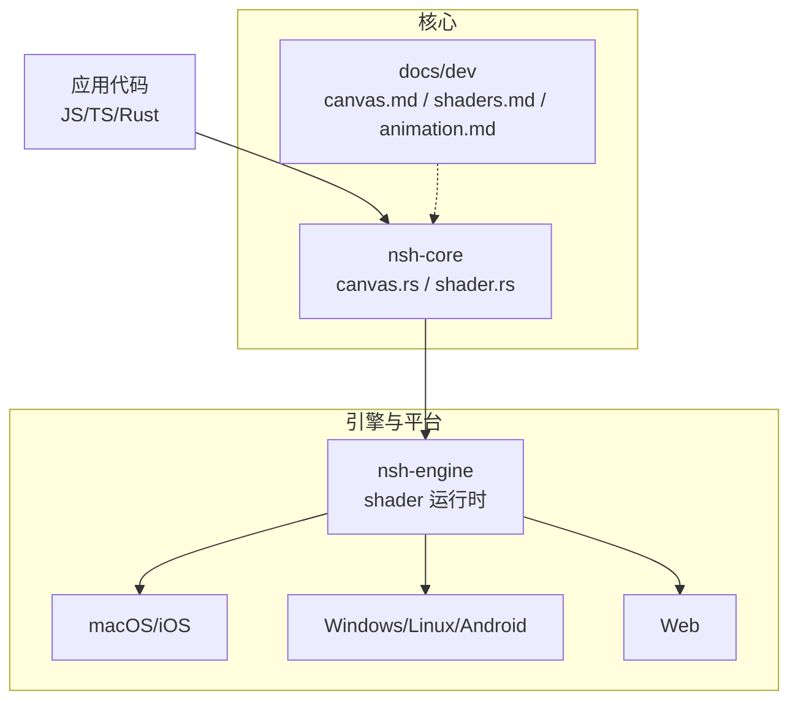
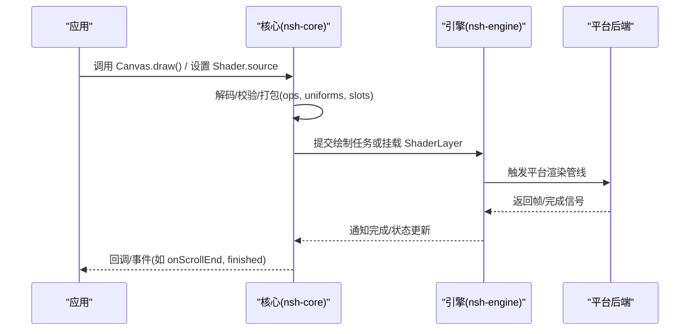
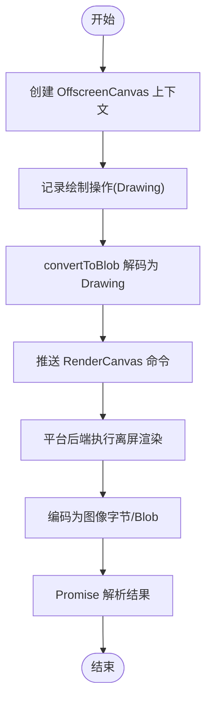
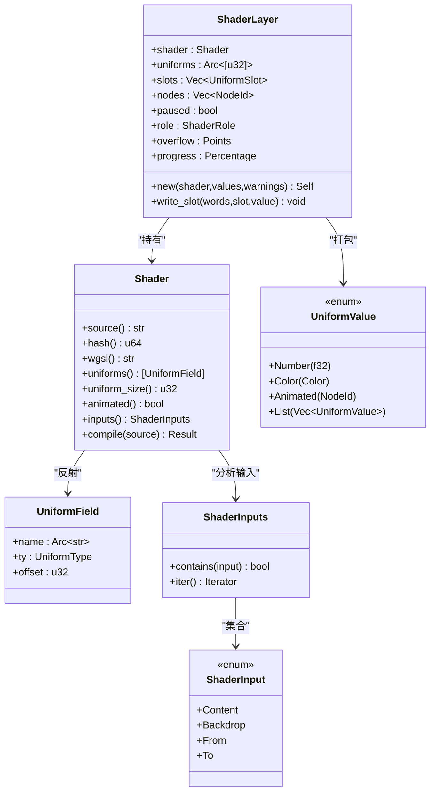
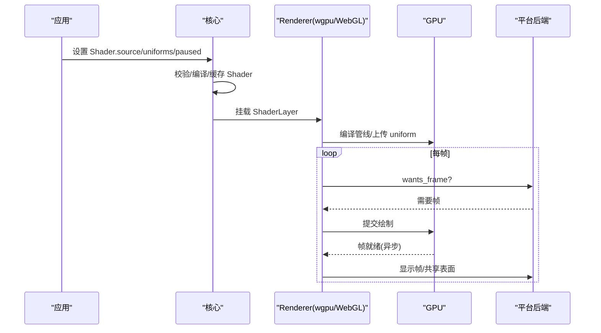
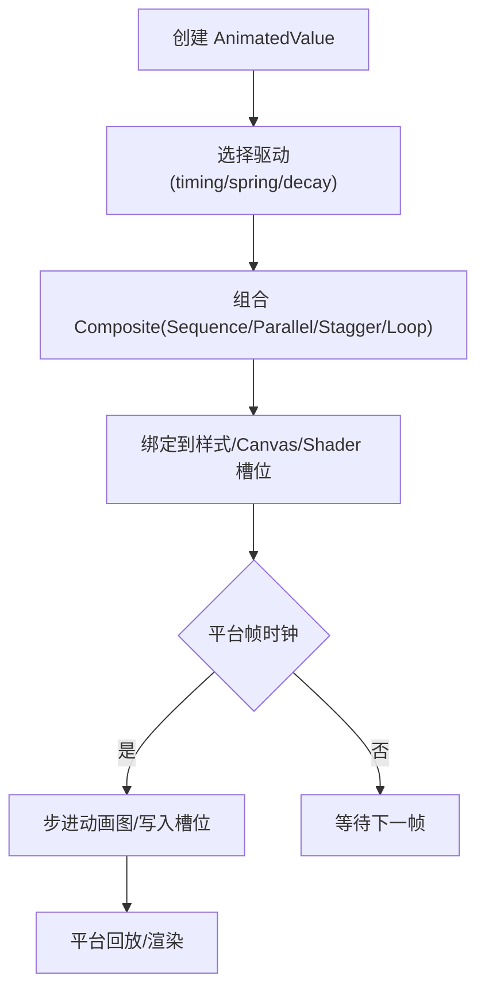
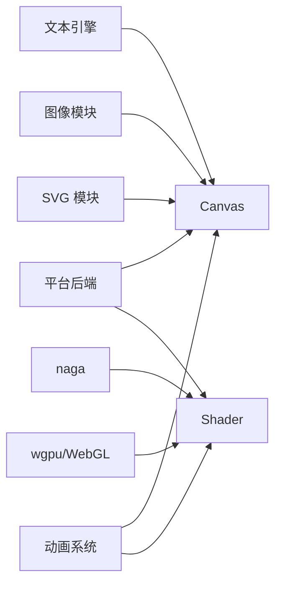

# 高级主题

<cite>
**本文引用的文件**   
- [crates/nsh-core/src/canvas.rs](file://crates/nsh-core/src/canvas.rs)
- [crates/nsh-core/src/shader.rs](file://crates/nsh-core/src/shader.rs)
- [docs/dev/canvas.md](file://docs/dev/canvas.md)
- [docs/dev/shaders.md](file://docs/dev/shaders.md)
- [docs/dev/animation.md](file://docs/dev/animation.md)
</cite>

## 目录
1. [简介](#简介)
2. [项目结构](#项目结构)
3. [核心组件](#核心组件)
4. [架构总览](#架构总览)
5. [详细组件分析](#详细组件分析)
6. [依赖关系分析](#依赖关系分析)
7. [性能考量](#性能考量)
8. [故障排查指南](#故障排查指南)
9. [结论](#结论)
10. [附录](#附录)

## 简介
本文件聚焦 NSH 的高级特性，围绕三大子系统展开：Canvas 绘图系统、着色器（Shader）系统与动画系统。内容涵盖实现原理、数据流、平台差异、内存与资源管理、性能分析与优化策略，并给出大数据列表、实时可视化与交互式图表等复杂场景的最佳实践。

## 项目结构
NSH 的 Canvas 与 Shader 能力由核心库提供，文档位于 docs/dev 下；各平台在各自后端中实现渲染细节。动画系统贯穿 UI 线程与平台帧时钟，为 Canvas 与 Shader 提供驱动值。



图示来源
- [crates/nsh-core/src/canvas.rs:1-10](file://crates/nsh-core/src/canvas.rs#L1-L10)
- [crates/nsh-core/src/shader.rs:1-30](file://crates/nsh-core/src/shader.rs#L1-L30)
- [docs/dev/canvas.md:1-40](file://docs/dev/canvas.md#L1-L40)
- [docs/dev/shaders.md:1-25](file://docs/dev/shaders.md#L1-L25)

章节来源
- [crates/nsh-core/src/canvas.rs:1-10](file://crates/nsh-core/src/canvas.rs#L1-L10)
- [crates/nsh-core/src/shader.rs:1-30](file://crates/nsh-core/src/shader.rs#L1-L30)
- [docs/dev/canvas.md:1-40](file://docs/dev/canvas.md#L1-L40)
- [docs/dev/shaders.md:1-25](file://docs/dev/shaders.md#L1-L25)

## 核心组件
- Canvas 绘图系统
  - 以 HTML Canvas 2D 子集为基础，将 draw 回调记录为 Rust 端的不可变操作序列，平台侧回放绘制。支持路径、渐变、阴影、文本测量、图像绘制、合成模式、变换、裁剪等。
  - 数值参数可绑定动画槽位，平台侧直接更新并重绘，无需 JS 每帧参与。
  - OffscreenCanvas 支持离屏渲染与 Blob 导出，跨平台实现各异。
- 着色器（Shader）系统
  - 使用 WGSL 编写 shade(uv)->vec4f，核心校验并包装模块，原生端通过 wgpu 渲染，Web 端翻译为 GLSL ES 走 WebGL 2。
  - 支持 Uniforms、内置 nsh（size/time/scale/progress/overflow）、图片采样（content/backdrop/from/to）。
  - 支持效果、过渡、屏幕级效果与页面/对话框过渡。
- 动画系统
  - createAnimatedValue + timing/spring/decay/interpolate 等构建动画图，完全在原生运行。
  - 支持布局动画、物理弹簧、关键帧、缓动曲线、指针驱动运动、滚动跟随等。
  - 与 Canvas/Shader 的动画槽位联动，减少主线程开销。

章节来源
- [docs/dev/canvas.md:1-40](file://docs/dev/canvas.md#L1-L40)
- [docs/dev/shaders.md:1-25](file://docs/dev/shaders.md#L1-L25)
- [docs/dev/animation.md:1-40](file://docs/dev/animation.md#L1-L40)

## 架构总览
Canvas 与 Shader 共享“记录/编译 -> 平台回放/渲染”的分层架构；动画系统作为驱动源，向两者注入随时间变化的值。



图示来源
- [crates/nsh-core/src/canvas.rs:1-10](file://crates/nsh-core/src/canvas.rs#L1-L10)
- [crates/nsh-core/src/shader.rs:1-30](file://crates/nsh-core/src/shader.rs#L1-L30)
- [docs/dev/shaders.md:114-176](file://docs/dev/shaders.md#L114-L176)

## 详细组件分析

### Canvas 绘图系统
- 数据结构与操作
  - PathOp/CanvasOp 枚举描述路径与绘制命令；Drawing 持有 ops、slots、nodes 与 view_paints。
  - Num 支持常量与动画槽位；Paint/Gradient/Composite 表示填充、渐变与混合模式。
  - ViewBoxFit 支持 SVG viewBox 映射到画布尺寸。
- 文本与命中测试
  - measure_line/line_metrics 基于文本引擎计算宽度与基线度量。
  - point_in_path/point_in_stroke 在 Rust 回放路径进行命中检测。
- OffscreenCanvas
  - 离屏上下文记录 Drawing，convertToBlob 解码为 Blob；各平台后端分别实现编码与回传。
- 部分重绘
  - DamageScan 根据已记录的动画槽位依赖计算受损区域，避免全量重绘。

```mermaid
classDiagram
class Drawing {
+ops : Vec~CanvasOp~
+slots : Vec~NodeId~
+nodes : Vec~CanvasNode~
+view_paints : Vec~(u32, ViewPaint)~
+painted(paint,current,background,images,size) Drawing
+slot(node) u16
+images() Iterator
}
class CanvasOp {
<<enum>>
+Fill(path, rule)
+Stroke(path)
+DrawImage(image, source, dest)
+FillText(text,x,y,maxWidth)
+...
}
class PathOp {
<<enum>>
+MoveTo(x,y)
+LineTo(x,y)
+QuadTo([x;y;x;y])
+CubicTo([cp1;cp2;x;y])
+Arc{...}
+Ellipse{...}
+Rect(...)
+RoundRect(...)
+Close
}
class Num {
<<enum>>
+Const(f32)
+Slot(u16)
+get(slot) f32
}
class Paint {
<<enum>>
+Color(Color)
+Slot(u16)
+Gradient(Arc~CanvasGradient~)
}
class CanvasGradient {
+shape : GradientShape
+stops : Vec~(Percentage, Color)~
+add_color_stop(offset,color) Self
+from_css(gradient,area) Option<Self>
}
class ViewBoxFit {
+view_box : Bounds
+align : Option~(Percentage,Percentage)~
+slice : bool
+size : Size
+transform(size) [f32;6]
}
Drawing --> CanvasOp : "包含"
CanvasOp --> PathOp : "嵌套"
CanvasOp --> Num : "参数"
CanvasOp --> Paint : "样式"
Paint --> CanvasGradient : "引用"
Drawing --> ViewBoxFit : "背景/适配"
```

图示来源
- [crates/nsh-core/src/canvas.rs:56-130](file://crates/nsh-core/src/canvas.rs#L56-L130)
- [crates/nsh-core/src/canvas.rs:689-841](file://crates/nsh-core/src/canvas.rs#L689-L841)
- [crates/nsh-core/src/canvas.rs:862-942](file://crates/nsh-core/src/canvas.rs#L862-L942)
- [crates/nsh-core/src/canvas.rs:1025-1146](file://crates/nsh-core/src/canvas.rs#L1025-L1146)

章节来源
- [crates/nsh-core/src/canvas.rs:56-130](file://crates/nsh-core/src/canvas.rs#L56-L130)
- [crates/nsh-core/src/canvas.rs:689-841](file://crates/nsh-core/src/canvas.rs#L689-L841)
- [crates/nsh-core/src/canvas.rs:862-942](file://crates/nsh-core/src/canvas.rs#L862-L942)
- [crates/nsh-core/src/canvas.rs:1025-1146](file://crates/nsh-core/src/canvas.rs#L1025-L1146)
- [docs/dev/canvas.md:1-40](file://docs/dev/canvas.md#L1-L40)

#### OffscreenCanvas 导出流程


图示来源
- [docs/dev/canvas.md:41-84](file://docs/dev/canvas.md#L41-L84)

章节来源
- [docs/dev/canvas.md:41-84](file://docs/dev/canvas.md#L41-L84)

### 着色器（Shader）系统
- 合约与验证
  - 应用定义 fn shade(uv: vec2f) -> vec4f；可选 struct Uniforms。
  - 核心用 naga 校验源码大小、签名、Uniforms 类型与大小、无自定义入口点/资源。
  - 自动注入 BUILTINS（nsh 内置、纹理采样函数）与 ENTRY_POINTS（顶点/片段）。
- 运行时
  - 原生端 wgpu，Web 端 GLSL ES + WebGL 2。
  - Renderer 负责设备打开、管线缓存、异步帧回读、共享表面优化（Apple IOSurface、Windows 共享纹理）。
  - ShaderLayer 打包 uniforms 与动画槽位，按 slot 写入。
- 效果与过渡
  - 支持 Effect/Transition/ScreenEffect/ScreenTransition，以及页面/对话框 transitionShader。
  - 平台侧对 pictures（content/backdrop/from/to）采样，处理溢出与进度。



图示来源
- [crates/nsh-core/src/shader.rs:551-758](file://crates/nsh-core/src/shader.rs#L551-L758)
- [crates/nsh-core/src/shader.rs:1133-1300](file://crates/nsh-core/src/shader.rs#L1133-L1300)
- [crates/nsh-core/src/shader.rs:248-296](file://crates/nsh-core/src/shader.rs#L248-L296)

章节来源
- [crates/nsh-core/src/shader.rs:551-758](file://crates/nsh-core/src/shader.rs#L551-L758)
- [crates/nsh-core/src/shader.rs:1133-1300](file://crates/nsh-core/src/shader.rs#L1133-L1300)
- [docs/dev/shaders.md:52-73](file://docs/dev/shaders.md#L52-L73)
- [docs/dev/shaders.md:114-176](file://docs/dev/shaders.md#L114-L176)

#### 着色器渲染时序


图示来源
- [docs/dev/shaders.md:114-176](file://docs/dev/shaders.md#L114-L176)

### 动画系统
- 动画图与驱动
  - createAnimatedValue + timing/spring/decay/interpolate/diffClamp 等组合成 Composite 树，原生运行。
  - 支持缓动曲线表、物理弹簧、关键帧、stagger、loop、delay、sequence/parallel。
- 绑定与驱动
  - 样式属性、transform、颜色、sticky 位置等可绑定动画值。
  - Canvas/Shader 的动画槽位（AnimationProp::CanvasArg）在平台侧直接写入，无需 JS 每帧。
- 布局动画与跟随
  - LayoutAnimation 针对下一批 commit 的插入/删除/移动做动画。
  - follow(target) 使视图跟随目标元素在主轴上的位置。



图示来源
- [docs/dev/animation.md:1-40](file://docs/dev/animation.md#L1-L40)
- [docs/dev/animation.md:111-142](file://docs/dev/animation.md#L111-L142)
- [docs/dev/animation.md:143-159](file://docs/dev/animation.md#L143-L159)

章节来源
- [docs/dev/animation.md:1-40](file://docs/dev/animation.md#L1-L40)
- [docs/dev/animation.md:111-142](file://docs/dev/animation.md#L111-L142)
- [docs/dev/animation.md:143-159](file://docs/dev/animation.md#L143-L159)

## 依赖关系分析
- Canvas 依赖
  - 文本引擎用于测量与度量；图像模块用于加载与密度推断；SVG 模块用于矢量绘制；平台后端实现回放与离屏导出。
- Shader 依赖
  - naga 校验与反射；wgpu/GLSL ES 用于渲染；平台后端负责设备打开、管线缓存、帧回读与共享表面。
- 动画依赖
  - 与 DOM/平台视图绑定；与 Canvas/Shader 槽位联动；与滚动/手势/指针事件联动。



图示来源
- [docs/dev/canvas.md:1-40](file://docs/dev/canvas.md#L1-L40)
- [docs/dev/shaders.md:1-25](file://docs/dev/shaders.md#L1-L25)
- [docs/dev/animation.md:1-40](file://docs/dev/animation.md#L1-L40)

章节来源
- [docs/dev/canvas.md:1-40](file://docs/dev/canvas.md#L1-L40)
- [docs/dev/shaders.md:1-25](file://docs/dev/shaders.md#L1-L25)
- [docs/dev/animation.md:1-40](file://docs/dev/animation.md#L1-L40)

## 性能考量
- Canvas
  - 部分重绘：DamageScan 依据动画槽位依赖计算受损区域，避免全量重绘；iOS/macOS/Windows 有增量优化，Linux/GPUI/Android/Web 可能整帧重绘。
  - OffscreenCanvas：限制最大像素数与边长，超时拒绝请求；平台侧并行编码，避免阻塞 UI 线程。
  - 图像与 SVG：共享加载器、去重、磁盘缓存；SVG 矢量化回放，避免栅格化放大失真。
- Shader
  - 编译缓存：按 source_hash 缓存，上限 64 项；失败日志带行列号。
  - 设备打开与管线编译：后台线程执行，避免主线程卡顿；IOSurface/共享纹理减少回读。
  - 帧节奏：wants_frame 控制是否请求帧；macOS 按需恢复 display link；Web 单 requestAnimationFrame 防重复调度。
- 动画
  - 原生图驱动：减少 JS 每帧开销；deadline 机制保证隐藏窗口也能按时结束。
  - 物理弹簧：closed-form 计算，避免溢出；LayoutCurve 与 Transition 统一 settle_ms 计时。
  - 低帧率场景：frameRate 选项按需降低刷新率。

章节来源
- [docs/dev/canvas.md:85-120](file://docs/dev/canvas.md#L85-L120)
- [docs/dev/shaders.md:74-176](file://docs/dev/shaders.md#L74-L176)
- [docs/dev/animation.md:57-86](file://docs/dev/animation.md#L57-L86)
- [docs/dev/animation.md:179-186](file://docs/dev/animation.md#L179-L186)

## 故障排查指南
- Canvas
  - 离屏渲染超时：检查 MAX_SIDE/MAX_PIXELS 与网络图像 CORS；确认 convertToBlob 未读取被污染的 canvas。
  - 命中测试异常：确保 stroke 使用圆角连接且忽略虚线；动画值在命中时视为 0。
- Shader
  - 编译错误：查看 ShaderError 的行/列信息；确认 shade 签名、Uniforms 类型与大小、无自定义入口点/资源。
  - 首帧为空：GPU 回读延迟导致 frame() 为空，需保持 ticking 直到帧到达。
  - 上下文丢失：Web 端 webglcontextlost/restored 后重建程序与纹理；原生端设备丢失时回退到背景+子视图。
- 动画
  - 停止/重置：Composite 释放后仍继续运行，需确保 JS 侧保留 composites 引用。
  - 滚动结束：diffClamp 在滚动静止时 snap 到边界，注意 onScrollEnd 在各平台的触发时机。

章节来源
- [docs/dev/canvas.md:41-84](file://docs/dev/canvas.md#L41-L84)
- [docs/dev/shaders.md:469-503](file://docs/dev/shaders.md#L469-L503)
- [docs/dev/animation.md:1-40](file://docs/dev/animation.md#L1-L40)

## 结论
NSH 的 Canvas、Shader 与 Animation 子系统采用“记录/编译 -> 平台回放/渲染”的分层设计，配合动画槽位与平台优化，实现了高性能、跨平台一致的图形与交互体验。通过合理的部分重绘、GPU 加速、共享表面与原生动画图，可在大数据列表、实时可视化与交互式图表等复杂场景中保持稳定流畅。

## 附录
- 最佳实践
  - 大数据列表
    - 使用虚拟滚动与回收复用；结合 LayoutAnimation 仅对变化行做动画；避免在 draw 中创建新对象，复用 Path/Gradient。
  - 实时数据可视化
    - 使用 OffscreenCanvas 预计算静态图层；动态数据通过 Canvas 增量绘制；动画值驱动坐标/颜色，减少 JS 循环。
  - 交互式图表
    - 使用 CanvasNode 标注可交互区域；命中测试在 Rust 端完成；hover/press 事件直接驱动动画值，避免二次插值。
  - Shader 视觉特效
    - 尽量使用 nsh.time 与 uniforms 动画槽位；避免频繁重新编译；利用 sample_content/backdrop/from/to 实现叠加与过渡。
  - 性能监控
    - 关注 DamageScan 的受损区域比例；观察 Renderer 的管线编译次数与回读延迟；统计 OffscreenCanvas 的超时与失败率。